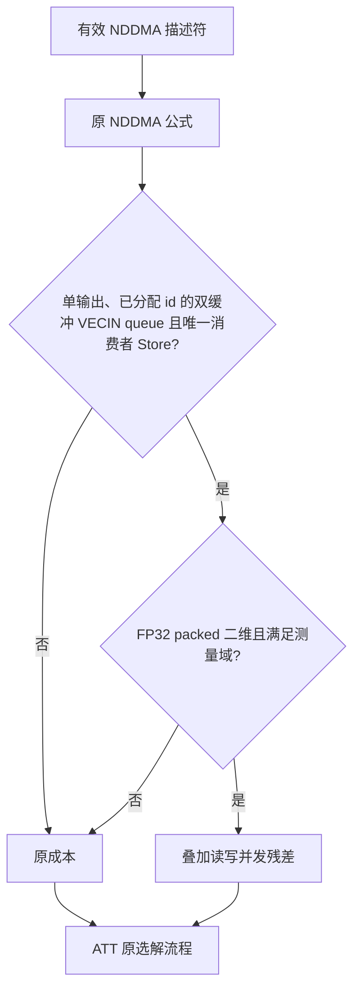

# 简介

## 目的

校准 packed 二维转置的 NDDMA→Store 直通流水中，完整写回对 MTE2 吞吐的影响。普通 NDDMA 单 API 参数保持原值。

## 范围

仅修改 v35 ATT 估值及对应采集入口。不修改 Codegen、同步、设备 kernel、搜索策略、配置含义或 SuperKernel。

# 总体概述

## 软件概述

### 项目介绍

孤立 NDDMA 的斜率与真实直通流水不同；把孤立成本直接用于这类模板，会低估 MTE2。
同一份 API、描述符、队列与地址轮换，改变写回长度即可重现差异，见 report.md。

### 产品环境介绍

采集采用 CANN 9.3.0、dav-3510，实际设备有 56 个可用 AIV。模型只读取候选的 block_dim，不读取设备总核数。

## 软件功能

保留孤立 NDDMA 成本；在已验证的直通路径叠加读写并发残差。Transpose 双内轴索引 Store 按真实 int16/int32 类型查已有指令表。

## 设计约束

公共 API/ABI、包路径、运行时调用及 kernel 源码不变。构建最多 8 并行，采集独占 device。
不按用例名、绝对地址、设备总核数分派，不用 MTE3/VEC 误差抵消 MTE2。

## 假设和依赖关系

输出为单个已知 id、双缓冲 VECIN queue 且唯一数据消费者为 Store，与 Codegen 的直通队列场景一致。
本轮仅标定单个完整写回消费者、队列 buf_num=2，GM 连续源不超过一个 32B DMA block。多 Store、向量消费者和 CV/UB fusion 保持原模型。
56 核以上是活跃并发量的公式外推，未计为真机验证通过。

# 需求分析与设计

## 整体介绍

## 功能需求

### 功能需求 1：直通流水有效 MTE2 成本

1. 介绍：区分孤立 API 与完整读写流水，避免扩大所有 NDDMA 的系数。
2. 输入：现有 NodeInfo.node_ptr、有效 descriptor、dtype 和候选 block_dim；结构条件缺失视为未命中。
3. 处理：原成本加 `k*max(B*C-U,0)`；B 为每核每调用 payload 字节，C 为候选活跃核数。
   输入维度 `[M,N]`、GM stride `[1,M]`、UB stride `[N,1]`；M=2–8、N=512–16384、
   B=8192–131072、N 是 8 的倍数，且 dtype 为 float32。静态域外不生成分支，符号值生成 guard。
   系数仅用 train 点冻结：k=0.0038940645164791633、U=4456448。
4. 输出：有效 AIV_MTE2 成本及 `NDDMA_ND_MULTICORE_DIRECT_STORE_V1` 模型归因；符号选择沿用 runtime dispatch。

### 功能需求 2：索引 Store 类型

1. 介绍：GenTwoInnerDimTransposeIndex 的 DataCopy 写入 RangeType<T>，不是 uint8。
2. 输入：原始 data dtype size。
3. 处理：size≤2 用 int16，其他用 int32，查询已有 kStore 指令表；初始化与尾部循环同时修正。
4. 输出：仅影响使用该索引生成函数的 VEC 成本，保持既有语义模板分类。

## 非功能需求

### 可维护性

沿用原 NDDMA 公式与 runtime guard。新增参数属于直通流水残差，不重拟合孤立 API。缺少结构证据时关闭残差。

### 可测试性

训练、留出、known 候选角色写入 cases.csv；用标准采集器复现。UT 覆盖常量/符号边界、dtype、布局与低核回退。

### 可移植性

仅接入 v35，V1 不调用本模型。更高活跃核数需目标设备验收，不能用 Host 公式结果代替。

### 可靠性

不增加设备缓冲区、线程或资源。符号适用条件使用现有 TernaryOp。descriptor 仍先经过原校验。

### 特性交叉影响

| 场景 | 适用性与结论 |
| --- | --- |
| SuperKernel Python、C++/AOT | 不适用，无接口或实现改动 |
| Autofuse 图优化 | 不适用，不改图与 pass |
| Autofuse Codegen/Backend | 适用，仅 ATT 生成的估值与选解可能变化；kernel API 不变 |
| AscendC/Runtime | 设备调用、缓存 hint、同步和资源生命周期均不变 |
| Python/C++ 混合绑定 | 对外接口不变 |
| 构建与打包 | 不增目标、依赖或安装路径 |
| 测试与覆盖率 | 新增定向 UT、独立采集、目标与非目标回归 |
| 性能与日志 | 一次邻接检查、有限符号表达式；无设备运行时逻辑 |
| 兼容性 | 现有脚本参数兼容，采集入口新增 nddma_full_store |

## 性能

### 编译时长

每个 NDDMA 节点检查其直接消费者；适用模型增加一个线性 hinge 和至多一个域守卫。30组实测首次 Host tiling +1.42%，重复命中基本不变，见 report.md。

### 执行性能

不增加 kernel 指令或 runtime 调用。目标默认选型及耗时见 report.md，全量回归尚未完成。

### 内存和产物大小

无新增常驻缓存和共享状态；数据归档仅保存摘要，不保留逐元素张量。

## 接口设计

### 新增/修改接口描述

内部 EvaluateNddmaModel 增加默认 false 的 direct_store 参数，由 ATT 读取现有图关系后传入。
所有未传参数的内部调用保持孤立模型。不改变外部导出接口。

### 接口检查项

| 检查项 | 子检查项 | 是否涉及 | 说明 |
| --- | --- | --- | --- |
| 接口说明 | 接口评审 | 内部 | 仅 ATT helper |
| 接口说明 | 文档 | 是 | 本文及工具 README |
| 接口兼容 | 行为 | 是 | 结构证据与测量域内更新估值 |
| 接口兼容 | ABI/API | 否 | 无公共接口变化 |
| 接口约束 | 非法输入 | 是 | 沿用 descriptor 校验，域外保持原式 |
| 接口测试 | 独立测试 | 是 | NddmaModelV2 / UTestAscirPerfV2 |

## 软件设计

### 关键数据结构

复用 NddmaDescriptorInfo、NddmaModelResult、NodeInfo，不新增共享状态。

### 关键技术/算法

每个点按 K=1/2/4/10 的每核 MTE2 中位周期拟合调用斜率。只在 train 上拟合正系数与单阈值；冻结后评估 holdout/known。

### 流程设计

采集校验→计算斜率→冻结拟合→留出验证→产品构建→关闭 PGO 验证默认→增量回归。
失败保留精简证据，不覆盖原样本或修改孤立 API 系数。

### 对子模块的修改

nddma_model：独立的直通残差；ascir_api_perf_v2：读取结构证据；ascendc_regbase_perf：索引 Store 类型；tools/modeling/v35/dma：复用完整写回模式。

### 错误处理

#### 系统错误

构建/采集错误保留退出码；新拟合输出使用独占创建，不覆盖历史结果。

#### 接口错误

沿用原 descriptor fallback；没有图或队列证据不启用直通成本。

## 安全检查

已检查编码红线：无凭据/账号/芯片类型特判，无新增数组下标、内存分配、runtime 生命周期或图改写；沿用原 descriptor 长度校验。

## 兼容性检查

不改变 accuracy_level 含义、配置默认值、Codegen、设备 ABI、Python 接口或安装目录。

## 测试设计

### 测试边界

API/结构门禁、常量与符号公式、独立采集及默认/PGO 真实执行。不能把强制快模板算作默认验证。

### 测试用例设计

| 类别 | 测试项 | 方法 | 类型 |
| --- | --- | --- | --- |
| 功能 | 直通成本、索引类型 | 定向 gtest | UT |
| 异常 | 域外、padding、dtype、低核 | 对比原式 | UT |
| 性能 | train/holdout/known 与默认/PGO | fresh GM、完整写回、独立 profiler | Benchmark |
| 兼容性 | 静态/符号、非目标 | guard 与执行身份对比 | UT/回归 |
| 特性交叉 | V1、CV/UB fusion | 保留原入口门禁 | UT/回归 |

### 测试命令

工具 README 给出构建、采集与拟合命令。原生 UT：构建 att_ut 后运行
`--gtest_filter='NddmaModelV2.*:UTestAscirPerfV2.*Transpose*:UTestAscirPerfV2.*Nddma*'`。

## 验收标准

训练/留出/known 隔离；留出最大相对误差≤30%；关闭 PGO 实际默认耗时不超过同包 PGO 的 1.05 倍；
精度通过；边界 UT、受影响回归及 Host 开销完成后才报告全部通过。当前完成情况见 report.md。
