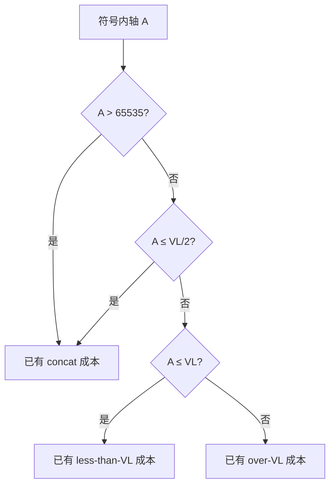

# 简介

## 目的

使 ATT 对符号内轴的 RA Reduce 估值与生产 `ReduceRAImpl` 的分支选择一致。本文面向 ATT 模型维护者。

## 范围

修改 v35 normal、aligned RA Reduce 的公式分派，沿用已有 concat、less-than-VL 和 over-VL 公式及系数。
不改设备 Reduce 实现、Codegen 模板、VF 指令计数或公共 head cost。

# 总体概述

## 软件概述

### 项目介绍

ATT 构造估值时，静态输入的 tile 内轴也可能是符号。此前此路径直接使用 over-VL 公式，实际设备可能执行 concat。
这会把小内轴 RA 候选估值抬高，影响默认选解。

### 产品环境介绍

所属 Autofuse v35 ATT，复用现有表达式、参数表及 CANN AscendC Reduce。对外 API、ABI、安装和包布局不变。

## 软件功能

按求解后的实际内轴 A 选择已有成本分支，静态和符号描述符保持一致。

## 设计约束

无设备总核数、用例或网络名称特判；不以 MTE2/MTE3 偏差补偿 VEC；只添加有限条件表达式。

## 假设和依赖关系

生产 `reduce_common_ra_reuse_align_3510_impl.h::ReduceRAImpl` 使用 `REGULAR_FOLD_NUM=2`，normal VL 由 dtype 决定。
若生产边界变化，需同步模型与边界测试。

# 需求分析与设计

## 整体介绍

`BuildRaNormalAlignedCost` 的符号 A 分支复用 `SelectByLessEqual`，建立与常量 A 相同的判断链。

## 功能需求

### 功能需求 1：符号内轴分派

1. 介绍：A≤VL/2 或 A>65535 使用 concat；VL/2<A≤VL 使用 less-than-VL；其余使用 over-VL。
2. 输入：normal aligned RA 的 dtype、reduce_extent、inner_extent 和 reuse_source。沿用现有正维度契约。
3. 处理：先计算已有三个分支，再生成 3 个条件表达式。错误沿用 `GE_ASSERT_SUCCESS` 返回，无静默吞错。
4. 输出：AIV_VEC 估值及有限的 ternary 表。常量路径、其他 Reduce 路径和参数保持原值。

## 非功能需求

### 可维护性

复用现有分支和 helper，无第二套指令模型或命名表。设备模板语义名称沿用现有分类，因为生产 API 和实际策略未改。

### 可测试性

[用例](cases.csv)固定 dtype、reuse 和阈值两侧；分别验证符号 A 与常量 A，以及符号 R/A 与符号 R、常量 A 的结果。

### 可移植性

仅 v35 模型；其他平台未修改。使用现有 C++ 和表达式 API，无新增构建依赖。

### 可靠性

无新资源或共享状态。未选分支的估值表达式由既有生成器维护，构造复杂度为常数。

### 特性交叉影响

| 场景 | 适用性与结论 |
| --- | --- |
| SuperKernel Python / C++ / AOT | 不适用，源码及接口未变 |
| Autofuse 图优化 | 不适用，无图改写 |
| Autofuse Codegen/Backend | 适用，生成 Host 成本分派改变，设备模板与命名不变 |
| AscendC / Runtime | 不适用，无新增调用、同步或资源 |
| Python/C++ 绑定 | 不适用，接口不变 |
| 构建与打包 | 不适用，产物布局及依赖不变 |
| 测试与覆盖率 | 适用，模型 UT 和默认选解验证 |
| 性能与日志 | 适用，每符号 RA 增加 3 个条件，无新增求解或日志 |
| 兼容性 | 适用，默认排序会按正确分支改变，ABI/API 不变 |

## 性能

### 编译时长

每符号 RA 生成 3 个条件，复用既有成本函数，无图遍历或额外候选求解。
Host 首次与缓存命中计时、生成产物比较见[配套验证报告](../../mte2/load/results/dense-bulk-v1/report.md#影响筛选和工程性能)。

### 执行性能

无新增设备指令。转置+Softmax 的新默认选中 PGO 的 case1/1/4 组合；实际 tile 与 PGO 核数可不同。
相关 Load 校准另有独立数据，不将其收益全部归因于本修正。

### 内存和产物大小

仅有限 Host 表达式，设备源码和 ABI 布局不变，不增加运行时缓存或日志。

## 接口设计

### 新增/修改接口描述

无新增对外接口；内部 `BuildRaNormalAlignedCost` 签名保持不变，失败返回原 af::Status。

### 接口检查项

| 检查项 | 子检查项 | 是否涉及 | 说明 |
| --- | --- | --- | --- |
| 接口说明 | 接口评审 | 否 | 无新增接口 |
| 接口说明 | 补充文档 | 是 | 本设计和用例 |
| 接口兼容 | 行为兼容 | 是 | 修正错误估值，常量路径不变 |
| 接口兼容 | ABI/API | 否 | 无布局或签名变化 |
| 接口约束 | 失败报错 | 否 | 沿用原状态传播 |
| 接口测试 | 独立用例 | 是 | 阈值和符号等价 UT |

## 软件设计

### 关键数据结构

复用 `PerfOutputInfo.ternary_ops`；由既有生成器管理生命周期，无新成员。

### 关键技术/算法



### 流程设计

构造模型→按 A 生成条件→求解成本→默认选择。常量 A 沿原代码，域外 API 沿原入口；无需回滚设备实现。

### 对子模块的修改

`reduce_api_perf_v2.cpp` 增补符号分派；`test_reduce_min_max_api_perf_v2.cpp` 覆盖规则。
原 BF16 测试不再禁止公式任意位置出现 1/64：concat 折叠可合法简化出该值，改为核对 BF16/FP16 分支数值一致。

### 错误处理

#### 系统错误

无新增内存、文件或 runtime 调用；沿用模型构造状态传播。

#### 接口错误

不新增错误码，原模型输入契约不变。

## 安全检查

已按编码红线检查：无敏感信息、外部索引、新内存偏移、除零或异步生命周期；无 ABI 和图改写风险。
常量阈值与设备实现相同，未引入核数或地址特判。

## 兼容性检查

公共脚本、安装路径、配置及设备 API 均保持原约定。模型仅修复 v35 normal aligned RA 的符号分派。

## 测试设计

### 测试边界

从 ReducePerf 上层入口构造真实 NodeDetail，解析 ternary 后比较数值；覆盖 F32/F16/BF16、reuse 与非 reuse、VL/2、VL 和 65535 边界。

### 测试用例设计

| 类别 | 测试项 | 方法 | 类型 |
| --- | --- | --- | --- |
| 功能 | 符号 A 等价常量 A | 数值求值，不比较字符串形态 | UT |
| 功能 | 符号 R/A 分派 | 保留符号 R，与固定 A 对照 | UT |
| 边界/兼容 | 多 dtype、reuse、65536 | 确认原设备分派边界 | UT |
| 性能 | 默认与已知 PGO 独立重放 | 当前包与完整身份核对 | 上板 |
| 交叉 | 17/48 完整身份 | Host 复算，仅变化输入上板 | 增量回归 |

### 测试命令

构建限制 `-j 8`；已构建测试目标可执行：

```bash
"$ut_binary" --gtest_filter='UTestReduceMinMaxApiPerfV2.*:UTestAscirPerfV2.*Load*:UTestAscirPerfV2.*Transpose*:UTestAscirPerfV2.*Nddma*:NddmaModelV2.*'
```

本轮共 195 项通过；新增符号内轴测试在修改前失败。完整结果见配套报告。

## 验收标准

上述符号/常量分派 UT 通过；真实默认选中快模板并通过精度；相关回归无执行身份变化，变化时必须补测。
本设计没有声称全部 Reduce 绝对估值误差已校准，也没有用候选 profile 重新拟合 VF 系数。
