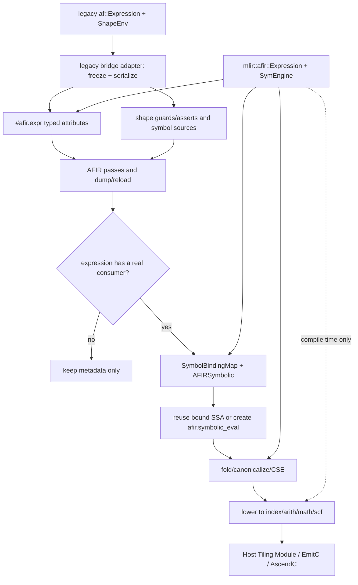

# Autofuse MLIR 复用 SymEngine 的符号表达式设计

> 状态：草稿（AFIR 符号基础能力已实现，完整 ShapeEnv/Host Tiling 方案尚未完成）
> 日期：2026-07-31
> 更新日期：2026-08-06
> 决策：符号表达式能力归属 AFIR；当前由 `AFIRSymbolicSupport`、`AFIRDialect` 和 `AFIRTransforms` 三层实现，
> 核心类型为 `mlir::afir::Expression`，新 MLIR 符号层不依赖 `af::Expression`/`aihac_symbolizer_af`
> 文档类型：组件设计

> 2026-08-05 目录落地更新：下文设计阶段的 `AFIRSymbolicCore` 对应当前
> `mlir/dialect/AFIR/Support` 下的 `AFIRSymbolicSupport` target；`AFIRSymbolic` 对应
> `mlir/dialect/AFIR/Transforms/Symbolic`，统一编入 `AFIRTransforms` target。IR materializer 已归入
> `mlir/dialect/AFIR/IR`，不要求 bridge 依赖 transforms。下文保留原名用于记录设计形成过程。
> 相关文档：[ScheduledResult 到 MLIR 迁移设计](./2026-07-27-schedule-att-mlir-migration-design.md)

> 已实现：`ExprAttr`、typed repeats/strides、纯 C++ Expression support、`SymbolicBuilder`、
> `afir.symbolic_eval`、simplify/safety/lowering/no-symbolic passes 及对应 UT/LIT。尚未完成：ShapeEnv 约束的
> 完整 SSA/runtime guard lowering、Host Tiling Module、legacy/MLIR 全量 corpus 对拍、多线程/E2E/package 验收。

### 设计文档检查结果

- [x] 跨特性交叉影响：已按 `cross_feature_check.md` 逐项检查 SuperKernel、Autofuse optimize/codegen、Python/C++、构建打包和测试路径
- [x] 编码红线：已检查表达式输入边界、整数溢出和除 0、资源生命周期、ABI/API、图改写确定性以及跨 SO 静态析构
- [x] 测试设计：已给出 Attribute、符号服务、bridge、SSA 物化、lowering、dump/reload、并发和 legacy 对拍用例
- [x] 性能评估：已限制解析缓存生命周期、禁止 verifier 无条件执行昂贵 expand，并给出编译时长、内存和产物评估方法

# 简介

## 目的

本文说明 Autofuse 的 MLIR 路径如何继续使用 SymEngine，同时避免把 SymEngine 的进程内对象和 legacy
`ShapeEnv` 隐式状态带进 IR。

设计采用三层边界：

1. `ExprAttr` 只保存可序列化的规范表达式文本，使 `repeats`、`strides`、axis size、workspace 和性能公式可以
   跨 Pass，并能 dump/reload。
2. `mlir::afir::Expression` 在编译期封装 SymEngine，集中处理解析、化简、替换、自由符号、证明和常量求值。
3. 表达式有真实使用者时，`afir.symbolic_eval` 才把它接入 SSA；随后 lowering 到标准 MLIR 方言，最终产物不依赖
   SymEngine。

动态 Shape 符号和 tiling 参数通过显式 SSA 绑定进入计算。没有使用者的表达式继续作为 Attribute 保存，不提前生成
无用 SSA。这样既能保持 legacy ATT Expression 的行为，也为后续 Host Tiling Module 提供稳定输入。

目标读者为 Autofuse MLIR bridge、AFIR dialect、ATT、Codegen、构建和测试维护者。

## 范围

本设计包含：

- AFIR 中只封装 canonical string 的 `ExprAttr`；
- MLIR 编译期 SymEngine 服务层；
- ShapeEnv 到 MLIR 显式约束和符号来源的冻结边界；
- 表达式 Attribute 到 SSA 的按需物化；
- `afir.symbolic_eval` 的验证、fold、canonicalize 和 lowering；
- bridge、AFIR Pass、Host Tiling Module 和 EmitC/AscendC lowering 的调用边界；
- 构建、打包、错误处理、性能、安全和测试方案；
- repeats/strides 从裸 StringAttr 到 ExprAttr 的原子迁移。

本设计不包含：

- 不替换 SymEngine，不自研通用 CAS；
- 不在本阶段重写 ATT solver 算法；
- 不要求本阶段一次性删除 legacy ATT/common 内部的 `af::Expression`；
- 不修改 `FusedScheduledResult`、`ScheduledResult`、`ScheduleGroup` 的公开布局；
- 不改变现有 tiling data、kernel entry、Python `CodegenResult` ABI/API；
- 不要求表达式在尚无 consumer 时提前变成 SSA；
- 不引入跨 Pass、进程级或全局静态表达式缓存；
- 不让最终生成的 host tiling C++、AscendC kernel 或 runtime 调度代码链接 SymEngine；编译器侧 Host Tiling 生成 Pass 可以使用 SymEngine。

# 总体概述

## 软件概述

### 项目介绍

当前 ATT、common 和 bridge 通过 `af::Expression` 间接调用 SymEngine。迁移后的 ATT、Codegen 和 Schedule 都基于
AFIR，因此新符号能力归入 `mlir::afir`，直接封装 SymEngine，不再依赖 legacy wrapper。

`af::Expression` 当前同时负责：

- 表达式构造和基础 canonical form；
- `expand + simplify`；
- Replace/Subs；
- FreeSymbols/ContainVar；
- 常量求值和类型判断；
- 等价、排序、分子分母；
- C++ 字符串打印和序列化。

`ScheduleToAfir` 当前在 bridge 中调用 `Expression::Simplify().Serialize()`，再把结果保存为普通 `StringAttr`。
例如，`AscTensorGroupsAttr.repeats` 在 TableGen 中是通用 `Attribute` 数组，实际通常装字符串。迁移期间只有 legacy
adapter 的 `.cpp` 文件需要读取 `af::Expression`。从 `ExprAttr` 开始，AFIR dialect、Pass、工具和新 ATT 路径都不再
包含或链接 legacy 类型。

普通字符串可以保存内容，但没有类型约束和统一校验。`ExprAttr` 只保存 canonical expression，不重复保存语义或
可重新计算的数据：

- 结果数值域由 owning field 或 `symbolic_eval` result type 决定；
- FreeSymbols 可以由 SymEngine 按需计算；
- 当前单一 grammar 由 `#afir.expr` dialect schema 和 golden corpus 管理；只有确认需要多个 grammar 版本同时被读取时，才引入 Module/Dialect 级 format version；
- SSA 绑定属于 materializer，不应复制进 metadata Attribute。

因此，IR 负责保存稳定语义，SymEngine 对象只在编译期短暂存在。

### 产品环境介绍

- 仓库通过 `add_cann_third_party(symengine)` 引入 SymEngine 0.12.0。
- `AFIRSymbolicCore` 是编译期静态库，直接链接 `symengine`，但不包含 MLIR 头文件，也不安装为运行时 SO。
- 依赖方向固定为 `AFIRSymbolicCore -> AFIRDialect -> AFIRSymbolic`，避免链接环。`af-opt` 依赖
  `AFIRSymbolic`，不依赖 `aihac_symbolizer_af`。
- legacy `aihac_symbolizer_af` 在迁移期保持不变。新旧实现通过同一 corpus 对拍，legacy 路径退役后再删除旧
  parser/printer。
- 只有 `ENABLE_AUTOFUSE_MLIR=ON` 时才构建这些 target。开关关闭时不增加 LLVM/MLIR 依赖，也不改变 legacy
  符号库依赖。

legacy grammar 与 `SymEngine::parse` 不完全兼容。例如 legacy 使用 `Max`、`Ceiling`、`Rational`、`ExpectEq` 和
`LogicAnd`，SymEngine 原生 parser 使用 `max`、`ceiling`、`Eq` 和 `And` 等形式。因此 `AFIRSymbolicCore` 需要兼容
parser/printer，不能把 legacy 字符串直接交给原生 parser。

Host Tiling 生成 Pass 和 `af-opt` 可以在编译期使用 SymEngine。动态 Shape 表达式会 lower 为
`index`、`arith`、`math`、`scf` 或 EmitC 表达式。生成后的 host tiling 代码在运行时接收 Shape 值并执行普通算术，
但 host、kernel 和 runtime 产物都不链接 SymEngine。

## 软件功能

本需求提供以下能力：

1. `#afir.expr<"...">` typed Attribute，只持久化 canonical expression string；
2. `AFIRSymbolicCore`/`AFIRSymbolic` 编译期服务，统一 parse、serialize、simplify、substitute、free-symbol、constant-eval 和 compare/prove；
3. `SymbolBindingMap`，将叶子符号或完整子表达式绑定到 SSA Value；
4. `afir.symbolic_eval`，在表达式第一次被真实 consumer 使用时建立 SSA use-def；
5. `MaterializeSymbolicExpr`，优先复用已绑定 SSA，再递归 lower 到 `index/arith/math`；
6. `ExprAttr` verifier 和三个 expression 数组的 typed accessor；
7. legacy `af::Expression` 与 `mlir::afir::Expression` 的双向对拍测试；
8. 不支持表达式、非法输入和复杂度超限的显式失败/回退策略。

## 设计约束

1. `ExprAttr` 只保存 `StringAttr`；不得保存 `SymEngine::RCP`、`af::Expression` 指针或进程地址。
2. 跨 Pass 的语义必须存在于 IR；任何解析缓存都只是性能优化，丢失后不得影响正确性。
3. MLIR Pass 不得直接散落调用 SymEngine；Core 能力经过 `mlir::afir::Expression`，Pass 侧调用经过 `AFIRSymbolic`。
4. bridge 之后的 SymEngine 运算必须是上下文显式或上下文无关的；不得隐式读取遗留线程局部 `ShapeEnv`。
5. ShapeEnv replacement、guard、assert 和 symbol source 必须在 bridge 边界冻结到 IR 或显式 adapter 输入。
6. 表达式尚无 consumer 时只保留 Attribute，不生成孤立 `arith`/`index` op。
7. 表达式产生 SSA 后必须存在真实 consumer；无用结果允许被 DCE 删除。
8. 最终 Codegen 前所有被消费的 `afir.symbolic_eval` 必须完成 lowering；残留 op 是 pipeline 错误。
9. 表达式相等和稳定排序不得使用指针地址、进程随机 hash 或 unordered container 遍历顺序。
10. Shape、stride、workspace 和 tiling 参数使用整数语义；除法、取模、溢出和正数前置条件必须明确。
11. verifier 不得对每个 Attribute 无条件执行可能指数膨胀的 `expand + simplify`。
12. 构建和测试并行度限制为 `-j 8`。

## 假设和依赖关系

- 现有 `af::Expression::Serialize()` 字符串是迁移输入契约；`AFIRSymbolicCore` 的 compatibility parser 必须能解析该 grammar，并输出稳定 canonical string。
- SymEngine 升级不得直接改变 `#afir.expr` 文本；必须运行 legacy/new parser、printer 和数值 golden corpus 后显式更新 dialect grammar。
- 若未来需要同一工具同时读取多个不兼容 grammar，必须在修改 grammar 前设计 Module/Dialect 级 format version（例如 `afir.expr_format`）和 parser dispatch；不在每个 `ExprAttr` 中重复保存版本。
- `ScheduleToAfir` 可以访问当前 ShapeEnv，并能够读取 guard/assert；Schedule 阶段已经确定的 axis size、`size_vars`、`shape_exprs`、`origin_vars` 和 `var_relations` 作为 Module/func metadata 冻结。输入 Shape 符号在 Host Tiling 中绑定到 `tensor.dim`，`tile_size` 等 tiling 参数绑定到 Host Tiling 函数入参 `tilingdata` 的字段；Bridge 必须同时冻结稳定的字段映射，不再把这些来源留作未解析的自由符号。
- `repeats`、`strides`、axis size、align 和 workspace 的数值域默认是非负整数；具体 divisor 必须为正，不能只依赖默认假设。
- performance/cost expression 可能包含 Rational、double、Pow 和 Log，不能强制按 `index` 语义 lower。
- 当前 `AscTensorGroupsAttr` 的 repeat/stride 参数已允许任意 Attribute，因此切换为 typed Attribute 不要求修改公开 C++ ABI。
- 现有仓内 `.mlir` 测试和调试文件含 StringAttr，原子迁移时与 TableGen/bridge 同一变更统一升级；不承诺 typed array 收紧后直接读取外部旧 StringAttr IR。若外部兼容成为硬需求，必须先走 normalize pass 的两阶段迁移。

# 需求分析与设计

## 整体介绍

数据流如下：



图中有三个关键边界：

- `ExprAttr(StringAttr)` 保存可持久化的表达式。
- `afir.symbolic_eval` 表示表达式开始参与 SSA use-def。
- standard dialect lowering 把符号表达式转换为普通 IR；从这里开始，pipeline 不再需要 SymEngine。

## 功能需求 1：最小 Typed ExprAttr

### 1. 介绍

新增 `ExprAttr`，用带校验的 canonical string 替代 `repeats` 和 `strides` 中的裸 `StringAttr`：

```tablegen
def ExprAttr : AFIR_Attr<"Expr", "expr"> {
  let summary = "Symbolic expression in AFIR canonical string form backed by SymEngine";
  let parameters = (ins "StringAttr":$value);
  let assemblyFormat = "`<` $value `>`";
  let genVerifyDecl = 1;
}
```

文本形式：

```mlir
#afir.expr<"Ceiling((s0 / tile_size))">
```

`ExprAttr` 不保存 `kind` 和 `symbols`，原因如下：

- `repeats/strides` 的整数语义由 owning field 决定，`afir.symbolic_eval` 的计算类型由 operand/result type 决定；若 Attr 再保存 `kind`，将形成两个可能冲突的语义来源；
- FreeSymbols 由 `mlir::afir::Expression` 按需计算；`symbols` 是派生数据，持久化后会增加一致性校验和 IR 冗余；
- `afir.symbolic_eval` 的符号绑定由 operand-normalized placeholder `__arg0 ... __argN-1` 与 operand 顺序定义，不依赖 `symbols` 数组；
- `__arg0 ... __argN-1` 保留为 AFIR 内部 placeholder 命名空间；原始 canonical expression 不得把它们作为用户符号，normalization/verifier 必须拒绝碰撞；
- 当前 canonical grammar 由 `#afir.expr` schema 和 golden corpus 管理。若未来必须同时读取多个不兼容 grammar，优先在 Module/Dialect 层增加 format version，而不是在每个 `ExprAttr` 中重复保存。

`AscTensorGroupsAttr` 收紧为 typed array：

```tablegen
OptionalArrayRefParameter<"ExprAttr", "array of repeat expressions">:$repeats,
OptionalArrayRefParameter<"ExprAttr", "array of stride expressions">:$strides,
OptionalArrayRefParameter<"ExprAttr", "array of vectorized stride expressions">:$vectorized_strides,
```

### 2. 输入

- legacy bridge 产生的 canonical expression string；
- 旧 AFIR 中 repeat/stride/axis/shape/guard 的 StringAttr；
- 手写或 dump/reload 的 MLIR 文本。

### 3. 处理

Attribute verifier 执行：

1. 检查 value 字节长度和基础词法边界；
2. 调用 `mlir::afir::Expression::Parse`；
3. 检查 parse 后由 compatibility printer 输出的字符串与 value 完全一致；
4. 拒绝空表达式、非法语法、未完整消费的 token 和不支持节点；
5. 将 SymEngine parse/内存异常转换为 MLIR diagnostic。

verifier 只做 parse/canonical 检查，不调用通用 `expand + simplify`，也不读取 ShapeEnv。

MLIR 侧转换接口返回新命名空间类型：

```cpp
FailureOr<mlir::afir::Expression> parseExpr(ExprAttr attr);
```

禁止新增：

```cpp
af::Expression toExpr(ExprAttr attr);
```

### 4. 输出

- C++ accessor 从 `ArrayRef<Attribute>` 收紧为 `ArrayRef<ExprAttr>`；
- `AscTensorGroupsArrayAttr::constBuilderCall` 中三处空数组参数同步改为 `ArrayRef<ExprAttr>{}`，所有显式 builder 调用同步修改；
- ATT MLIR 路径拿到类型安全句柄；
- Attribute equality 由 canonical `StringAttr value` 决定；
- 相同 Attribute 由 MLIRContext uniquing，不依赖 SymEngine pointer/hash。

## 功能需求 2：冻结 ShapeEnv 上下文

### 1. 介绍

当前 `Expression::Simplify()` 会隐式读取 thread-local `ShapeEnv`。MLIR Pass 不能继续依赖这个状态，否则会出现：

- 同一 IR 在 `af-opt` 和 in-process pipeline 得到不同结果；
- dump/reload 后丢失 replacement；
- Pass 并发和重入行为难以证明；
- 表达式语义无法从 IR 自身恢复。

因此，legacy 到 MLIR 的 bridge 是读取 `ShapeEnv` 的唯一位置。bridge 返回后，所有信息都必须能从 IR 或显式输入
恢复。

### 2. 输入

- 当前 thread-local ShapeEnv；
- origin variables；
- symbol-to-source；
- replacement；
- check/assert guards；
- `FusedScheduledResult` 中的全部 Expression。

### 3. 处理

bridge 按以下顺序冻结：

1. 在当前 ShapeEnv 下完成 replacement 和需要保持 legacy 行为的 simplify；
2. serialize 为 canonical expression；
3. 记录实际 FreeSymbols；普通 metadata 按符号名字典序输出；
4. 将输入 Shape 符号绑定到稳定的 `tensor.dim` 结果，将 `tile_size` 等 tiling 符号绑定到 Host Tiling 函数 `tilingdata` 字段；
5. 将 Schedule 阶段确定的 axis size、`size_vars`、`shape_exprs`、`origin_vars` 和 `var_relations` 冻结到 Module/func 的 typed metadata，并保留其字段/坐标映射；
6. 将 compile-time guard/assert 转为 typed constraint；需要运行时检查时，使用标准 `cf.assert` 或 `scf.if` 控制流，而不是只保留字符串 metadata；
7. 将完整动态 dimension expression 绑定到对应 `tensor.dim` 结果；
8. bridge 返回后，MLIR Symbolic 服务只使用冻结后的 IR，不再读取 ambient ShapeEnv。

符号来源分两类：

```text
leaf binding:
  s0 -> %arg0.dim0

expression binding:
  (100 + s0) -> %arg0.dim0
```

`tile_size` 不是未解析的 ShapeEnv 自由符号。它来自 Host Tiling 函数入参 `tilingdata` 的字段，lowering 时由对应的
SSA load 提供。axis size、`size_vars` 和 relation 表达式虽然在 Schedule 阶段已经确定，但其中的动态输入仍要通过
显式 source 映射绑定。表达式文本不能替代运行时 SSA 值。

第二类用于当前动态维度表达式不是单一叶子符号的情况。物化器先检查完整表达式绑定，再递归处理叶子符号，避免错误地假设 `%dim == s0`。

### 4. 输出

- `tensor.dim` 或函数参数上的 `afir.symbolic_value = #afir.expr<"...">`；
- function/module 上稳定排序的 shape guard/assert；
- 不依赖 ShapeEnv TLS 的 AFIR Module。

若某个被消费表达式仍含无法绑定的自由符号，materialization 必须失败并报告符号名、表达式和 owning op，不得生成未定义 SSA。

binding 和 constraint 的持久化边界如下：

- `ExprAttr` 只保存表达式文本；`tensor.dim`/函数参数等 owning field 保存 typed shape expression 和稳定 source 坐标；
- `SymbolBindingMap` 只作为当前 materialization 的临时索引，不进入 IR；dump/reload 后由上述 owning field 和显式 operand 重新构造；
- compile-time guard/assert 使用 AFIR 命名空间的 Module/func 级 typed metadata：`afir.shape_guards`、`afir.shape_asserts`、`afir.var_relations`；需要运行时检查时必须物化为标准 `cf.assert` 或 `scf.if` 控制流，第一阶段不新增只包装 assert 的 AFIR op；
- 调度、来源和计划元数据使用 `afir.*`，例如 `afir.original_graph_name`、`afir.stage_id`、`afir.template_id`、`afir.score_func`；目标信息与后端生成的 schema 使用 `ascendc.*`；
- 不使用无法追溯到 IR 的 C++ map、TLS 或进程级 cache 作为正确性依据。

## 功能需求 3：AFIRSymbolicCore 与 AFIR Expression

### 1. 介绍

新增不依赖 MLIR 头文件和 graph_metadef 的 `AFIRSymbolicCore` 库：

```text
目录：mlir/symbolic/Core/（实现时可按现有 CMake 布局调整）
CMake target：AFIRSymbolicCore
C++ namespace：mlir::afir
核心类型：mlir::afir::Expression
唯一第三方符号依赖：symengine
```

它直接持有和操作 SymEngine 节点，不包含任何 MLIR 或 `graph/symbolizer/symbolic.h` 头文件，不链接 `aihac_symbolizer_af`，不返回 `af::Expression`。C++ namespace 本身不会引入 MLIR 依赖；选择 `mlir::afir` 是因为 ATT、Codegen、Schedule 的新实现都作为 AFIR Pass 运行，该表达式能力属于 AFIR 基础设施。

AFIR 实现文件通常已经位于 `namespace mlir::afir` 中，调用时直接写 `Expression`；只有跨命名空间接口才写完整的 `mlir::afir::Expression`。不另建顶层 `afir` namespace，避免与现有 Dialect C++ namespace 分裂。

依赖方向固定为：

```text
SymEngine
    ↑                              ↑
AFIRSymbolicCore                  legacy aihac_symbolizer_af
(mlir::afir::Expression)          迁移期对拍 oracle，无生产链接
    ↑
AFIRDialect
ExprAttr verifier
    ↑
AFIRSymbolic
pass/materializer
```

禁止出现反向依赖：

```text
AFIRSymbolicCore -> AFIRDialect/MLIR headers
AFIRSymbolicCore -> af::Expression
AFIRDialect      -> aihac_symbolizer_af
AFIRSymbolic     -> graph_metadef/expression
```

### 2. 输入

- canonical string；
- `ExprAttr`；
- substitute/binding map；
- 常量输入；
- 可选的显式约束集合。

### 3. 处理

公共接口只暴露一个轻量、不可变的表达式类型：

```cpp
namespace mlir::afir {

struct Error {
    ErrorCode code;
    std::string message;
};

template <typename T>
class Result;

class Expression {
 public:
    static Result<Expression> Parse(std::string_view canonical);

    Result<Expression> Simplify() const;
    std::string Serialize() const;

 private:
    class Impl;
    std::shared_ptr<const Impl> impl_;
};

}  // namespace mlir::afir
```

`Impl` 内部持有 `SymEngine::RCP<const SymEngine::Basic>`，公开头文件不暴露 SymEngine 类型。Core 的错误和容器接口只使用标准库/自有 `Result`，不依赖 LLVM/MLIR；`ExprAttr` verifier 和 `AFIRSymbolic` Pass 分别负责转换为 MLIR diagnostic/`FailureOr`。

第一阶段用户可见 API 只包含 `Parse`、`Simplify`、`Serialize`。`FreeSymbols`、`Replace`、`Evaluate`、`Compare`、节点遍历和 parse cache 保持在 Core 的非安装 detail header 或 AFIRSymbolic Pass 内部，不向普通调用者暴露；只有出现真实外部调用者时才逐项提升为公共方法。`Expression` 对象只是一个共享 immutable SymEngine tree 的轻量 handle，复制它不复制整棵表达式树。`Simplify` 是成员函数，因为化简自然作用于当前表达式；改为 `Expression::Simplify(expr)` 仍需创建同一个 handle，不会减少对象或 SymEngine tree 开销，只会增加调用长度。

`Serialize()` 对已通过 `Parse` 的受支持节点是 total 操作，不再调用可能产生语义失败的 SymEngine 算法；解析、化简和 detail 操作的失败通过 `Result` 返回。这样保留 `expr.Simplify()` 的简洁用法，同时使异常边界明确。

#### Grammar 兼容策略

不能直接对当前字符串调用 `SymEngine::parse`：

| 语义 | legacy canonical grammar | SymEngine 原生 parser |
|---|---|---|
| max/min | `Max`/`Min` | `max`/`min` |
| ceil/floor/abs | `Ceiling`/`Floor`/`Abs` | `ceiling`/`floor`/`abs` |
| rational | `Rational(a, b)` | 不提供相同名称入口，通常表示为除法 |
| relation | `ExpectEq/ExpectNe/ExpectLe/ExpectLt` | `Eq/Ne/Le/Lt` |
| boolean | `LogicAnd/LogicOr` | `And/Or` |

因此 `AFIRSymbolicCore` 提供自己的 compatibility scanner/parser，grammar 与当前序列化格式一致，但 action 直接调用 `SymEngine::add/mul/div/max/...` 构造节点。printer 同样位于 Core，保证 parse → serialize 稳定。

为避免长期维护两套 parser/printer，实施时将当前 grammar 和打印规则移植到 `AFIRSymbolicCore`，并用同一 corpus 与 legacy `af::Expression` 对拍。迁移窗口内允许两套实现暂时并存，但不增加生产链接；旧 ATT/Codegen 路径退役后删除 legacy parser/printer，长期只维护 `AFIRSymbolicCore` 中的一套 canonical grammar。

普通使用方式：

```cpp
// 省略 Result 的错误传播样板代码。
auto expr = Expression::Parse(attr.getValue().getValue()).value();
auto simplified = expr.Simplify().value();
auto canonical = simplified.Serialize();
```

不公开 `SymbolicExprSession`、`ExpressionContext`、`SymbolicService` 或 `SimplifyWithContext` 等相似包装。若 Pass 需要去重解析，直接在 Pass 实现内部维护局部 cache，使用者不创建或传递 session。

行为约束：

- `Parse` 同时完成 compatibility parser/printer canonical 校验；
- `Simplify` 才允许调用明确受控的 SymEngine 化简流程；
- `Simplify` 只处理已经冻结到表达式中的语义，不读取 thread-local ShapeEnv；
- Core 对 parser、simplify 和 detail 操作捕获 SymEngine 异常并转换为自有 `Error`/`Result`；`Serialize()` 只打印已验证的受支持节点；`ExprAttr` verifier 或 AFIRSymbolic Pass 再转换为 MLIR diagnostic/`FailureOr`；
- Core 和 Pass 都不读取 thread-local ShapeEnv；
- `Expression` 不持有 MLIR Operation 指针；
- `Expression` 是 immutable value handle，实际 tree 由 RAII 管理。

### 4. 输出

- MLIR/AFIR 通过独立 `AFIRSymbolicCore` 层使用 SymEngine；
- `af::Expression` 在新 MLIR 路径中只允许出现在 legacy bridge 翻译单元；迁移后的 ATT/Codegen/Schedule Pass 不再使用它；
- parser/printer 和 simplify 有单一新实现边界；
- SymEngine 类型不扩散到 MLIR dialect/public headers。

## 功能需求 4：缓存和 Pass 生命周期

### 1. 介绍

SymEngine parse 可能被同一 Pass 重复调用，但缓存不能成为跨 Pass 的隐藏语义。

### 2. 输入

- 当前 Pass 正在处理的 Module/func；
- uniqued ExprAttr。

### 3. 处理

若 profile 证明有必要，Pass 实现内部可以维护一个仅当前 `runOnOperation()` 有效的局部 map：

```text
ExprAttr -> mlir::afir::Expression
```

约束：

- cache 是 Pass 的私有成员或 `runOnOperation()` 栈对象，不定义公共 session/context 类型；
- Pass 结束立即释放其中的轻量 `Expression` handle 和 SymEngine tree；
- 不放入全局 singleton、MLIRContext extension 或静态变量；
- 不承诺不同 Pass 复用；
- 不承诺不同 `af-opt` invocation 复用；
- IR 语义只来自 Attribute；清空缓存后重新 parse 必须得到相同结果。

如果后续 profile 证明 parse 成为瓶颈，可以增加标准 AnalysisManager analysis；只有在 analysis 被 preserve 且相关 IR 未修改时复用。该优化不属于第一阶段验收条件。

### 4. 输出

- 同一 Pass 内可按唯一 Attribute 去重 parse，但调用者仍只面对 `Expression::Parse` 和成员函数；
- 无跨 Pass invalidation 和多 Module 所有权问题；
- dump/reload、单线程和多线程执行语义一致。

## 功能需求 5：按需 SSA 物化

### 1. 介绍

`repeats` 当前可能只是未来 ATT/Codegen metadata。没有 consumer 时不创建 SSA；consumer 出现时才调用 `MaterializeSymbolicExpr`。

### 2. 输入

- ExprAttr；
- insertion point；
- `SymbolBindingMap<ExprAttr, Value>`；
- consumer 要求的结果类型。

### 3. 处理

物化顺序：

1. 若完整 expression 已绑定到 SSA，直接返回该 Value；
2. 若 expression 为常量，创建 standard constant；
3. 若 expression 为叶子符号，查找 leaf binding；
4. 否则递归处理子表达式；
5. 对明确支持且语义一致的节点直接创建 `index/arith/math`；
6. 对暂时需要保持 symbolic 的节点，将已绑定子表达式替换成保留占位符 `__arg0`、`__arg1`，生成 operand-normalized ExprAttr，再创建 `afir.symbolic_eval`；
7. 无法绑定或无法保证语义时返回 failure。

示例：

```mlir
// metadata 阶段：没有 SSA
#repeat = #afir.expr<"Ceiling((s0 / tile_size))">

// Host Tiling consumer 出现后：%dim 来自输入 tensor.dim，%tile 来自 tilingdata 字段 load
#eval_repeat = #afir.expr<"Ceiling((__arg0 / __arg1))">
%repeat = afir.symbolic_eval %dim, %tile
    {expr = #eval_repeat}
    : (index, index) -> index

// lowering 后：
%repeat = index.ceildivu %dim, %tile
```

`afir.symbolic_eval` verifier 检查：

- expr 的 FreeSymbols 必须严格为 `__arg0 ... __argN-1`，分别绑定第 0 到第 N-1 个 operand；
- operand/result type 满足当前表达式 lowering profile；
- placeholder 无重复、无缺失；
- expression 可解析；
- expression 使用的 placeholder 已有显式 source binding。

原始 `#repeat` 继续作为 owning op 的 metadata；`afir.symbolic_eval` 使用 operand-normalized ExprAttr，因此它的语义完全由 operands、expr 和 result type 决定，不需要在 op 中保存 C++ side binding map。

该 op 无内存副作用，但不默认声明 `AlwaysSpeculatable`，避免把潜在除 0、domain error 的表达式移动到 safety guard 之前。除数正值、domain 和 overflow 由独立的 `afir-verify-symbolic-safety` pass 检查；该 pass 失败时不得继续 lowering。运行时保护使用标准 `cf.assert` 或 `scf.if`，第一阶段不新增 `afir.assert`。

### 4. 输出

- 有真实 use-def 的 SSA Value；
- 可被 fold、canonicalize、CSE 和 DCE 的纯计算；
- 进入最终 Codegen 前可全部 lower 的 standard/AFIR IR。

## 功能需求 6：运算语义与 lowering

### 1. 介绍

SymEngine 是数学表达式系统，MLIR/C++/index 有有限位宽、overflow、除法和 domain 语义。lowering 必须按 owning field 或 `symbolic_eval` result type 明确映射。

### 2. 输入

- `mlir::afir::Expression`；
- owning field 或目标 result type；
- Shape/tiling constraints；
- target index bit width。

### 3. 处理

第一阶段支持矩阵：

| SymEngine 节点 | `index/i64` lowering | `f64` lowering | 约束 |
|---|---|---|---|
| Add/Sub/Mul | `index`/`arith` | `arith.addf/subf/mulf` | 整数溢出策略显式 |
| Div | 仅明确整数除法 profile | `arith.divf` | divisor 非 0 |
| Ceiling(a/b) | `index.ceildivu` 或等价 arith | `math.ceil` | a 非负、b 正 |
| Floor(a/b) | `index.floordivs`/明确 signedness | `math.floor` | signedness 明确 |
| Mod | `index.remu`/`arith.rem*` | 不作为首阶段目标 | divisor 正/非 0 |
| Max/Min | 非负整数用 `index.maxu/minu`，其余明确 signedness | `arith.maximumf/minimumf` | NaN 语义明确 |
| Abs | cmp/select 或 arith | `math.absf` | signed min 边界 |
| Eq/Ne/Lt/Le/Gt/Ge | `arith.cmpi` | `arith.cmpf` | 比较 profile 明确 |
| LogicalAnd/Or/Not | `arith.andi/ori/xori` | 不适用 | operand 为 i1 |
| Pow/Log | 仅已证明安全的整数特例 | `math.powf/log/log2` | domain guard |
| Rational | 仅常量折叠或 f64 | f64 constant/div | index 不允许隐式截断 |

整数 Profile：

- Shape、repeat、stride、tile、workspace 默认按非负整数解释；
- 不允许把 SymEngine Rational 自动截断为 index；
- 不允许把数学整数无限精度语义静默变成有限位宽 wrap；
- 用于 size/offset 的乘加在 lower 或生成代码时使用 checked arithmetic/guard；
- divisor 无法证明为正时，先生成 guard，不能直接发射 `ceildivu`。

Pow/Log：

- performance f64 expression 可 lower 到 math；
- ArgsReplacer 的 exact integer `align * 2^x` 首阶段继续走 symbolic/legacy fallback；
- 只有在 power-of-two、范围和整除前置条件均明确时，才允许专用 lowering 为 shift/cttz；
- 不做未经证明的机械替换。

### 4. 输出

- Host Tiling Module 中的 `index/arith/math/scf`；
- EmitC/AscendC 能继续消费的结构化 IR；
- 不支持节点的明确 diagnostic，而不是残留字符串拼接。

## 功能需求 7：SymEngine 化简、替换和证明的使用边界

### 1. 介绍

继续使用 SymEngine，不代表每个 Pass 都应无条件调用通用 Simplify。

### 2. 输入

- canonical ExprAttr；
- substitute map；
- constraints；
- Pass 的明确目标。

### 3. 处理

规则：

1. parse/verifier 只做 canonical 检查；
2. 表达式的完整常量求值只在所有必需输入均为常量时执行；即使仍有动态 operand，也允许执行语义明确且安全的代数化简；
3. `Expression::Simplify()` 是唯一公开化简入口；调用者可以直接对单个表达式调用，`afir-simplify-symbolic` 只是批量调用该成员函数的可选 Pass；verifier 不调用 `Simplify()`；
4. substitute 只使用 IR 中显式 binding/relation；
5. FreeSymbols 用于 verifier、binding 和依赖分析；
6. 第一阶段的 prove/`StaticCheck*` 保持 legacy 三态语义并通过 corpus 对拍，不要求接入 MLIR ValueBounds/Presburger；后续增强阶段再采用“ValueBounds/Presburger 处理线性事实，SymEngine 处理纯代数事实”的混合证明；
7. 无法证明返回 Unknown；
8. ShapeEnv guard/assert 作为显式 typed constraint 输入，不读 TLS；需要运行时检查时必须转成标准 `cf.assert` 或 `scf.if` 控制流；
9. 复杂度超限或 SymEngine 失败时不改变原 Attribute，Pass 返回 failure/保守结果。

`StaticCheck*` 对应关系：

```text
proved predicate      -> True
proved negation       -> False
neither proved        -> Unknown
```

### 4. 输出

- 可预测的化简时机；
- 不把 verifier 变成昂贵优化 Pass；
- 与 ATT 三态判断一致的保守证明结果。

## 功能需求 8：兼容迁移和 fallback

### 1. 介绍

现有 AFIR 测试、demo 和 bridge 使用 StringAttr。`OptionalArrayRefParameter<"ExprAttr">` 在 parse 阶段就会拒绝旧 StringAttr，因此不能在类型已经收紧后再依靠普通 Pass 修复旧 IR。

### 2. 输入

- legacy StringAttr；
- typed ExprAttr；
- `AF_MLIR_CODEGEN=off/on/compare` 路由。

### 3. 处理

本设计对 `repeats/strides/vectorized_strides` 选择一次性原子迁移：

1. 新增 ExprAttr 和 verifier；
2. 修改 bridge、AfirBuilder、`af-afir-gen`，直接生成 ExprAttr；
3. 修改全部 demo、lit、gtest golden 为 `#afir.expr<"...">`；
4. 在同一个变更中把三个数组参数收紧为 `OptionalArrayRefParameter<"ExprAttr">`；
5. 运行 roundtrip 和全部 bridge/MLIR 测试。

如果后续发现外部长期保存的旧 AFIR 文本必须兼容，只能采用另一条两阶段路线：第一阶段继续保留 `ArrayRef<Attribute>` 并运行 normalize pass，全部持久化 IR 升级后第二阶段再收紧 TableGen 类型。不能同时宣称 typed array 已收紧、又允许其中存在 StringAttr。

fallback 粒度：

- metadata 未被消费：允许保留 typed Attribute；
- 当前 candidate 的表达式无法 materialize：淘汰 candidate；
- 所有 candidate 失败：MLIR pipeline 失败；
- compare 模式：记录结构化差异并返回 legacy 结果；
- on 模式：返回明确错误，不静默返回可能错误的 MLIR 结果；
- off 模式：完全不进入新路径。

### 4. 输出

- 可分阶段合入的迁移路径；
- 旧 IR 的明确兼容窗口；
- 不支持表达式不会生成错误 kernel/tiling。

## 非功能需求

### 可维护性

- MLIR Pass 只依赖 `AFIRSymbolic` 和 `mlir::afir::Expression` 公共接口，不包含 `af::Expression`/ExpressionImpl；
- Attribute、Core、binding、materializer 和 lowering 分目录维护；
- Core/Pass 内部的 canonicalize、simplify、prove 阶段语义严格区分，不因此增加同名公共包装类或方法；
- owning field/result type 到数值 profile 的映射集中定义；
- 不在各 Pass 中重复字符串解析和手写替换；
- 迁移窗口内允许 legacy 与 Core 两套 parser/printer 并存并通过 corpus 对拍；legacy 路径退役后只维护 Core 的一份实现。

### 可测试性

- `AFIRSymbolic` 可在不构造完整 ScheduleResult 的情况下单测；
- Attribute 可 text roundtrip 和 bytecode roundtrip；
- materializer 接受显式 binding map，可用小型 func fixture 测试；
- legacy Expression 与 typed Attribute 可用同一表达式 corpus 对拍；
- dump/reload 后不需要 ShapeEnv 或进程 cache。

### 可移植性

- 不硬编码芯片型号；
- index bit width、UB 和 core 等从 target/config 获取；
- SymEngine 版本由现有第三方依赖管理；
- `ENABLE_AUTOFUSE_MLIR=OFF` 不新增 MLIR target；
- 平台不支持某个 math lowering 时返回 Unsupported，不静默改变语义。

### 可靠性

- 所有 SymEngine 对象由 `Expression` PIMPL 和 Pass 局部容器通过 RAII 管理；
- 无跨 SO 静态 singleton 和退出期析构；
- parser/simplifier 异常全部转换为 failure；
- Attribute 保存 string/value，不保存悬空指针；
- 每次 materialization 校验 symbol binding 完整性；
- Pass mutation 后不复用旧 Operation/Value 缓存；
- 并发 Pass 各自拥有私有局部 cache，不共享可变 map。

### 特性交叉影响

| 场景 | 适用性 | 分析说明 |
|---|---|---|
| SuperKernel Python 接口 | 不适用 | 不修改 SuperKernel Python 包、选项和 wheel；交付时跑既有 smoke/E2E 防回归 |
| SuperKernel C++/AOT 接口 | 不适用 | 不修改 `libascendsk.so`、AOT ABI 或设备端接口 |
| Autofuse 图优化 | 部分适用 | legacy optimize 继续产出 Expression；bridge 冻结为 typed Attribute，不改变图改写顺序 |
| Autofuse Codegen/Backend | 适用 | 被消费表达式必须在 Codegen 前 lower；kernel/tiling ABI 保持 |
| AscendC API / Runtime 交互 | 部分适用 | 不新增 runtime API；需验证 workspace、block_dim、size 运算结果一致 |
| Python/C++ 混合绑定 | 部分适用 | 不改 Python API；MLIR on/compare 错误必须按现有异常路径传播 |
| 构建与打包 | 适用 | 新增 `AFIRSymbolicCore -> symengine`；`AFIRDialect -> AFIRSymbolicCore`；`af-opt`/AFIR 不链接 `aihac_symbolizer_af`；验证静态库/动态库闭包和离线构建 |
| 测试与覆盖率 | 适用 | 新增 Attribute、Core、bridge、pass、ST/E2E 和 legacy 对拍 |
| 性能与日志 | 适用 | parse/simplify 在编译期；限制 Pass 局部 cache 和日志，测量 compile time/RSS |
| 兼容性 | 适用 | 对外 ABI 不变；内部三个 AFIR expression 数组原子迁移到 ExprAttr |

## 性能

### 编译时长

主要新增成本：

- Attribute parse/canonical validation；
- FreeSymbols；
- 显式 simplify/substitute；
- symbolic_eval materialization。

控制措施：

- 同一 Pass 可在实现内部按 uniqued Attribute 去重 parse；
- verifier 不执行 expand；
- 仅在 consumer 出现时 materialize；
- 表达式 complexity limit 在昂贵操作前检查；
- Pass 统计 unique expression 数、parse 次数、simplify 次数和耗时；
- 不在每个 op 默认打印表达式日志。

验收时以代表性静态/动态 Shape corpus 建立基线。目标为符号层开销随唯一表达式节点数近似线性，不出现因重复 Attribute 导致的平方级增长；总编译耗时回归阈值在基线测量后固化到测试配置。

### 执行性能

- SymEngine 不进入最终运行时产物，因此不增加 kernel launch、host tiling 执行或 runtime 调度的符号库依赖；
- 动态表达式在编译期 lower 为与 legacy host tiling 公式等价的整数/浮点 SSA、控制流或 EmitC；`s0/s1/s2` 等动态 Shape 仍作为运行时输入参与这些计算，不会被错误静态化；
- 静态表达式在编译期 fold，运行时不保留 symbolic_eval；
- guard 不得被错误删除或移动到危险运算之后；
- compare 模式只用于开发/CI，默认路径不双执行。

### 内存和产物大小

- Attribute 字符串由 MLIRContext uniquing；相同 repeats 不复制 SymEngine tree；
- `mlir::afir::Expression` parsed tree 仅在当前 Pass 或明确的局部算法中存活；
- 不建立全 Module 生命周期永久 SymEngine cache；
- 第一阶段新增独立 `AFIRSymbolicCore` 编译期库并复用既有 SymEngine 第三方包；优先静态链接到编译工具，不新增运行时共享库；
- `af-opt` 和 MLIR 编译库的链接依赖会增加，需用 `ldd/readelf` 验证开发工具依赖闭包，并确认默认 run 包仍不包含 `af-opt`、LLVM/MLIR 或 SymEngine 新制品；
- 生成的 kernel/host tiling 产物不得包含需要 SymEngine 在运行时解析、化简或求值的字符串及对象；允许包含由动态 Shape 参数驱动的普通算术和控制流。

## 接口设计

### 新增/修改接口描述

1. Typed Attribute：

```cpp
class ExprAttr;
```

只包含 `StringAttr value`。使用 `ExprAttr::getChecked` 或等价 checked builder 创建，禁止绕过 verifier 进入生产 IR。

2. AFIR 符号 Core：

```cpp
namespace mlir::afir {
class Expression {
 public:
    static Result<Expression> Parse(std::string_view canonical);
    Result<Expression> Simplify() const;
    std::string Serialize() const;
};
}
```

`Expression` 直接包装 SymEngine immutable tree，不依赖 MLIR 头文件和 `af::Expression`。`Parse` 是静态工厂；`Simplify`、`Serialize` 是当前对象的成员函数。`Expression::Simplify(expr)` 不作为接口提供。

3. Binding：

```cpp
struct SymbolicBinding {
    ExprAttr key;
    mlir::Value value;
};
using SymbolBindingMap = llvm::MapVector<ExprAttr, mlir::Value>;
```

使用稳定插入顺序；冲突 binding 返回错误。

4. Materializer（AFIRSymbolic 内部接口）：

```cpp
FailureOr<Value> materializeSymbolicExpr(
    OpBuilder &builder, Location loc, ExprAttr expr,
    const SymbolBindingMap &bindings);
```

materializer 如需复用已解析表达式，由 owning Pass 在内部完成，不把 cache/session 参数暴露给调用者。

5. canonical string 到 Attribute 的新接口：

```cpp
FailureOr<ExprAttr> makeExprAttr(MLIRContext *ctx,
                                StringRef canonicalExpression);
```

该接口及其头文件不出现 `af::Expression`。迁移期间，`ScheduleToAfir.cpp` 因 `FusedScheduledResult` 的现有字段类型仍需读取旧对象，但只允许在该翻译单元内部执行 `Simplify().Serialize()`，再立即调用 `makeExprAttr`；不得把接收 `af::Expression` 的适配函数声明到公共头文件或新 target。待上游 ScheduleResult 完成迁移后，这段翻译单元内的旧依赖直接删除。

6. Pass：

```text
afir-simplify-symbolic
afir-materialize-symbolic
afir-verify-symbolic-safety
afir-lower-symbolic
afir-verify-no-symbolic-eval
```

Pass 时序依赖：

```text
verify/binding collection
  -> simplify（可选、显式）
  -> materialize（consumer 已存在）
  -> canonicalize/CSE
  -> verify-symbolic-safety
  -> lower-symbolic
  -> verify-no-symbolic-eval
  -> EmitC/AscendC translation
```

`lower-symbolic` 必须位于最终 backend translation 之前，因为 backend 不认识 SymEngine 或 symbolic_eval；该顺序需要在 pipeline 构造处注释和测试。

### 接口检查项

| 检查项 | 子检查项 | 是否涉及 | 说明 |
|---|---|---|---|
| 接口说明 | 是否需要接口评审 | 是 | ExprAttr grammar、数值 profile、Pass 时序和 fallback 需评审 |
| 接口说明 | 是否需要补充文档 | 是 | dialect 文档、pass 文档和迁移说明 |
| 接口兼容 | 行为是否兼容 | 是 | legacy Expression 数值、字符串和 StaticCheck 三态对拍 |
| 接口兼容 | ABI/API 是否兼容 | 是 | 不改公开 C++/Python/tiling ABI；新增内部 MLIR schema |
| 接口约束 | 约束不满足时是否清晰报错 | 是 | invalid syntax、unbound symbol、div0、unsupported node、complexity limit |
| 接口测试 | 是否需要独立接口用例 | 是 | Core、attr、materializer、pass 均有独立 UT |

## 软件设计

### 关键数据结构

#### ExprAttr

不可变、MLIRContext uniqued，只持有 `StringAttr value`，不持有第三方对象。

#### mlir::afir::Expression

PIMPL 内部只持有 SymEngine immutable tree，不包含 `af::Expression`/ExpressionImpl。解析得到的 `Expression` 只在当前 Pass 或明确的局部算法中存活，不得放入 Operation Attribute、Module 全局 map 或静态对象。

#### SymbolBindingMap

将 canonical 子表达式绑定到 SSA Value。允许 key 为叶子 symbol 或完整 dimension expression；同一 key 只能绑定一个 Value。Value 必须支配 materialization insertion point。

创建 `afir.symbolic_eval` 前，materializer 将实际使用到的 binding key 替换为保留 placeholder，并按 placeholder 顺序排列 operands。`SymbolBindingMap` 本身不进入 IR，也不跨 Pass 保存。

#### SymbolicConstraintSet

这是 AFIRSymbolic Pass 内部数据结构，不属于 `Expression` 公共 API。

Pass 内部可收集显式 constraint：

- ShapeEnv guard/assert（已冻结为 typed metadata，运行时使用标准 `cf.assert`/`scf.if`）；
- SSA ValueBounds/Presburger 可证明事实；
- divisor positive；
- nonnegative Shape；
- known equalities/substitutions。

第一阶段不引入 ValueBounds/Presburger 与 SymEngine 的混合 solver，只保持 legacy prove/`StaticCheck*` 的 `True/False/Unknown` 语义并完成 corpus 对拍；`afir-verify-symbolic-safety` 只消费显式约束，不读取 TLS。混合证明作为后续增强，其查询范围仍应受限，不演进为通用 solver。

### 关键技术/算法

#### Canonical identity

表达式稳定身份为：

```text
#afir.expr canonical StringAttr value
```

不使用 SymEngine Hash 作为持久化 ID。Hash 只允许在当前进程容器中作为加速，并必须用完整 equality 解决冲突。

#### Binding resolution

binding 查找顺序：

1. 完整表达式 exact match；
2. leaf symbol match；
3. 递归 materialize child；
4. unresolved symbol failure。

这样 `%dim` 表示 `(100 + s0)` 时，可以直接复用 `%dim`，不需要错误地求逆得到 `s0`。

#### Complexity control

在 parser/simplify 前检查命名常量限制：

- serialized bytes；
- AST depth；
- node count；
- free symbol count；
- substitute entry count。

具体默认值在实现前根据 ATT corpus P99 大小确定并写入集中常量；不得散落 magic number。超限返回 ResourceExhausted/Failure，不截断表达式。

`expand + simplify` 只允许由显式的 `Expression::Simplify()` 调用触发；批量 Pass 只是批量调用该成员函数，verifier 不调用。若 SymEngine API 无法提供可中断预算，第一阶段通过输入复杂度限制和不自动 expand 降低风险；超大表达式保留 legacy fallback。

#### Thread model

- 每个 Pass/线程独立持有局部 `Expression` handle 和可选 cache；
- immutable ExprAttr 可跨线程读取；
- `mlir::afir::Expression` 只包装 immutable SymEngine tree，Pass 局部 map 不跨线程共享；
- 不设置或依赖 ShapeEnv TLS；
- MLIR core/pass 中禁止调用 `af::Expression`；ShapeEnv TLS 只存在于 legacy bridge freeze 之前。

### 流程设计

#### 主流程

```text
legacy Expression
  -> legacy bridge freezes ShapeEnv and serializes
  -> ExprAttr + bindings + guards
  -> AFIR dump/pass pipeline
  -> ATT/Codegen consumer requests value
  -> materializeSymbolicExpr
  -> symbolic_eval or native SSA
  -> canonicalize/CSE
  -> lower-symbolic
  -> verify no remaining symbolic_eval
  -> Host Tiling/EmitC/AscendC
```

#### 异常流程

```text
invalid/corrupt expression
  -> verifier failure

unbound dynamic symbol
  -> materialization failure with symbol and owner

unsupported exact integer Pow/Log
  -> candidate unsupported
  -> compare returns legacy; on returns failure

divisor not proven positive
  -> emit explicit guard if policy permits
  -> otherwise failure

complexity limit exceeded/SymEngine exception
  -> no partial rewrite
  -> fail current pass/candidate
```

#### 回滚/清理流程

- Pass 使用 rewriter transaction/先构造后替换，失败不留下半物化 IR；
- `Expression` PIMPL 和 Pass 局部容器通过 RAII 自动释放 SymEngine tree；
- Module 继续由 `OwningOpRef` 管理；
- dump 文件只在显式开关下产生并位于忽略目录；
- `ENABLE_AUTOFUSE_MLIR=OFF` 是完整构建回滚路径；
- compare 模式保留 legacy 结果作为行为回滚路径。

#### 实施里程碑

| 里程碑 | 范围 | 完成门槛 |
|---|---|---|
| M0：行为基线 | 从 ATT/bridge 收集 expression corpus，记录 serialize/simplify/freeSymbols/substitute/prove 结果 | corpus 可重复运行，覆盖动态 Shape、perf、workspace、Pow/Log 和 guard |
| M1：符号基础设施 | AFIRSymbolicCore、ExprAttr、verifier、roundtrip、三个数组原子切换 | MLIR target 不链接 `aihac_symbolizer_af`；typed attr 与 legacy corpus 对拍通过 |
| M2：bridge 冻结 | ShapeEnv replacement/source/guard、输入 dim 与 tilingdata 字段映射写入 IR，bridge 输出 typed attr | 清空 TLS 并 dump/reload 后 binding、constraint 和结果一致 |
| M3：整数物化 | binding、symbolic_eval、Add/Mul/ceildiv/mod/max/min/boolean lowering、安全检查 | repeats/stride/workspace/tilingdata 代表用例无残留 symbolic_eval，数值一致且 safety pass 通过 |
| M4：ATT 扩展 | perf f64、Ternary、更多 substitute/prove，Host Tiling consumer 接入 | ATT 动态 Shape 和静态 Shape tiling 字段对拍通过 |
| M5：收口 | 移除生产 StringAttr 生成和无用兼容分支 | on/compare、E2E、package、性能门槛通过，legacy fallback 范围有清单 |

每个里程碑独立可回滚；不得在 M1/M2 尚未对拍通过时同时重写 ATT solver。

### 对子模块的修改

| 目录 | 修改 |
|---|---|
| `mlir/symbolic/Core` | 新增 `AFIRSymbolicCore` target 和 `mlir::afir::Expression`，直接依赖 SymEngine，承载 AFIR 侧及长期唯一的 compatibility parser/printer，不包含 MLIR 头文件 |
| `mlir/dialect/AFIR/Core` | 新增最小 ExprAttr 和 `afir.symbolic_eval`；repeat/stride 数组收紧为 `ExprAttr`；`AFIRDialect` 依赖 `AFIRSymbolicCore` 完成 verifier |
| `mlir/symbolic/` | 新增 AFIRSymbolic Pass 支撑、binding、materializer 和 lowering 内部实现，依赖 `AFIRDialect` 与 `AFIRSymbolicCore`；不新增公共 session/context/service 类型 |
| `mlir/bridge/ScheduleToAfir` | 冻结 ShapeEnv、输出 typed attr、symbol source、guard/assert |
| `mlir/bridge/AfirBuilder` | 将 canonical string 构造成 ExprAttr；原子迁移仓内 demo 的生成输入 |
| `mlir/conversion/` | 新增 symbolic_eval 到 index/arith/math/scf 的 lowering |
| `mlir/tools/af-opt` | 注册 symbolic passes 并链接 AFIRSymbolic |
| `mlir/test` | 新增 attr/Core/materializer/pass/roundtrip/legacy 对拍 |
| `graph_metadef/graph/expression` | 第一阶段保持不变，作为 corpus 对拍 oracle；不得成为新 MLIR target 的依赖，旧路径退役后删除重复 parser/printer |
| `CMakeLists.txt`/`mlir/CMakeLists.txt` | 建立 `AFIRSymbolicCore -> symengine`、`AFIRDialect -> AFIRSymbolicCore`、`AFIRSymbolic -> AFIRDialect + AFIRSymbolicCore` 单向依赖，保持开关和离线依赖 |
| `att/` | 第一阶段不重构；仅作为对拍 oracle，后续 Host Tiling 逐步消费 typed attr |

### 错误处理

#### 系统错误

- SymEngine parser/simplify/detail 操作的异常：捕获并转换为 MLIR error，不允许异常穿过 Pass 边界；`Serialize()` 仅处理已验证的受支持节点；
- MLIR Attribute/Operation 创建失败：返回 failure，原 IR 不替换；
- dump 文件失败：只影响显式 dump，不吞掉主 pipeline 状态；
- 动态库加载/符号缺失：构建或工具启动阶段明确失败，不延迟到 kernel 运行时。

#### 接口错误

diagnostic 至少包含：

- expression canonical string 或受限摘要；
- owning op/function；
- owning field/result type；
- unresolved symbol 或 unsupported node；
- 失败阶段（parse/simplify/bind/materialize/lower/prove）；
- plan/stage/template 坐标（可用时）。

不得记录海量完整表达式到默认 INFO 日志；长表达式在 error 中按统一长度截断，同时保留 hash/位置便于定位。

## 安全检查

| 红线 | 设计措施 |
|---|---|
| 敏感信息/公网地址 | Expression 只允许数学符号；文档和测试不增加真实账号、地址、Token |
| 外部输入作索引/长度 | attr size、FreeSymbols、arg/dim、operand 数量、stage/template 在使用前校验 |
| 整数溢出/反转/除 0 | size/workspace/stride 用 checked arithmetic；div/mod/ceildiv 要求非零/正 divisor |
| 资源生命周期 | Expression PIMPL、Pass 局部容器和 OwningOpRef 使用 RAII；不保存跨 Pass Value/Operation 指针 |
| 内存申请 | parser/simplify 前做 complexity limit；超限失败，不申请未校验大对象 |
| 未定义行为 | 不依赖 pointer cast identity、求值顺序、signed overflow 或不明确除法语义 |
| ABI/API | 不改公开 Expression/FusedScheduledResult/CodegenResult/tiling layout |
| 图改写等价性 | materialize/lower 前后数值对拍；失败不留下部分替换 |
| Pass 时序 | 明确 lower-symbolic 必须早于 backend translation |
| 图改写确定性 | canonical string、eval placeholder/operand 显式顺序和 MapVector；不用 unordered/pointer 顺序 |
| 高频日志 | 默认无逐表达式 INFO；统计聚合到 debug/remark |
| Runtime/AscendC 生命周期 | 不新增 runtime API；生成代码继续遵守 size、workspace 和同步约束 |
| 非开放接口 | 不调用非开放 runtime；SymEngine 仅编译期第三方依赖 |
| 跨 SO 静态析构 | 禁止全局 SymEngine cache/singleton；Expression 和 Pass 局部 cache 显式生命周期 |

## 兼容性检查

- `ENABLE_AUTOFUSE_MLIR=OFF`：完全保持当前 legacy 构建和运行；
- legacy `af::Expression` API/ABI：不改变类布局和已公开方法语义；只允许 legacy bridge/旧 ATT 继续依赖；
- AFIR 文本：三个 expression 数组采用仓内原子切换；旧文本若需长期兼容，必须在 TableGen 收紧前用独立升级步骤转换，不能依赖收紧后的 Pass；
- SymEngine 升级：不得自动改变 ExprAttr canonical grammar，必须通过 corpus 对拍后显式升级；若新旧 grammar 需要共存，先增加 Module/Dialect 级 format version 和兼容 parser；
- Python/C++：不改入口签名和返回结构；
- tiling/kernel ABI：不改字段、对齐、symbol 和安装路径；
- 打包：新 MLIR 编译工具通过 AFIRSymbolicCore 链接 SymEngine，不通过 `aihac_symbolizer_af`；默认 run 包继续排除 `af-opt` 和 MLIR 工具，如后续增加开发工具包则单独验证其依赖闭包；
- 离线构建：继续使用现有 third-party cache，不新增运行期下载；
- 旧模型：只要不持久化旧 AFIR expression 数组文本，入口和公开模型格式保持兼容；旧 `.mlir` 文本不承诺在 typed array 收紧后直接解析，仓内文件随同一变更原子升级；若外部旧 `.mlir` 必须长期兼容，则先采用第 8 节的两阶段路线。

## 测试设计

### 测试边界

输入：

- 常量、单符号、重复符号；
- Add/Sub/Mul/Div/Mod/Ceiling/Floor/Max/Min/Abs；
- Rational、double、Pow、Log；
- bool relation 和 logical op；
- 静态 Shape和动态 `s0/s1/s2`；
- `(100 + s0)` 这类完整 dimension expression binding；
- ShapeEnv replacement、guard、assert；
- invalid syntax、non-canonical string、unbound symbol；
- div0、负值、overflow 边界；
- complexity limit；
- 多线程并行处理多个 Module。

输出：

- Attribute roundtrip 完全一致；
- FreeSymbols 稳定排序；
- legacy `af::Expression` 和 `mlir::afir::Expression` simplify/substitute/evaluate 一致；
- materialized SSA 数值一致；
- dump/reload 后结果一致且不需要 cache/ShapeEnv；
- final pipeline 无 `afir.symbolic_eval`；
- package/runtime 产物无额外 SymEngine 运行时调用。

### 测试用例设计

| 测试类别 | 关键测试项 | 测试方法 | 用例类型 |
|---|---|---|---|
| Attribute | `#afir.expr<"...">` parse/print/bytecode、invalid/non-canonical | MLIR parser + FileCheck/gTest | UT |
| Core grammar | legacy uppercase/special functions 与 SymEngine lowercase parser 差异 | compatibility parser golden | UT |
| Service | simplify/replace/freeSymbols/constant/prove | 新 core 与 legacy `af::Expression` 结果对拍，但无链接依赖 | UT |
| Dependency | AFIR/af-opt 不出现 `af::Expression`/`aihac_symbolizer_af` | include/link dependency 检查 | UT/ST |
| ShapeEnv | replacement/guard/source freeze | bridge 前后对拍并清空 TLS | UT |
| Binding | leaf/exact-expression/input-dim/tilingdata/unbound/conflict/dominance | 小型 func fixture，验证 dump/reload 后重建 | UT |
| Materialize | 常量、动态 Shape、ceildiv、max/min、boolean | 运行解释/检查 SSA | UT |
| Safety | divisor/domain/overflow、guard dominance、Unknown fallback | safety pass + control-flow FileCheck | UT/ST |
| Lowering | symbolic_eval 全部消除 | `af-opt` + FileCheck | UT |
| 异常 | invalid、div0、overflow、complexity、unsupported | 检查 failure 和 diagnostic | UT |
| Roundtrip | dump → 新进程 af-opt → reload | 比较 canonical IR 和结果 | ST |
| Determinism | 重复运行和不同线程顺序 | 比较 IR/hash/生成代码 | UT/ST |
| ATT 对拍 | repeats/stride/workspace/perf corpus | legacy 与 MLIR 数值/三态比较 | ST |
| Codegen | Host Tiling/EmitC/AscendC | 编译并比较 tiling fields | ST/E2E |
| 性能 | unique expr、parse、simplify、耗时、RSS | benchmark/统计 remark | Benchmark |
| 兼容性 | 三个数组原子切换、MLIR off/on/compare | pipeline 路由验证 | UT/ST |
| 构建打包 | 增量、离线、run 包依赖闭包 | build/package/ldd/readelf | ST |

### 测试命令

实施后执行，所有构建限制 `-j 8`：

```bash
bash scripts/test/run_autofuse_test.sh -u -m mlir -j 8
sh build.sh -u --module=autofuse_framework -j 8
sh build.sh -s --module=autofuse_e2e -j 8
sh build.sh --pkg -j 8
```

MLIR 专项 lit 测试应包含：

```bash
cmake --build build --target check-autofuse-mlir -j 8
```

具体 build 目录以当前环境配置为准。

## 验收标准

- [x] AFIR 已新增最小 `ExprAttr(StringAttr value)`，打印为 `#afir.expr<"...">`，Attribute 中不保存 SymEngine/Expression 指针；
- [x] `ExprAttr` 不保存 `kind` 和 `symbols`；类型语义由 owning field/result type 承载，FreeSymbols 由 Support detail API 按需计算；
- [x] 当前使用单一 grammar，未在每个 Attr 中保存 format；若未来需要多版本共存，再补充 Module/Dialect 级 format version；
- [x] `AscTensorGroupsAttr.repeats/strides/vectorized_strides` accessor 已改为 `ArrayRef<ExprAttr>`；
- [x] `AscTensorGroupsArrayAttr::constBuilderCall` 和显式 builder 调用已同步使用 `ArrayRef<ExprAttr>`；
- [x] bridge、AfirBuilder、demo 和 tests 已停止向三个表达式数组写入 `StringAttr`；
- [x] 非法/non-canonical `ExprAttr` 会在 parse/verifier 阶段明确失败；
- [ ] bridge 后清空 ShapeEnv TLS，dump/reload 后 parse/simplify/materialize 结果不变；
- [ ] 输入 Shape 符号、axis/size expression 和 `tile_size` 等 tilingdata 字段均有稳定 source mapping；被消费表达式不存在未解析的自由符号；
- [ ] binding、compile-time constraint 和 runtime `cf.assert`/`scf.if` 控制流的 IR schema 已定义，dump/reload 后可重建，不依赖 C++ map 或 TLS；
- [x] `afir.shape_guards`、`afir.shape_asserts`、`afir.var_relations` 已作为 AFIR 语义属性写入；调度/诊断/计划元数据现已归入 `afir.*`，后端属性归入 `ascendc.*`；
- [x] 完整 expression 可作为 `SymbolBindingMap` 的键直接绑定，materializer 不会把它错误降为单一叶子 symbol；
- [x] repeats 等元数据不会自动生成 SSA；只有真实调用 `materializeSymbolicExpr` 时才按需创建有 use 的 `afir.symbolic_eval`；
- [x] 规划中的 `AFIRSymbolicCore` 实现时改名为 `AFIRSymbolicSupport`；核心类型为 `mlir::afir::Expression`，公共头文件不包含 MLIR 头文件；
- [x] 实际依赖方向为 `AFIRSymbolicSupport → AFIRDialect → AFIRTransforms`，不存在链接环；
- [x] `AFIRDialect`、`AFIRTransforms`、`af-opt` 不包含 `graph/symbolizer/symbolic.h`，也不直接链接 `aihac_symbolizer_af`；
- [x] 新公共头文件和三个 AFIR target 不使用 `af::Expression`；legacy 表达式到字符串的适配被限制在 `ScheduleToAfir.cpp`；
- [x] legacy canonical grammar 由 compatibility parser 构造 SymEngine node，没有把原始字符串直接交给 `SymEngine::parse`；
- [x] 规划中的 `AFIRSymbolic` 已收敛为 `AFIRTransforms`；pass 通过 `AFIRSymbolicSupport` 使用 SymEngine，`ExprAttr` verifier 只调用 parse/canonical 能力；
- [x] 当前实现不存在进程级、全局静态或跨 Pass 的正确性缓存；
- [x] 第一阶段公共表达式 API 只有 `Expression::Parse`、`expr.Simplify()`、`expr.Serialize()`；未公开 session/context/service；
- [x] FreeSymbols、Substitute、Evaluate、Prove 和节点遍历保留在 `SymbolicExpressionDetail.h`，未提升为公共 API；
- [x] `__arg0 ... __argN-1` placeholder 命名空间与用户符号隔离，并有碰撞失败测试；
- [x] `afir-verify-symbolic-safety` 是 `afir-lower-symbolic` 的强制前置；divisor/domain/overflow 无法证明时 pass 失败且不发射危险算术；
- [ ] 正式 backend translation 前保证不存在 `afir.symbolic_eval`；`afir-verify-no-symbolic-eval` 已实现，但尚未接入未完成的正式 backend pipeline；
- [x] index 除法、mod、ceildiv、overflow 和正数前置条件已有证明属性或保守失败路径；runtime guard 仍属于后续完整 ShapeEnv 方案；
- [x] Pow/Log exact integer 不做未经证明的 lowering；
- [ ] legacy 与 MLIR 表达式 corpus 的 serialize、simplify、substitute、constant-eval 和三态判断对拍通过；
- [ ] 同一 IR 在 in-process、dump/reload 和多线程测试中结果确定；
- [x] `ENABLE_AUTOFUSE_MLIR=OFF`、公开 ABI、tiling data、kernel entry 和 Python 返回保持不变；当前 MLIR bridge 只提供受环境变量控制的调试 dump；
- [ ] MLIR UT、Autofuse framework UT、E2E 和 package 验证通过；
- [ ] 编译耗时/RSS 随唯一表达式规模近似线性，没有重复 repeats 引起的平方级增长；
- [ ] 编译器侧 Host Tiling 生成 Pass 可使用 SymEngine；生成的 host tiling 代码能以动态 Shape 为输入完成等价计算，但 host/kernel/runtime 产物不链接或调用 SymEngine。

# 最终结论

本设计继续使用 SymEngine，但只在编译期使用：

```text
IR 持久化：ExprAttr(StringAttr)
AFIR 符号 Core：mlir::afir::Expression -> SymEngine
MLIR Pass 支撑：AFIRSymbolic（不依赖 af::Expression）
动态值身份：SSA + SymbolBindingMap
第一次真实使用：afir.symbolic_eval
最终可执行表达：index/arith/math/scf/EmitC/AscendC
```

`repeats` 没有 consumer 时只保存 typed Attribute。ATT 或 Codegen 使用它时再物化 SSA。Pass 之间不传递
SymEngine 对象，也不依赖函数级或进程级 cache。

Host Tiling Module 可以在编译器 pipeline 中使用 `mlir::afir::Expression` 做化简、替换和证明，但进入最终产物前
必须 lower 为普通 SSA、控制流或 EmitC。动态 Shape 在运行时作为普通计算的输入，因此最终产物不链接 SymEngine，
仍然可以计算动态表达式。

这样既保留 ATT 需要的 simplify、Replace、FreeSymbols、Pow/Log 和分式能力，也让 MLIR IR 可以独立
dump/reload、验证、并行处理和逐步 lower，不再依赖 legacy 隐式状态。
