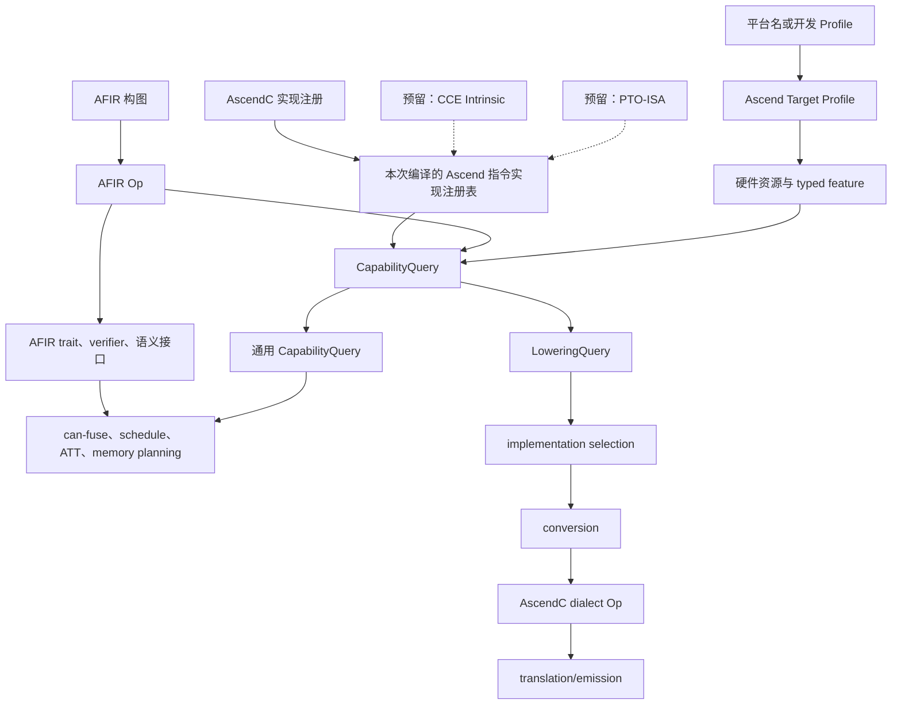

# AFIR/AscendC Op Capability 架构设计

> 状态：Capability 基础设施 D0～D2 已完成；`afir.add` 已有纵向 lowering 样例。canonical AFIR Attr/Bridge/MemoryAllocate 集成属于
> 2026-08-13 AFIR 方言重构，本文件不宣称该集成已经完成；完整源码生成、CANN 编译和设备 E2E 仍需单独验收。
> 日期：2026-08-05
> 现状复核日期：2026-08-14
> 文档类型：架构设计

> 当前代码事实：`AFIR_BRIDGE_OPERATION_REGISTRY` 只服务 codegen 迁移期的 typed bridge。Ascend Target Profile、
> ImplementationRegistry、CapabilityQuery、owning 查询结果、selection 属性/helper/pass、conversion preflight、
> `populateEnabledPatterns` 和 mock standard conversion 已实现，`af-opt --target`/`--target-profile` 已完成接线。
>
> 下一阶段范围：完成本文件与实现文档的状态收敛，并由 AFIR 方言重构接入 canonical descriptor；scalar、broadcast inline、
> inplace 和 resource 的 consumer 迁移仍属于后续独立任务；
> 当前内置 Profile 资源已完成人工来源和许可证审计，38 份 canonical INI 的逐文件 SHA-256 已记录并由 UT 校验；
> Profile 交付审计门禁已关闭。

> 方言边界更新（2026-08-13）：AFIR tensor/buffer 双形态、`memref`、Trait/Interface、Scalar 和 verifier 的具体实施
> 见[AFIR 方言重构开发实施方案](../development/2026-08-13-afir-dialect-refactoring-implementation-design.md)。本文只维护
> Capability、Target、implementation selection 和 backend lowering 的边界，不重新定义 AFIR Op。

当前状态矩阵如下。架构文档中的“已完成”只表示对应基础设施或 IR 阶段已完成，不等同于 CANN 源码生成或设备交付完成：

| 能力/阶段 | 当前状态 | 证据边界 | 后续动作 |
|---|---|---|---|
| Target Profile、registry、CapabilityQuery、selection/preflight | 已完成 | UT/LIT 和 `af-opt` Target 接线 | 保持只读、稳定顺序和既有兼容边界 |
| `afir.add -> ascendc.add_l2` | D2 已完成 | 正式 pattern、selection/conversion 和 AFIR/AscendC IR LIT | 补源码生成、CANN 编译和设备 E2E |
| scalar/broadcast inline/inplace | 协议与 fixture 已完成 | provider/query 约定和负向测试；不表示 legacy consumer 已迁移 | consumer 迁移另立设计，不在本文件宣称完成 |
| resource query | provider 数据模型已完成 | `ResourceRequirements` 接口可返回 owning 结果；尚未接入 canonical AFIR owner | 由 AFIR 方言重构在 Schedule→MLIR 后提供 `ResourceOwnerContext` 并落盘 descriptor |
| canonical `TensorDescAttr`/`BufferDescAttr`、Bridge、MemoryAllocate、正式四段 pipeline | 未完成 | 属于 2026-08-13 AFIR 方言重构 | 以实施方案为唯一开发入口 |
| CANN 源码、Kernel 编译和设备 E2E | 未完成 | 当前尚无完整商用链路证明 | 单独记录环境、命令和结果 |

# 1 简介

## 1.1 目的

本文设计 Autofuse 编译链迁移到 MLIR 后的 Op Capability 体系。它需要回答：给定一个 AFIR Op、输入类型和 shape、
目标平台以及必要的 schedule 上下文，当前 AscendC 实现能否处理；如果不能，原因是什么。

旧 ASCIR 把 Op 语义、后端限制、优化策略、性能估算和最终代码生成混在一组 C++ 虚方法中。新架构不逐个复制旧方法，
而是先确定每类信息的唯一事实来源，再为 can-fuse、schedule、ATT、memory planning、lowering 和 codegen 提供稳定的
查询入口。

## 1.2 范围

本文包含以下内容：

- AFIR 固有语义、Ascend 目标信息、AscendC API 能力和策略/成本的职责边界；
- Ascend 指令实现注册表、Capability 查询接口和结果类型；
- scalar、broadcast inline、inplace、lowering 和资源需求的表达方式；
- bridge registry、conversion pattern 和支持矩阵与 Capability 的关系；
- 旧 ASCIR 能力的迁移归属、未来迁移边界、测试和兼容方案。

本文定义架构和迁移边界，D0～D2 已按本文落地。当前只实现 AscendC API 路径。CCE Intrinsic 和 PTO-ISA 只预留
实现类型，本期不注册、不查询、不 lowering。计划废弃的 `AFIRToAscendCQueue` demo 不作为正式实现或 fallback。

本期不迁移 can-fuse、schedule、ATT、memory planner 或其他 legacy consumer。本文只规定这些 consumer 将来如何查询和
消费 Capability；具体 pass 改造、时序调整和行为兼容在真正启动迁移时另行设计。

AFIR Core 的当前重构范围由[AFIR 方言重构开发实施方案](../development/2026-08-13-afir-dialect-refactoring-implementation-design.md)定义。Capability
不得把 AscendC implementation 细节反向写入 AFIR ODS、Trait、Interface 或公共 Op 属性。

## 1.3 文档结构

本文按下面的顺序组织。第一次阅读不需要从旧接口清单开始。

文中使用“当前代码事实”描述已经在仓库中存在的行为，使用“规划”描述尚未实现的接口或目录。两者不混用。

| 部分 | 回答的问题 |
|---|---|
| 总体概述 | 为什么需要 Capability；目标编译链是什么；最终采用什么分层 |
| 需求分析与设计 | 每一层由谁定义、谁查询、返回什么、缺失时如何处理 |
| 接口设计 | Target 和 C++ 查询接口长什么样；注册与查询如何关联 |
| 软件设计 | 代码目录、数据流、现有机制关系、扩展和未来迁移边界 |
| 性能、安全、兼容和测试 | 实施时必须满足的工程约束和验收条件 |
| 附录 A | 旧 ASCIR Capability inventory 与消费阶段 |
| 附录 B | 旧接口到新架构的逐项迁移示例 |

# 2 总体概述

## 2.1 软件概述

### 2.1.1 项目介绍

旧 ASCIR 按硬件平台注册 `AscIrCodegen` 和 `AscIrAtt` 对象。同一个对象既回答 scalar、inplace、broadcast inline，
又提供 API 名、头文件、临时 buffer 和 ATT 性能入口。不同编译阶段都依赖这个 registry，因此后端限制、优化策略和
代码生成细节无法独立演进。

Autofuse 完整迁移到 MLIR 后，编译链从 AFIR 构图开始：

```text
AFIR 构图
  -> AFIR 语义校验和分析
  -> can-fuse 与 schedule 候选生成
  -> ATT 合法性过滤和成本评估
  -> memory planning 与 inplace 决策
  -> 选择 Ascend 指令实现并执行 conversion
  -> typed AscendC dialect Op
  -> translation/emission
```

当前先迁移 codegen 时，还存在一条过渡路径：

```text
legacy ScheduledResult -> bridge -> AFIR -> AscendC conversion
```

bridge 只负责把旧 scheduler 结果构造成 AFIR Op。schedule、ATT 和 codegen 全部迁移后，目标编译链不再依赖 bridge。
Capability 服务完整编译链，不能放入 bridge registry。

### 2.1.2 产品环境介绍

普通用户只指定目标平台，例如：

```text
--target=Ascend910B1
```

Autofuse 仓库保存已支持平台对应的 CANN 原始 `platform_config/*.ini`，构建时将原始字节嵌入 Target library。
`TargetProfileLoader` 从内置字节构造只读的 `TargetProfile`。AFIR pass、AscendC IR 和 AscendC C++ 源码生成不要求
本机安装 CANN。

仓库只保存明确支持平台的必要配置，不复制整个 CANN 配置目录。提交并编译这些文件前必须确认再分发许可，并记录
来源、许可证和校验值。来源版本用于追溯配置，不表示硬件事实依赖该 CANN 版本。将 AscendC C++ 编译成 Kernel
二进制时，仍需要 CANN Toolkit 或等价工具链；真机执行还需要 runtime、驱动和 NPU。

开发、测试和新平台 bring-up 可以使用 `--target-profile=<file>` 直接加载外部 Profile。启用 Capability、正式
AFIRToAscendC 或其他 Target-dependent pipeline 时，`--target` 与 `--target-profile` 必须且只能指定一个。不使用这些
pipeline 的既有 `af-opt` 用法可以不指定 Target。系统不设计多层加载优先级，也不提供 `--cann-root` 编译入口。

## 2.2 软件功能

Capability 体系提供以下功能：

- AFIR dialect 描述与后端无关的 Op 语义和永真约束；
- Ascend Target Profile 提供硬件资源和 typed target feature；
- 每个 AscendC lowering 实现注册 conversion pattern、参数映射和 API 能力；
- pass 通过统一查询入口获得候选实现、支持状态、原因和约束；
- can-fuse、schedule、ATT 和 memory planner 只在合法候选中做选择；
- translator/emitter 根据 typed backend Op 生成最终 AscendC API 调用。

## 2.3 架构结论

### 2.3.1 分层架构



图中五个部分的职责如下：

1. **AFIR 语义层**定义 Op 本身的语义和永真合法性，不依赖 AscendC。
2. **Ascend Target Profile**定义平台硬件事实，不保存 Op 名或 API 名。
3. **Ascend 指令实现注册表**记录本次 pipeline 实际加载了哪些实现。本期只有 AscendC API 实现。
4. **能力提供者和查询入口**判断当前 Op 是否满足某个具体实现的 dtype、shape、operand 和 target 条件。
5. **策略和成本模块**从合法候选中选择实现。Capability 不决定哪个候选更快或是否值得采用。

实现选择到代码生成的信息分为三类：

| 协议 | 回答的问题 | 唯一定义方 |
|---|---|---|
| Target Profile | 硬件支持什么 | `TargetProfile` 根据 `NpuArch` 提供强类型执行能力查询 |
| `ascend.implementation` | 该 AFIR Op 选择哪个后端实现 | kind 选择实现路径，稳定 ID 选择路径内的具体实现 |
| AscendC Op 属性 | 选中实现具体生成什么代码 | `unit`、`execution_model` 和可选 `instruction_form` |

implementation mapping 保存该实现要求的完整 execution spec。provider 用它查询 Target Profile，conversion 再把同一份
spec 写入 AscendC IR。emitter 只消费 IR，不读取平台名或 implementation ID 重新猜测执行形式。

`ImplementationKind` 当前定义 `AscendC`、`CCEIntrinsic` 和 `PTOISA` 三种并列路径，序列化值分别为
`ascendc_api`、`cce_intrinsic` 和 `pto_isa`。因此 `ascend.implementation` 可以表达 PTO-ISA 或 CCE Intrinsic 实现；
当前只有 AscendC 路径完成注册和 lowering，不代表选择协议只能选择 AscendC API。

### 2.3.2 关键决策

| 问题 | 决策 |
|---|---|
| AFIR 是否保存 AscendC 能力 | 不保存。AFIR 只定义固有语义；AscendC API 能力由具体实现定义 |
| 硬件信息从哪里来 | 从仓内内置的 Ascend Target Profile 构造；pass 不按 SoC 字符串判断 |
| 如何判断 lowering 是否已经实现 | 以本次编译 pipeline 是否实际加载对应 conversion pattern 为准 |
| pattern 和能力如何避免漂移 | 使用同一个 typed 注册函数同时接入 pattern、参数映射和能力提供者 |
| 执行模式和指令形态放在哪里 | 由 mapping 定义要求，conversion 显式写入 AscendC IR；不写入 `ascend.implementation` |
| bridge registry 是否保存 Capability | 不保存，只保留 bridge mapping/construction |
| API 名称由谁决定 | typed AscendC Op 的 translator/emitter |
| CCE Intrinsic 和 PTO-ISA 如何处理 | 只预留并列实现类型，本期不注册、不查询、不 lowering |
| 成本和收益由谁决定 | ATT、schedule 和 memory policy；不进入 Capability |

### 2.3.3 Backend Capability 承载方式权衡

| 方案 | 优点 | 主要问题 | 结论 |
|---|---|---|---|
| AFIR Op 直接实现 AscendC-specific `OpInterface` | 查询直接，类型安全 | AFIR 反向依赖 AscendC；新增实现必须修改 AFIR | 不采用 |
| AscendC external interface model | AFIR 不链接 backend，符合 MLIR 扩展方式 | 同一 Op 有多个 AscendC 实现时，model 内仍需管理候选；不能直接表达本次 pipeline 加载了哪些 pattern | 不作为主体 |
| 独立 `OperationName -> Boolean` 总表 | 实现简单 | 会与 pattern、provider 和 emitter 重复，最终形成新的旧式 registry | 不采用 |
| 本次编译的实现注册表 + per-implementation provider | 支持一个 Op 的多个实现；能与实际加载的 pattern 同步；consumer 入口统一 | 需要一个小型类型擦除和注册完整性检查 | 采用 |

外部 interface model 后续仍可用于某些 backend-neutral 语义，但 AscendC 动态能力的主体是实现注册项和 provider。
只有真正出现第二个 backend 且公共协议不足时，才扩展公共抽象，不预先设计万能插件系统。

## 2.4 设计约束

- AFIR dialect 不能 include 或链接 AscendC backend 实现；
- `.td` 中的 Op 集合只表示 AFIR 可表达范围，不表示 backend 支持范围；
- pass 不维护 Op 名称字符串白名单或 SoC 型号 `if` 链；
- SIMD、SIMT、MemoryBased 和 RegBased 必须以完整 execution spec 查询，不拆成可自由组合的 Boolean；
- SIMT 不区分 MemoryBased/RegBased，SIMT 目标 Op 不携带 `instruction_form`；
- conversion pattern、参数映射和能力提供者从同一个实现注册点接入；
- Target Profile、实现注册表和查询对象在一次编译中保持只读；
- 不使用可变全局 registry，也不依赖静态初始化顺序；
- 查询必须先校验 operand/result 下标、mask 长度和必需上下文；
- 信息不足和明确不支持是不同状态；信息不足时不能默认支持；
- 第一阶段不增加跨 pass Capability cache；
- 实施先覆盖 elementwise/scalar、broadcast-related 和 inplace 三类能力场景，但基础设施不绑定具体 Op 名；
- 本文档阶段不触发构建；后续构建命令统一限制为 `-j 8`。

## 2.5 假设和依赖关系

- CANN 原始配置已经完成人工来源和许可证审计，适用 CANN Open Software License Agreement Version 2.0；逐文件
  SHA-256 记录在 `target/Ascend/Profiles/SHA256SUMS`，并由生成器 UT 校验。
- AFIR 中 scalar 的统一表示尚未确定。查询接口使用 `ScalarValueAnalysis` 产生的 operand mask，不提前绑定 rank-0、
  `ScalarOp` 或旧 repeats 表示。
- AFIR ODS 中可能混有旧 backend 的 dtype 限制。实施时必须判断约束属于 AFIR 语义还是 AscendC API 能力。
- 正式 `AFIRToAscendC` 当前只有基础 ABI、函数签名和 loop generation；queue demo 不能作为计算 Op 已有 lowering 的
  依据。

# 3 需求分析与设计

## 3.1 整体介绍

一次查询从 AFIR Op 开始，按下面的顺序获得结果：

```text
AFIR Op
  -> 查询本次 pipeline 为该 Op 注册的实现候选
  -> 对每个候选调用它自己的能力提供者
  -> 能力提供者读取 Op、Target Profile 和必要上下文
  -> 返回 supported / unsupported / undetermined、原因和约束
  -> consumer 只在 supported 候选中做策略或成本选择
```

下面的功能需求分别定义每一层。每项事实只在一个章节完整定义。

### 3.1.1 架构文档与开发文档的关系

本文件回答“为什么这样分层、谁拥有事实、接口边界是什么”。它不展开每个类的成员布局、CMake 接线和逐文件改动。
具体实现方案放在单独的开发设计文档中，但不按 7 个功能需求机械拆成 7 份文档。第一阶段建议只维护下面 3 份：

| 本文功能需求 | 具体实现落点 | 开发设计文档（规划） |
|---|---|---|
| 3.2.1 AFIR 固有语义 | ODS、`verify()`、semantic trait/interface、`ScalarValueAnalysis` | 随 `dialect/AFIR` 实现 PR 描述，不单独建文档 |
| 3.2.2 Ascend Target Profile | 内置原始 INI、构建时字节嵌入、Profile loader、强类型硬件模型 | [`2026-08-05-ascend-target-profile-implementation-design.md`](../development/2026-08-05-ascend-target-profile-implementation-design.md) |
| 3.2.3～3.2.5 注册、AscendC 能力和统一查询 | registry、pattern wiring、mapping、provider、结果类型和诊断 | [`2026-08-05-ascend-instruction-registry-and-capability-query-implementation-design.md`](../development/2026-08-05-ascend-instruction-registry-and-capability-query-implementation-design.md) |
| 3.2.6～3.2.7 consumer 使用和覆盖状态 | can-fuse、schedule、ATT、memory planner 如何查询和消费；lowerability/support matrix 派生 | 本文第 3.2.6、5.4～5.5 节；不单独拆分开发文档 |

每份开发文档都必须给出：当前代码入口、目标目录、数据结构、接口使用示例、正常/异常流程、测试用例、性能影响和
回滚边界。测试不单独复制一套 Capability 规则，而是跟随对应实现文档描述。

在这些开发文档完成前，本文的 7 项功能需求只作为架构契约和实施验收依据，不表示相应代码已经存在。

## 3.2 功能需求

### 3.2.1 功能需求 1：AFIR 固有语义

1. 介绍

   AFIR 只描述与 backend 无关、对所有合法 AFIR 都成立的性质。它不回答 AscendC 是否支持 scalar、inplace 或
   broadcast inline，也不保存 API 名和成本。

2. 输入

   输入是 AFIR Op、operand/result type、attribute 和 shape，不需要 target、schedule 或 AscendC 版本。

3. 处理

   - 永远成立的 shape、type 和 attribute 约束写入 ODS 或 `verify()`；
   - elementwise 使用标准 `Elementwise` trait；
   - `Commutative` 只表示语义上允许交换 operand，不能由某个 backend 的实现能力反推；
   - Broadcast 和 Reduction 只在确有共享 consumer 时增加小型语义接口；
   - `ScalarValueAnalysis` 识别哪些 operand 是 scalar，不判断 backend 是否接受。

4. 输出

   输出是 verifier 结果、标准 trait 或语义描述。Op 没有声明某项语义时，通用 pass 不得通过 Op 名称猜测。

### 3.2.2 功能需求 2：Ascend Target Profile

1. 介绍

   Target Profile 只描述平台事实，例如 core 拓扑、L1/L0/UB/GM 容量、对齐、直接搬运边、原始 bytes/cycle 和
   typed feature。它不包含 AFIR Op 名、AscendC API 名、conversion pattern 或收益判断。

2. 输入

   产品输入是平台名，例如 `Ascend910B1`。loader 根据名称查询构建时嵌入工具的原始 INI 字节，并构造
   `TargetProfile`。
   配置加载完成后，平台名的作用结束。后续 pass 和能力提供者查询 typed feature 或完整 execution spec，
   不能编写 `if (socVersion == "Ascend910B1")` 这样的型号判断。

   开发测试输入是一个显式 Profile 文件。Target-dependent pipeline 要求两种输入二选一；未知平台、同时指定或在该
   pipeline 中都未指定都属于初始化错误。

3. 处理

   每次编译在 pass pipeline 启动前加载并校验一次 Profile。loader 检查必需字段、范围、单位和相互约束，随后构造
   只读目标模型。Profile 没有提供的数据不能由 consumer 猜测补齐。loader 将 `version.NpuArch` 转换为强类型
   `NpuArch`，Target Profile 直接据此查询执行能力，不建立逐平台代际清单或额外的 generation 映射层。

   资源存在性与规格完整性分开建模。GM、L2 固定存在；Cube local memory 和 Vector UB 分别随 Cube Core、Vector Core
   存在。`cube_core_cnt` 和 `vector_core_cnt` 是必需字段，也是计算单元存在性的唯一事实。资源或计算单元存在但容量、
   block、频率等规格缺失时，查询成功并返回 `nullopt`；对象不存在时查询才返回 failure。

   Profile 中的直接搬运边和 bytes/cycle 是设备事实。执行模式能力由受控架构规则提供：所有已支持架构支持
   `Vector + SIMD + MemoryBased`，A5（950 系列）额外支持 `Vector + SIMD + RegBased` 和 `Vector + SIMT`。SIMT 不区分
   MemoryBased/RegBased。A2/A3 和 A5 的 Cube Core、Vector Core 都是独立单元。每个 `MemorySpace` 的 owner 是固定类型
   语义；Profile 使用计算访问权限和直接搬运边表达硬件图。A2/A3 的 Cube 输出到 Vector UB 需要
   `Cube.L0C -> GM -> Vector.UB`，A5 额外存在
   `Cube.L0C -> Vector.UB` 直连。loader 根据 `AICoreintrinsicDtypeMap` 中明确的搬运 intrinsic 建边，不能从 `NpuArch`、
   `cube_vector_combine`、UB 容量或 `l0_c_to_ub_rate` 推断直连。启动开销、路径搜索、重叠关系、估算周期和收益属于
   memory planner/ATT Cost Model。

   `TransferEdge.engine` 使用具体硬件流水线名称，不使用泛化的 `DataMove`：

   | 搬运流水线 | 当前建模的主要方向 |
   |---|---|
   | `MTE1` | `L1 -> L0A/L0B` |
   | `MTE2` | `GM -> L1/L0A/L0B/UB`、`L1 -> UB` |
   | `MTE3` | `L1/UB -> GM`、`UB -> L1` |
   | `Fixpipe` | `L0C -> L1/GM/UB` |

   INI 中的 `Intrinsic_data_move_*` 是原始配置协议。loader 将其转换为对应的 `MTE1`、`MTE2` 或 `MTE3`；
   `Intrinsic_fix_pipe_*` 转换为 `Fixpipe`。同一对 `MemorySpace` 可以存在由不同流水线提供的多条直接边。
   `hasDirectTransfer(source, destination)` 只表示至少存在一条直连边。memory planner 和 ATT 做流水线竞争与成本计算时，
   必须读取具体 `TransferEdge` 的 `engine` 和 `bytesPerCycle`。

   Loader 规范化完成后的 `TransferEdge` 集合采用闭世界语义：未出现的直接边就是不可用。只有 source、destination 和
   相关计算单元都存在时才能创建边；GM↔UB 基线边也只在 GM、UB、Vector Core 都存在时补充。整个
   `AICoreintrinsicDtypeMap` section 缺失属于 loader failure。`support_fixpipe` 不形成独立 `TargetFeature`，Fixpipe 能力只由
   具体 `TransferEdge.engine` 表达。

   Consumer 使用语义查询，不自行拼接“存在且有效”条件。只关心布尔存在性时使用 `hasMemory()` 或
   `hasComputeUnit()`；需要规格时直接使用 `getMemorySpec()` 或 `getComputeUnitSpec()`；判断执行形态时只使用
   `getExecutionSupport()`；判断访问和搬运时只使用 `canAccess()` 或 `hasDirectTransfer()`。这些接口内部统一处理相关对象
   的存在性，provider 不再单独读取 core 数。

   ATT 使用 Target Profile 提供的设备事实构造自己的成本模型，Target Profile 不承担成本计算职责。

4. 输出

   输出是只读 `TargetProfile` 和稳定 fingerprint。必需字段缺失或矛盾时初始化失败；可选 feature 缺失时保留
   “未建模”状态，使用该 feature 的 provider 返回 `undetermined`，不能当作支持。IR 只保存必要的规范化 target 描述，
   不保存 C++ 引用或完整配置文本。

   lowering 到 PyAsc `ascendc` Op 时不再建立第二套硬件事实模型。PyAsc Op 描述 API 调用和参数；Target Profile 仍是
   core、容量和 feature 的唯一来源。`MemorySpace` 到 PyAsc `Hardware` 通过显式 adapter 映射。PyAsc Python 编译
   工程不参与当前链路；AscendC C++ 继续由现有 `compiler/python/ascendc_compile.py` 调用 `bisheng` 编译。Profile 的
   `socVersion` 与现有编译入口的 `soc_version` 必须一致，不能让源码生成和 Kernel 编译选择不同平台。

### 3.2.3 功能需求 3：Ascend 指令实现注册

1. 介绍

   一个“实现”表示把某类 AFIR Op 转换成后端 IR 的具体方法。本期实现类型只有 AscendC API；公共注册协议为
   CCE Intrinsic 和 PTO-ISA 预留枚举值，但不实现相关功能。

2. 输入

   每个注册项包含：

   - AFIR Op 类型；
   - 实现类型和强类型实现标识；
   - conversion pattern registration；当前实现要求 entry 带 pattern；后续通用 Capability-only entry 可以不带 pattern，但不得
     进入 lowering candidates；
   - AFIR operand/result 到后端参数的 typed mapping；
   - 该实现要求的 typed execution spec；
   - 该实现的 `instruction::CapabilityProvider`。

3. 处理

   backend pipeline 通过一个 typed 注册函数，创建完整的实现注册项。注册项同时绑定 source Op、实现类型和 ID、
   typed mapping、capability provider，以及可选的 conversion pattern registration。Capability 查询使用 provider 和
   mapping；Lowering 查询只筛选带 conversion pattern 的实现。这样，图优化可以在没有加载 conversion pattern 的
   pipeline 中查询能力，而 lowering selection 仍然只选择当前 pipeline 能够转换的实现。

   注册完成后冻结注册表。注册项缺 mapping、provider 或稳定实现 ID 属于开发期接线错误，在冻结时失败；如果某个
   entry 参与 lowering，则还必须有完整的 pattern registration。注册表不集中保存 scalar、broadcast inline 或
   inplace Boolean，也不保存 API 名字符串。

4. 输出

   Capability 查询输出按 `OperationName` 分组、按 implementation 返回的只读能力结果。Lowering 查询输出只包含
   当前 pipeline 已加载 pattern 的实现候选。合法查询没有注册项时返回成功的空容器；这不等价于某个能力明确不支持。

### 3.2.4 功能需求 4：AscendC API 能力

1. 介绍

   能力提供者回答：“当前 AFIR Op 能否使用这个具体 AscendC API 实现？”AscendC API 能力是当前实现路径中
   scalar、broadcast inline、inplace、dtype、shape 和资源约束的唯一事实来源。

   当前 AscendC API 路径不再检查底层 CCE Intrinsic。以后如果 AFIR 直接 lowering 到 CCE Intrinsic 或 PTO-ISA，
   由新的实现注册项和 provider 独立判断。

2. 输入

   每次查询包含三类信息：

   - 当前 AFIR Op：type、shape、attribute、常量值和动态维；
   - 当前 `TargetProfile`；
   - 查询专用请求：operand mask、broadcast pattern、alias request 等当前 IR 或分析已经提供的信息。

   当前 canonical AFIR 路径已经由 ScheduleToAfir Bridge 生成 buffer-form；因此查询直接读取 Op 上按 operand/result/
   destination 下标对齐的 `TensorDescAttr` 和 `BufferDescAttr`。`repeats`、`strides`、`vectorized_strides`、format、tile
   和 layout 只来自 `TensorDescAttr`；`space`、`buffer_id`、`reuse_id`、`slot_count`、`queue_depth`、`size_bytes_expr`、
   `alignment_bytes` 和 `life_time_axis_id` 只来自对应的 `BufferDescAttr`。函数级、无 SSA owner 的 workspace 从
   `func.func` 的 `afir.workspace_plan` 读取。这样 Capability 不回读 `outputs`、`AscTensorGroupsAttr` 或 Legacy DTO。

   resource 查询不重复接收上述 descriptor 字段，也不自行推断 Schedule binding 或生命周期。provider 通过
   backend-neutral accessor 读取 canonical descriptor，返回当前 implementation 所需的 `ResourceRequirements`（例如
   scratch/workspace 大小、对齐和附加资源约束）；selection 将 provider 结果合并到对应 `BufferDescAttr` 或
   `afir.workspace_plan`，`AFIRToAscendC` 在 selection 之后负责物化。Kernel Workspace 仍属于 ATT/tiling/kernel ABI
   链路，但其资源需求在 AFIR 中通过同一 `BufferDescAttr` 规范化，不与 Op-level scratch 混用。

3. 处理

   | 查询 | provider 判断的内容 | 返回的约束 |
   |---|---|---|
   | lowering | 参数 mapping、dtype、rank、shape 和 target 是否可处理 | 实现可用条件 |
   | scalar | 哪些 operand 位置允许 scalar；是否允许 all-scalar | operand mask 和组合约束 |
   | broadcast inline | consumer 是否接受给定 broadcast pattern | operand、axis、stride 和动态维约束 |
   | inplace | 指定 input/result 是否允许 alias | alias pair、读写、dtype 和对齐约束 |
   | resource | 从 canonical `TensorDescAttr`/`BufferDescAttr` 计算某个 implementation 所需的 scratch、对齐和执行资源 | `ResourceRequirements` |

   对 Schedule 已绑定的普通资源，`BufferDescAttr.size_bytes_expr`、binding、slot/depth 和 lifetime 是既有事实，provider 不得静默覆盖。
   provider 只能新增 implementation-specific scratch/workspace requirement，或对已有字段提出可校验的最小约束；若需求与 canonical
   descriptor 冲突，selection 必须 failure。`q<id>_size`/`b<id>_size` 等符号在后续 `AFIRMemoryAllocatePass` 中解析为 TilingData/axis SSA，
   TilingData 不构成第二份资源事实。

   lowering provider 先用 mapping 中的完整 execution spec 查询 Target Profile，再检查 API 特有的 dtype、shape、operand 和资源约束。
   CANN/PyAsc 若提供稳定的结构化 API metadata，可以生成 target、dtype、overload 等机械信息。operand 级 scalar、
   broadcast inline、inplace alias、shape 组合和 workspace 语义仍由 provider 明确定义。不能通过扫描头文件并发现
   API 符号来推断能力。

4. 输出

   lowering、scalar、broadcast inline 和 inplace 查询的每个候选返回 `CapabilitySupport`；resource 查询返回带有
   `ResourceRequirements` 的 resource candidate：

   - `Supported`：当前信息足够并且满足约束；
   - `Unsupported`：明确不满足约束；
   - `Undetermined`：缺少当前查询已经声明需要的动态 shape、tensor layout 或表达式绑定等必要信息；未来 schedule/tiling 迁移后，可增加相应的
     context-required reason；
   - 稳定的 reason code 和结构化约束；
   - 支持时对应的 `instruction::ImplementationKey`。

### 3.2.5 功能需求 5：通用能力查询与 lowering 查询分层

1. 介绍

   `instruction::CapabilityQuery` 是所有 consumer 的统一 facade，但它提供两类职责不同的入口：

   - `queryCapability()` 查询某个 Op 或某个具体 implementation 的通用能力，供融合、图优化、schedule 和 memory
     policy 使用；
   - `queryLowering()` 查询当前 pipeline 中可转换的 backend implementation，供 lowering selection 使用。

   两个入口共享冻结 registry、provider、typed mapping 和 `QueryContext`，不维护两套能力事实。`queryLowering()` 不应
   被当作 scalar、broadcast inline 或 inplace 的通用查询入口。

2. 输入

   输入是 AFIR `Operation *`、当前版本的 `instruction::QueryContext`、只读实现注册表和类型化的查询请求。请求可以
   不指定 implementation，表示查询该 Op 的所有注册实现；也可以指定 `ImplementationKey`，表示只查询该实现。

3. 处理

   1. 校验 Op、implementation key、operand/result 下标、mask 长度和必需上下文；
   2. 从注册表找到当前 Op 的全部候选，或定位请求指定的唯一 implementation；
   3. 对每个候选调用对应的 provider 能力方法；
   4. `queryCapability()` 返回每个实现的状态、原因和结构化约束，不替 consumer 做成本排序；
   5. `queryLowering()` 只调用 lowering provider 方法，并过滤没有 conversion pattern 的 entry。

   当请求未指定 implementation 时，不把多个实现的结果隐式折叠成一个 Boolean 或三态。调用方可以检查“至少一个
   实现支持”，也可以根据 implementation key 逐个消费结果；如确实需要聚合，必须显式指定 `AnyImplementation` 或
   `AllImplementations` 策略。

   Selection 根据查询结果写入 implementation key。Conversion 读取该 key 并执行对应 pattern，不再次调用 provider，
   也不重新写一套 dtype、shape 或 operand 判断。Conversion 使用选中 entry 的 mapping 把同一份 execution spec 显式写入
   AscendC Op。若 Capability 查询输入发生变化，必须先重新运行 selection。

4. 输出

   合法调用返回对应的 implementation candidate 容器。没有注册候选时返回成功的空容器，不构造虚假的 candidate 或
   reason；调用参数非法、指定 key 不属于当前 Op、registry 未冻结或内部状态损坏时返回 `FailureOr` failure 和诊断。
   已注册候选缺少必要信息时保留 `Undetermined`，不能转换成 `Supported` 或 `Unsupported`。

### 3.2.6 功能需求 6：向策略层提供合法候选

1. 介绍

   本需求只定义 Capability 与 consumer 的边界，不设计 schedule、ATT 或 memory planner 的具体算法。
   Capability 回答“能不能”，consumer 再回答“要不要”。本期只说明 consumer 的调用约定，不修改这些 consumer 的
   现有实现；真正迁移时另行设计 pass 边界、时序和行为兼容方案。

2. 输入

   consumer 接收候选、支持状态、原因和约束。图依赖、liveness、候选 schedule、成本和 profiling 数据由各自模块维护，
   不回写 Capability。

3. 处理

   - can-fuse 只把 AFIR 语义和 Capability 都允许的候选交给融合规则；
   - schedule 只在合法候选中安排实现；
   - ATT 只对合法候选计算成本和收益；
   - memory planner 先查询 alias 能力，再结合 use-count、liveness 和收益选择 inplace；
   - broadcast pass 先查询 consumer 的 inline 能力，再决定删除或保留显式 Broadcast。

4. 输出

   consumer 输出选择结果或跳过原因，不修改 Capability。schedule 搜索空间、ATT 成本公式、memory planner 收益模型
   和 profiling 数据格式不属于本设计。

### 3.2.7 功能需求 7：覆盖状态和唯一事实来源

1. 介绍

   支持矩阵只报告覆盖状态，不承担 Capability 数据库职责。每个状态有唯一来源。

2. 输入与处理

   | 状态或事实 | 唯一来源 | 含义 |
   |---|---|---|
   | `declared` | AFIR ODS | dialect 已声明该 Op |
   | `bridgeable` | bridge registry | 迁移期 bridge 能构造该 Op |
   | `lowerable` | 当前 pipeline 加载的 conversion pattern | 已有相应 lowering 代码 |
   | dynamic Capability | 对应实现的 provider | 指定 target、dtype、shape 和 operand 条件下是否可用 |
   | `E2E verified` | 测试清单和 CI 结果 | 指定组合已经过端到端验证 |

   `lowerable` 不能由 `.td` 或 bridge registry 推断。动态 Capability 必须带查询上下文，不能写成全局静态列。

3. 输出

   支持矩阵独立报告上述状态，不提供含义不清的总 `supported`。codegen 过渡期额外报告 `bridgeable`；完整迁移后
   bridgeable 不属于目标编译链覆盖状态。

## 3.3 非功能需求

### 3.3.1 可维护性

- AFIR 语义接口按语义族拆分，不设计万能 Capability interface；
- AscendC provider 与对应 pattern 放在相邻 backend 代码中；
- pass 只使用统一查询入口，不维护 Op 白名单；
- reason code 使用稳定 enum，诊断文本统一生成；
- 新增 Op、实现或 target feature 的修改点由“扩展流程”明确限定。

### 3.3.2 可测试性

- Target Profile loader、实现注册表、provider 和查询入口可以分别测试；
- verifier 和 trait 使用 textual MLIR + FileCheck；
- pass 测试只验证行为，不复制 provider 的 dtype/shape 条件；
- 支持矩阵从注册和测试结果派生；
- 普通 CPU 环境覆盖“不安装 CANN 仍能生成 AscendC C++”的测试。

### 3.3.3 可移植性

- AFIR 语义不依赖 AscendC、CANN Toolkit 版本或设备型号；
- Target feature 使用 enum、bitset 或 typed accessors，不使用 SoC 字符串分支；
- Profile 随 Autofuse MLIR 交付，源码生成不依赖 CANN 安装路径；
- 未来实现类型通过公共注册协议扩展，不修改已有 AFIR verifier。

### 3.3.4 可靠性

- operand/result 下标和 mask 长度在访问前校验；
- 缺少信息时返回 `Undetermined`；
- provider、注册表和 Target Profile 在 pipeline 运行期间只读；
- pass 改写 IR 后不得复用未 preserve 的分析；
- 候选按 implementation kind 和稳定 ID 排序，不使用注册顺序、地址或哈希遍历顺序。

### 3.3.5 特性交叉影响

| 场景 | 适用性 | 结论 |
|---|---|---|
| SuperKernel Python | 不适用 | 不修改 Python 包或接口 |
| SuperKernel C++/AOT | 不适用 | 不修改 `libascendsk.so` 或 AOT ABI |
| Autofuse 图优化 | 部分适用 | 本期只定义 can-fuse/scalar/broadcast/inplace consumer 的查询约定，不修改现有 pass |
| Autofuse Codegen/Backend | 适用 | 新增 Target、实现注册、provider、query 和正式 conversion |
| AscendC API / Runtime | 部分适用 | 生成 C++ 不调用 runtime；编译 Kernel 仍依赖工具链 |
| Python/C++ 混合绑定 | 不适用 | 不修改 pyautofuse 和 CPython 生命周期 |
| 构建与打包 | 适用 | 原始 INI 构建为只读字节并链接进 Target library，不安装独立 Profile 文件 |
| 测试与覆盖率 | 适用 | 新增 gtest、lit、负向和 AscendC E2E |
| 性能与日志 | 适用 | 查询位于编译期遍历，不增加逐 Op 默认日志 |
| 兼容性 | 适用 | legacy 路径保持；MLIR 工具增加 Target 输入 |

# 4 性能

## 4.1 编译时长

实现注册表按 `OperationName` 建索引，找到候选的成本为 O(1) 加候选数量。普通 provider 查询通常只遍历 operand 和
rank；resource provider 还会遍历 layout 数组和 `Expression` 节点。Target Profile 每次编译只解析一次。

第一阶段不缓存单个 Op 的 Capability 结果。查询本身较小，而跨 pass 缓存容易产生失效错误。只有基准证明存在明显
回归后，才通过 MLIR `AnalysisManager` 引入可失效缓存；cache key 必须包含 target fingerprint、注册表版本、查询类型
和相关 analysis 版本。

## 4.2 执行性能

Capability 查询只影响编译期。最终 Kernel 性能由策略选择的 lowering、schedule、inline 和 inplace 决定，使用
ATT 与 E2E A/B 验证。接入查询接口本身不自动启用任何优化。

## 4.3 内存和产物大小

每次编译只持有一份 Target Profile 和实现注册表。注册项保存类型标识、factory、mapping 和 provider，不为每个
Operation 创建常驻对象。查询结果使用 enum、bitset、`SmallVector` 和实现句柄，不保存大字符串。

源码仓只增加明确支持平台的原始 INI。构建时机械生成只读字节并链接进工具，不复制完整 CANN 配置目录，也不在安装态
交付独立 INI。第一阶段不增加跨 pass cache、runtime 常驻内存或 wheel 内容。

# 5 接口设计

## 5.1 Target 输入

MLIR 工具规划两种互斥输入：

```text
--target=<平台名>          # 产品模式，从内置 Profile 加载
--target-profile=<文件>   # 开发测试模式，直接加载指定 Profile
```

Target-dependent pipeline 启动时，两者同时指定或都未指定都报错；不使用 Target 的既有工具流程可以都不指定。生产
pipeline 接收等价的 Target 选择结果，不自行搜索 CANN 安装目录。

## 5.2 核心 C++ 接口

本节只冻结调用契约，不规定类成员布局、模板实现、CMake 接线或资源 accessor 的具体文件。具体实现见
`docs/development/2026-08-05-ascend-instruction-registry-and-capability-query-implementation-design.md`。

公共查询契约包含三种状态：`Supported`、`Unsupported` 和 `Undetermined`。结果必须携带稳定 reason 和结构化约束；
结果对象自己拥有约束，consumer 只能在结果对象存活期间读取约束 view。资源查询返回额外的结构化资源需求，大小字段使用
现有 `mlir::afir::Expression`。

### 5.2.1 实现类型和注册项

registry entry 是 provider、mapping、pattern registration 和 implementation key 的唯一绑定单位。本期实现类型只有
`instruction::ImplementationKind::AscendC`；`instruction::ImplementationKind::CCEIntrinsic` 和
`instruction::ImplementationKind::PTOISA` 只预留枚举值。
Entry 的唯一性、所有权、稳定顺序和 pattern 绑定方式见开发设计文档。

`instruction::QueryContext` 当前只包含 `TargetProfile`，由调用方持有、只读且只在一次查询期间有效。未来 schedule 或
tiling 迁移时可以扩展这个类型，但不能把尚未存在的分析对象伪造成当前接口依赖。

### 5.2.2 CapabilityQuery 与 LoweringQuery

`instruction::CapabilityQuery` 是 pass 的统一 facade，但分成两个职责不同的入口：

- `queryCapability()` 面向融合、图优化、schedule 和 memory policy，查询某个 Op 或某个具体 implementation 的
  scalar、broadcast inline、inplace 等通用能力；
- `queryLowering()` 面向 lowering selection，查询当前 pipeline 中完整可转换的 backend implementation 候选。

两个入口共享冻结 registry、provider、typed mapping 和 `instruction::QueryContext`。Capability 查询不依赖 conversion
pattern 是否加载；Lowering 查询只返回带 conversion pattern 的 entry。具体方法签名、请求 payload、候选容器和错误码定义见
开发设计文档。

`queryCapability()` 未指定 implementation 时返回每个已注册实现的独立结果；指定 implementation 时只返回该实现的结果。
它不隐式把多个实现聚合为一个 Boolean 或三态。调用方若需要“任意实现支持”或“所有实现支持”，必须显式执行聚合策略。

调用参数非法、指定 key 与 Op 不匹配、registry 未冻结或内部状态损坏返回 failure。调用合法但没有注册候选时返回成功的
空容器。provider 不把 `Undetermined` 转换成 `Supported`，query 也不替 consumer 做成本排序。

## 5.3 注册接口

注册函数必须生成完整 entry，并在冻结前验证 source Op、实现 kind/id、mapping 和 provider 的绑定关系。参与 lowering
的 entry 还必须提供 pattern registration；只服务通用 Capability 查询的 entry 可以没有 pattern。具体 entry 字段、模板
builder、所有权和 pattern 接线见
`docs/development/2026-08-05-ascend-instruction-registry-and-capability-query-implementation-design.md`。

Conversion pass 一次性加载当前 pipeline 启用的全部 patterns。每个 pattern 固定绑定一个
`instruction::ImplementationKey`，只有
选择属性与该 key 一致时才能匹配。

## 5.4 使用方法示例

以下示例展示一个 pass 如何从 Target 初始化走到 Capability 查询。`TargetSelection`、loader、registry/query、
正式 AscendC 注册函数、selection helper/pass、conversion preflight 和首个 `afir.add -> ascendc.add_l2` pattern 已实现；
canonical AFIR Attr/Bridge/MemoryAllocate 接入属于本次方言重构，尚未实现。resource query 的完整布局读取和 `Expression` 结果示例见
`docs/development/2026-08-05-ascend-instruction-registry-and-capability-query-implementation-design.md`。

调用方是最终实现选择 pass。输入是当前 buffer-form AFIR `Operation *`，输出是写入 IR 的
`instruction::ImplementationKey`，或者
可诊断的失败结果。

```cpp
// 1. 编译初始化：产品模式只指定平台名。
TargetSelection selection =
    TargetSelection::builtinPlatform("Ascend910B1");
FailureOr<TargetProfile> target =
    TargetProfileLoader::load(selection, llvm::errs());
if (failed(target)) {
  return emitTargetDiagnostic(selection);
}

// 2. 同一个 pipeline 注册完整 entry（pattern registration、mapping 和 provider），然后冻结注册表。
mlir::ascend::instruction::ImplementationRegistry registry(
    mlirContext);
if (failed(registerAscendCImplementations(registry)) ||
    failed(registry.freeze())) {
  return emitRegistrationDiagnostic();
}

// 3. pass 为本次查询创建只读 context。当前 context 只有 target。
mlir::ascend::instruction::CapabilityQuery capabilities(registry);
mlir::ascend::instruction::QueryContext context{*target};

// 4. 图优化查询通用能力：不指定具体后端实现。
CapabilityQueryRequest inplaceRequest{
    CapabilityKind::Inplace, op, std::nullopt,
    InplaceQuery{/* input/result alias pair */}};
FailureOr<mlir::ascend::instruction::Candidates> inplace =
    capabilities.queryCapability(inplaceRequest, context);
if (failed(inplace)) {
  return failure();
}
// 调用方根据逐 implementation 结果继续分析生命周期和收益。

// 5. lowering selection 查询完整的可转换实现。
FailureOr<mlir::ascend::instruction::Candidates> candidates =
    capabilities.queryLowering(op, context);
if (failed(candidates)) {
  return failure();  // 调用参数非法，查询入口已经产生 diagnostic。
}

// provider 返回 supported/unsupported/undetermined 和原因。
if (candidates->getSupported().empty()) {
  return skipOrFailAccordingToPassPolicy(op, candidates->getAll());
}

// 6. 单候选直接选择；多候选由显式 policy 选择，然后把结果写入 IR。
FailureOr<mlir::ascend::instruction::ImplementationKey> selected =
    selectImplementation(op, *candidates, context, selectionPolicy);
if (failed(selected)) {
  return emitImplementationDiagnostic(op);
}
return setSelectedImplementation(op, *selected);
```

正常路径是“加载目标 → 注册实现 → 查询候选 → 策略选择 → 写入选择属性”。后续 conversion pass 根据属性执行对应
pattern。如果 Profile 缺失、注册不完整或参数非法，
初始化或查询直接失败；如果 API 明确不支持，Capability 返回 reason，必需 lowering 在 selection 失败，可选优化跳过；如果信息
不足，返回 `Undetermined`，策略不能把它当作支持。

`instruction::QueryContext` 由调用方持有，不被 `instruction::CapabilityQuery` 保存或拥有。未来 schedule 或 tiling 迁移时，
只扩展这个 context 类型并增加可选的只读字段；查询方法和 provider 的参数列表保持不变。新增字段必须有明确的
生命周期和所有权，不能用可变全局对象代替。只有当 schedule/tiling 影响 Capability 合法性时才传入查询；如果它们
只影响收益比较，就继续由 ATT 或 schedule cost model 使用。

开发测试模式把第 1 步替换为 `--target-profile=<file>`，其余步骤不变。`--target` 与 `--target-profile` 不能同时使用。

## 5.5 scalar operand 位置示例

`Commutative` 表示 AFIR 语义允许交换输入；后端支持哪些 scalar 位置是另一件事。

如果某个非交换 Op 的 AscendC API 同时支持 `(tensor, scalar)` 和 `(scalar, tensor)`，可以注册两个 mapping 候选：

```text
TensorScalar：operand 0 -> tensor，operand 1 -> scalar，scalarOperands = {1}
ScalarTensor：operand 0 -> scalar，operand 1 -> tensor，scalarOperands = {0}
```

如果两个位置的 overload、mapping 和约束完全相同，也可以合并成一个 `scalarOperands = {0, 1}` 的候选。整个过程
保持 `operand0 op operand1` 的顺序，不添加 `Commutative`，也不交换输入。all-scalar 只有 provider 明确支持时才允许。

## 5.6 接口检查项

| 检查项 | 是否涉及 | 说明 |
|---|---|---|
| 接口评审 | 是 | Target 输入、注册协议、结果类型和查询接口均为 MLIR 内部新接口 |
| 文档更新 | 是 | 本文定义职责、默认行为和扩展流程 |
| 对外 ABI/API | 否 | 不修改公共 C++/Python ABI；MLIR 工具新增内部 Target 选项 |
| 错误诊断 | 是 | 非法调用返回 failure；不支持返回稳定 reason code |
| 独立接口测试 | 是 | 覆盖 Target、注册、查询、缺失实现和多编译上下文 |

# 6 软件设计

## 6.1 规划目录结构

下面是逻辑目录，不表示本期一次性创建所有文件。公共注册协议由 Target、schedule、ATT 和 conversion 共同使用，
因此放在 `target/Ascend/Capability`，不放在任何一条 conversion 路径中。AscendC API、CCE Intrinsic 和 PTO-ISA
是并列的指令实现路径，各自拥有 provider、typed mapping 和 conversion pattern。

```text
autofuse/mlir/
├── dialect/AFIR/
│   ├── IR/                         # ODS、verifier、backend-neutral trait/interface
│   └── Transforms/                 # 通用分析和变换
├── target/Ascend/
│   ├── Profiles/                   # 受支持平台的 CANN 原始 INI 与来源清单
│   ├── AscendTargetProfile.*       # 只读目标模型
│   ├── TargetProfileLoader.*       # 内置/显式 Profile 加载与校验
│   └── Capability/                 # 公共注册协议、查询结果、注册表和统一查询入口
├── conversion/AFIRToAscendC/
│   ├── Capability/                 # AscendC API providers 和 typed mappings
│   ├── Patterns/                   # AFIR -> AscendC conversion patterns
│   └── RegisterAscendCImplementations.*
│                                    # 绑定 provider、mapping 和 pattern registration
├── conversion/AFIRToCCEIntrinsic/  # 远期：仅在支持 AFIR 直接 lowering 时创建
│   ├── Capability/                 # CCE Intrinsic providers 和 typed mappings
│   ├── Patterns/                   # AFIR -> CCE Intrinsic conversion patterns
│   └── RegisterCCEIntrinsicImplementations.*
├── conversion/AFIRToPTOISA/        # 远期：仅在支持 AFIR 直接 lowering 时创建
│   ├── Capability/
│   ├── Patterns/
│   └── RegisterPTOISAImplementations.*
├── tools/af-opt/                   # Target 输入和 pipeline 组装
└── test/
    ├── ut/target/                  # Profile loader/目标模型 UT
    ├── ut/conversion/              # registry/provider/query UT
    └── lit/                        # verifier、pass 和 lowering 测试
```

构建时，manifest 和原始 INI 机械生成只读字节数组及平台索引，并链接进 Target library。生成步骤不解析字段，也不维护
第二份 Profile 格式。交付工具不依赖独立 INI 或安装路径；生成的源码、目标文件和 Kernel 二进制同样不携带 Profile。

## 6.2 能力所有权矩阵

| 事实 | 唯一定义方 | 主要消费方 | 缺失行为 |
|---|---|---|---|
| operand/result 语义角色 | AFIR ODS/语义接口 | 通用分析、schedule | 不宣称语义 |
| 永真 shape/type 合法性 | ODS + `verify()` | 所有阶段 | verifier failure |
| bridge 可构造性 | bridge registry | codegen 过渡路径 | bridge failure |
| 硬件资源和 feature | Ascend Target Profile | schedule、ATT、provider | 初始化失败或 feature unavailable |
| Memory/Compute 对象存在性 | Ascend Target Profile 的统一查询接口 | schedule、memory planner、provider | 规格查询 failure 表示对象不存在；字段 `nullopt` 表示规格未知 |
| `MemorySpace` 固定 owner | Target 模块的 `getMemoryOwner()` | schedule、memory planner | GM/L2 无 owner，其余按枚举语义固定 |
| 计算访问权限 | Ascend Target Profile 的 `ComputeAccess` | schedule、memory planner | 未声明即不可直接访问 |
| Buffer 直接搬运能力及所占流水线 | Ascend Target Profile 的 `TransferEdge` | memory planner、provider、ATT | 未声明即无直连；存在边时读取 `MTE1/MTE2/MTE3/Fixpipe` 和可选速率 |
| 多跳搬运路径与成本选择 | memory planner、ATT Cost Model | schedule、conversion | 无合法路径或策略失败 |
| SIMD/SIMT 和 MemoryBased/RegBased 组合 | Ascend Target Profile 的 execution spec 查询 | provider | unavailable 或 undetermined |
| lowering 是否存在 | 当前 pipeline 的 conversion registration | query、conversion、支持矩阵 | 空候选 |
| AFIR 到 API 参数映射 | 实现注册项的 typed mapping | provider、conversion | 注册失败 |
| AFIR Op 的已选后端实现 | `ascend.implementation` 的 kind 和稳定 ID | selection、conversion | 属性缺失、未知 kind 或未知 ID 时 failure |
| 执行单元、执行模式和指令形态 | AscendC Op 属性 | conversion、emitter | 组合非法或属性缺失时 failure |
| scalar/inline/inplace 等动态约束 | 对应 AscendC API provider | pass、conversion | unsupported |
| 资源需求 | 对应实现 provider；大小使用 AFIR `Expression` 计算 | schedule、ATT、memory planner | 属性缺失或表达式无法构造时 `undetermined` |
| Profile 到 PyAsc 的内存映射 | Profile-to-PyAsc adapter | conversion | 内存枚举无法映射时 failure |
| Kernel 编译目标 | 规范化 Target 选择和现有 `ascendc_compile.py` | `bisheng` Kernel 编译 | `soc_version` 与 Profile 设备身份不一致时 failure |
| 成本和收益 | ATT/schedule/memory policy | 策略选择 | 按策略处理 |
| API 名、overload 和 header | AscendC Op translator/emitter | emission | translation failure |
| E2E 状态 | 测试和 CI | 支持报告 | 未验证 |

## 6.3 正常流程

```text
解析 Target 输入并加载 Ascend Target Profile
  -> 注册并冻结 Ascend 指令实现注册表
  -> AFIR verifier 和语义分析
  -> consumer 查询当前 Op 的候选实现
  -> provider 返回状态、原因、约束和（resource 查询时）结构化资源需求
  -> 策略在合法候选中选择
  -> selection 只写入 ascend.implementation 的 kind 和稳定 ID
  -> conversion 读取选择属性，并把 mapping 中的 execution spec 写入 AscendC dialect Op
  -> translation/emission 只读取 AscendC IR
```

Target Profile、注册表和 provider 在 pipeline 运行期间只读。不同编译任务构造独立对象，可以使用不同 target 和
实现集合，不共享可变全局状态。

## 6.4 与现有机制的关系

### 6.4.1 `AFIR_BRIDGE_OPERATION_REGISTRY`

- 只服务迁移期 `ScheduledResult -> AFIR` typed construction；
- 不增加 scalar、inplace、inline、dtype、target 或 API 字段；
- 目标编译链从 AFIR 构图开始，Capability query 不依赖 bridgeable 状态。

### 6.4.2 conversion patterns

- 某个 AFIR Op 是否具备 AscendC lowering，以本次 pipeline 是否加载对应 conversion pattern 为准；
- typed 注册函数同时接入 pattern、mapping、provider 和实现标识；
- selection 调用 provider，pattern 根据选择属性执行，不复制 dtype/rank 条件；
- queue demo TypeSwitch 不计入正式 lowerability。

### 6.4.3 支持矩阵

- 分开报告 declared、迁移期 bridgeable、lowerable、动态 Capability 和 E2E verified；
- 动态结果必须附带 target、dtype、shape 和 operand fixture；
- UT 检查实现标识不重复，每个注册项都有 pattern、mapping 和 provider；
- 不维护全 backend Op 字符串总表。

### 6.4.4 ATT Cost Model

- Target Profile 提供 core、容量、访问权限、直接搬运边和边上的可选 rate；
- provider 提供合法实现和资源需求；
- ATT Cost Model 计算启动开销、重叠、周期和收益；
- Capability 不保存性能估值，ATT 也不能把非法实现选为低成本候选。

## 6.5 扩展流程

### 6.5.1 新增 AFIR Op

1. 在 ODS 定义固有语义、type/attr 和 verifier；
2. 只有 codegen 过渡路径需要时才增加 bridge mapping；
3. 需要 AscendC lowering 时增加一个完整注册项：pattern、mapping、provider；
4. 增加 provider/query UT 和 lowering lit；达到交付要求后增加 E2E；
5. 支持矩阵从注册和测试结果派生。

### 6.5.2 新增 AscendC API 实现

1. 在 `AFIRToAscendC` backend 中定义 pattern、包含 execution spec 的 typed mapping 和 provider；
2. 通过单个注册函数接入本次 pipeline；
3. provider 查询 Target Profile 是否支持 mapping 的 execution spec，再声明 API 实际支持的 dtype、shape、scalar、inline、
   inplace 和资源约束；
4. conversion 把同一份 execution spec 写入 AscendC IR；
5. 增加注册完整性、能力查询、属性校验和 lowering 测试；
6. 不修改 AFIR ODS、bridge registry 或 Target Profile schema，除非出现新的真实语义或硬件事实需求。

### 6.5.3 新增硬件能力字段

1. 先确认至少一个 schedule、ATT、资源分析或 provider 确实需要该设备事实；
2. 确认原始 Profile 存在该字段，loader 完成解析、范围和单位校验；
3. consumer 读取 typed feature，不按平台名或 fingerprint 分支；
4. 增加至少两个 target fixture 的一致性和负向测试；
5. 不修改 AFIR ODS、bridge registry 或 conversion pattern 集合。

新增搬运能力时，loader/schema adapter 把已确认的 intrinsic 映射成 `TransferEdge`。速率字段只能补充已存在边的
`bytesPerCycle`，不能创造边。consumer 只查询资源、访问权限和直接边，不能维护 `NpuArch`、A2/A3、A5、intrinsic
名称或具体 SoC 判断。多跳路径搜索留在 memory planner，不加入 Target Profile 接口。

新增架构级执行形态时，必须扩展 Target 模块的唯一 execution capability 规则和完整组合测试。不在 provider 中
增加平台名判断。

### 6.5.4 启用 CCE Intrinsic 或 PTO-ISA

本期只在公共枚举中预留 `instruction::ImplementationKind::CCEIntrinsic` 和
`instruction::ImplementationKind::PTOISA`，不创建对应目录，不注册候选，也不执行 lowering。

只有编译链需要直接执行 `AFIR -> CCE Intrinsic dialect` 时，才创建 `AFIRToCCEIntrinsic`。该路径与
`AFIRToAscendC` 并列，并独立提供：

1. CCE Intrinsic capability provider；
2. AFIR operand 到 intrinsic 参数的 typed mapping；
3. `AFIR -> CCE Intrinsic` conversion pattern；
4. 将 provider、mapping 和 pattern registration 绑定到同一实现标识的注册函数；
5. 对应 backend IR 的 verifier、translation/emission 和测试。

同一个 AFIR Op 可以同时注册 AscendC API 和 CCE Intrinsic 候选。公共查询入口按
`instruction::ImplementationKind + instruction::ImplementationId` 区分候选，selection 将选中的
`instruction::ImplementationKey` 写入属性；conversion 只允许
该 key 绑定的 pattern 匹配。AscendC provider 只判断 AscendC API 是否可用，不检查底层 CCE Intrinsic；直接 intrinsic 路径的
约束由 CCE Intrinsic provider 单独定义。

如果 CCE Intrinsic 只是 AscendC API 内部实现细节，AFIR pipeline 不能直接选择它，则不创建
`AFIRToCCEIntrinsic`，也不向公共注册表暴露 intrinsic 候选。PTO-ISA 按相同条件和边界扩展。

## 6.6 Capability 基础设施实施阶段

P0～P1 公共基础设施和 Profile 交付审计已完成：来源、适用许可证和 38 份 canonical INI 的逐文件
SHA-256 已记录，UT 会检查清单完整性和文件内容。D2 已接入首个正式 compute lowering。

### 6.6.1 P0：冻结事实和门禁

- 保留附录中的旧接口 inventory 和调用锚点；
- 已完成内置 Profile 的逐文件校验值、再分发许可审计和首批支持平台记录；
- 盘点 AscendC 结构化 metadata，区分可生成字段和手写组合约束；
- 建立注册完整性和支持矩阵一致性测试框架；
- 不改变 legacy 路径行为。

### 6.6.2 P1：建立公共基础设施（已完成）

- 实现最小 Target Profile loader/adapter；
- 实现结果类型、Ascend 指令实现注册表、provider 协议和统一查询入口；
- 用 mock provider 验证 owning result、registry 和 lowering query；正式计算 Op pattern 出现后再接入真实 lowering；
- 覆盖未知 target、非法 Profile、注册不完整、不同 dtype/shape 和多编译上下文。

### 6.6.3 P2：覆盖代表能力场景

- 已完成一个正式 `afir.add -> ascendc.add_l2` lowering，用于验证 registry、provider、selection 和 conversion 纵向链路；
- 已完成 Add mapping 的 execution spec 和 AscendC 执行属性显式化；
- 覆盖一个 operand 位置相关的 scalar 场景；
- 覆盖一条显式 broadcast 或 consumer inline 场景；
- 覆盖一个后端允许 alias 的 inplace 场景；
- 具体 Op 根据正式 pattern 和 emission 完整度选择，基础设施不依赖 Op 名称。
- resource query 从 AFIR tensor/layout 属性构造静态或动态 `Expression`，不依赖尚未迁移的 schedule/tiling context。

### 6.6.4 P3：固化 consumer 使用约定（本期不迁移）

- 为 can-fuse、schedule、ATT、memory planner 和 broadcast pass 提供查询示例和失败处理约定；
- 明确这些 consumer 只能消费 Capability 结果，不能复制 provider 的 dtype、shape、operand 或 target 判断；
- 本期不修改 legacy consumer、MLIR consumer 或 pass 时序；
- 将来真正迁移某个 consumer 时，另建开发设计文档，说明 pass 边界、时序、图改写等价性、兼容策略和 A/B 验证。

### 6.6.5 P4：后续扩展和退役边界（暂不实施）

- 按实际调用方和 E2E 优先级扩展其他 Op；
- 只有确认旧方法无生产调用且 legacy 阶段已退役时才删除；
- 无实现或无调用的旧接口不机械迁移；
- 最终删除 API name/string factory 路径。

## 6.7 错误处理

### 6.7.1 系统错误

内置平台未登记、内置资源生成错误、外部 Profile 文件读取失败、Profile 解析失败、必需字段非法、注册表冻结失败和
MLIR context 初始化失败都在 Target-dependent pipeline 启动前报告。
Target Profile、注册表和 provider 不持有 runtime handle 或跨 SO 资源，析构时不调用 backend/runtime。

### 6.7.2 接口错误

- Target-dependent pipeline 未指定 Target、同时指定两种 Target 或平台未知：初始化失败；
- Op 为空、下标越界、mask 长度错误：诊断并返回 failure；
- 注册项缺 pattern、mapping、provider 或标识重复：冻结注册表失败；
- 合法查询但不支持：返回 reason code，不打印高频默认日志；
- 必要上下文缺失：返回 `Undetermined` 和对应 reason；
- 必需 lowering 没有 supported 候选：selection failure；
- 可选优化不支持：跳过优化，可通过 debug remark 查看原因。

# 7 安全检查

- 不新增密码、Token、账号、公网地址、域名、邮箱或敏感大数组；
- 平台名只在内置 Profile 查询和 loader 边界使用，pass/provider 不硬编码芯片型号；
- operand/result index、mask 长度和 Profile 数值在使用前校验；
- 后续资源字节数计算使用 checked arithmetic，防止溢出和除 0；
- Target Profile、注册表和 provider 不持有 runtime、stream、event 或文件借用资源；
- 图改写必须同时保持数据边和控制边等价；
- 注册和候选遍历不依赖 `unordered_map` 顺序或对象地址；
- 不新增逐 Op 默认开启日志；
- Target 模块内部 C++ interface 和结构布局同步迁移仓内调用方，不修改对外 Python/C++ API 或动态库 ABI；
- 不使用析构时跨 SO 调用的全局或静态单例。

结论：架构不触碰编码红线。后续实现中的图改写、资源计算、Profile parser 和内置资源生成需要按本节逐项复核。

# 8 兼容性检查

- legacy ASCIR optimize、ATT 和 codegen 在迁移期保持原样；
- `FusedScheduledResult`、`CodegenResult`、Python binding 和公共 C++ ABI 不变；
- AFIR textual IR 不保存 AscendC API 名或 Capability Boolean；
- 没有注册实现时返回空候选；已注册 provider 明确拒绝时返回 unsupported。两种情况都不能生成非法 Kernel；
- `AFIRToAscendCQueue` demo 不作为 fallback；
- `af-opt`、生产 pipeline 和测试调用同一个实现注册函数；
- 普通 CPU 环境不安装 CANN 也能生成 AscendC C++；Kernel 二进制编译和设备执行继续使用既有工具链；
- 内置 Profile 变化必须触发增量重建；交付工具脱离源码 INI 后仍能运行，并覆盖离线构建和 `--no-autofuse`。

# 9 测试设计

## 9.1 测试边界

测试输入包括合法/非法平台名、内置/显式 Profile、AFIR Op、operand mask/index、静态/动态 shape、不同 dtype、
有无实现注册、多个候选、tensor/layout Expression、alias pair 和多个 `MLIRContext`。schedule/tiling context 属于未来
consumer 迁移测试，不是本期基础设施输入。

验证输出包括候选状态、reason、constraints、诊断、consumer 使用契约、注册 pattern、AscendC IR、生成源码和设备或
模拟器数值。本期通过 mock consumer 验证调用约定，不迁移现有 consumer pass。

## 9.2 测试用例设计

| 类别 | 关键测试项 | 方法 | 类型 |
|---|---|---|---|
| Target Profile | 按平台名加载内置原始 Profile，检查字段、单位和 fingerprint | loader fixture | UT/gtest |
| 存在性与规格 | core 数缺失失败；core 为 0 移除对应资源；规格缺失保留对象并返回 `nullopt` | 合成 Profile fixture | UT/gtest |
| 硬件资源图 | `MemorySpace` 固定 owner、计算单元读写权限和直接搬运边正确构造 | Profile/loader fixture | UT/gtest |
| 统一执行查询 | Vector Core 不存在时 `getExecutionSupport()` 返回 unavailable，provider 不自行检查 core 数 | Profile/provider fixture | UT/gtest |
| 搬运闭世界 | intrinsic map section 缺失失败，边不引用不存在资源，基线 GM↔UB 仅在资源和 Vector 存在时创建 | 合成 Profile fixture | UT/gtest |
| 搬运流水线 | `Intrinsic_data_move_*` 分别映射到 `MTE1/MTE2/MTE3`，`Intrinsic_fix_pipe_*` 映射到 `Fixpipe` | 合成 Profile fixture，检查 `TransferEdge.engine` | UT/gtest |
| 跨单元访存 | A2/A3 只有 L0C→GM→UB，A5 额外具有 L0C→UB 直连 | 内置 Profile fixture | UT/gtest |
| 速率负向 | rate 只标注已声明边，不能创建 L0C→UB 直连 | 合成 Profile fixture | UT/gtest |
| Target 异常 | 未知平台、两种输入冲突、字段缺失/非法/矛盾 | 检查初始化失败 | UT/gtest/lit |
| 无 CANN 源码生成 | 普通 CPU 环境完成 AFIR 到 AscendC C++ | 隔离 CANN 安装路径 | ST/E2E |
| Profile 交付 | 工具脱离源码 INI 后仍可加载内置平台，许可证和校验信息完整 | package test + OAT | ST |
| 注册门禁 | pattern/mapping/provider 缺失、标识重复、冻结后修改 | registry fixture | UT/gtest |
| lowering 查询 | 无候选、一个候选、多个候选和 target 条件 | query fixture | UT/gtest |
| resource 查询 | 从按 SSA 位置对齐的 `TensorDescAttr`/`BufferDescAttr` 及 `afir.workspace_plan` 读取 layout、repeats、strides、vectorized_strides、space、binding、size/alignment 和 lifetime，构造静态和动态 `Expression`；验证与 TilingData symbol 冲突时 failure | provider/query fixture | UT/gtest/lit |
| 查询结果生命周期 | provider 临时约束、CapabilitySupport copy/move、候选冻结后读取和并发只读访问 | owning result fixture | UT/gtest |
| scalar | operand 位置、all-scalar、非交换 Op 的两个 mapping | provider/query fixture | UT/gtest |
| broadcast 使用契约 | pattern 支持/不支持、动态维和 stride 负向 | analysis + mock consumer | UT/gtest/lit |
| inplace 使用契约 | alias capability 与 use-count/liveness policy 分离 | query + mock memory policy | UT/gtest/lit |
| AFIR 语义 | elementwise/commutative、Broadcast/Reduction verifier | textual IR + FileCheck | UT/lit |
| conversion | 当前 Op 的 provider 条件与 pattern 行为一致 | conversion lit | UT/lit |
| 支持矩阵 | 注册项、pattern、provider、lit 和 E2E 状态一致 | 派生矩阵检查 | UT/gtest |
| ATT | 非法候选不进入 cost；同一合法能力可有不同成本 | mock cost model | UT/gtest |
| 多编译任务 | 不同 target 和注册集合互不影响 | multi-context fixture | UT/gtest |
| 并发与确定性 | 并行只读查询，多次运行得到相同 reason 和 IR | stress/hash | UT/gtest |
| E2E | elementwise/scalar、broadcast-related、inplace 三类场景 | 源码、数值和设备/模拟器 | ST/E2E |
| 性能 | 查询次数、编译时长、峰值内存 | benchmark | Benchmark |
| 兼容性 | MLIR off/compare、legacy 行为不变 | 既有 Autofuse E2E | ST/E2E |

负向用例至少覆盖：

- scalar 出现在实现不支持的位置；
- 非交换 Op 不得通过交换 operand 获得支持；
- all-scalar 组合未声明支持；
- broadcast 轴、stride 或动态条件不满足；
- Op 没有正式 pattern 时，其他能力不能让 conversion 继续；
- 同一 Op 的一个候选被拒绝、另一个候选可用；
- IR 改写后未 preserve 的 analysis 不得复用。

## 9.3 测试命令

当前基线命令为：

```bash
AF_CANN_VOLUME=cann-volume \
bash autofuse/mlir/scripts/enter_dev_container.sh -- \
bash scripts/test/run_autofuse_test.sh -u -m mlir -j 8
```

当前已提供 `check-ascend-target-profile`、`check-afir-capability`、Target CLI LIT、selection/conversion preflight、
AscendC 执行属性校验、`afir.add -> ascendc.add_l2` 正式 conversion 和对应 LIT。无 CANN 源码生成 ST 和设备 E2E 仍待补充。

# 10 验收标准

- AFIR dialect 不依赖 AscendC backend；
- Target Profile 是硬件事实唯一来源，pass 不按 SoC 字符串判断；
- 规格查询统一区分“对象不存在”和“对象存在但规格未知”，consumer 不重复拼接存在性与字段有效性判断；
- `getExecutionSupport()` 内部包含计算单元存在性判断，provider 不维护第二套 core 判断；
- 搬运图采用闭世界语义，Fixpipe 只由具体搬运边表达，不存在独立 Feature Boolean；
- Cube/Vector 独立拓扑、`MemorySpace` 固定 owner、计算访问权限和直接搬运边分别建模；consumer 不解析 INI 或平台型号；
- Target Profile 不做多跳路径搜索；A2/A3 的 L0C→GM→UB 与 A5 的 L0C→UB 由 memory planner 基于同一张图选择；
- 普通用户只指定平台名，普通 CPU 环境无需 CANN 即可生成 AscendC C++；
- bridge registry 只保存 bridge mapping；
- 当前 pipeline 是否加载 conversion pattern，决定 lowering 是否存在；
- 每个实现从同一注册点接入 pattern、mapping 和 provider；
- resource query 能从 AFIR tensor/layout 属性构造 owning 的 implementation-specific scratch `Expression`；
- AFIR Core 不定义 AscendC `tmp_buffers` 属性；scratch 由 provider 描述并由 backend materializer 物化；
- Kernel Workspace 与 Op-level scratch 在 `ResourceRequirements` 中保持类型区分，但最终分别落到 `afir.workspace_plan` 或对应
  Op 的 `BufferDescAttr`，不引入第三套资源属性；
- AscendC API provider 是当前动态 Op Capability 的唯一来源；
- CCE Intrinsic 和 PTO-ISA 本期只预留实现类型；
- scalar、broadcast-related 和 inplace 三类能力的 provider/query 协议与 fixture 已走通；legacy consumer 迁移不属于本文件；
- Capability 与 ATT/schedule/memory policy 分离；
- `IsNodeValid` 拆入 verifier 和动态 legality，不保留无上下文 Boolean；
- API 名、调用类和头文件不进入 AFIR Capability；
- 缺少注册实现时返回空候选并由必需 lowering 失败，注册不完整时初始化失败；
- 多编译任务和并行查询没有可变全局状态，结果确定；
- interface/query UT、pass lit、负向和支持矩阵门禁通过；CANN 源码生成、Kernel 编译和设备 E2E 单独作为未完成门禁记录；
- 外部 Python/C++ API、ABI 和 legacy 路径保持兼容。

## 10.1 设计文档检查结果

- [x] 跨特性交叉影响：已检查 SuperKernel、Autofuse optimize/codegen、AscendC/runtime、Python/C++、构建交付、
  测试、性能和兼容性。影响集中在 Autofuse MLIR target/capability/backend 和内置 Profile 生成。
- [x] 编码红线：已检查输入索引、整数/资源、ABI/API、图改写确定性、runtime 生命周期、日志和全局对象约束。
- [x] 测试设计：已覆盖 Target Profile、注册/query、pass/lowering、负向、多编译任务和确定性；三类能力的 provider/query fixture 已覆盖，CANN 源码和设备 E2E 仍待补充。
- [x] 性能评估：Target Profile 每次编译加载一次，查询为 O(1) 索引加 O(候选数量 × (operand 数量 + rank))；
  第一阶段不使用跨 pass cache 或逐 Op runtime 查询。
- [x] 贡献规范：本需求属于新内部架构，实施前应关联 Requirement Issue；commit message 使用
  `<type>: <简短描述>`。

## 10.2 开发准入结论

架构职责、查询上下文、结果所有权、实现注册、选择属性与 conversion pattern 的绑定关系已经闭环。Capability 基础设施
D0～D2 已完成，包括 owning 查询结果、注册表、lowering provider/query 协议、selection 属性/helper/pass、conversion
preflight、`populateEnabledPatterns` 和首个正式 `afir.add -> ascendc.add_l2` compute pattern。canonical AFIR
`TensorDescAttr`/`BufferDescAttr`、ScheduleToAfir Bridge、`AFIRMemoryAllocatePass` 两阶段改造和正式 pipeline 接线属于
本次 AFIR 方言重构，尚未实现；这三份文档统一后作为该实现的开发基线。

Profile 交付审计和执行模式协议已经完成。以下事项分别阻塞后续产品接入：

- 源码生成与设备 E2E：验证 emitter 只读取 AscendC IR 属性并生成预期代码；
- 产品 Kernel 编译：把同一份规范化 Target 选择传给现有 `soc_version` 入口，并在调用 `bisheng` 前校验一致性。

# 11 附录 A：旧 ASCIR Capability inventory

## 11.1 平台版本关系

旧基类分为 V1 和 V2：V1 服务 A2/A3，V2 服务 A5。新架构不迁移成两个 Capability 基类。平台差异由
Ascend Target Profile 的 typed feature、AscendC API provider 的 target 条件和实现候选表达。

A5 独有的 VF 编程在新文档中称为 RegBased；旧 `IsVectorFunctionSupported` 和 `GetMicro*` 属于这条路径，不是普通
Vector 能力。SIMT 同样是 A5 独有，但与 RegBased 是两种不同实现方式。A2/A3 不支持 RegBased 或 SIMT。

## 11.2 旧方法清单

旧基类位于 `inc/graph_metadef/graph/ascendc_ir/ascir_registry.h`，V2 扩展位于
`v35/ascir/ascir_codegen_v2.h`。逐 Op 实现位于 `ascir/generator/v1_ascir_codegen_impl.h` 和
`v35/ascir/generator/v2_ascir_codegen_impl.h`。

下表的 V1/V2 数字来自两个 implementation header 的文本统计，只用于说明接口规模和重复程度，不表示每个 override
都有独立语义。

| 旧方法 | 默认行为 | V1/V2 定义数 | 主要消费阶段 | 旧接口混合的语义 | 新归属 |
|---|---|---:|---|---|---|
| `CalcTmpBufSize` | 空 | 48/76 | buffer allocation、codegen | backend 资源需求 | 实现 provider 的 `queryResource`；从 canonical `TensorDescAttr`/`BufferDescAttr` 读取 repeats、strides、vectorized_strides、size/alignment 和 lifetime scope，用 `mlir::afir::Expression` 返回资源需求 |
| `GetApiTilingTypeName` | 空 | 2/1 | ATT、tiling、emission | tiling schema/API 名 | typed tiling schema 与 emission |
| `GetInstNum` | 0 | 0/0 | V2 partition/cost | 指令估算占位 | 有真实 consumer 时进入 cost model |
| `GetApiCallName` | 空 | 70/136 | API factory、codegen | emitter 类选择 | typed backend Op |
| `GetApiName` | 空 | 70/140 | API factory、codegen | API 拼写 | translator/emitter |
| `LoadApiHeaderFiles` | 空 | 54/84 | source assembly | header/source 注入 | translator/emitter |
| `IncludeApiHeaderFiles` | 空 | 70/110 | source assembly | include 选择 | translator/emitter |
| `IsVectorFunctionSupported` | false | 0/21 | V2 partition/scalar | A5 RegBased 支持 | AscendC implementation capability |
| `GetMicroApiCallName` | 空 | 0/25 | A5 RegBased codegen | RegBased emitter 类选择 | typed backend Op |
| `GetMicroApiName` | 空 | 0/27 | A5 RegBased codegen | RegBased API 名 | typed implementation + emitter |
| `GetMicroInstNum` | 1 | 0/0 | 未发现生产调用 | RegBased 指令估算占位 | 按需进入 cost model |
| `IsSimtScalarSupported` | false | 0/35 | schedule/codegen | A5 SIMT + dtype/arity | AscendC SIMT implementation capability |
| `GenerateSimtScalarExpr` | failed | 0/34 | codegen | SIMT 字符串生成 | typed SIMT Op/conversion + emitter |
| `IsScalarInputSupported` | false | 20/10 | scalar optimization | operand 位置和组合 | scalar query |
| `IsScalarInputSupportedIfExchangeInputs` | false | 8/6 | scalar optimization | 后端位置 + 交换策略 | scalar query + AFIR `Commutative` + policy |
| `IsInplaceSupported` | false | 19/20 | buffer allocation | backend alias 可行性 | inplace query；liveness 留给 memory planner |
| `IsBrcInlineSupported` | false | 6/7 | broadcast/ATT/codegen | consumer backend 白名单 | broadcast analysis + consumer provider |
| `GetConversionDtype` | 原 dtype | 0/53 | dtype consistency | backend legalization | TypeConverter/lowering plan |
| `IsNodeValid` | true | 58/125 | codegen graph check | 结构、类型、后端和上下文混合 | verifier + dynamic capability/legality |

`AscIrAtt` 的 `GetApiPerf` 和 `GetAscendCApiPerfTable` 属于 ATT Cost Model，不属于 hard Capability。

## 11.3 旧调用链锚点

| 能力族 | 主要调用方 | 阶段结论 |
|---|---|---|
| scalar | `optimize/graph_pass/scalar_broadcast_optimization.cpp` | optimize/can-transform |
| broadcast inline | V1/V2 brc template、ATT `ExeTimePassManager`、`BinaryApiCall::Init` | legality、ATT、codegen 重复判断 |
| inplace | `optimize/buffer_allocate/buf_que_allocator.cpp` | memory planning + policy |
| node validity | `codegen/codegen_graph_check.cpp` | 过晚的混合校验 |
| dtype conversion | `optimize/graph_completeness/dtype_consistency.cpp` | lowering 前 legalization |
| temporary buffer | `BufQueAllocator::GetAndSetNodeTempBuffer` | resource/memory planning |
| RegBased/SIMT | V2 partitioner、indirect-load candidate、SIMT emitter | schedule/can-fuse + codegen |
| API name/header | API factories、kernel source assembly | emission |
| ATT performance | model info/perf expression | cost/profitability |

# 12 附录 B：旧接口迁移示例

## 12.1 `IsScalarInputSupported`

旧接口只返回 Boolean，无法完整表达 operand 位置、all-scalar 组合、dtype、shape 和 target。

新架构由 `ScalarInputQuery` 携带完整 operand mask；AscendC API provider 返回支持状态、原因和约束。是否交换 operand
由 AFIR `Commutative` 语义和 pass policy 决定。非交换 Op 即使后端同时支持 scalar 在两个位置，也使用两个 mapping
候选表达，不交换输入。

## 12.2 `IsBrcInlineSupported`

旧实现把 per-Op Boolean、broadcast scene 分析、ATT 和 codegen 判断分散在多处。

新架构由 `BroadcastPatternAnalysis` 统一计算 operand、axis、stride 和动态条件；consumer 的 AscendC provider 判断
该模式是否合法；broadcast pass 和 ATT 分别决定是否采用及其成本。

## 12.3 `IsInplaceSupported`

旧实现返回 backend Boolean，allocator 再追加引用数、dtype 和生命周期判断。

新架构由 provider 返回允许的 input/result alias pair 和后端约束；memory planner 再结合 use-count、liveness、
buffer 大小和收益决定是否使用 inplace。AFIR Op 保持函数式语义。

## 12.4 `IsNodeValid`

旧方法混合多类检查。新架构拆分为：

- 永真结构、type、shape 进入 ODS verifier 或 `verify()`；
- AscendC dtype、rank、shape 和 target 限制进入对应 provider；
- schedule/tiling 条件进入带上下文 query；
- selection 使用当前 Op 的查询结果选择实现，conversion 根据选择属性执行；
- 不保留无上下文的 `isNodeValid()` Boolean。

## 12.5 `GetApiName` / `GetApiCallName`

旧 codegen 通过字符串 factory 选择 emitter 并拼接 API。新架构由 conversion pattern 构造 typed AscendC Op，
translator/emitter 决定 API 名、overload、模板参数和 include。早期阶段只持有
`instruction::ImplementationKey`，不查询 API 名字符串。
