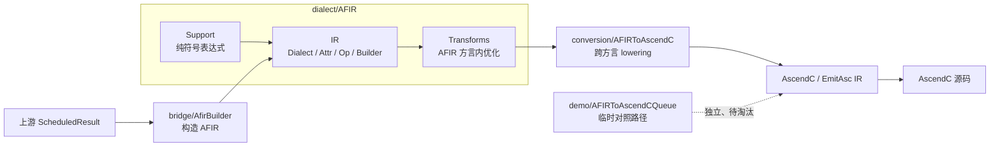
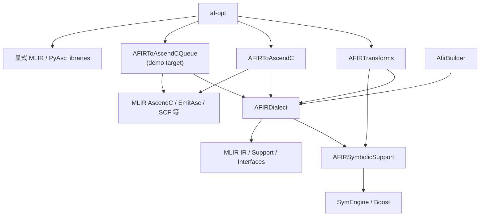
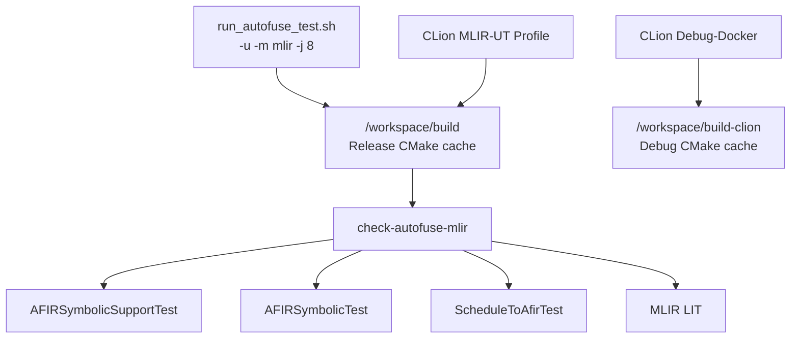

# Autofuse MLIR 架构与构建重构设计

> 状态：已完成
> 日期：2026-08-06
> 现状复核日期：2026-08-06
> 文档类型：架构设计与重构记录

> 代码一致性：`AFIRSymbolicSupport → AFIRDialect → AFIRTransforms`、单一 `AFIRToAscendC` target、
> `AfirBuilder` 不依赖 transforms、Queue demo 隔离、`af-opt` 显式依赖、单一完整 MLIR UT 入口和
> 顶层 `build` 增量复用均已落地；本文已同步当前 `design/development/guides` 文档结构。

# 简介

## 目的

本文记录 `autofuse/mlir` 目录与 CMake 构建方案重构后的架构、模块边界、依赖规则和验证结果，重点说明
为什么 AFIR 的 Support、IR、Transforms、跨方言 Conversion 和 demo 必须分层，以及这些边界如何改善复用、
增量构建、链接、测试和后续 schedule pass 迁移。

目标读者包括 AFIR dialect、Schedule → AFIR bridge、AFIR → AscendC lowering、MLIR 工具链和构建系统的
开发与维护人员。本文是当前目录归属和依赖方向的说明；具体 AFIR → AscendC 完整 pipeline 的后续设计见
[AFIR → AscendC Pass Pipeline 设计](2026-08-05-afir-to-ascendc-pass-pipeline-design.md)。

## 范围

本次设计包含：

- `mlir/dialect/AFIR` 按 `Support`、`IR`、`Transforms` 分层；
- 符号表达式、`SymbolicEvalOp`、IR builder helper 和 symbolic passes 的职责重新归属；
- `mlir/conversion/AFIRToAscendC` 收敛为单一正式 conversion target；
- `AFIRToAscendCQueue` 从正式 conversion 迁到 `mlir/demo`；
- `AfirBuilder` 去除对 transforms library 的错误依赖；
- `af-opt` 改为显式注册 dialect/pass，并只链接实际使用的库；
- MLIR UT 使用单一完整入口并覆盖 Schedule → AFIR bridge；
- CLion MLIR-UT Profile 与命令行测试复用顶层 `build`；
- 静态检查脚本的临时目录和依赖验证边界收敛；
- `mlir/docs` 按 `design`、`development`、`guides` 分类并增加索引。

本次设计不包含：

- 实现尚未完成的通用 AFIR → AscendC conversion patterns；
- 迁移尚未进入 MLIR 的 schedule passes；
- 修改 AFIR textual IR 名称、已有 symbolic pass CLI 或产品对外 API/ABI；
- 修改 SuperKernel、runtime、打包产物或设备端执行逻辑；
- 为未来模块预创建空的 `Schedule`、`Analysis` 或其他目录。

# 总体概述

## 软件概述

### 项目介绍

Autofuse MLIR 路径负责把上游调度结果构造成 AFIR，并逐步转换到 PyAsc 提供的 AscendC/EmitAsc dialect，
最终生成 AscendC 代码。重构前，dialect 定义、符号表达式、symbolic transforms、多个 conversion pass 和 demo
分散在按来源或单个 pass 命名的目录中，CMake target 也过度贴合单文件，导致职责和依赖方向不清晰。

重构后，目录按 MLIR 语义职责组织，而不是按“一个 pass 一个目录、一个 CMake target”组织。正式代码和 demo
分开，纯算法、IR 定义、方言内变换和跨方言 lowering 形成单向依赖。

### 产品环境介绍

- AFIR IR 和 passes 基于项目固定版本的 LLVM/MLIR；
- AFIR → AscendC conversion 和 demo 依赖 PyAsc 的 AscendC/EmitAsc dialect；
- 符号表达式实现复用 Boost 与 SymEngine，但其公开接口不暴露 MLIR 类型；
- `af-opt` 是开发和 LIT 测试工具，不进入默认产品 API；
- 本次不新增 CANN runtime/aclrt/AscendC API 调用，也不改变 run 包或 wheel 内容。

## 软件功能

重构后的架构提供以下能力：

1. 以稳定目录表达 AFIR 模块职责和代码所有权；
2. 以组件级 CMake target 表达真实依赖，而不是为每个 pass 创建 target；
3. 允许不需要 pass manager 的消费者只链接 AFIR IR；
4. 将正式 AFIR → AscendC lowering 与临时 Queue demo 隔离；
5. 让 `af-opt` 只注册并链接实际使用的 dialect 和 passes；
6. 为后续 schedule passes 提供清晰、不过度预设计的落点；
7. 通过文档索引区分长期设计、阶段开发记录和当前使用指南。

## 设计约束

- AFIR dialect core 不得依赖 AscendC、EmitAsc 或正式 conversion；
- IR builder helper 可以依赖 AFIR IR，但不得为了创建 IR 而依赖 pass library；
- AFIR 方言内部优化放入 `AFIR/Transforms`，跨 dialect lowering 放入 `conversion`；
- demo 不得作为正式 conversion 的 fallback 或依赖来源；
- 多个内聚 pass 共享一个组件级 library target，不按 pass 数量拆 target；
- CMake 依赖必须显式且保持无环；直接使用某库 API 的 target 应声明直接依赖；
- `af-opt` 只注册实际需要的 dialect/pass，不通过全局 MLIR library property 引入全集；
- `check-autofuse-mlir` 是唯一完整 MLIR UT 聚合入口，不为首次构建时长增加另一套 fast 入口；
- Debug 与 Release 不得共用 CMake cache；相同 Release 配置可以复用同一构建目录；
- 一次性检查目录使用系统临时目录，仓库内 `.artifacts` 只保存可复用产物和并发锁；
- 构建命令必须限制并行度为 `-j 8`；
- 不预创建没有实现代码的目录或抽象。

## 假设和依赖关系

- AFIR textual IR 名称和已有 pass CLI 在本次重构前已被测试使用；
- `AFIRToAscendCQueue` 仍只用于迁移演示，待正式 pipeline 验收后删除；
- 后续 schedule 模块主要对 AFIR op 做方言内优化，因此初期直接放入 `AFIR/Transforms`；
- 如果未来某类 transforms 文件数量明显增长，可在 `Transforms` 内再按主题分子目录，但继续共享
  `AFIRTransforms` target，除非出现独立复用或依赖隔离需求；
- 命令行 MLIR UT 复用容器内顶层 `/workspace/build`，宿主机对应仓库根目录下 `build`；
- CLion 保留独立 Debug Profile，Release `MLIR-UT` Profile 与命令行使用相同的顶层构建目录；
- 本次记录的链接参数和耗时来自本地 Debug + coverage 构建，只作为相对基线，不承诺跨机器绝对一致。

# 需求分析与设计

## 整体介绍

### 重构后目录架构

```text
mlir/
├── bridge/
│   └── AfirBuilder/                 # 调度 DTO → AFIR IR，只依赖 AFIRDialect
├── dialect/AFIR/
│   ├── Support/                     # 不依赖 MLIR 的符号表达式能力
│   ├── IR/
│   │   ├── Ops/                     # AFIR op 的 .td 与自定义实现
│   │   ├── AFIRDialect.*            # dialect 定义
│   │   ├── AFIRAttrs.td             # attributes
│   │   ├── AFIREnums.td             # enums
│   │   ├── AFIROps.td               # op 聚合入口
│   │   └── SymbolicBuilder.*         # 构造 AFIR symbolic IR 的 helper
│   └── Transforms/
│       ├── Passes.h                 # AFIR 方言内 pass 声明
│       └── Symbolic/                 # symbolic simplify/safety/lowering passes
├── conversion/
│   └── AFIRToAscendC/               # 正式跨方言 lowering，共享一个 target
├── demo/
│   └── AFIRToAscendCQueue/          # 待淘汰的 Queue lowering demo
├── tools/
│   └── af-opt/                      # 显式注册项目所需 dialect/pass
└── docs/
    ├── design/                      # 架构、组件和长期迁移设计
    ├── development/                 # 需求、Bugfix、重构和实施总结
    └── guides/                      # 操作手册和查询资料
```



图中的实线表示正式职责流。Queue demo 保留为临时对照入口，但不属于正式 conversion pipeline，不能被正式
实现依赖或用作静默 fallback。

### CMake 依赖架构

下图箭头表示“消费者依赖提供者”。依赖自上而下收敛到基础层，不允许从基础层反向指向 pass 或 backend。



核心依赖链为：

```text
AFIRSymbolicSupport → AFIRDialect → AFIRTransforms
                           ↑
                       AfirBuilder
```

此处箭头表示“被上层使用”。`AfirBuilder` 与 transforms 是并列消费者；bridge 不再为了调用一个 IR 构造
helper 而依赖整个 transforms library。

### 构建与验证入口



命令行和 CLion 的 `MLIR-UT` Profile 只有在编译器、生成器、Build Type 和 CMake options 一致时才共享
`build`。`Debug-Docker` 保持独立，且 CLion 与命令行不得同时写同一 CMake build directory。

## 功能需求

### 功能需求 1：建立 AFIR 内部分层

1. 介绍

   将纯算法、AFIR IR 定义和 AFIR 方言内 passes 分别归入 `Support`、`IR` 和 `Transforms`。

2. 输入

   重构前分散于 `mlir/symbolic`、`AFIR/Core`、`AFIR/Ops/Basic`、`AFIR/Ops/Adv` 和
   `AFIR/Ops/Symbolic` 的源码与 TableGen 文件。

3. 处理

   按“是否依赖 MLIR、是否定义/构造 IR、是否遍历并改写 IR”判定归属，更新 include 路径和 CMake 依赖，
   保持 IR 名称和 pass 行为不变。

4. 输出

   形成 `AFIRSymbolicSupport`、`AFIRDialect`、`AFIRTransforms` 三个职责明确的 target。

### 功能需求 2：收敛正式 conversion 并隔离 demo

1. 介绍

   将正式 AFIR → AscendC 相关 pass 收敛到一个目录和一个 `AFIRToAscendC` library，将 Queue demo 移到
   `mlir/demo`。

2. 输入

   原先独立的 `AFIRLoopGenerate`、`AFIRTemplateFunctionSignature`、`conversion/Support`、旧最小
   `AFIRToAscendC` 和 `AFIRToAscendCQueue` 目录。

3. 处理

   把 ABI、function signature 和 loop generation 作为同一正式 lowering 组件编译；删除无产品使用者的旧
   最小 lowering pass；保留 Queue demo 的 CLI 供迁移对照，但禁止正式代码依赖它。

4. 输出

   正式目录只有 `conversion/AFIRToAscendC`，当前包含 `AFIRLoopGenerate`、
   `AFIRTemplateFunctionSignature` 和 `AscendCKernelABI`；demo 位于 `demo/AFIRToAscendCQueue`。

### 功能需求 3：精简 af-opt 依赖

1. 介绍

   `af-opt` 显式注册项目实际使用的 dialect、extension 和 passes，显式链接对应 library。

2. 输入

   原先通过全局 `MLIR_DIALECT_LIBS`、`MLIR_CONVERSION_LIBS`、`MLIR_EXTENSION_LIBS` 和
   `MLIRMlirOptMain` 聚合的大范围传递依赖。

3. 处理

   使用 `MLIROptLib`，在 `main.cpp` 中显式插入 dialect 和注册 passes；CMake 只列出实际依赖。

4. 输出

   `af-opt` 功能保持可用，链接参数显著收敛，新增或删除 dialect/pass 时依赖变化可审查。

### 功能需求 4：建立文档信息架构

1. 介绍

   将当前设计、开发规则、参考数据和历史迁移记录分开，并提供统一索引。

2. 输入

   原先平铺在 `mlir/docs` 根目录、`development` 和 `migration` 中的文档。

3. 处理

   架构和长期迁移方案归入 `design`，具体波次记录归入 `development`，日常规则和查询资料归入
   `guides`；同步更新仓库内引用。

4. 输出

   `mlir/docs/README.md` 成为统一入口，不产生内容重复的兼容副本。

### 功能需求 5：收敛开发构建与依赖检查

1. 介绍

   提供一个完整 MLIR UT 入口，并让 IDE 和命令行在配置一致时复用增量构建结果；同时避免静态检查为了
   验证单一依赖而伪造完整 LLVM/MLIR 构建系统。

2. 输入

   原聚合入口遗漏 `ScheduleToAfirTest`；曾讨论增加 `mlir-fast` 入口；PyAsc 检查通过 fake LLVM 进入完整
   AFIR CMake，导致每增加一个 MLIR CMake API 都要扩充 fake；两个检查脚本依赖预先存在的 `.artifacts`。

3. 处理

   将 `check-schedule-to-afir` 纳入 `check-autofuse-mlir`，保持 `-u -m mlir` 单一入口。首次构建完整依赖，
   后续由顶层 `build` 增量复用。PyAsc 脚本只检查 submodule、固定 commit、patch 应用/导出和 CMake
   接入声明；真实 LLVM/PyAsc/AFIR 配置由完整 MLIR UT 验证。一次性目录改用 `${TMPDIR:-/tmp}`，仅仓库级
   并发锁按需创建于 `.artifacts/locks`。

4. 输出

   用户只需记住一条完整 MLIR UT 命令；CLion `MLIR-UT` Profile 可复用同一 build tree；没有 LLVM/MLIR
   时 CMake 直接提示使用开发容器或安装依赖，不再以 fake AFIR 配置代替真实集成验证。

## 架构收益

### 1. 依赖方向与语义职责一致

`SymbolicExpression` 只提供解析、简化和序列化能力，公开头文件不包含 MLIR 类型，因此放在 `Support`。
这样它可以被纯 C++ UT 或其他非 pass 代码直接复用，不会被迫引入 `MLIRPass`、dialect registration 或
transforms 依赖。

`SymbolicEvalOp` 是 AFIR op，其定义、verifier 和自定义实现属于 `IR/Ops`。它不是一个 symbolic pass，
也不应放在独立的“symbolic 子系统”顶层目录中。

`materializeSymbolicExpr` 接收 `OpBuilder`、`ExprAttr` 和 SSA `Value`，最终创建 `afir.symbolic_eval`。它只在
调用点构造一段 AFIR IR，不遍历 operation、不持有 pass 状态、也不注册 CLI，因此是 IR builder helper，
不是 transform。把它放入 `AFIR/IR/SymbolicBuilder.*` 后，`AfirBuilder` 只需链接 `AFIRDialect`；重构前为
调用这个 helper 而链接整个 symbolic transforms library，会额外带入 `MLIRPass`、Arith/Index/Math dialect
和通用 transforms，依赖层级与实际用途不符。

### 2. 方言内优化和跨方言 lowering 边界清晰

`AFIR/Transforms` 容纳主要输入和输出仍属于 AFIR 语义域的优化、规范化与校验。当前先按 Symbolic 子主题
归档；后续 schedule 模块迁移后，只要 pass 主要针对 AFIR op 做优化，就先平铺到 `AFIR/Transforms`。
文件明显增多时再按主题拆目录，不提前创建空 `Schedule` 或 `Analysis`。

`conversion/AFIRToAscendC` 容纳依赖 AscendC/EmitAsc 的 ABI 准备、循环实体化和跨 dialect lowering。
这保证 `AFIRDialect` 不反向依赖 backend，也让未来其他 backend 可以复用 AFIR IR 和 transforms。

### 3. CMake target 表达组件，而不是文件数量

一个 pass 通常只是同一 pipeline 的一个实现单元，并不天然需要独立 library。按 pass 拆 target 会增加
CMake 配置、include/link 声明和静态库参数，还容易让公共 helper 被放进一个含义模糊的 `Support` target。

重构后：

- 多个 AFIR 方言内 pass 统一编入 `AFIRTransforms`；
- 多个 AFIR → AscendC pass 统一编入 `AFIRToAscendC`；
- 每个 `.cpp` 仍由构建系统独立增量编译，修改一个 pass 不会重新编译同 target 内所有未受影响的 `.cpp`；
- library 归档更新后，最终消费者仍可能需要重链接。目标合并减少的是 target 和链接图复杂度，并不承诺
  “修改 pass 后永远不用链接”。

只有当某组 pass 出现独立消费者、不同依赖集合、不同交付边界或明显的并行构建收益时，才应再拆 target。

### 4. bridge 成为后端中立的 IR 构造层

`AfirBuilder` 的任务是把中立 schedule DTO 构造成合法 AFIR module。它需要 AFIR op、attribute 和 builder
helper，但不负责运行 symbolic transforms，也不应知道 AscendC lowering。移除 `AfirBuilder →
AFIRTransforms` 后，bridge 的链接闭包更小，职责更容易单测，也避免未来 transforms 新增 dialect 依赖时
无意扩大 codegen bridge 的依赖。

### 5. 正式实现和 demo 生命周期可见

`AFIRToAscendCQueue` 名称和实现都带有特定 demo 假设。把它放在 `conversion` 会让维护者误以为它是正式
lowering 的组成部分，并可能继续在 demo 上叠加产品功能。迁到 `demo` 后，正式 pipeline 只能在
`conversion/AFIRToAscendC` 演进；demo 保留对照价值，但其待删除状态在目录和 CMake 中都明确可见。

### 6. af-opt 依赖可审查、可裁剪

全局聚合 MLIR dialect/conversion libraries 会把“当前构建图中存在的库”误当成“af-opt 实际使用的库”，
导致任意新 subdirectory 都可能悄悄扩大链接闭包。显式 registry 与显式 library list 让工具能力和构建依赖
一一对应，减少偶然传递依赖；缺少注册或链接时会在开发阶段直接暴露，而不是依赖其他库碰巧带入符号。

### 7. 测试边界更自然

纯符号表达式通过 `AFIRSymbolicSupportTest` 验证，不需要创建 MLIRContext；IR materializer 和 symbolic
passes 通过 `AFIRSymbolicTest` 验证；Schedule bridge 通过 `ScheduleToAfirTest` 验证；conversion 和 demo 可以
分别建立 LIT/UT。所有已实现的 MLIR UT 由 `check-autofuse-mlir` 聚合，避免“入口成功但 bridge 未执行”。
失败也能更快定位到纯算法、IR 构造、bridge、方言内变换或 backend lowering。

### 8. 文档的有效期更容易判断

`design` 描述当前或目标架构，`development` 记录具体波次，`guides` 提供当前操作和查询入口。维护者不再
需要从文件日期猜测一份文档是长期设计还是阶段记录，也避免为少量资料继续增加目录类别。

### 9. 构建与检查成本符合真实边界

完整 UT 首次构建包含 Schedule bridge 所需的 legacy Autofuse 依赖，耗时会更长，但后续修改只会触发 CMake
增量编译。为节省第一次等待时间再维护 `mlir-fast` 会增加入口选择、CI 覆盖和“究竟测了什么”的理解成本，
收益有限，因此不采用。

PyAsc 管理脚本不需要 AFIR Dialect。此前进入 AFIR 只是因为 fake wrapper 对整个 `mlir/CMakeLists.txt` 执行
`add_subdirectory` 的副作用，并非 PyAsc 元数据检查的语义依赖。重构后静态检查只验证管理契约，真实编译
使用真实 LLVM/MLIR；缺失依赖时给出明确安装/路径提示。临时 worktree 先通过 `git worktree remove` 注销，
再删除系统临时目录，避免留下 prunable 元数据。

## 非功能需求

### 可维护性

- 目录名表达职责，文件名保留 AFIR 缩写的一致大写形式；
- CMake target 与组件边界一致，避免单 pass target 和无明确语义的通用 Support target；
- pass 声明统一从 `AFIR/Transforms/Passes.h` 或 conversion 组件头文件暴露；
- 新代码按职责判定表归档：

| 代码性质 | 归属 |
|---|---|
| 不依赖 MLIR 的 AFIR 领域算法/数据结构 | `dialect/AFIR/Support` |
| dialect、type、attr、op、verifier、IR builder helper | `dialect/AFIR/IR` |
| 主要针对 AFIR op 的方言内优化/校验 | `dialect/AFIR/Transforms` |
| AFIR 与其他 dialect 之间的 lowering | `conversion/<Source>To<Target>` |
| 临时演示、迁移对照路径 | `demo` |
| CLI/开发工具入口 | `tools` |

### 可测试性

各层具有独立 target 和测试入口。`af-opt` 显式注册使单 pass CLI/LIT 的可用性可直接检查；纯 Support 层
测试不依赖 MLIR 初始化。对开发者只暴露 `check-autofuse-mlir` 完整入口，由 CMake 内部聚合 Support、
IR/Transforms、Schedule bridge 和 LIT，避免调用者维护测试清单。

### 可移植性

本次不新增芯片、操作系统、编译器或 CANN 版本分支。只有 conversion/demo 依赖 PyAsc AscendC/EmitAsc；
AFIR Support/IR/Transforms 保持 backend 依赖隔离。

### 可靠性

本次只调整源码归属、构建依赖和文档路径，不改变 IR 改写算法、运行时资源或并发模型。显式依赖减少因
链接顺序和偶然传递依赖造成的构建不稳定。

### 特性交叉影响

| 场景 | 适用性 | 分析说明 |
|---|---|---|
| SuperKernel Python 接口 | 不适用 | 不修改 Python 包、选项解析、pytest 或 wheel |
| SuperKernel C++/AOT 接口 | 不适用 | 不修改 `libascendsk.so`、AOT、设备端 RDV 或 ABI/API |
| Autofuse 图优化 | 适用 | Schedule → AFIR bridge 依赖边界收敛；不修改 ASCIR 图、融合 pass、数据边或控制边 |
| Autofuse Codegen/Backend | 适用 | 重组 AFIR 构造和 lowering targets；生成 IR/代码语义保持不变 |
| AscendC API / Runtime 交互 | 不适用 | 不新增或修改 runtime/aclrt/设备端 AscendC API 调用 |
| Python/C++ 混合绑定 | 不适用 | 不修改 pyautofuse、CPython 引用计数、导入路径或异常传播 |
| 构建与打包 | 适用 | 调整 CMake targets 和 `af-opt` 链接；不修改 install/package 或默认 run 包 |
| 测试与覆盖率 | 适用 | 完整入口聚合 Support、IR/Transforms、Schedule bridge 和 LIT；不新增 ST/RDV |
| 性能与日志 | 适用 | 改善 CMake/link 闭包并复用增量构建；不修改运行时执行和日志 |
| 兼容性 | 适用 | 内部 include/target 路径变化；保留 `-u -m mlir`，不增加 `mlir-fast` |

## 性能

### 编译时长

正式 conversion 从多个独立 target 收敛为 `AFIRToAscendC`，减少 CMake target、重复 link interface 和
静态库参数。`af-opt` 去除 `MLIRMlirOptMain` 与全局 MLIR library 聚合后，本地 Debug + coverage 构建中：

| 指标 | 重构前 | 重构后 | 说明 |
|---|---:|---:|---|
| MLIR 静态库参数数量 | 约 291 | 71（61 个唯一库） | 反映链接闭包收敛 |
| `link.txt` 大小 | 约 14 KB | 约 3.7 KB | 反映链接命令复杂度下降 |
| `af-opt` 重链接观测 | 361.61 s | 188.82–221.20 s | Debug + coverage，非跨机器 benchmark |

剩余链接时间主要来自 LLVM/MLIR 大量静态 archive、Debug 信息和 coverage 插桩；项目已经使用 `lld`，因此
后续优化应优先减少实际链接闭包或调整开发构建配置，而不是继续为每个 pass 拆小 target。

增量构建语义保持标准 CMake 行为：修改单个 `.cpp` 只重编受影响 object，再更新所属 archive；若验证
`AFIRTransforms` target，可在 library 构建成功后停止。若要验证 `af-opt` 可执行文件、pass 注册或最终符号
闭包，则仍必须完成一次链接。

完整 `check-autofuse-mlir` 首次构建还会编译 `ScheduleToAfirTest` 依赖的 legacy Autofuse libraries，因此
比只跑 symbolic/LIT 更慢。此成本只在首次构建或依赖失效时发生；命令行脚本和 CLion `MLIR-UT` Profile
共用 `/workspace/build` 后，后续验证复用已有 object/library。Debug Profile 使用独立目录，避免因
Build Type 切换导致大范围重编。

### 执行性能

目录和 target 重构不改变 pass 算法、生成的 AscendC IR、kernel launch、DataCopy、Queue 或设备端计算，
因此无运行时性能影响。没有新增默认日志。

### 内存和产物大小

不新增运行时缓存、常驻对象或交付动态库。`af-opt` 的链接输入减少，但本次未把其二进制大小作为验收指标。
文档移动不改变包内容；自动生成的 tracker/node_modules、`.artifacts` 等本地产物继续由 `.gitignore` 排除。
静态检查的一次性目录位于 `${TMPDIR:-/tmp}` 并在退出时清理，不增加仓库常驻产物。

## 接口设计

### 新增/修改接口描述

本次不新增产品对外接口。内部源码和 CMake 接口变化如下：

| 原接口/路径 | 新接口/路径 | 兼容说明 |
|---|---|---|
| `AFIR/AFIR.h` | `AFIR/IR/AFIR.h` | 仓内 include 已更新 |
| `symbolic/Core/Expression.h` | `AFIR/Support/SymbolicExpression.h` | 类型名收敛为 `Expression`，不暴露 MLIR 依赖 |
| `symbolic/AFIRSymbolic.h` | `AFIR/Transforms/Passes.h` | pass 声明按 transforms 归属 |
| symbolic materializer 位于 transforms library | `AFIR/IR/SymbolicBuilder.h` | helper 随 `AFIRDialect` 提供 |
| `AFIRSymbolicCore` | `AFIRSymbolicSupport` | 内部 CMake target 重命名 |
| `AFIRSymbolic` | `AFIRTransforms` | 内部 CMake target 重命名 |
| 多个 conversion pass targets | `AFIRToAscendC` | 组件级 target |
| `conversion/AFIRToAscendCQueue` | `demo/AFIRToAscendCQueue` | CLI 暂时保留，明确待淘汰 |

已有 symbolic pass CLI 和 AFIR operation textual name 不变。无产品使用者的旧最小 AFIRToAscendC demo pass
已删除，不作为兼容接口；完整正式 pipeline 将使用独立设计中定义的新入口。

### 接口检查项

| 检查项 | 子检查项 | 是否涉及 | 说明 |
|---|---|---|---|
| 接口说明 | 是否需要接口评审 | 是 | 需评审内部目录和 target 边界 |
| 接口说明 | 是否需要补充文档 | 是 | 本文和 `docs/README.md` 已补充 |
| 接口兼容 | 行为是否兼容 | 是 | IR 与保留 pass 行为不变，旧无使用者 demo pass 删除 |
| 接口兼容 | ABI/API 是否兼容 | 是 | 不修改对外 SO、Python、脚本或配置 ABI/API |
| 接口约束 | 约束不满足时是否清晰报错 | 不适用 | 本次不新增运行时/用户输入接口 |
| 接口测试 | 是否需要独立接口用例 | 是 | 构建 target、CLI 注册和现有 LIT/UT 覆盖 |

## 软件设计

### 关键数据结构

- `Expression`：PImpl 封装的纯 C++ 符号表达式，生命周期由 `shared_ptr<const Impl>` 管理；
- `ExprAttr`、`SymbolicEvalOp`：MLIRContext 管理的 AFIR IR 实体，属于 `AFIRDialect`；
- `SymbolBindingMap`：IR materializer 的稳定绑定表，使用 `MapVector` 保持插入顺序；
- Pass 实例仍由 MLIR pass manager 管理，本次不新增全局或静态可变状态。

### 关键技术/算法

本次没有新增计算算法。核心技术决策是依据依赖最小闭包进行分层：

1. 公开 API 不含 MLIR 类型的领域算法下沉到 Support；
2. 定义或直接创建 AFIR operation 的代码归入 IR；
3. 需要 pass manager 遍历/改写 IR 的代码归入 Transforms；
4. 引入目标 dialect 合法化的代码归入 Conversion；
5. CMake target 以独立复用、依赖集合和交付边界为拆分依据。

### 流程设计

当前主流程为：

```text
ScheduledResult
  → ScheduleToAfir / AfirBuilder
  → AFIR module
  → AFIRTransforms（按需执行 symbolic 及后续 schedule 优化）
  → AFIRToAscendC（当前提供 ABI/signature/loop 基础，完整 pipeline 继续实现）
  → AscendC / EmitAsc IR
  → translator / AscendC source
```

异常处理仍由各 builder/pass 的 `FailureOr`、`LogicalResult`、MLIR diagnostic 和 `signalPassFailure()` 负责。
本次不增加 fallback；正式 conversion 失败时不得自动切换到 Queue demo。

### 对子模块的修改

| 子模块 | 修改点 |
|---|---|
| `mlir/dialect/AFIR/Support` | 接收原纯符号表达式实现，形成 `AFIRSymbolicSupport` |
| `mlir/dialect/AFIR/IR` | 接收 dialect/attrs/enums/ops/verifier 和 `SymbolicBuilder`，形成 `AFIRDialect` |
| `mlir/dialect/AFIR/Transforms` | 接收 symbolic passes，形成 `AFIRTransforms` |
| `mlir/bridge/AfirBuilder` | 去除 `AFIRTransforms` 依赖，只消费 AFIR IR/builder API |
| `mlir/conversion/AFIRToAscendC` | 合并 ABI、signature、loop generation，删除旧无使用者最小 pass |
| `mlir/demo/AFIRToAscendCQueue` | 承接并标记临时 Queue demo |
| `mlir/tools/af-opt` | 使用 `MLIROptLib`，显式注册/链接所需 dialect 和 passes |
| `mlir/test` | 测试路径随新分层更新，完整入口纳入 `check-schedule-to-afir` |
| `mlir/scripts` | PyAsc 检查移除 fake AFIR 配置；一次性目录使用系统临时目录并正确注销 worktree |
| `scripts/test/run_autofuse_test.sh` | 保持 `-u -m mlir` 单一入口并复用顶层 `build` 增量构建目录 |
| `mlir/docker` | 增加 CLion `MLIR-UT` Profile，配置与命令行 UT 对齐 |
| `mlir/docs` | 新增索引并按 design/development/guides 分类 |

### 错误处理

#### 系统错误

检查脚本通过 `mktemp` 创建一次性目录并由 `trap` 清理；临时 PyAsc worktree 必须先执行
`git worktree remove --force`，再删除其父目录。仓库级 LLVM 默认路径检查使用 `.artifacts/locks` 串行化，
锁目录由脚本按需创建并在退出时移除。CMake 配置、TableGen、编译或链接失败直接报告，不隐藏缺失依赖。

#### 接口错误

不新增用户可见错误码。缺失 LLVM/MLIR 时，CMake 提示使用 Autofuse MLIR 开发容器或安装 LLVM/MLIR，
并说明 `LLVM_BUILD_DIR` 配置方式；缺失 PyAsc 时提示执行同步脚本。内部 include/target 缺失
在编译或链接阶段失败；pass 输入错误仍由原有 MLIR diagnostic 报告。

## 安全检查

- 未新增密码、Token、账号、公网地址、邮箱或真实凭据；
- 未新增外部输入、数组索引、内存长度、shape/tiling 算术、除法或内存申请；
- 未新增资源生命周期、异步 runtime、aclrt 或 AscendC API 调用；
- 未改变图节点、数据边、控制边或 pass 改写顺序，不涉及图改写等价性变化；
- 未新增依赖无序容器或指针地址的 IR 生成顺序；
- 未新增高频日志；
- 未修改动态库导出、Python/C++ ABI 或跨 SO 静态析构行为；
- 临时 worktree 的正常和异常退出路径均显式注销并清理；
- 构建仍支持增量模式，且所有验证命令限制 `-j 8`。

结论：本次重构未触碰编码红线。

## 兼容性检查

- AFIR dialect 名称、operation/attribute textual name 和保留 pass CLI 不变；
- 仓内 C++ include 和 CMake target 名称已迁移，不提供旧内部 target 的兼容别名，避免长期双轨；
- 无产品使用者的旧最小 lowering pass 及其专属测试已删除；
- Queue demo CLI 暂时保留，正式 pipeline 验收后再删除；
- 不修改 SuperKernel、pyautofuse、run 包、wheel、安装路径或既有 `-u -m mlir` 脚本接口；
- 不新增 `mlir-fast` 模块名；完整入口首次构建范围扩大，属于测试覆盖修正；
- `ENABLE_AUTOFUSE_MLIR=OFF` 和 `--no-autofuse` 路径不因新 MLIR target 增加依赖；
- 文档移动后的仓库内引用已同步；长期迁移设计归入 `design`，阶段实施记录归入 `development`。

## 测试设计

### 测试边界

- 构建：验证 `AFIRTransforms` 和 `af-opt` target 的完整编译/链接闭包；
- Support UT：验证纯表达式 parse/simplify/serialize/error；
- IR/Transforms UT：验证 symbolic materializer 和 passes；
- Bridge UT：验证 Schedule DTO 到 AFIR 的构造；
- LIT：验证 AFIR parse/print、verifier、symbolic pass CLI 和 conversion 基础；
- 依赖脚本：验证 LLVM 路径解析、PyAsc submodule/patch 工作流和临时资源清理；
- 静态检查：验证旧源码/CMake 路径消失、文档引用有效、diff 无空白错误。

### 测试用例设计

| 测试类别 | 关键测试项 | 测试方法 | 用例类型 |
|---|---|---|---|
| 功能 | 新 targets 可构建、`af-opt` 可执行、bridge 被完整入口覆盖 | 定向构建 + CLI/LIT | UT/LIT |
| 异常 | 符号表达式非法输入、未绑定 symbol、pass 安全校验 | gtest + diagnostic check | UT/LIT |
| 性能 | `af-opt` 链接参数、命令大小和重链接耗时 | `link.txt`/time 对比 | 手工验证 |
| 兼容性 | AFIR textual IR 和保留 CLI 不变 | 现有 LIT | LIT |
| 特性交叉 | Schedule bridge → AFIR → symbolic transforms | 聚合 bridge/symbolic 测试 | UT |

### 测试命令

```bash
AF_CANN_VOLUME=cann-volume \
bash autofuse/mlir/scripts/enter_dev_container.sh -- \
bash scripts/test/run_autofuse_test.sh -u -m mlir -j 8

bash autofuse/mlir/scripts/check_llvm_dependency_resolution.sh
bash autofuse/mlir/scripts/check_pyasc_integration.sh
```

完成一次配置后，也可在容器或 CLion `MLIR-UT` Profile 中复用同一构建树：

```bash
cmake --build /workspace/build --target AFIRTransforms -j 8
cmake --build /workspace/build --target af-opt -j 8
cmake --build /workspace/build --target check-autofuse-mlir -j 8
```

本次重构已完成的验证结果：

- `AFIRTransforms` 构建成功；
- `af-opt` 构建和链接成功；
- `AFIRSymbolicSupportTest`：16/16 通过；
- `AFIRSymbolicTest`：5/5 通过；
- `ScheduleToAfirTest`：2/2 通过，并已纳入 `check-autofuse-mlir` 聚合依赖；
- MLIR LIT：19/19 通过；
- symbolic pass CLI 均可用；
- `git diff HEAD --check` 通过；
- 旧源码/CMake 路径检查通过；
- 仅 Queue demo 保留既有 `DenseMap` 初始化 warning，无本次新增 warning。

本轮在同一顶层 `build` 中完成 CMake 重新配置和增量构建，完整聚合入口、三个 GTest 组和 LIT 均已验证。

## 验收标准

- `AFIR` 形成 `Support`、`IR`、`Transforms` 三层，依赖保持单向无环；
- `materializeSymbolicExpr` 随 `AFIRDialect` 提供，`AfirBuilder` 不依赖 `AFIRTransforms`；
- 正式 AFIR → AscendC 代码只有一个 `AFIRToAscendC` target，不按 pass 拆 target；
- Queue demo 位于 `mlir/demo`，正式 conversion 不依赖或 fallback 到 demo；
- `af-opt` 不链接 `MLIRMlirOptMain`，不使用全局 MLIR library 聚合；
- `check-autofuse-mlir` 聚合 Support、IR/Transforms、Schedule bridge 和 LIT，不维护 `mlir-fast` 分支入口；
- CLion `MLIR-UT` 与命令行 UT 可安全复用顶层 `build`，Debug Profile 保持独立；
- PyAsc 静态检查不进入 AFIR Dialect，真实集成由完整 MLIR 构建验证；
- 一次性检查目录无需仓库预创建，临时 worktree 不遗留 Git 元数据；
- 新目录下构建、完整 UT、LIT 和 pass CLI 验证通过；
- AFIR textual IR、保留 CLI 和产品 API/ABI 不变；
- `mlir/docs/README.md` 可从统一入口访问设计、开发记录和指南；
- 仓库内不存在指向本次移动前文档路径的有效引用；
- 无无关源码重构、无临时构建/测试产物进入版本库。

### 设计文档检查结果

- [x] 跨特性交叉影响：已按 `cross_feature_check.md` 检查 SuperKernel、Autofuse optimize/codegen、
  AscendC/runtime、Python/C++ 接口、构建打包、测试和兼容场景。
- [x] 编码红线：已检查敏感信息、外部输入、资源生命周期、ABI/API、图改写确定性、runtime/AscendC
  约束和增量构建要求，无违反。
- [x] 测试设计：已覆盖 Support UT、IR/Transforms UT、Schedule bridge UT、MLIR LIT、target 构建、CLI 注册、
  依赖脚本和静态路径检查。
- [x] 性能评估：已记录 CMake target 收敛、`af-opt` 链接闭包、首次完整构建成本、顶层 `build` 增量复用
  以及对运行时无影响的结论。
