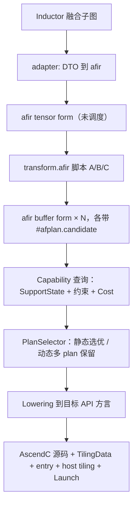

# AFIR DSL 架构重构设计

| | |
|---|---|
| **日期** | 2026-09-09 |
| **状态** | 实施中。本期范围内已全部落地；剩余四项（退出 `TQue` / Op 补齐 / Schedule 迁移 / ATT 迁移）与性能基线见 5.7 |
| **替代** | `2026-09-06-afir-ascendnpu-kernel-dsl-capability-design.md` |

---

## 摘要

**目标**：把 AFIR 从"融合调度结果的内部承载格式"重构为**可对外公开的昇腾底层完备性 Kernel DSL**。

**现状**：AFIR 当前的问题不是"Op 覆盖率低"，而是 **值的属性被编码成了 Op 的属性。**

这导致 IR 无法复用 MLIR 既有机制、无法承受改写、也无法安全地对外公开。**在错误的编码地基上继续补 Op，只会放大成本**。

**目标架构**——四层命名空间，公开面与内部面物理隔离：

| 层 | 命名空间 | 一句话职责 | 形态 | 对外 |
|---|---|---|---|---|
| Payload IR | `afir` | 这个 kernel **是什么** | 方言（Op + Type + Attr） | **公开稳定** |
| 调度变换 | `transform.afir.*` | **怎么**得到它 | transform dialect extension | **公开** |
| 候选身份与选择 | `afplan` | 这是**哪个**候选、凭什么选它 | **仅属性，无 Op** | 内部 |
| 迁移与溯源 | adapter 命名空间 | 从哪来、尚未建模的字段 | 仅属性 | 内部，带删除条件 |

**本期做**：命名空间分工、值属性归位 Type、资源 SSA 化、属性系统收敛、Schedule 迁移为 transform、P0 语义补全、完备性判据可执行化。（Capability 的 cost 接口原列入本期，已改为随 ATT 模块迁移一并处理，见 3.5。）

**本期不做**：ATT 内部结构迁移、符号系统合一、P1/P2 语义 family、对外开源运营方案、逐 Op 的 ODS 与 conversion pattern 实现细节。

---

# 1 分析

## 1.1 背景介绍

当前处于旧 Codegen 模块迁移阶段，需要复用旧 Schedule 模块。而计算优化和 Buffer分配是 Schedule 模块完成的，即当前 AFIR 主要承担代码生成能力。所以当前 AFIR 的输入是已经完成 Buffer分配优化的计算图。

## 1.2 问题分析

这样就引入了一个信息的编码方式问题。在 MLIR 中，一个 SSA 值的固有属性（地址空间、布局、shape/stride）的标准结构是 **Type**。AFIR 却把它们做成挂在 Op 上、按下标对齐的 `ArrayAttr`：

- 每个 Op 挂 6 个 descriptor 数组：`{operand, result, destination} × {tensor, buffer}`；
- func 上再挂 2 个（`arg_descs` / `arg_buffer_descs`）加一个 `afir.num_inputs`；
- 同一个 SSA 值的 space / role / stride 在**每个使用点各存一份**，需要运行时交叉校验一致性；
- 而 `memref` 自带的 memory space 与 layout 扩展点**完全没有被使用**。

| 统计项 | 数据 |
|---|---|
| `afir.` 前缀属性名常量 | **61 个**（`AFIRAttributes.h`，字符串常量共 75 个） |
| 与 `BufferDescAttr` 字段重复编码的扁平属性 | **至少 6 组** |
| 直接耦合 descriptor 编码的文件 | **24 个**（18 非测试：6 个方言定义 + 12 个消费端） |
| tensor/buffer 形态互斥导致的死字段 | **恒为 6 个数组中的一半** |
| `MemRefType::get()` 携带的 space / layout | **无**（`bridge/AfirBuilder/AfirBuilder.cpp:98`） |

三处代码最能说明代价：

1. **`AFIRVerifierUtils.cpp:98`（`getCanonicalTargetRole`）**——role 被存了两份（`destination_descs` 与 `result_descs`），于是需要一段代码检查两份是否一致。**Type 方案下这种不一致在结构上不可能发生**，该校验根本不必存在。

2. **`AFIRVerifierUtils.cpp`（`regularOperandCount = getNumOperands() - destinationCount`）**——靠位置算术把 operand 切成两段，再按下标索引三个数组。**RAUW / canonicalize / DCE / fold 没有一个会维护这些数组**，每次改写都得手工重切。`AFIR_RejectUnknownAttributes` 之所以存在，本质就是这套设计承受不了属性漂移，只能把字典锁死。

3. **`MemoryAllocate/CanonicalBindings.cpp`**——必须维护 `CanonicalValueInfo` / `CanonicalBindings` 侧表，把 value 反查回 descriptor。**这套侧表正是 Type 本可以免费提供的东西。**

## 1.3 问题清单

代码位置以 `reorg/mlir-inductor-launch-pipeline` 为准，路径相对 `autofuse/mlir/`（ATT 相关相对 `autofuse/`）。

### 1.3.1 架构问题

| # | 问题 | 位置 | 影响 |
|---|---|---|---|
| A1 | **值的属性被编码成 Op 的属性**（根因） | `dialect/AFIR/IR/AFIROpBase.td:41-56` | 无法复用 MLIR 机制；无法承受改写；D1–D3 均由此派生 |
| A2 | 公开面与内部面未分离 | 全方言 | 对外公开会把 autofuse 内部结构冻进公共 IR |
| A3 | Schedule 无 IR 表示，调度决策以属性形式空降 | `optimize/autoschedule` ↔ `bridge/ScheduleToAfir` | 调度过程不可见、不可重放、不可单独回归 |
| A4 | 成本模型在 AFIR 之外且只认 AscendC | `att/gen_model_info/api_perf_register/`、`bridge/PlanSelector` | **PTO-ISA 后端接入后 plan 选优将静默出错**；**本期不缓解**，随 ATT 迁移处理（见 3.5） |
| A5 | ATT 自带硬件模型，绕过 TargetProfile | `att/base/arch_param.h` | 两套事实源，精度差一个数量级；触碰红线 Graph-2 |
| A6 | AFIR Core 通过字符串比较依赖后端方言 | `dialect/AFIR/IR/AFIROpBase.td:33` | 违反"Core 不绑定后端"地基原则；触碰红线 Graph-2 |

### 1.3.2 设计问题

| # | 问题 | 位置 | 影响 |
|---|---|---|---|
| D1 | 每 Op 6 个并行 desc 数组，func 上再 2 个 + `num_inputs` | `AFIROpBase.td:41-56`、`AFIRVerifierUtils.cpp` | 两形态互斥，恒有半数为死字段 |
| D2 | 同一事实多份拷贝，需运行时交叉校验 | `AFIRVerifierUtils.cpp:98` | 无单一事实源 |
| D3 | 下标耦合，MLIR 改写机制不维护 | `AFIRVerifierUtils.cpp` 位置算术 | 每次改写需手工重切 |
| D4 | 三套并行编码：结构化 Attr / 扁平字符串键 / 嵌套字典 | `AFIRAttributes.h` | 见 I2、I3 |
| D5 | 用 IR 属性记录 pass 执行状态 | `afir.loop_generated` / `memory_allocated` / `ascendc_materialized` / `pipeline_synchronized` | IR 不自描述；pass 不可组合 |
| D6 | 重造 MLIR 既有机制 | `afir.arg_descs` / `arg_buffer_descs` / `num_inputs` | `arg_attrs` / `res_attrs` 由 MLIR 自动维护 |
| D7 | 两套符号系统 | ATT `af::Expression` ↔ AFIR `afir::Expression` | 同一 SymEngine 后端，两个 wrapper + 字符串往返，元信息易丢 |
| D8 | `memref` 的 memory space 与 layout 完全未使用 | `bridge/AfirBuilder/AfirBuilder.cpp:98` | 迫使 `MemoryAllocate` 维护 value→desc 侧表 |

### 1.3.3 实现问题

| # | 问题 | 位置 | 处置 |
|---|---|---|---|
| I1 | `ir_attr_def` 声明于全部 54 个 Op，**零读零写** | `AFIROpBase.td:47` | 移出 Core 至 adapter（3.7），**不删除**（Schedule 迁移将使用） |
| I2 | `afir.buf_id` 与 `afir.buffer_id` 两个 buffer id 属性 | `AFIRAttributes.h:36-37` | 合一 |
| I3 | 6 组扁平属性与 `BufferDescAttr` 重复；轴相关 6 个与 `AxisAttr` 重复 | `AFIRAttributes.h` | 合一（buffer 组 + `axis_desc` 走步 2；轴相关其余 5 个走步 3b，见 5.1） |
| I4 | AscendC memory space 使用魔数（LIT 中可见 `memref<16xf16, 22 : i32>`） | `AscendCKernelABI.cpp:88` | 收为单点映射；AFIR 侧全程用 `#afir.space` |
| I5 | 54 个 Op 中 **53 个**缺 ODS `summary` / `description` | `dialect/AFIR/IR/Ops/*.td` | 对外公开档位（`stable` / `experimental`）强制补齐，门禁见 2.5 |
| I6 | `afir.is_inductor`：框架类型判断**被真实写入 IR**（唯一写入点，无读取点） | `AFIRAttributes.h:77`、`bridge/AfirBuilder/AfirBuilder.cpp:1088` | **目标是彻底删除该参数**，不止移出 IR；触碰红线 Graph-2，见 3.7 |
| I7 | descriptor 编码**无等价性 / round-trip 测试** | `test/` | 迁移前置硬门槛（5.3） |

---

# 2 目标架构

## 2.1 定位

**本文给出的回答**：AFIR 提供的是 **kernel 语义层 + 可编程调度接口 + 目标能力映射框架**这一整体。三者构成一条通用算子 IR 不提供的横向能力：同一份 kernel 语义，通过可编程的调度脚本产生多个候选，再由能力与成本评估决策落到哪个后端的哪条实现。

## 2.2 四层命名空间

见摘要中的分层表。依赖方向单向：

```
afir            ← 不知道 transform.afir 存在
transform.afir  → 依赖 afir
afplan          → 挂在 afir 的 func 上，但不被 afir 语义依赖
adapter         → 依赖以上三者，反之不成立
```

## 2.3 定义与归属判据

> **定义**　`afir`用于描述单个候选长什么样，`afplan` 是**调度阶段（迁移后即 `transform.afir.*`）产出的内部属性**，描述"**这是哪个候选、凭什么选它、运行时如何在候选间分派**"。

定义给出"是什么"，但四层划分要站得住，还需要一条能独立判断"某条信息该放哪层"的规则——否则 `afplan` 会逐渐吸收所有不好归类的字段，退化成又一个属性字典。

**判别**　当候选集中只有一个候选，这条信息还影响生成的 kernel 代码吗？

- **是** → `afir`。例：`tiling_key` 仍决定 TilingData 结构与 entry 分派。
- **否**，只影响候选之间的区分与分派 → `afplan`。例：`plan_id`、`score_func`、`template_counts_per_stage`。

判别不能只看来源。`transform.afir.*` 会**同时**产出 kernel 本体（循环 / buffer / space / layout → `afir`）和候选元数据（→ `afplan`）；"由调度产出"是 `afplan` 的真实属性，但不足以把这两类分开。

**验证**　看这条信息在编译流程中的**最后一个使用者**：

| 最后的使用者 | 归属 |
|---|---|
| lowering / verifier / 后端代码生成，且影响生成的 kernel 或其 ABI | **`afir`**（公开） |
| PlanSelector，或 entry / tiling 生成器中负责候选分派的部分 | **`afplan`** |
| transform 解释器（调度阶段结束即消失） | **`transform.afir`** |
| 只有 bridge 在构造 AFIR 时读，或当前无任何读点 | **adapter** |

这一步可以直接 grep。下表是当前代码中的实际读取点（路径相对 `autofuse/mlir/`）：

| 信息 | 当前读取点 | 归属 |
|---|---|---|
| `tiling_key` | `GenKernelEntry.cpp:99,103` —— 进入 kernel entry 分派与 TilingData | `afir` |
| `plan_id` / `subgraph_id` | `PlanMetadata.cpp:27`（`readPlanMetadata`），经 `TilingProgramSpec.cpp:47`、`GenAggregateKernelEntry.cpp:98-99` 消费 | `afplan` |
| `stage_id` / `template_id` | `GenTilingData.cpp:235,278` | `afplan` |
| `template_counts_per_stage` | `GenKernelEntry.cpp:283` | `afplan` |
| `score_func` | **无读点**（仅在 `AFIRDialect.cpp:89` 的已知属性表登记） | `afplan`，见下 |
| `shape_guards` / `shape_asserts` | **无读点** | 待确认，见下 |
| `frontend_shape_vars` | `TilingProgramSpec.cpp:105` —— host tiling 函数的 shape 参数列表 | `afir` |
| `is_inductor` | **无读点** | adapter |
| `ir_attr_def` | **无读点** | adapter（3.7） |

> 上表是**迁移前**的读取点普查，行号对应步 7 落地之前的代码。归属结论未变，编码已按 5.1 步 7 落到 `#afplan.candidate` / `#afplan.variant` / `#afplan.stages`；普查当时漏掉的 `stage_count`（值恒等于 `template_counts_per_stage` 的长度、零读点）在实施阶段被发现并删除。

`tiling_key` 是最容易归错的一项：它看起来像「选了哪个 tiling」的编号，但把候选固定为一个之后它**仍然**决定 TilingData 结构与 entry 分派（`GenKernelEntry.cpp:99,103`），因此归 `afir`。判别与验证在这一项上结论一致，不需要作为例外处理。

### 三个只写不读的属性

`score_func`、`shape_guards` / `shape_asserts`、`is_inductor` 目前**只有写入点、无读取点**。逐属性对应：

| 属性 | 写入点 |
|---|---|
| `score_func` | `AfirBuilder.cpp:926`（template 级）、`:1091`（plan 级） |
| `is_inductor` | `AfirBuilder.cpp:1088` |
| `shape_guards` / `shape_asserts` | `AfirBuilder.cpp:1097` / `:1098` |

判据无法据此定归属，必须先查清真实消费者：

- **`shape_guards` / `shape_asserts`**：若确实用于表达"此 kernel 变体在什么 shape 下有效"，属 kernel 语义契约 → `afir`（公开）；若只是 bridge 透传给外部 ATT，则属 adapter。**本文按前者规划，待实施阶段确认。**
- **`score_func`**：消费者在 MLIR 之外（ATT 打分），归 `afplan`。
- **`is_inductor`**：无论消费者是谁都不应留在 IR 里，且**目标是彻底删除该参数**（红线 Graph-2，见 I6 与 3.7）。

「只写不读」本身也是一个信号：它意味着该属性要么消费者在仓外、要么已经失效。实施阶段应逐一确认，不要默认保留。

### 层级归属

另有三项不涉及具体属性，按层直接归位：调度变换本身属 `transform.afir`；调度结果（循环 / buffer / space / layout）已是 `afir` 本体；成本公式属 Capability / Implementation 层（3.5）。

属性命名避免 stutter：`#afplan.candidate<>`、`#afplan.space<>`、`#afplan.cost<>`。`afplan` 注册为**仅属性方言**（无 Op、无 Type），注册成本接近零。


## 2.4 目标数据流



外部用户由此获得三种用法：只用 `afir` 手写 kernel；`afir` + 自定义 `transform.afir` 脚本；全自动调度。

## 2.5 稳定性分层

一旦公开，`afir` 的 Op mnemonic、Type、Attribute 名称即成为 API/ABI 契约。**公开前是唯一一次零成本重构窗口**——这是本次重构最强的立项理由。

| 档位 | 含义 | 变更要求 |
|---|---|---|
| `stable` | 公开契约，外部可依赖 | 破坏性变更需大版本 + 迁移诊断 |
| `experimental` | 公开但可能变 | 显式标注，可小版本内变更 |
| `internal` | 不对外，`afplan` 与 adapter 全部在此 | 自由演进 |

`stable` 与 `experimental` 档强制要求 ODS `summary` / `description`——它们会直接进入生成的对外文档。门禁脚本 `tools/af-mlir-tools/check_afir_ods_docs.py`，缺失即拦截 PR。

### 分档判据（2026-09-13 补）

上表说的是每档**意味着什么**，没说**怎么判一个 Op 属于哪档**。没有判据，分档就退化成主观标注：谁写谁定，标错了也没有任何东西会发现。

判据按「这个 Op 的形态被什么东西钉住了」来定，三条逐级累加：

| 档位 | 判据 |
|---|---|
| `internal` | 默认。不满足下面任何一条 |
| `experimental` | 三条同时成立：**(a)** 有生产者——bridge 或某个 pass 会产出它；**(b)** 有注册的目标实现，即完备性判据 C4 对它成立；**(c)** 有端到端用例覆盖到它产出的代码。ODS `summary` / `description` 必填 |
| `stable` | `experimental` 的全部要求，外加：形态经过至少一个完整版本周期未变；且**对外公开的时间点与范围已确定**（3.0 待确认项，尚未确定） |

三条判据不是凑数：**(a)** 没有生产者的 Op 形态没被任何真实输入检验过；**(b)** 没有实现的 Op 无法生成目标代码，公开它等于公开一个会在编译期失败的接口；**(c)** 有实现但没跑通端到端，等于只验证了「能翻译」而没验证「翻译对」。三条都是可机械核对的事实，不是判断。

**今天满足 (a)(b)(c) 的**：`afir.add` / `afir.load` / `afir.store` / `afir.block_id`（当前打通的 Vector 融合路径）与同步族三个 Op（`afir.event_record` / `afir.event_wait` / `afir.pipe_barrier`），以及 `afir.tiling_param`，均为 `experimental`。其余留在 `internal`——它们有 ODS 定义但没有注册实现，C4 对它们不成立。

**本期不冻结任何 `stable` 档**。`stable` 的第二条前提（公开时间点与范围）仍是 3.0 的待确认项；在它确定之前把任何 Op 标成 `stable`，等于用一个尚不存在的承诺去约束后续重构，而 2.5 开头那句「公开前是唯一一次零成本重构窗口」正是本次重构最强的立项理由。

---

# 3 重构方案

## 3.0 设计约束与前提

### 约束

1. **迁移期**：AFIR 按标准合理方案设计，**不为 legacy 兼容牺牲 IR 设计质量**。全部 legacy 差异由独立 adapter 层吸收，adapter 必须有明确删除条件。
2. **对外公开**：见 2.5。
3. **AFIR Core 不绑定后端**：不含 AscendC / PTO / CCE 的 API 名、芯片型号字符串、固定事件编号，**也不通过方言命名空间字符串比较间接依赖后端**。
4. **AscendC 侧尽量不修改**：与 AscendC 的差异（含 memory space 编码）在 conversion 边界的单点映射中吸收，AFIR 侧不出现魔数。
5. **不做 API 克隆**：不为每个后端 API 变体建 Op。少量正交原语 + 可验证的强类型 family 属性。
6. **不重造标准方言**：控制流用 `scf`，buffer 用 `memref`，视图用 `memref.subview`，变换用 `transform dialect`。AFIR 只补昇腾特有语义。
7. 保持或减少现有 Autofuse ABI、构建入口、脚本参数和 run 包布局兼容；不引入新的 CANN 依赖。

### 假设与待确认项

| 假设 / 依赖 | 状态 |
|---|---|
| MLIR/LLVM 21.1.8 基线，`memref` 的 memory space 与 layout 扩展点可用 | 已确认 |
| `Scheduler` 的图改写序列可映射为 transform op | 已确认形态（3.4），逐条映射待确认 |
| ATT 本期**不迁移**；目标形态为性能公式按 implementation 粒度拆分 | 已确认（分期见 3.5） |
| 短期**不提供** cost 接口，全部 `ImplementationKind` 均无 cost provider；implementation 选择走规则判定 | 已确认（原假设「只覆盖 AscendC」已修正，见 3.5） |
| SymEngine 为 ATT 与 AFIR 共同的符号后端 | 已确认（`ge::Symbol` 与 `afir::Expression` 同源） |
| **transform dialect 在当前 LLVM 基线可用且可扩展** | **已确认**（LLVM/MLIR 21.1.8，`smoke/transform_dialect_baseline.mlir`）。但它不是步 9 的唯一前置，见 5.1「落地形态与原文的差异」的步 9 段 |
| L0C→UB 仅 3510/5102 支持（`FixpipeConfig.isToUB`）；V2201 只能 L0C→L1/GM | 已确认（3.6.2） |
| AscendC 开放 L0 级 `Mmad` / `MmadMx`，非只能整体用 Matmul 模板 | 已确认（`basic_api/kernel_operator_mm_intf.h`） |
| **对外公开的时间点与范围** | 稳定层定义完成之后 |
| **epilogue 能力的 Capability 建模粒度**（relu / quant / layout / channel-split 逐 arch 差异如何进约束表） | **待确认**（决定 3.6.2 的 epilogue 属性 schema） |
| **`SetFixPipe*` 有状态配置在 conversion 中的状态管理方案** | **待确认**（lowering 风险，见 3.6.2） |
| **`is_inductor` 背后的真实条件**：`enable_autofuse_pgo \|\| is_inductor_scene` 这一析取代表什么能力，如何命名 | **待确认**（决定该参数能否彻底删除，需 ATT 侧配合，见 3.7） |
| **layout 推导策略**：layout 由 bridge 指定、pass 推导，还是两者混合 | **待确认**（ADR-16 定了表示未定来源；Cube 路径上 A/B/C 与搬运变换须一致，是约束传播问题，见附录 C.5） |

## 3.1 值属性归位到 Type

**现状**　`MemRefType::get(shape, elem)`，无 space、无 layout；space 由 `BufferDescAttr` 提供（D8）。

**方案**

- 定义 `#afir.space<gm|ub|l1|l2|l0a|l0b|l0c>` 作为 memref memory space。
- 定义 `#afir.layout` 作为 memref layout，采用**正交分解**而非扁平枚举（ADR-16）：

  | 维度 | 取值 | 说明 |
  |---|---|---|
  | 外层布局 | `row_major` / `col_major` | 未分块时的矩阵解释 |
  | 分块布局 | `none` / `row_major` / `col_major` | 是否按固定大小基块（fractal）内部分块 |
  | 基块尺寸 | 整数**参数** | 例如 A/B 操作数 512B、累加器 1024B；不是枚举值。**落地时单位由字节改为各维元素数**，理由见 5.1 的步 6 段 |

  扁平枚举（`nd|nz|dn|fractal`）会随组合爆炸；正交分解可组合，且基块大小参数化后跨代不必新增枚举项。映射查询复用 MLIR 自带的 `MemRefLayoutAttrInterface`（不另造 `LayoutInterface`），**不允许后端靠字符串猜测**；实际给出的是「逻辑下标 → 物理下标空间」的多结果 affine map 而非线性 offset，理由见 5.1 的步 6 段。
- **`space` 之外增加正交的 `role` 维度**（ADR-18）。`space` 是物理位置（buffer planner 按物理容量分配，必须保留），`role` 是语义角色（矩阵乘左/右操作数、累加器、向量、标量）。`role` 决定该值由哪条流水处理、哪些 Op 对它合法，跨代稳定；`space` 随代际变化。两者不互相替代。
- AscendC 侧的整数 memory space 编码收在 `getAscendCGlobalMemorySpaceAttr()` 单点映射（`AscendCKernelABI.cpp:88`，已有 5 处使用），**AFIR 侧全程不出现魔数**（约束 4，解决 I4）。

**Type 边界准则**（写死，避免每个 Op 重新争论）：

| 存储性质 | Type |
|---|---|
| 可寻址的片上 / 片外存储（GM / UB / L1 / L0A / L0B / L0C / workspace） | 标准 `memref` + `#afir.space` + `#afir.layout` |
| 句柄类（token / event） | 专用不透明 Type，仅由对应 Op 产生和消费。**无 queue 类型**，理由见 ADR-12 |

**不设 `!afir.tile` / `!afir.fragment`。**　L0A / L0B / L0C 是**可寻址的片上存储**（AscendC 的 `LocalTensor` 即在其上寻址），布局约束由 `#afir.layout` 的分块维承载即可，无需专用类型。若改用专用类型，`memref.alloc`（ADR-10）、`memref.view`（ADR-11）、`memref.subview`（双缓冲取 stage）与 destination-passing 累加（ADR-2）将全部失效，3.6.1「内层流水不需要新 Op」的结论也不成立。真正的寄存器若将来需要建模，届时再单独评估。

**收益**　`memref` 自带 verifier 生效；`subview` / `cast` 自动保持 space 与 layout；conversion pattern 可直接对 Type 做 match；`MemoryAllocate` 侧表可简化。

**开放项：layout 从哪来**　本节定的是 layout 的**表示**，未定**来源**——bridge 指定、pass 推导，还是两者混合。Cube 路径上 A/B/C 各自的 layout 与搬运期变换必须相互一致，这是**约束传播问题**，不是逐值独立决定。参照系的做法是独立的 layout inference pass（约束分组 + 组内择优，附录 C.5）。已列入 3.0 待确认项。

> 本项是 **Cube 支持的前置条件**——NZ / fractal 表达不了，根因就是 layout 没进 Type。

### 3.1.1 边界语义：已有机制待提升到 IR

尾块由生成代码处理：循环 preamble 按 outer 索引三元判断得到 `actual_size`（`codegen/codegen_kernel.cpp:998`），下游所有 size 表达式经 `size.Replace(actual_sizes)` 做**符号替换**（`codegen_kernel.cpp:848`）后成为底层 API 的计算参数。

**方案：用标准 MLIR 表达同一语义**（ADR-17）。

```mlir
%tile   = memref.alloc() : memref<128x256xf16, #afir.space<ub>>
%actual = affine.min affine_map<(d0)[s0] -> (128, s0 - d0)>(%i)[%N]   // 尾块判断
%v      = memref.subview %tile[0, 0] [%actual, 256] [1, 1]            // 有效区
afir.reduce %v ...
```

`memref.subview` 的动态 size 正是为此设计。相比把有效区做成类型字段，符号 extent 有三点优势：**编译期始终可见**（可折叠、可范围分析、`affine.min` 有现成化简）、**逐轴天然 N 维**、**复用标准方言**（约束 6）。

这是一处 AFIR 现有设计优于参照系的地方（详见附录 B），迁移任务是把 `actual_size` 从生成代码提升为 IR 中的 SSA 值，不是新增概念。

## 3.2 资源身份与生命周期 SSA 化

**现状**　由 `BufferDescAttr` 的 `buffer_id` / `reuse_id` / `slot_count` / `queue_depth` / `life_time_axis_id` 承载。

**方案**

- **分配复用 `memref.alloc` / `memref.dealloc`，不引入 `afir.alloc`**（ADR-10）。space 与 layout 已在类型里，`memref.alloc() : memref<128xf16, #afir.space<ub>>` 已携带全部信息，自定义 Op 不增加任何表达力。
- **复用表达为「同一 base + 各自 view」，不引入 `afir.reuse`**（ADR-11）：

```mlir
%pool = memref.alloc() : memref<2048xi8, #afir.space<ub>>
%a = memref.view %pool[%c0][] : memref<2048xi8, #afir.space<ub>>
                             to memref<128xf16, #afir.space<ub>>
// %a 活跃区间结束后，同一 pool 给 %b
%b = memref.view %pool[%c0][] : memref<2048xi8, #afir.space<ub>>
                             to memref<256xi8,  #afir.space<ub>>
```

- **不建 queue / ring buffer 抽象**（ADR-12）。多缓冲级数体现为 memref 的 stage 维（如 `memref<2x128xf16, #afir.space<ub>>`），阶段间依赖由 3.6 的 token / event 承担。
- 生命周期即 def-use 区间，直接复用 MLIR `Liveness` 分析。
- `BufferDescAttr` **仅保留规划结果**（对齐、size 表达式）；身份与所有权移交 SSA。

**为什么不要 queue**　AscendC 的 `TQue` 把两件事捆在一起：片上存储的分配，与 MTE2/MTE3 搬运的自动同步插入（`EnQue` / `DeQue`）。捆绑的代价是 **TQueue 空间与 TBuffer 空间不能互相复用**，造成明显的片上空间浪费。AFIR 的方向是解耦——**存储归 memref，同步归 token / event**。解耦之后 queue 不再是一种资源，只是一种同步模式，无需在 IR 里建模。

后端可行性已确认：forked AscendC 方言同时提供直接管理路径（`TBufOp` / `TPipeInitBufferOp` / `TBufGetWithOffsetOp`）与显式同步原语（`SetFlagOp` / `WaitFlagOp` / `PipeBarrierOp`），不依赖 `TQue` 的 enque/deque。

**这条决策把 3.2 与 3.6 强耦合。**　放弃 `TQue` 的自动同步意味着正确性改由 AFIR 自己保证。完备性判据 **C2 从「期望达成」升级为「本方案的前置条件」**：token / event 层不完整就直接管理片上 buffer，失败模式是静默的数据竞争，而不是编译报错。测试上必须有 race checker，不能只靠 LIT（见 5.3）。

**收益**　资源所有权可追踪、释放点可验证；`CanonicalValueInfo` / `CanonicalBindings` 侧表可大幅简化或消除；TQueue / TBuffer 分区消失后片上空间可统一复用。

**算法要点**　按稳定拓扑序收集定义与使用，计算 live interval。仅当 space、大小、对齐、layout 兼容且区间不重叠时允许 reuse。


## 3.3 属性系统收敛

**现状**　61 个属性名常量，三套并行编码（D4）。

**方案**（按风险从低到高，可独立提交）

| 动作 | 内容 |
|---|---|
| 删除死代码 | `ir_attr_def` 从 `AFIR_CommonAttrs` 移除（改由 adapter 承载，3.7） |
| 消除重复编码 | `afir.buf_id` 与 `afir.buffer_id` 二选一；`alignment_bytes` / `life_time_axis_id` 与 `BufferDescAttr` 合一；轴相关 6 个扁平属性与 `AxisAttr` 合一（`axis_desc` 随步 2 删除，其余 5 个走步 3b） |
| 按 ADR-12 改变去向 | `queue_depth` / `slot_count` 不再合入 `BufferDescAttr`，改为 memref 的 stage 维；`reuse_id` 改为「同一 base + view」的结构表达（ADR-11） |
| 消除嵌套字典 | `afir.dim_symbols`（`id`/`arg`/`dim`/`expr`）、`afir.var_relations`（`dst_stage`/`src_stage`/`dst_var`/`src_expr`）、`afir.api_tiling_fields` 改为强类型 Attr |
| 移除阶段标记 | `loop_generated` / `memory_allocated` / `ascendc_materialized` / `pipeline_synchronized` 不再作为 IR 状态。pipeline 顺序由固定 pipeline 保证；需判定合法性时用 `ConversionTarget` legality predicate |
| 复用 MLIR 机制 | `arg_descs` / `arg_buffer_descs` / `num_inputs` 改用 `func` 的 `arg_attrs` / `res_attrs` |

**收益**　每个事实只有一处编码；`AFIR_RejectUnknownAttributes` 不再被逃生舱口抵消。

**纪律**　新属性优先强类型 Attr；引入 `DictionaryAttr` 需在评审中说明理由与删除条件。

## 3.4 Schedule 迁移为 `transform.afir`

**现状**　`optimize/autoschedule` 已确认为**变换式**：

```
AscGraph → GenTilingCase / PrepareTilingCases → PruneTilingCase
         → ProcessOneTilingCase(每候选):
              Scheduler::DoScheduler()
                SelectLoopAxis → TileSplit → BlockSplit → ApplyTiling
                → ApplyBlockSplit → FindVectorizedAxes
                → RemoveRedundantBroadcastNode / ModifyStoreAfterReduce
         → std::vector<AutoScheduleOutput>
```

`Apply*` 系列均在 `ascir::ImplGraph` / `NodeView` 上**原地改写**；多候选 = 同一输入图应用不同 `TilingCase`。这正是 transform dialect 的形态。

**方案**

- payload 始终是 `afir`（tensor form 进，buffer form 出）。**Schedule 迁移不产生新的数据方言。**
- 每个 `Apply*` 映射为一个 transform op：`transform.afir.tile` / `split` / `bind_block` / `vectorize` / `assign_space` / `plan_buffer` 等（逐条映射清单待实施阶段确认；参照基线见附录 C.3）。
- 候选生成 = 同一 payload 上应用不同 transform 脚本；剪枝与选优在 transform 之外。

**收益**　调度过程**可重放、可 diff、可单独回归**（当前调度决策只体现在最终属性上，中间过程不可见）；候选生成从 C++ 循环变为脚本应用。

**推翻条件**　若迁移后 Schedule 退化为"先算完整 plan 再一次性构造 IR"，transform dialect 即为过度设计，应回退到 bridge 构造 + `afplan` 属性（ADR-3）。

**候选的表达形态（后续议题）**　本方案把 N 个候选表达为 N 个 transform 脚本。参照系采用另一种形态：调度是一段**带采样点的 trace**，候选 = 同一脚本 + N 组采样值，搜索即对采样点赋值（附录 C.2）。若采纳，`afplan` 的表达量会显著压缩，候选生成也与搜索策略解耦。**本期不改**，待 3.4 落地、`transform.afir` 算子集稳定后评估。

**风险**　transform dialect 有学习曲线，脚本序列化与版本管理是新增成本。前置验证见 3.0 待确认项。

## 3.5 ATT：成本模型归位与硬件参数统一

**现状**　ATT 承担四件事，性质各不相同：

| # | 职责 | 代码位置 | 性质 |
|---|---|---|---|
| 1 | 逐 AscendC API 的性能公式 | `att/gen_model_info/api_perf_register/` | 绑定后端 |
| 2 | 符号约束建模（轴 / align / value_range / 父子约束） | `att/base/model_info.h` | 与 AFIR 重叠 |
| 3 | Tuning space 求解 | `att/generator/solver_pass/` | **求解器生成为 host C++ 源码，运行时求解** |
| 4 | Host tiling 代码生成 | `att/gen_tiling_impl`、`generator/tiling_data_gen/` | emitter |

**ATT 不是变换，是"成本模型 provider + host 代码 emitter"。不建方言。**

**目标形态**

| ATT 组成 | 归到哪 | 说明 |
|---|---|---|
| 性能公式库 | **Capability / Implementation 层** | 成本是"实现"的属性，不是"语义"的属性 |
| 符号约束建模 | **`afir` 的 `AxisAttr` + `ExprAttr`** | 同一 SymEngine 后端，两套 wrapper，需合一 |
| Tuning space 求解 | **保留为 emitter**，输入改为 `afir` + `#afplan.space<>` | 求解发生在运行时 |
| Host tiling 生成 | **收敛到 `GenTilingData` / `TilingFuncEmitter`** | 当前存在两条并行路径 |

成本查询扩展 Capability 层：

```
CapabilityQuery(op, dtype, shape, layout, profile)
  → SupportState + 7 类约束      （已有）
  → Cost                          （新增，ATT 性能公式在此）
```

**理由是正确性，不是架构洁癖**：ATT 的公式是逐 AscendC API 的。同一个 `afir.add` 落到 AscendC / PTO-ISA / CCE 上成本不同。今天成本模型在 AFIR 之外且只认 AscendC——**一旦 PTO-ISA 后端接入，plan 选优将用 AscendC 的成本给 PTO 的实现打分，且不会报错**（A4）。

**分期**

本期**不迁移 ATT**，也**不预先定义 cost 接口**——原计划的「接口先行」已证伪，见下方。

| 项 | 本期 | 后续 |
|---|---|---|
| `getCost` 接口 | ~~按 implementation 定义、接口先行~~　**推迟至 ATT 模块迁移** | 随 ATT 迁移定义，返回形态必须是**符号表达式** |
| cost provider 实现 | **不做** | 按 kind 补 AscendC / PTO-ISA / CCE |
| ATT 内部结构 | 不动 | 性能公式按 implementation 拆分 |
| `att/base/arch_param.h` | **推迟至 ATT 模块迁移时一并处理** | 随 ATT 迁移落地 |
| 符号系统合一 | 不动 | IR 内统一 `ExprAttr` |

> **cost 接口为什么推迟**　曾按 ADR-9「接口先行」落地为 `CapabilityProvider::queryCost`（`Cost{double cycles}`），评审后连同实现一并回退。三条理由：ATT 的成本本来就是符号表达式（`af::Expression`），同一份模型既在编译期代入静态 shape 求值、又被 emit 成 host C++ 在运行期求解，`Cost{double}` 只复刻了前一半；本方案原生面向动态 shape，编译期拿不到具体元素数，该 provider 在生产路径上恒返回 `Undetermined`；implementation 选择本就不靠成本而是规则判定（`DataMovementSelectionPolicy` 按 `TargetFeature` 选 `data_copy` / `data_copy_pad_extend`），成本比较发生在 plan 粒度且必须运行期求解。
>
> A4 因此**仍是未缓解的开口**。ATT 迁移时的验收项三条：**(a)** cost 按 implementation 粒度定义；**(b)** 返回符号表达式，标量只是全部符号可折叠时的特例；**(c)** 无 provider 的 implementation 必须表现为「算不出」而非 0，使 PTO-ISA 接入时缺的是一个 provider，而不是一个被错误打分的结果。

**硬件参数统一（迁移ATT时处理，已知问题）**　`att/base/arch_param.h` 当前仅有两组硬编码常量（`kV1ArchHardwareConfig{512,256}` / `kV2ArchHardwareConfig{128,256}`），绕过了 40 个数据驱动 TargetProfile。改为 TargetProfile 查询。**性能模型用错硬件参数会静默产出错误的 plan 选择**（A5）。
> **为什么不能先做**　`autofuse/att/` 全量检索 `TargetProfile` 零命中，今天只有 `mlir → att` 一个方向，ATT 要查 TargetProfile 得先建反向接口；而 TargetProfile 侧也没有数据源——`platform_config/*.ini` 里不存在 cache line 字段（`MemorySpec::blockBytes` 是 UB block，语义不同，不可顶替）。真正的缺陷也不是「有硬编码」而是「静默兜底」：`arg_list_reorder.cpp` 已走数据驱动路径，`kDefaultCacheLineSize` 只是取不到时的无声兜底——而「用错硬件参数且不报错」恰是 A5 本身的失效形态。ATT 迁移时的验收项两条：**(a)** 走兜底即产生诊断，不得静默；**(b)** cache line 先在 TargetProfile 建模并补齐数据源，再让 ATT 查询。

**符号系统合一（迁移ATT时处理，已知问题）**　ATT 用 `af::Expression`(= `ge::Symbol`/`ge::SymbolicUtils`)，AFIR 用 `afir::Expression` 并序列化为 canonical string，底层同为 SymEngine。定向：**IR 内以 `ExprAttr` 为规范形式，ATT 侧改为消费它**，避免 `value_range` / `align` / `prompt_align` 在往返中丢失（D7）。

**对 AFIR 的反向约束**　因 tile size 由运行时求解，AFIR 中 tile 相关的 shape / stride **必须保持符号形式直到 host tiling 生成，中途不得折叠为常量**。

## 3.6 Kernel 语义补全（P0）

在正确的编码地基上补齐三个 P0 family。

| Family | 缺口 | 依赖 |
|---|---|---|
| Kernel 程序容器 | `afir.kernel` / `func` / `return`；kernel_arg 分类（GM 指针 / 标量 / workspace / descriptor）；thread / core / cluster 映射 | 无 |
| 流水与同步 | SSA 化的 `token` / `await` / `event_record` / `event_wait` / `pipe_barrier`；**`!afir.token` 携带 producer/consumer pipe 对**（ADR-19）；配对校验与事件槽分配；`pipeline` / `stage_loop` | **3.2** |
| Cube / MMA | **仅 `afir.matmul` 一个 Op**，层级由 operand space 决定（L0A/L0B → tile 原语，GM/L1 → 宏形态）；累加用 destination-passing + `acc_phase` 属性；L0C 写回是 `afir.copy` + epilogue 属性 | **3.1 的 layout**、**3.2 的 memref 资源**、**本节的同步** |

P1 / P2 family（scan / sort / topk / quant、gather / scatter、atomic、conv）延续既有优先级，不在本次范围。

> **Kernel 程序容器**　`afir.kernel` / `func` / `return` **不新造**（约束 6）：`func.func` / `func.return` 提供了符号名、参数表、参数属性、区域与返回，`SymbolTable` / inliner / `FunctionOpInterface` 一族设施都挂在上面。昇腾特有的只有两件事，各用一个属性表达：函数是 kernel body 还是 entry（`#afir.function_role`），以及每个参数是什么（`#afir.kernel_arg<role = input|output|workspace|tiling (, index = N)?>`，挂在参数自己的定义点）。
>
> `#afir.kernel_arg` 一次收掉四样东西：一对**互斥**的整数属性 `afir.input_index` / `afir.output_index`（两个都挂是合法 IR，只能在消费端事后发现）、计数属性 `afir.num_inputs`（恒等于 `arg_descs` 的长度，消费端还要 `take_front(N)` 做位置算术），以及两条从不成文的反推规则（workspace 按类型相等认、TilingData 按结构体名字认）。AscendC 的 C++ 签名仍要求 workspace / tiling 在最后两位，但这条位置约定从**推断依据**降级为**被检查的约定**。
>
> 词表暂不含「标量」：今天没有任何生产者或消费者产出标量 kernel 参数，加进枚举等于在公开面上立一条没有实现也没有用例的词条。
>
> **thread / core / cluster 映射：架子已有，未做层级。** 逻辑块索引由 `afir.block_id` 表达（后端中立，AscendC 侧降为 `GetBlockIdx`），块维切分由 `AxisType::BlockOuter` + `AxisAttr.bind_block` 表达。缺的是多核之外的层级（sub-block / cluster）与绑定校验，依赖 TargetProfile 里的层级建模，属 Op 完备性。

> **流水与同步**　`!afir.token<from, to>`（ADR-19）是 AFIR 的第一个自有类型——payload 类型全部复用标准方言（约束 6），自有类型只用来表达标准方言表达不了的昇腾语义，跨 pipe 的顺序边正是这样一件事。
>
> **pipe 词表是 `afir::Pipe`，一个取值对应一台异步引擎**：`transfer_in` / `transfer_out` / `transfer_local`（三台搬运）、`vector` / `cube` / `scalar`（三台计算）、`fixpipe`（乘加结果的后处理与搬出）。它是 AFIR 自己的抽象词表，映射到哪条物理 pipe 是 lowering 的事（ADR-20）。verifier 拒绝 `from == to`——同 pipe 内程序序即执行序，同 pipe 的 token 是一条什么都挡不住的空边，而作者以为自己挡住了某个依赖。
>
> `afir.event_record` / `afir.event_wait` / `afir.pipe_barrier` 三个 Op 均已注册 AscendC 实现。`HardEvent` 本身就是一个 pipe 对枚举（`mte2_v` / `mte1_m` / `m_fix` / …），这正是 ADR-19 让 token 携带 pipe 对的兑现点：映射是查表，下降期不需要重新推断方向。七台引擎的 42 个有序对里 `HardEvent` 覆盖 33 个，剩下 9 个硬件没有对应事件——查不到时由能力查询报 `UnsupportedTarget`，实现选择阶段在**编译期**拒绝（判据 C4），而不是生成一段查不到的枚举值。
>
> verifier 钉住「一个 token 只能被等待一次」：token 代表一个具体的事件槽，等第二次时该事件早已被消耗，硬件上不会阻塞。**跨迭代的边由 `scf.for` 的 iter_args 携带**，而不是靠事件 ID 复用：
>
> ```mlir
> %t0 = afir.event_record : !afir.token<from = transfer_out, to = transfer_in>
> scf.for %i = ... iter_args(%w = %t0) -> (!afir.token<...>) {
>   afir.event_wait %w        // 等的是上一次迭代记下的那个事件
>   ... 写 ...                //   ← 双缓冲 WAR 被这条边挡住
>   ... 读 ...
>   %next = afir.event_record
>   scf.yield %next
> }
> ```
>
> SSA 里 wait 消费的是块参数而不是 record 的结果，两者之间**没有**同迭代的 use-def 边——边跨的正好是一次迭代。AscendC 用事件 ID 复用达到同一效果，代价是配对关系在 IR 上看不见、verifier 也无从检查。
>
> **竞争检查器认这条边。** happens-before 的来源有三条：SSA 值依赖、同 pipe 程序序、显式同步。record 接在 `from` pipe 的链上、wait 接在 `to` pipe 的链上，与前两类走同一张图。检查器内部原有的 `ExecutionStream` C++ 枚举已并入方言的 `afir::Pipe`——检查器与同步原语谈的必须是同一件事，各留一份就是 D2。
>
> **事件槽逐条 `FetchEventID`，不做分配。** DAG coloring、profile 槽位上限与超限诊断是优化项：通路是通的，没有它只是可能超槽位。
>
> **循环生成放行「尺寸序言」与同步族。** `AFIRLoopGenerate` 原先要求函数体里每个 AFIR Op 都带 `afir.sched`。同步原语没有调度——它谈的是「这条边在哪两个 pipe 之间」，留在当前循环层（相对顺序即其全部语义）；`afir.tiling_param` / `afir.symbolic_eval` 是运行期尺寸的根，留在入口块顶部（谁都要用它）。两类都写成显式类型清单而不是「没挂 sched 就放行」：后者会让一个真忘了标注的计算 Op 静默落到循环外，那是算错不是报错。
>
> **自动同步的生产者只覆盖 V→V。** `AFIRPipelineSync` 的队列路径仍产 `ascendc` 的 enque / deque——`TQue` 的入队/出队自带隐式同步，叠一层显式 token 就是双重同步，那一段要与退出 `TQue`（ADR-11/12）一起改。这不影响**手写**路径：函数里只要出现任何一个 AFIR 同步 Op，`AFIRPipelineSync` 即整体跳过，用户自己写的同步图原样进入 lowering。

### 3.6.1 Cube 内层流水不需要新 Op

内层流水（L1→L0 双缓冲 + K 循环累加 + L0C 写回）可完全由已规划的组件组合表达：

```mlir
%a_l0 = memref.alloc() : memref<2x64x64xf16, #afir.layout<fractal>, #afir.space<l0a>>
%acc  = memref.alloc() : memref<64x64xf32,   #afir.space<l0c>>

scf.for %k = %c0 to %K step %c64 {                      // ADR-6
  %s   = arith.remsi %k, %c2                            // 双缓冲 = stage 维，ADR-12
  %a_s = memref.subview %a_l0[%s, 0, 0] ...
  %t   = afir.copy %a_l1[...] to %a_s -> !afir.token     // L1→L0，nz→fractal，带 layout 变换的 copy
  afir.await %t
  afir.matmul %a_s, %b_s outs(%acc) {acc_phase = partial}
}
afir.copy %acc to %out {epilogue = ...}                  // L0C 写回
```

| 要素 | 表达方式 | 依据 |
|---|---|---|
| tile 级 matmul | `afir.matmul`，operand 在 L0A/L0B | ADR-1（space 进类型） |
| L1→L0 带 layout 变换 | `afir.copy`（两端 layout 不同） | 3.1 + 数据搬运 family |
| L0A/L0B 双缓冲 | memref 的 stage 维 + `subview` | ADR-12 |
| ADR-13 | Cube 只有 `afir.matmul` 一个 Op，层级由 operand space 决定 | `mma` / `matmul` 分两个 Op（HIVM 的做法）；或再加 `gemm` / `gemv` | space 已在类型里，层级不必用 Op 名承载（HIVM 必须拆是因为它没把 space 放进类型）；`gemm` 的 α/β/bias/激活属 epilogue 融合，`gemv` 的 N=1 属 implementation selection——PTO 有独立 `TGEMV_IMPL` 恰是选择机制的用武之地，不是建 Op 的理由 | 出现无法用 operand space 区分、且 verifier 无法表达的层级语义 |
| ADR-14 | 累加用 destination-passing + `acc_phase` 属性 | AscendC 式的 `isBias` / `cmatrixInitVal` flag | PTO 的 `TMATMUL_ACC_IMPL(cOut, cIn, a, b)` 形状天然适配 SSA 与 ADR-2；flag 式会让 K 循环首轮与后续轮变成两种调用形态 | 两个后端都只提供 flag 式接口 |
| ADR-15 | L0C 写回是 `afir.copy` + epilogue 属性，不建 `afir.fixpipe` | 独立 `afir.fixpipe` Op | PTO 把它建模为 `TMOV`；两后端共同抽象是「L0C 搬出 + 可选 epilogue」。独立 Op 会克隆 AscendC 的 `FixpipeParams` 形状 | epilogue 参数面复杂到 copy 属性无法承载 |
| ADR-16 | `#afir.layout` 用正交分解（外层布局 × 分块布局 × 基块字节数参数） | 扁平枚举 `nd\|nz\|dn\|fractal` | 扁平枚举随组合爆炸，且基块大小跨代变化时须新增枚举项；正交分解可组合、可参数化 | 出现无法用三维分解表达的布局 |
| ADR-17 | 边界语义用 `memref.subview` + 符号 extent | 参照系的 valid-region 类型字段（`(RowValid, ColValid)`，可为 DYNAMIC） | 符号 extent 编译期始终可见（可折叠、可范围分析），逐轴天然 N 维，复用标准方言；类型字段在 DYNAMIC 时对编译器不透明，且绑定 2D 假设。AFIR 现有 `actual_size` 机制已是此形态，迁移是提升而非新增 | 出现符号 extent 无法表达的边界语义 |
| ADR-18 | `space`（物理位置）与 `role`（语义角色）正交并存 | 用角色名（left/right/acc）替换物理名（l0a/l0b/l0c） | buffer planner 需按物理容量分配，物理名不可省；`role` 决定流水归属与 Op 合法性且跨代稳定。两者职责不同，互不替代 | 物理容量分配改由后端全权负责 |
| ADR-19 | `!afir.token` 携带 producer/consumer pipe 对 | 无类型的通用 token | 硬件与两后端均按 pipe 对组织同步（AscendC `SetFlag`/`WaitFlag` 即是）；不带 pipe 则 lowering 须重新推断，verifier 也无法发现配对错误 | 目标硬件的同步不再按 pipe 对组织 |
| ADR-20 | 与 AscendC / PTO-ISA 在 layout、location、同步概念上的同构，是**多后端映射的结果**，不是借用 | — | 这些概念由硬件构造决定，两后端本身即同构；类型系统贴近后端是 lowering 可行的前提。AFIR 的差异化在调度、能力协商与产物交付层，与类型系统无关（见 2.1） | — |
| K 循环 | `scf.for` | ADR-6 |
| L0C 累加 | destination-passing + `acc_phase` | ADR-2、ADR-14 |
| L0C 写回 + epilogue | `afir.copy` + epilogue 属性 | ADR-15 |

结论：**内层流水不增加 Op 面，但把 3.1 / 3.2 / 同步三项从"该做"变成 Cube 的硬前置**。

**Cube 数据流是可验证规则**　硬件规定的合法路径为：

```
GM → L1 → L0A/L0B → Cube → L0C → (L1 | UB | GM)
```

这不是风格约定而是硬件构造，两个后端同构。`AFIRVerifyKernelPass` 应把它作为图规则检查：Cube 计算的 operand 必须在 L0A/L0B、结果必须在 L0C、L0C 的去向受 3.6.2 的逐 arch 能力约束。违反时编译期报错，而不是等 lowering 失败。

### 3.6.2 后端事实：Fixpipe 与 Mmad

以下为 CANN `asc/include/basic_api` 与 `pto-isa/include/pto` 的实测结果，是 3.6.1 建模选择的依据。

**Fixpipe 的目标位置随硬件而定**

| arch | L0C 可写到 |
|---|---|
| V220 家族（2201 / 3003 / 3113 / 3510 / 5102） | **L1、GM** |
| 3510、5102 额外：`FixpipeConfig.isToUB` | **UB** |
| M300(3002) / M310(3102) | L1 / UB、GM |

即 **V3510 可以让 epilogue 留在片上，V2201 不能**——必须经 TargetProfile 查询。这直接决定 MM+epilogue 融合在 910B 与 950 上收益不同，故 `NpuArch` 对 V2201/V3510 进行不同建模。

**Fixpipe 的 epilogue 能力随硬件变化**（`FixpipeParamsV220` vs `FixpipeParamsArch3510`）

| 能力 | V220 | Arch3510 额外 |
|---|---|---|
| relu | `reluEn`（bool） | `preReluMode`、`preClipReluMode`、`reluScalar`、`vectorRelu` |
| 量化 | `quantPre`(`QuantMode_t`)、`deqScalar`；deq tensor 走 `cbufWorkspace` 重载 | 同左 |
| layout | `CO2Layout` = NZ / ROW_MAJOR / COLUMN_MAJOR；nz2nd 参数 | `TransformParams<format>`（NZ→无参、ROW_MAJOR→`Nz2NdParams`、COLUMN_MAJOR→`Nz2DnParams`） |
| 其它 | `unitFlag`、`isChannelSplit` | `dualDstCtl`、`subBlockId`、`fixShiftVal` |

**PTO-ISA 把同一件事建模成 MOV**：`TMOV_IMPL(dst, src)`，重载带 `preQuantScalar` 或 `FpTileData`。两个后端形状差异很大，但共同抽象是「L0C 搬出 + 可选 epilogue」——这是把它建成 `afir.copy` + epilogue 属性、而非 `afir.fixpipe` 独立 Op 的直接依据（ADR-15）。

**累加：跟 PTO 的形状，不跟 AscendC 的**

- AscendC `MmadParams`：`isBias`（注释即「是否累加初始矩阵」）、`cmatrixSource`、`cmatrixInitVal`——**flag 式**
- PTO `TMATMUL_ACC_IMPL(cOut, cIn, a, b)`——**显式 in/out 操作数**

AFIR 取 PTO 的形式（destination-passing，天然适配 SSA 与 ADR-2），lowering 到 AscendC 时转成 flag（ADR-14）。

**`unitFlag` / `AccPhase`：matmul 与 fixpipe 是耦合的**

两个后端都有这个概念——AscendC 的 `unitFlag`（同时出现在 `MmadParams` 与 `FixpipeParams*`），PTO 的 `AccPhase`（`Unspecified` / `Partial` / `Final`，注释写明是 "unit-flag aware TMATMUL paths"）。语义是：**K 循环最后一次 mmad 可自动触发 writeback**。

这是一个跨 Op 的硬件优化。AFIR 用 `afir.matmul` 上的 `acc_phase` 属性承载，由 conversion pattern 翻成 `unitFlag` / `AccPhase`；不表达则丧失该优化。

**一个 lowering 风险**：AscendC 的 `SetFixPipeConfig` / `SetFixpipeNz2ndFlag` / `SetFixpipePreQuantFlag` / `SetFixPipeClipRelu` / `SetFixPipeAddr` 是**有状态的旁路配置**——`Fixpipe` 的行为依赖此前设置的全局状态，不只取决于自身参数。AFIR 侧把这些归入 `afir.copy` 的 epilogue 属性，由 `AFIRToAscendC` 负责在正确位置发射 `Set*` 并保证不被其它 Op 干扰。这属于实现约束，需在 conversion 中有明确的状态管理与测试。


**token 携带 pipe 对**　`!afir.token<from_pipe, to_pipe>`。理由是硬件与两个后端都按 pipe 对组织同步——AscendC 的 `SetFlag` / `WaitFlag` 本就是 pipe 对，参照系亦然（附录 B）。token 不带 pipe 信息则 lowering 时须重新推断，且无法在 verifier 阶段发现 pipe 配对错误。

**同步的算法要点**　从 `MemoryEffectsOpInterface`、显式 token 与 alias 分析构造依赖 DAG。事件分配为 DAG coloring；超出 profile 事件槽时返回诊断。不得用"默认插入全局 barrier"掩盖依赖错误——无法证明安全时失败并指出 producer、consumer 与资源。

**Op 组织**　按 `Kernel/Control`、`Type/Layout`、`Memory`、`Compute`、`Sync`、`Resource` 分文件；每个 family 提供 TableGen verifier、Interface 和至少一组正负向 LIT。

## 3.7 Adapter 层与 legacy 兼容

**方案**

- adapter 承载：`ir_attr_def`（**不删除**，从 `AFIR_CommonAttrs` 移出，改为 adapter 命名空间下的 func 级具名属性，如 `#af_migration.pending<>`）、`original_graph_name`（写入点 `AfirBuilder.cpp:909`）、`origin_vars`（`:1096`）。两者均只有写入点、无读取点。
- **`is_inductor` 不进 adapter，目标是彻底删除**（写入点 `AfirBuilder.cpp:1088`，无读取点）。理由不止红线 Graph-2：AFIR 不应感知上层接入框架，同一套逻辑对所有前端成立。

  现状是 `is_inductor_scene` 在 ATT 中有十余处行为分支，且**绝大多数形如 `enable_autofuse_pgo || is_inductor_scene`**（`att/generator/tiling_code_gen_impl.cpp`、`axes_reorder_solver_gen.cpp` 等）。这个反复出现的析取说明它在充当某个**共同底层条件的代号**，而非真正的框架身份。

  **路径**：① 本期把该属性移出 IR；② 识别 `enable_autofuse_pgo || is_inductor_scene` 背后的真实条件，命名为一个能力或选项；③ 用该能力替换全部分支后删除参数。②③ 需 ATT 侧配合，不在本期范围，记为待确认项。
- **`frontend_shape_vars` 不属 adapter**：它被 `TilingProgramSpec.cpp:105` 真实读取，作为 host tiling 函数的 shape 参数列表，属 kernel 的 host 侧 ABI → 归 `afir`（公开）。
- 每一项 adapter 载荷必须记录**删除条件**。`ir_attr_def` 的删除条件：Schedule 模块迁移完成、其字段全部转为强类型 Attr。
- Schedule 迁移落地时字段已知，**应直接建强类型 Attr，而非复用字典**。
- adapter 提供**双向**转换，保证新旧形态可互转，任一迁移步骤可单独回退。

**收益**　AFIR Core 无无类型逃生舱口；legacy 兼容集中且可退出。

## 3.8 关键接口

本次重构的对外接口面即 **IR 本身**。C++ 接口变更集中在 Capability 层：

```cpp
// 成本查询，与既有能力查询同源（3.5）。**本期不落地**，随 ATT 模块迁移定义；
// 返回形态必须是符号表达式而非标量，理由见 3.5。
FailureOr<Expr> getCost(const ImplementationKey &impl,
                        Operation *op,
                        const ShapeContext &shape,
                        const TargetProfile &profile);

// layout 映射查询（3.1）
FailureOr<LayoutMapping> getLayoutMapping(Value value);

// 资源使用与生命周期查询（3.2）
FailureOr<KernelResourceUse> getResourceUse(Operation *op);
FailureOr<AsyncDependency>   getAsyncDependency(Operation *op);
LogicalResult verifyKernelResources(Operation *kernel, const TargetProfile &profile);
```

以上为**规划接口**，签名在实施阶段按现有 Capability 命名规范调整。

**合法性检查分四阶段，按序执行**：

```
Stage 1  TYPE            元素类型兼容性
Stage 2  SHAPE           形状与 rank 关系
Stage 3  LAYOUT          布局、对齐、分块约束
Stage 4  TARGET PROFILE  目标能力与资源上限
```

分阶段的价值有二：**诊断质量**（type 错不必再报 layout 错），以及**前三阶段硬件无关、只有第四阶段查 profile**——这是「AFIR Core 不绑定后端」（约束 3）的可执行形式。现有 7 类约束按此归入四阶段，不新增约束类型。

**错误处理契约**：全部返回 `FailureOr` / `LogicalResult`；失败必须包含 Op、operand 索引、字段与约束来源；**不得返回 unsupported 后继续生成部分资源**。约束不满足时返回三态 `SupportState` + 枚举 `CapabilityReason`。若资源已创建但后续 planning 失败，pass 只提交完整 plan，不写入半成品 marker。迁移期遇到 adapter 无法转换的旧形态，报告缺失字段与来源模块，**不得由后端猜测**。

**provider 约束**：不得修改 AFIR 语义，不得在查询期间分配 runtime 资源。

## 3.9 涉及的子模块

| 目录 | 修改 |
|---|---|
| `mlir/dialect/AFIR/IR` | Type / layout / space 定义；属性收敛；`AFIR_CommonAttrs` 瘦身；移除 `AFIR_LegacyAscendCShapedType` 的方言字符串比较；补 ODS 文档 |
| `mlir/dialect/AFIR/Transforms` | 新增 shape/layout、buffer plan、async dependency、resource verify、完备性检查 pass |
| `mlir/dialect/AFPlan`（新） | 仅属性方言：candidate / space / cost |
| `mlir/transform`（新） | `transform.afir.*` extension，承接 `optimize/autoschedule` |
| `mlir/conversion/AFIRToAscendC` | 12 个消费端文件改为读 Type 与 SSA；`getAscendCGlobalMemorySpaceAttr()` 成为 space 映射唯一点 |
| `mlir/target/Ascend` | TargetProfile 扩展 ATT 硬件参数；Capability 新增 cost 查询 |
| `mlir/bridge` | 收敛为 adapter：DTO→AFIR、legacy 属性透传、删除条件标注 |
| `autofuse/optimize/autoschedule` | 迁移为 transform op（分阶段，保留 legacy 路径直至切换完成） |
| `autofuse/att` | arch 参数改走 TargetProfile；cost provider 接口对接（公式拆分与符号合一属后续） |
| `mlir/test` | round-trip、negative、conversion、完备性、设备 E2E |
| `mlir/docs` | 本文；Op reference（生成）；覆盖矩阵（生成） |

---

# 4 设计决策记录（ADR）

| # | 决策 | 备选 | 理由 | 推翻条件 |
|---|---|---|---|---|
| ADR-1 | buffer 用标准 `memref` + `#afir.space` / `#afir.layout` | 自定义 `!afir.buffer` | 复用 MLIR bufferization / subview / alias / verifier 基础设施 | memref 无法表达某类必需语义且无扩展点 |
| ADR-2 | 保持单方言双形态（tensor form ↔ buffer form） | 拆为两个方言 | 避免分配前后双份维护。**形态的区分器是 `destination` 的类型，不是它的存在性**——原表述「`destination` 操作数已足够区分」按 ADR-22 订正，见 4.1 | 两形态的 verifier / lowering 协议出现不可调和分歧 |
| ADR-3 | Schedule 迁移为 `transform.afir.*` | bridge 构造 + `afplan` 属性 | `Scheduler` 已是变换式、多候选、需可重放 | 迁移后 Schedule 退化为一次性生成 |
| ADR-4 | ATT 不建方言；成本并入 Capability，求解器保留为 emitter | 建 `att` 方言 | ATT 是成本 provider + host emitter，不是变换 | ATT 出现需要在 IR 上表达的变换语义 |
| ADR-5 | `afplan` 作为独立的仅属性命名空间 | 留在 `afir` 内标 `internal` | 对外公开时用户不应看到 `score_func` 等内部字段 | 放弃对外公开目标 |
| ADR-6 | 控制流复用 `scf` | 自定义 AFIR 控制流 | 复用 canonicalization / iter_args / region 基础设施 | 昇腾控制流语义无法用 `scf` + AFIR 属性表达 |
| ADR-7 | `ir_attr_def` 移至 adapter 而非删除 | 直接删除 | Schedule 迁移期需要透传尚未建模的字段 | Schedule 迁移完成后按删除条件移除 |
| ADR-8 | 命名采用 `afplan` | `afsched` / `aftune` / `afvariant` | 全仓已用 "plan" 表达该概念（`PlanSelector` / `plan_id` / `kPlanModuleKind`）；`afsched` 会误导为承载调度事实 | 团队更倾向强调调优语义时可换 `aftune`，不影响架构 |
| ADR-9 | ~~cost 接口先行、实现只覆盖 AscendC~~　**已推翻**：cost 接口随 ATT 迁移一并定义；implementation 选择走**规则判定**（参数 + TargetProfile 能力），不比较成本 | 接口先行（原决策） | 标量 `Cost` 承载不了 ATT 的符号表达式，「只换函数体」的前提不成立；本方案原生面向动态 shape，编译期无具体 shape 可代入，接口先行只会产出一个恒为 `Undetermined` 的死接口。见 3.5 | — |
| ADR-10 | 分配复用 `memref.alloc` / `memref.dealloc` | 定义 `afir.alloc` / `afir.dealloc` | space 与 layout 已在类型里，自定义 Op 不增加表达力；白拿 memory effects / `Liveness` / buffer-deallocation。选 `alloc`+`dealloc` 而非 `alloca`，因判据 C1 要求释放点可追踪 | 出现 memref 分配语义无法表达的片上资源 |
| ADR-11 | 复用表达为「同一 base + 各自 `memref.view`」 | `afir.reuse` 关系 Op；或保留 `reuse_id` | 结构化事实不可伪造，alias 分析免费可见；关系断言 Op 与 `reuse_id` 是同一种病，只是换了个壳 | — |
| ADR-12 | 不建 queue / ring buffer 抽象；多缓冲用 memref stage 维 + token/event | `afir.queue_alloc` / `queue_acquire` / `queue_release` | 不再使用 AscendC `TQue`：存储与同步解耦后 queue 只是同步模式而非资源，解耦同时消除 TQueue / TBuffer 空间不可复用的浪费 | 后端强制要求 queue 语义且无法用 `TBuf` + 显式 flag 替代 |
| ADR-21 | 本阶段自定义 `AFIRDestinationStyleInterface`，不实现标准 `DestinationStyleOpInterface` / `BufferizableOpInterface` | 直接接标准接口；或注册外部模型 | 现形态下接不上：逻辑 tensor 形态无 `destination` 却有 tensor result，过不了上游 verifier；下降中段 `destination` 持有 AscendC 类型，上游只认 tensor / memref。`BufferizableOpInterface` 则无消费者——输入进入 MLIR 时已是 buffer 形态。详见 4.1 | ADR-22 的形态改造落地（两条硬失败同时消失）；或 Schedule 迁移产出 tensor-form 输入（`BufferizableOpInterface` 出现消费者） |
| ADR-22 | Schedule 迁移后 tensor 形态对齐 linalg：`destination` 从 `Optional` 改为必选，tensor 形态带 tensor `destination`；buffer 形态保留 memref result | tensor 形态单独一组 op 名，只让它接标准 DPS | 维持 ADR-2 的单方言双形态：op 名数量直接决定 bridge registry、capability、AscendC implementation 三张表的大小，拆组即三表翻倍并新增两组之间的失配面。改造在逻辑 tensor 形态尚无生产者时最便宜，而它变贵的时点恰是最需要它已完成的时点。详见 4.1 | 两形态的 lowering 协议出现 ADR-2 推翻条件所述的分歧 |

---

## 4.1 标准 destination-style / bufferization 接口的复用边界

本节是 ADR-21、ADR-22 的依据，并订正 ADR-2 理由栏的形态判据。

### 4.1.1 两条硬失败

上游 `DestinationStyleOpInterface` 自带 `verifyDestinationStyleOpInterface`，而 PassManager 默认每个
pass 后全量校验，因此「接上接口」等于「每一轮校验都要过」。现形态下有两条过不去：

1. **逻辑 tensor 形态无 `destination`**。AFIR 的 `destination` 是 `Optional`
   （`AFIROpBase.td:293`），逻辑形态一个 destination 都没有却有一个 tensor result
   （`Ops/Elementwise.cpp:188` 的 `verifyLogicalForm`）。上游要求 tensor result 数等于 tensor init
   数，于是报「expected the number of tensor results (1) to be equal to the number of output tensors (0)」。
   **这与 linalg 的双形态不是一回事**：linalg 两种形态都带 `outs`，变的是 `outs` 的类型和有无 result；
   AFIR 变的是 `destination` 本身的有无。ADR-22 即改这一条。
2. **下降中段 `destination` 持有 AscendC 类型**。操作数类型放开到 `AFIR_TargetShapedType`
   （`AFIROpBase.td:31`，在 `:36` 的 `AFIR_BufferizableShapedType` 中被接纳）：`AFIRMemoryAllocatePass`
   之后、`ConvertAFIRToAscendCPass` 之前，op 名仍是 `afir.*` 而 `destination` 已是 `!ascendc.local_tensor<...>`
   （`test/lit/conversion/afir-to-ascendc-binary-l2-buffer-desc.mlir:35`；判据见
   `Transforms/LoweringStage.cpp:28`）。上游对非 tensor / memref 的 init 操作数硬报错。
   这一条的归属见 2026-09-14 分层文档 2.4，受阻于 ADR-11/12。

另有一条**非阻塞项**：AFIR 操作数分三段 `inputs | destinations | tmpBuffers`，上游只有两段切分，
`tmpBuffers` 会被计入输入段而 `afir.operand_descs` 按输入个数对齐（`AFIRDialect.cpp:539`）。但这不构成
失败——三段里的两段仍需 `getNumTmpBuffers` 单独回答，接了标准接口也省不掉该方法。记录于此以免被
反复当作阻塞理由。

### 4.1.2 `BufferizableOpInterface` 无消费者

Schedule 在 MLIR 之外完成 buffer 决策，Bridge 直接产 memref buffer 形态
（`ScheduleToAfir.cpp:794` 的 `info.buffer_form = true` 无条件成立），`addPlanCandidateLoweringPipeline`
九步中没有任何 bufferize pass。因此本阶段实现该接口等于实现一个永不被调用的外部模型。
Schedule 迁移产出 tensor-form 输入后，该接口才出现消费者，届时按 ADR-21 推翻条件重新评估。

### 4.1.3 buffer 形态为何保留 memref result（有意偏离）

上游 DPS 文档建议「没有 tensor init 的 destination-style op 不应有 OpResult」，其 verifier 并不检查这一条。
AFIR **有意**保留该 result，理由是它承载 happens-before：

> destination-style 的写把「这块存储被写过」表达成一个新结果，顺着它往下走能到的 Op 就是被这次写
> 覆盖到的消费者（`Analysis/RaceCheck.cpp:157`）

`load -> add -> store` 的链条正是顺着 result 走（`test/lit/conversion/afir-aggregate-launch.mlir:52`、`:58`：
`afir.store` 吃的是 `%computed` 而非 `%compute_tile`）。去掉 result，这类顺序边只能退回 memory effect，
RaceCheck 的两类边就塌成一类。另两个消费者是 `Analysis/BufferAlias.cpp:227` 的别名链和
`AFIRDialect.cpp:227` 的 descriptor 查找。

**该 result 承重，不得作为冗余删除。** 双 SSA 名字（result 与 destination 指同一块存储）的风险已收口为
硬失败：`Transforms/ExecConditionPass.cpp:86` 的 `detachResults` 在溶解 result 时，tie 不上又有使用者即报
`InvalidBinding`（`:97`），而非静默回落。

该承重关系在 ADR-22 落地后依然成立——`RaceCheck` 与 `AFIRPipelineSync` 不能随变换一并提前到 tensor 层，
理由见 4.1.5。

**遗留的复用缺口**：上游 `BufferViewFlowAnalysis` 顺 `ViewLikeOpInterface::getViewSource()` 走别名链，
而 result→destination 这条边不是 `ViewLikeOpInterface`，上游看不见——这正是 `BufferAlias.cpp:212` 的
`resolveBufferSlice` 必须手写走链的原因（链上另两种边 `memref::CastOp` / `memref::SubViewOp` 上游本就会走）。
按 ADR-1「复用 alias 基础设施」与 ADR-11「结构化事实不可伪造，alias 分析免费可见」，该边应实现
`ViewLikeOpInterface`（单方法，`getViewSource()` 返回 tied destination；每个 op 至多一个 destination，
单值够用）。此项为 ADR-1 / ADR-11 的未兑现项，单独排期，不随 ADR-22 一并改动。

### 4.1.4 过渡期约束：逻辑 tensor 形态不得增长

ADR-22 的改造成本由依赖逻辑 tensor 形态的代码量决定，而非由 op 形状决定。当前基线（2026-10-13 实测）：

| 依赖面 | 数量 | 位置 |
|---|---|---|
| UT 实例 | 7 | `AFIRElementwiseContractTest.cpp` ×4、`AFIRToAscendCPipelineTest.cpp`、`AFIRRoleInterfaceTest.cpp`、`KernelBodySignatureTest.cpp` |
| lit 实例 | 29 | 15 个文件，集中在 `test/lit/smoke/` 的 verifier / parser 用例与 `test/lit/demo/` |
| Bridge 分支 | 4 | `AfirBuilder.cpp` 的 `!buffer_form` 分支 |

对照面：lit 中带 `outs(` 的 buffer 形态实例 304 处。**生产路径无逻辑形态产生者**
（`ScheduleToAfir.cpp:794` 的 `info.buffer_form = true` 无条件成立），上表三项是该形态的全部用户。
lit 那 29 处的改造是机械的（补一个 `outs(%init)` 与对应的初值），但数量须据实计入。

**约束**：在 ADR-22 落地前，不得为逻辑 tensor 形态新增 pass、lit 用例或生产者。该形态的用户维持在上表
量级，ADR-22 的改造成本即维持在当前量级。本约束由代码检视把关，不设自动门禁。

> 计数口径：op 实例按 `= afir.<op> ` 开头的行统计，排除注释行；逻辑形态指不含 `outs(` 且操作数为
> `tensor<...>` 者。换口径重算前不要引用上表数字——此处首版曾因正则中的 `exp` 命中 `#afir.expr`
> 而把数量写成 781，并误称 lit 中无逻辑形态。

### 4.1.5 为什么竞争检查与同步插入不能提前到 tensor 层

ADR-22 让 tensor 形态对齐 linalg 后，一个自然的提问是：既然变换都能挪到 tensor 层，`RaceCheck` 与
`AFIRPipelineSync` 是否也能提前？**不能**，但理由不是「pipe 归属需要 buffer 层信息」——该理由不成立，
记录于此以免被重复提出。

**pipe 归属不是障碍。** `getPipe`（`Analysis/RaceCheck.cpp:55`）的全部输入是 ODS trait
（`AFIRTransferIn` / `AFIRTransferOut`）与同步原语的 token 类型（`from` / `to`），兜底为
`Pipe::Vector`。这些都是 op 种类级别的静态事实，不读 memref、不读 `#afir.space`，tensor 层同样拿得到。

**真正的原因是竞争这件事由分配创造。** 值语义下「两个访问指向同一块存储」不可表达：两个不同的 tensor
SSA 值就是两个不同的值，DPS 的 `outs(%init)` 只是「希望就地」的提示，是否同一块存储由 bufferization
决定。`isBufferValue`（`RaceCheck.cpp:49`）只收 `MemRefType` 是这一点的实现表现，不是其原因。

逐类看 `HazardKind`（`Analysis/RaceCheck.h:41`）：

| 类别 | tensor 层有无对应物 | 说明 |
|---|---|---|
| RAW | 有 | 就是 use-def 链本身，这一类理论上可提前 |
| WAR / WAW | **无** | 主要来自 buffer 复用（ADR-11 的「同一 base + 各自 view」）与多缓冲轮转 |

决定性的一处是 `RaceFinding::iterationDistance` 的口径（`RaceCheck.h:50`）：「单缓冲是 1，S 路轮转是
S」——这类撞车**只因同一块物理 buffer 跨迭代被重用才存在**。tensor 层每次迭代都产生新值，没有可撞的
对象；该 hazard 不是被漏掉，而是尚未被制造出来。

因此提前到 tensor 层的结果是三类里只查得到一类，而漏掉的两类恰是分配之后才存在的两类。考虑到 UB 容量
使复用成为常态而非边角情形，这不是可接受的近似：竞争检查的漏报没有观察点。

**上游的对应物落在同一条边界上。** linalg 世界中 `RaceCheck` 的等价物是 One-Shot Bufferize 的冲突分析
（MLIR `docs/Bufferization.md:183`：「RaW conflicts are detected with an analysis of SSA use-def chains」），
它发生在 tensor→buffer 的那一刻，不在之前。差别在**处置方式**：上游在那一刻插拷贝以避免冲突
（同文档 `:400`「… will insert a buffer copy for the conflicting write」），
AFIR 在 buffer 层只能报错——因为 AFIR 拿到 IR 时 Schedule 已经决定完分配，不再握有可改的那一手。

**推论（ADR-22 的连带结论）**：buffer 形态保留 memref result 不是过渡期妥协。即便 Schedule 迁入 MLIR
且变换全在 tensor 层完成，`RaceCheck` 与 `AFIRPipelineSync` 仍在 buffer 层，仍需 4.1.3 所述的
happens-before 载体。

**推论（可提前的真实方向）**：值得提前的不是「挪到 tensor 层」，而是「把冲突分析并入分配决策」——
使其从事后检查变为仍可选择（加一级缓冲，或插一次拷贝）。该窗口是 Schedule 迁入 MLIR 的时刻，即
tensor→buffer 边界本身，而非其之前。此项随 Schedule 迁入 MLIR（其表达机制见 ADR-3）一并设计，
不在 ADR-21 / ADR-22 之内。

---

# 5 实施与验证

## 5.1 迁移顺序

按 风险↑ / 收益↓ 排列。每一步独立可提交、可回退。

| 步 | 内容 | 状态 |
|---|---|---|
| 0 | `add_mlir_doc` doc target + ODS 文档 PR 门禁 | 已落地 |
| 1 | `ir_attr_def` 移出 `AFIR_CommonAttrs` | 已落地 |
| 2 | 删除扁平重复属性（buffer 组 + `axis_desc`） | 已落地 |
| 3 | space 进 memref memory space | 已落地（`BufferDescAttr.space` 保留至步 9） |
| 3b | 轴扁平属性合一 | 已落地 |
| 4 | ~~ATT arch 参数改走 TargetProfile~~ | **推迟**至 ATT 迁移（3.5） |
| 5 | ~~Capability 增加 `getCost`~~ | **推迟**至 ATT 迁移，ADR-9 已推翻（3.5） |
| 6 | `#afir.layout` 进 memref layout | 已落地（表示；来源未定） |
| 7 | `afplan` 拆分 + plan 元数据收敛 | 已落地 |
| 8 | buffer 身份 / 生命周期 SSA 化 | **部分**：收敛到「定义点一份」+ 尺寸 SSA 化；ADR-11/12 形态未落 |
| 8b | race checker 基础设施 | 已落地（刻意不接门禁） |
| 9 | Schedule 迁移为 `transform.afir` | **本期不做**，与步 8 未落的部分绑在一起 |
| 10 | P0 语义补全（kernel 容器 / 同步 / Cube） | **部分**：kernel 容器与同步族已落，Cube 待 Op 补齐 |

排期上有两条硬约束：步 3b 必须在步 3 之后、步 6 之前（否则 `#afir.layout` 落地后替代通路要按新 layout 再改一遍）；步 8 必须与 `memref.alloc` / `memref.view` 的引入一起做，勿单独进行。

### 落地形态与原文的差异

每一步落地后与 5.1 原表述不同的地方记在这里。只记**形态**，不记过程。

**步 3（space 进 memref）——`BufferDescAttr.space` 保留。** tensor 形态的 Op 同样挂 buffer descriptor，而 `tensor` 类型没有 memory space 扩展点，删字段会让这一形态直接失去空间信息。这本身是旧编码：space 是调度结果，按 2.4 只应出现在调度之后的 buffer 形态上；生产路径（`ScheduleToAfir`）已无条件走 buffer 形态，tensor 形态只剩演示与手写 fixture。**删除的前置是让 tensor 形态不再携带调度结果，属步 9。** 并存期间由 `verifyCanonicalBufferDescriptors` 强制「类型上的 space 与 descriptor 的 space 一致」，两份拷贝不会发散。

**步 3b（轴扁平属性）——合的是引用之间的重复，`AxisAttr` 未动。** `AxisAttr` 是轴的*定义*（id / 类型 / size 表达式），那 5 个扁平属性是对轴的*引用*，二者不重叠。落地后按性质分三路：

| 原属性 | 性质 | 去向 |
|---|---|---|
| `sched_axis` + `loop_axis` | 一条调度事实拆成两个属性，彼此的约束无处表达 | 合为 `#afir.sched<axis = [...], loop_axis = N>` |
| `axis_id` + `axis_role` | IR 结构上不存在的反向引用，角色是自由字符串 | 合为 `#afir.axis_binding<axis = N, role = ...>`，role 进 `AxisValueRole` 枚举 |
| `vectorized_axis` | 影子拷贝：值即局部侧 `TensorDescAttr.vectorized_axis` | 删除，唯一读点改读该 descriptor |

替代通路：`scf.for` 携带 `#afir.axis_binding<axis = N, role = loop>`，循环生成物化出的标量值携带 `role = axis_index | axis_size | loop_size | tail_size | actual_size`，`TransferPlan::findAxisValue` 按 (轴, 角色) 反查。角色枚举化后，拼错从「查不到值 → 静默回退到 identity 搬运」变成解析期失败。

**步 6（`#afir.layout`）——接口契约逼出三处与 3.1 不同的形态。**

| 3.1 原文 | 落地形态 | 原因 |
|---|---|---|
| 基块**字节数**参数 | 基块**各维长度**（元素数）`tile = [T0, T1]` | `getAffineMap()` 既不收 shape 也不收元素类型，换算不出来；字节数可由 `product(tile) × 元素宽` 反算，另存即第二份编码（D2） |
| 三个标量即可 | 另存 `rank` | `getAffineMap()` 不收 rank 也不许返回 NULL，而 memref 构造期校验 `map.getNumDims() == rank` |
| 「逻辑索引 → 物理 offset」 | **多结果** affine map：逻辑下标 → 物理下标空间 | 线性 offset 需要矩阵一整条边的长度，接口拿不到 shape。改用 `(m, n) -> (n floordiv N0, m floordiv M0, m mod M0, n mod N0)`，只依赖基块尺寸 |

> **第 3 点的代价**：分块形态就此脱离 MLIR 的 strided 工具链。`getStridesAndOffset` 在其上必然返回 failure，所有以「layout 是 strided 或单结果映射」为前提的设施都会失效或退化——`memref.subview` / `expand_shape` 的结果类型推导、memref→LLVM 下降、依赖 stride 的别名分析。这不是实现不足，分块布局本来就不是 strided；但它是一条真实边界：**当前没有生产者产出分块布局所以碰不到，一旦 layout 的来源问题落地，Cube 路径上的 L1 / L0 搬运与切分就会正面撞上**。届时要么走专门的搬运 Op，要么在分块维之外保持 strided。

另外三条：四种 (outer, tiling) 组合与昇腾的两字母格式名一一对应（`row_major × none` = ND，`col_major × none` = DN，`col_major × row_major` = FRACTAL_NZ，`row_major × col_major` = FRACTAL_ZN）——硬件侧的命名本来就是两维的，是 ADR-16 的独立佐证；布局只作用于最后两维，前导维（如 stage 维）原样透传；identity 可显式写出，但判「是不是连续 ND」一律用 `getLayout().isIdentity()`，不要用「有没有 `LayoutAttr`」——后者对 null layout 和 `strided<>` 都会答错。

**本步只落表示，未落来源**（layout 由 bridge 指定还是 pass 推导，仍是 3.0 待确认项）。当前 Vector 生产路径全是连续 ND，生产代码只多一处闸门：`verifyCanonicalKernelArguments` 拒绝 kernel 参数上的非 identity 布局。Cube 路线打通 GM 侧 NZ 输入时要随之放开并补上边界上的布局约定。

**步 7（`afplan` 拆分）——收敛掉的主要是校验。** 候选身份的字段迁移为 `#afplan.candidate<subgraph, plan>` / `#afplan.variant<stage, template>` / `#afplan.stages<template_counts>`，`stage_count` 删除（恒等于 `template_counts` 的长度）。「候选编号必须非负」此前散在五处读点各判一遍，现在由属性 verifier 一次钉死；`readPlanMetadata` 与 `PlanMetadata` 结构体整体消失——`CandidateAttr` 本身就是那个结构体。

`afplan.*` 是 discardable 属性，名字拼错会被无声忽略，因此 `AFPlanDialect::verifyOperationAttribute` 同时校验名字与值类型。`-1` 哨兵不再进 IR（未设置就不挂属性），但「不挂属性」与「判负失败」不等价——「没有 `#afplan.variant`」在下游的含义是「这个 func 不是 template」，部分缺失会静默通过。缺口补在产出点：`validatePlanTemplateVariants` 要求「只要 plan 声明了分派表，每个 template 就必须给出坐标」。

**步 8（buffer SSA 化）——只落到「定义点一份」。** 同一个值的规划结果此前在每个使用点各存一份（四个按下标对齐的数组），一致性靠消费端交叉校验；现在只在值的定义点存一份 `afir.buffer_desc`，用点顺着 SSA 取。这是 D2 / D3 的核心。

ADR-11/12 的「同一 base + `memref.view`」形态与 `buffer_id` / `slot_count` / `queue_depth` 的删除**未做**，两条阻塞事实：

1. **`buffer_id` 是 host 侧 ABI 的一部分**，不是纯身份。TilingData 的字段名 `q{id}_size` / `b{id}_size` 由它拼出，host tiling 按这个名字填值。按 2.3 的判据它归 `afir`。删除的前置是资源尺寸字段不再由 buffer id 拼名——那是 ABI 形态的变更，名字的产地在 ATT。
2. **`TQue` 的槽位轮转在 memref 里表达不出来。** `slot_count` / `queue_depth` 描述的是 N 槽轮转与入队/出队顺序；pool + `memref.view` 形态没有「当前轮到第几槽」这个状态，`AllocTensor` / `FreeTensor` 自带的隐式同步也无处安放。**这是今天唯一真正挡住 ADR-11/12 的那一条**，要与退出 `TQue` 一起解。

> 曾有第三条——「符号化的 `size_bytes_expr` 在 bridge 阶段还不是 SSA 值」。已解开：`afir.tiling_param "q0_size" : index` 按**符号名**取运行期参数，`materializeRuntimeSize` 把一个尺寸表达式物化成入口块顶部的一个 index 值，UB 局部张量因此是 `memref<?xf16>`，动态维由入口块的**尺寸序言**（块首那一段连续的 `afir.tiling_param` 与 `afir.symbolic_eval`）给出。
>
> **按名字，不按序号。** 序号方案（IREE `hal.interface.constant.load ordinal(N)` 的形状）被否决：IREE 的 push constant 本来就没有名字；而 `q0_size` 是一个已经存在且有含义的名字——它同时是 host 侧 TilingData 的字段名。**也不展开成 N 个标量 kernel 参数**（Triton / `gpu` 的做法）：每多一个 tiling 值就要改一次 body 签名与全部调用点，而 `GenKernelEntry` 是按 stage 取子结构体再传给 template。
>
> 顺带堵掉 C3 上的一个真实口子：循环生成与资源物化此前**各当场建一个 `emitasc.member`**——后端算子出现在 AFIR 阶段的函数体里。现在两处绑定同一个 `afir.tiling_param`，`emitasc.member` 只在 lowering 里出现一次；ABI 校验留在 `AscendCKernelABI.cpp`，挪走的只是「建后端算子」这个动作。host ABI 逐字节不变。

**步 8b（race checker）——就位，但刻意不接进流水线当门禁。** `AFIRAnalysis` 落地为依赖图 + 别名分析（`dialect/AFIR/Analysis/BufferAlias.*` 与 `RaceCheck.*`），入口是 `af-opt --afir-race-check`。

**双缓冲 WAR 冒险的形式化**　跨迭代方向有两条，结论不同：`earlier`@i 对 `later`@(i+d) 被同迭代的顺序顺带覆盖；反方向 `later`@i 对 `earlier`@(i+d) **没有任何东西覆盖**——值依赖不跨迭代，唯一能覆盖它的是「两者同流」。这就是消费者还在读第 i 次的数据、生产者已经在写第 i+d 次同一块存储的形态。d 由 ADR-12 的 stage 维轮转下标给出：别名分析把 `(iv + phase) mod S` 识别成 `Rotating{S, phase}`，两个轮转下标在距离 d 上相等当且仅当 `d ≡ phase_a - phase_b (mod S)`，于是 **S 路轮转把距离推到 S，推不掉**。这条推导有三个前提，缺一条就是漏报：兄弟循环各自独立轮转、多维只在公倍数上对齐、步长为 1。

**别名分析的边界（宁可多报不可漏报）**　追根穿过 `memref.subview`（静态或轮转 offset、单位 stride）、`memref.cast`、以及 destination-style 的 tie。识别不了的形式（嵌套 subview、非单位 stride、环）一律退化成「整块」。不同 base 一律判 NoAlias：AFIR 里没有指针算术。未建模：`scf.if` 分支互斥、跨 block 与跨函数的访问、ADR-11 的 pool + `memref.view` 复用（该形态未落地，暂无对象可分析）。

**为什么不接门禁**　AFIR 层的同步今天只覆盖 V→V，队列路径的顺序仍由 `TQue` 的 enque/deque 补上。因此在现有 kernel 上检查器会如实报出每一条跨流的循环携带 WAR——**那不是误报**，正是退出 `TQue` 必须产出的那批边的清单。接成门禁等于把未完成的工作记成回归失败。

**为什么覆盖在 UT 不在 LIT**　竞争的失败形态是「IR 完全合法，但少一条 happens-between 的边」。一条缺失的顺序边在输出文本里没有任何形状，LIT 只能断言检查器**报了什么**，断言不了它**该报什么**。`test/ut/dialect/AFIRRaceCheckTest.cpp` 因此逐个构造已知有竞争 / 已知无竞争的形态，正反两侧都钉住——没有反例侧，一个「全报」的检查器也能通过。

**步 9（Schedule 迁移）——真实前置不是 transform dialect 的可用性。** transform dialect 在当前基线可用且可扩展已验证（`smoke/transform_dialect_baseline.mlir`）。但按 3.4 搭出扩展、把 `AscGraph` 的轴代数原语逐条接过来之后，节点级那一层撞在表达能力上：AFIR 有一条由 `verifyDescriptorList` 钉住的不变量——**`#afir.tensor_desc` 的轴数等于值的 shaped rank**。轴切分要同时改轴表与节点的张量视图，后者会改变 rank，而在 buffer 形态下 rank 就是 memref 的 rank。只改 `#afir.sched` 不动张量视图能编译通过，但那是把 `DoApplyTensorAxisSplit` 落下——轴表与节点视图从此各说各话，没有任何东西会发现。

因此步 9 与 ADR-11/12 的 buffer 形态绑在一起：尺寸一旦是 SSA 值、buffer 形态定下来，节点级 `apply_*` 才有落点。在那之前单独落图级轴代数没有意义——它只改轴表，改不了任何 kernel。

**并行工作线**：把已有 54 个 Op 的 AscendC lowering 从当前的 4 条铺开到全量。它不依赖任何新语义，直接决定当前 Vector 融合场景的可用范围。

## 5.2 完备性判据（可执行）

把完备性从文档表格变成可运行的检查——否则"完备"永远是主观判断，也无法在 PR 里 gate。

| # | 判据 | 当前 |
|---|---|---|
| C1 | 任意 SSA buffer 的来源、地址空间、shape/stride、所有权和释放点可追踪 | 部分（所有权未 SSA 化） |
| C2 | 每个异步操作的完成条件可表示，所有 consumer 的 wait 可验证 | 未满足 |
| C3 | Vector / Cube / Scalar / MTE 数据流与控制流可只用 AFIR 表示 | 未满足 |
| C4 | 可通过确定的 lowering 生成目标代码，unsupported 编译期返回原因 | 机制就位，覆盖面窄 |

实现 `af-opt --afir-verify-kernel-complete`（或等价 pass），每条判据对应一组正负向 LIT，作为 PR gate。

**每条判据被收窄成一个对单个 kernel 函数可判定的命题。** 判据原文谈的是表达能力（「任意 SSA buffer 都……」「……可只用 AFIR 表示」），而表达能力的检验方式就是「我们关心的每个 kernel 都通过」：

| 判据 | 可判定形式 |
|---|---|
| C1 | 每个 memref 值是 ranked、类型上带地址空间；每个 `memref.alloc` 有配对的 `memref.dealloc`。后半条正是 ADR-10 选 `alloc`+`dealloc` 而非 `alloca` 的唯一理由 |
| C2 | 竞争检查器在该函数上零发现。两者是同一命题的两种说法——「所有 consumer 的 wait 可验证」成立，当且仅当没有哪一对访问缺 happens-before |
| C3 | 函数体里只出现 AFIR 与它复用的标准方言。后端方言（`ascendc` / `emitasc` / `emitc`）出现在 AFIR 层，就说明有一段语义只能靠提前下降绕过去 |
| C4 | 每个 AFIR Op 在实现注册表里查得到实现。查不到时今天的失败是 `applyFullConversion` 的一句泛化的 "failed to legalize"，本检查把它换成指名道姓的诊断，且发生在下降开始**之前** |

**默认只跑 C3**，另外三条要显式点名（`=criteria=c1,c3`）。这不是把门槛放低，而是如实反映上表的「当前」列。四条一起设成默认，这个 pass 会在今天的每个生产 kernel 上失败，然后立刻被加进忽略名单，再也没人看。逐条可选之后，每条判据可以独立地从红转绿，而**转绿是一次显式提交**——把它加进默认集合。

C3 的「当前」仍是未满足：那一栏说的是 Vector / **Cube** / Scalar / MTE 全覆盖，Cube 族还没有 Op。但 Vector 路径上它是真通的，且钉在流水线的真实位置——`afir-tiling-param-lowering.mlir` 与 `afir-dynamic-tile-extent.mlir` 各有一条 RUN 是「循环生成之后 C3 仍然通过」，而不是钉在一段手写 fixture 上。

## 5.3 测试策略

> **硬纪律**：每个字段迁移必须**先补 round-trip 与 negative LIT 锁住等价性，再改生产代码**。当前 descriptor 编码无等价性测试（I7），直接改会静默丢信息且不报错。

> **`genVerifyDecl` 不是全路径闸门**（W2 复核结论，对后续每一步都成立）。把无类型属性收敛成带 verifier 的强类型属性，容易让人以为不变量从此处处成立——实际上 ODS 生成的 `verify` 只在两条路径上跑：文本解析，以及显式调用 `getChecked`。**`Attr::get` 把它放在 `assert` 里**（`StorageUniquerSupport.h`），断言是否编进来取决于构建选项；`Dialect::verifyOperationAttribute` 也只看属性名与类型，不看属性内部不变量。
>
> 后果分两类：拿到一个违反不变量的值（可容忍，行为可预期地错），或者消费端**因为「verifier 保证了」而删掉了原有的显式检查**（不可容忍，失败形态从诊断退化成越界读或 abort）。因此两条规则：**bridge 从外部输入构造属性一律走 `getChecked`**（调度器给的值没有任何前置校验，错了应该是诊断而不是 assert）；**消费端删检查前先问「漏判的后果是取到错值，还是 UB」**——后者必须保留，verifier 只作为第二道闸门。W2 里 `LoopGenerate` 的 `loop_axis` 包含性检查就属于后者：漏判会走到 `std::next(end())`。

四层测试边界：**IR/ODS**（解析、打印、类型推导、Interface、verifier）→ **分析/转换**（layout、buffer plan、lifetime、async DAG、event 分配、完备性）→ **backend**（AFIR→AscendC typed IR、源码生成、CANN 编译）→ **运行时**（CPU simulator、NPU 真机、边界 mask、跨 block、双缓冲、错误路径）。打桩：mock implementation provider、mock TargetProfile、mock cost model。

| 类别 | 关键测试项 | 方法 | 用例类型 |
|---|---|---|---|
| **等价性** | **每个字段迁移前后 IR 语义等价** | **新旧形态双向转换 + round-trip diff** | **UT/LIT（前置硬门槛）** |
| 功能 | space/layout 进 Type 后的 parse-print；SSA 资源；transform 脚本应用 | round-trip + expected IR | UT/LIT |
| 功能 | Capability 查询；多候选由 `SelectionPolicy` 按 TargetProfile 能力判定 | mock provider / mock TargetProfile 对照 | UT |
| 异常 | 越界 view、负/溢出 size、未 wait、重复 release、错误 scope、旧形态无法转换 | 诊断文本与失败位置 | UT/LIT |
| 完备性 | C1–C4 各一组正负向 | `af-opt --afir-verify-kernel-complete` | LIT |
| **数据竞争** | **双缓冲 WAR 冒险、未覆盖的 producer、跨 stage 读写重叠** | **race checker（依赖图 + 别名分析，非 LIT）** | **UT/ST（步 10 前置）** |
| layout | ND/NZ/fractal、stride、transpose、mask | layout map 对照 | UT/ST |
| backend | implementation selection、AscendC lowering | typed IR、源码 diff、CANN compile | ST |
| 运行时 | GM→UB→Vector→GM；GM→L0→MMA→GM | CPU simulator + NPU | E2E/RDV |
| 性能 | 编译时长；plan 选优结果对比；overlap 与 barrier 数 | benchmark 对照基线 | Benchmark |
| 兼容性 | 既有 bridge 输入、旧 descriptor、`--no-autofuse`、增量构建 | 原有命令与安装测试 | UT/ST |
| 特性交叉 | Autofuse optimize / codegen 全链路 | 端到端 pipeline | E2E |

```bash
sh build.sh -u --module=autofuse_framework --enable-mlir -j 8
sh build.sh -s --module=autofuse_e2e -j 8
bash scripts/test/run_autofuse_test.sh -u -s -m mlir -j 8
```

```bash
cmake --build build --target af-opt -j 8
ctest --test-dir build -R 'AFIR|Mlir' --output-on-failure -j 8
```

## 5.4 性能验证

**编译时长**　预期改善：space / layout 进 Type 后侧表简化，减少每 Op 属性解析与查找。预期新增：transform 脚本解释与匹配、layout / lifetime 分析遍历——应按函数缓存 shape / layout 事实，使用稳定拓扑序，避免全模块 O(n²) 搜索。大型 kernel 的验证与规划提供统计日志开关，**默认不打印逐 Op 日志**。验收：既有 E2E 用例上不劣化超过 10%（阈值待依基线确认）。

**执行性能**　显式 token / event 的目标是消除不必要的全局同步，让 MTE / Vector / Cube 重叠。lowering 需检查：wait 是否只覆盖真实 producer；barrier 是否因别名不确定被过度插入；双缓冲是否保持足够并行阶段。

**选优结果**　成本模型归位会改变 plan 选优结果。**必须 benchmark 对比重构前后选出的 plan**，差异需能归因到成本模型修正而非引入 bug。

**产物**　属性收敛应减小 IR 体积；`afplan` 无 Op，注册对二进制体积影响可忽略；产物只包含被选中的 implementation。

## 5.5 对外文档的生成与时机

对外公开的文档有两份，都必须**生成**而非手写，否则在 P0 期间必然漂移。

**① Op reference —— `mlir-tblgen -gen-dialect-doc`**

机制仓内已有三处在用（`api/ascendc` 的 Asc / EmitAsc / Passes），AFIR 的 `dialect/AFIR/IR/CMakeLists.txt` 目前没有任何 doc target。补一行即可：

```cmake
add_mlir_doc(AFIROps AFIR Dialects/ -gen-dialect-doc -dialect afir)
```

前置条件是 ODS `summary` / `description`——当前 54 个 Op 中 53 个缺失（I5），今天生成就是 53 条空壳。

**② 覆盖矩阵 —— 从 `ImplementationRegistry` 生成**

回答「哪个 Op 在哪个后端有 implementation」。没有它，用户写出的 IR 能解析、能过 verifier，然后在 `SelectImplementation` 挂掉——当前 54 个 Op 只有 4 条 lowering，这个落差必须对外可见。仓内已有现成范式：`docs/guides/pyasc_ascendc_op_coverage.md` + `tools/af-mlir-tools/scan_pyasc_coverage.py`，数据源改取 `ImplementationRegistry` 即可保证不漂移。

**时机——不设「补文档」阶段**

| 何时 | 做什么 |
|---|---|
| 5.1 步 0（立即） | doc target 接入构建；覆盖矩阵生成脚本就位 |
| 每个 family 迁移完成时 | 该 family 的 ODS 文档齐全，作为 PR 门禁 |
| `stable` 档冻结时 | 文档随之定版，对外发布 |

关键是第二条：**`stable` 档的 Op 缺 `summary` / `description` 即 PR 拦截**。这样文档质量随重构单调上升，而不是最后集中补一次。对外发布时间点等同于稳定性分层的冻结时间点，即 3.0 的待确认项。

## 5.6 验收标准

**架构**

| # | 验收项 | 状态 |
|---|---|---|
| 1 | 四个命名空间注册完成，依赖方向单向且有测试保证 | **方向已保证，命名空间到不了四个**。`transform.afir` 随步 9、adapter 随 Schedule 迁移；在场的是 `afir` 与 `afplan`。方向由两半钉住——`tools/af-mlir-tools/check_afir_layering.py`（源码不出现 `afplan`、CMake 不链接 `AFPlanDialect`，已进 pre-commit）与 `test/ut/dialect/AFIRLayeringTest.cpp`（只加载 `afir` 的 context 能解析并校验 kernel body）。两半不可互相替代：一个没被用例走到的 `#include` 运行期测不出来，而脚本看不见语义 |
| 2 | `afir` 公开面不含后端 API 名、芯片字符串、框架判断，且不含方言命名空间字符串比较 | 已满足 |
| 3 | 稳定性三档分层完成，公开档 ODS 文档 100%，缺失时 PR 拦截 | 已满足，且判据比原文更严：2.5 补了可机械核对的三条分档判据；门禁从「只管 `stable`」扩到「`stable` 与 `experimental` 都管」——升到 `experimental` 的那一刻 Op 就已对外可见。`stable` 本期不冻结任何 Op |
| 4 | doc target 与覆盖矩阵生成脚本进入构建，产物可复现 | 已满足 |

**编码**

| # | 验收项 | 状态 |
|---|---|---|
| 5 | `memref` 携带 space 与 layout；`AfirBuilder` 不再产出无 space 的 memref | 已满足 |
| 6 | buffer 身份与生命周期由 SSA 表达；`BufferDescAttr` 仅保留规划结果字段 | **部分**：收敛到「定义点一份」，尺寸已 SSA 化；`buffer_id` / `slot_count` / `queue_depth` 仍在，见步 8 的两条阻塞事实 |
| 7 | 属性名常量数量相对基线（61）显著下降；无重复编码；Core 无 `DictionaryAttr` 逃生舱口 | 已满足 |
| 8 | 阶段标记属性移除，pipeline 顺序依赖在设计与注释中说明 | 已满足 |

**模块**

| # | 验收项 | 状态 |
|---|---|---|
| 9 | ~~Schedule 的 `Apply*` 序列有对应 transform op~~ | **不计入本期**：步 9 的真实前置是 buffer 形态，不是 transform dialect 的可用性 |
| 10 | ~~Capability 提供 `getCost`~~ | **不计入本期**：随 ATT 迁移，见 3.5 |
| 11 | `PlanSelector` 不再直接依赖 `att::ModelInfo` 内部结构 | 已满足 |

**质量**

| # | 验收项 | 状态 |
|---|---|---|
| 12 | C1–C4 由 `af-opt` 可执行检查，全部通过 | **半满足**：可执行检查已就位，四条各有正负向 LIT；「全部通过」未达成，默认只跑 C3 |
| 13 | 每个迁移步骤有前置的 round-trip / negative 等价性用例 | 已满足 |
| 14 | 编译时长不劣化超过阈值；plan 选优结果差异可归因 | **未做，且缺的不是跑一次 benchmark 而是基线**。5.4 的阈值本身写着「待依基线确认」，仓库里没有 benchmark 产物，也没有一条「在哪台机器、用哪组 E2E 用例、量哪一段」的口径。没有口径的对照数字比没有数字更糟——它会被当成结论引用。下一步是先定口径，再补产物 |
| 15 | race checker 就位，双缓冲 WAR 冒险与未覆盖 producer 有用例覆盖 | 已满足。**但它还不是门禁**——见步 8b。判据随退出 `TQue` 升级为「检查器在生产 kernel 上零发现」 |
| 16 | `docs/README.md` 索引更新；本文状态标注准确 | 已满足 |

## 5.7 剩余工作

本节是「还没做的」的唯一清单。除此之外，本期范围内的项已全部落地。

| # | 剩余项 | 卡在哪 |
|---|---|---|
| 1 | **退出 `TQue`**（ADR-11/12 的 pool + `memref.view`，含 `slot_count` / `queue_depth` 删除） | 槽位轮转在 memref 里表达不出来（步 8 阻塞事实 2）。它同时决定 C1 的所有权那一半、C2、以及队列路径的同步生产者——四件事是同一件 |
| 2 | **Op 补齐** | C4 转绿的唯一路径。54 个 Op 里今天有注册实现的是 4 个计算 / 搬运 Op 加同步族三个。每补一个实现，`afir-verify-kernel-complete.mlir` 的 C4 负例就该换一个**还没补的** Op，不是放宽判据。C4 转绿是一次显式提交：把 `c4` 加进 `--afir-verify-kernel-complete` 的默认集合 |
| 3 | **Schedule 迁移**（步 9） | 与第 1 项绑在一起，见「落地形态与原文的差异」的步 9 段 |
| 4 | **ATT 迁移** | cost 接口、arch 参数、符号系统合一、以及 `q{id}_size` 命名的产地。三条 / 两条验收项分别记在 3.5 |
| 5 | **验收 14 的性能基线** | 独立于上面四项：缺的是口径而不是工作量，见 5.6 |

两条**不是**阻塞项、记在这里免得被当成遗漏：

- **事件槽分配**（DAG coloring、profile 槽位上限、超限诊断）。通路是通的，没有它只是可能超槽位。手写同步成为一等用法之后风险上升，但性质不变。
- **`dialect/AFIR/Analysis/RaceCheck.cpp` 的收集循环不收 `afir.pipe_barrier`**，这是故意的：它是单 pipe 内的全序点，而模型已假定同 pipe 程序序即执行序——同一条理由让 `!afir.token<from = X, to = X>` 被 verifier 拒掉。加进去只会得到一条已经成立的边。

另有一项已知的**分层问题**，方案见 [AFIR 分层重构设计](2026-09-14-afir-layering-refactor.md)：`AFIRMemoryAllocate` / `AFIRPipelineSync` 这类对任何后端都成立的 pass 今天住在 `conversion/AFIRToAscendC/` 下。它们在那里不是放错了位置——**它们的产物就是 `ascendc` 算子**，原样搬进 `dialect/AFIR/Transforms/` 会让 AFIR 层反向依赖后端方言。能搬的判据是「产物是不是 AFIR」，因此那次重构的大头是**拆**（分析归 AFIR 层、发射留在 conversion）而不是**移**；`LoopGenerate`（AFIR 层算法 + conversion 层薄壳）是现成的模板。它不阻塞本节的五项，本节五项也不阻塞它。

---

# 附录 A　评审检查

## A.1 特性交叉影响

依据 [cross_feature_check.md](../../../../docs/guidelines/cross_feature_check.md)。

| 场景 | 适用性 | 说明 |
|------|--------|------|
| SuperKernel Python 接口 | 不适用 | 不触及 `super_kernel/*.py`、选项解析与 wheel 内容 |
| SuperKernel C++/AOT 接口 | 不适用 | 不改 `libascendsk.so` 导出符号与 AOT 路径 |
| Autofuse 图优化 | **适用** | 3.4 改变图改写载体。必须保证改写等价性与确定性（红线 Graph-3、5），并说明 pass 时序依赖（Graph-4） |
| Autofuse Codegen/Backend | **适用** | descriptor 编码变更影响 12 个消费端文件；3.5 影响 tiling 生成路径。需覆盖生成代码、tiling 与 kernel 执行验证 |
| AscendC API / Runtime 交互 | **适用（受限）** | 不新增 runtime/AscendC 调用；仅在 `getAscendCGlobalMemorySpaceAttr()` 单点做 space 映射。需确认异步拷贝生命周期约束在 3.2 的 SSA 模型下仍成立（Graph-7） |
| Python/C++ 混合绑定 | 不适用 | AFIR 当前无 Python 绑定；本次不新增 |
| 构建与打包 | **适用（低）** | 新增方言与 transform extension 需接入 CMake。须验证 `build.sh --pkg -j 8`、`--no-autofuse` 与增量构建（Graph-10） |
| 测试与覆盖率 | **适用** | 见 5.3；每步先补 round-trip 与 negative 用例 |
| 性能与日志 | **适用** | 见 5.4 |
| 兼容性 | **适用** | 见 A.3 |

## A.2 编码红线

依据 [编码红线.md](../../../../docs/guidelines/编码红线.md)。仅列涉及项。

| 红线 | 结论 |
|---|---|
| 通用-2 外部输入作索引/长度前校验 | shape、stride、offset、size、alignment、loop bound、event id、多缓冲 stage 数使用前必须检查范围 |
| 通用-3 整数溢出/除 0 | 所有字节数与地址计算使用 checked arithmetic，拒绝 0 长度、负值、溢出、除 0 |
| 通用-4 异常分支释放资源 | 3.2 的 SSA 资源模型必须覆盖异常路径；buffer / event / workspace 所有权显式定义 |
| 通用-7 不扩大修改范围 | 每个提交限定在 5.1 的一个步骤内；1.3 中未纳入本次范围的问题只记录不修改 |
| Graph-1 API/ABI 兼容 | 对外公开后 IR 即 API，见 2.5 与 A.3 |
| **Graph-2 禁止硬编码芯片/平台/框架类型** | **当前已违反三处**：`afir.is_inductor`（I6）、`AFIROpBase.td:33` 的 `"ascendc"` 字符串比较（A6）、`att/base/arch_param.h` 的 V1/V2 硬编码（A5）。前两项已在本次处理；`arch_param.h` 一项推迟至 ATT 模块迁移，见 3.5 |
| Graph-3 图改写等价性 | 3.4 的 transform 迁移必须保持数据边与控制边等价 |
| Graph-4 pass 时序依赖说明 | 3.3 移除阶段标记后，pipeline 顺序成为隐式契约，必须在设计与代码注释中说明 |
| Graph-5 图改写确定性 | descriptor → SSA 迁移中的遍历顺序必须稳定，禁止依赖哈希序 |
| Graph-6 高频路径日志 | 验证与规划 pass 的逐 Op 日志默认关闭 |
| Graph-7 runtime/AscendC 生命周期 | 异步拷贝的 source/destination 生命周期至少覆盖完成 token |
| Graph-10 增量/离线构建 | 新增方言与 transform extension 的 CMake 接入 |

不涉及：通用-1（敏感信息）、Graph-8（非开放 runtime 接口）、Graph-9（Python 绑定）、Graph-12（全局对象析构）。通用-5、6、Graph-11 按常规代码规范执行。

## A.3 兼容性与接口

| 项 | 影响 | 策略 |
|---|---|---|
| IR 序列化格式 | **变更** | adapter 双向转换；旧形态可解析或给出明确迁移诊断 |
| 现有 `load`/`store`/`add` 语义 | 保持 | 语义不变，仅编码载体变更 |
| `memref.load/store` 单元素语义 | 不受影响 | 不替代 AFIR 的区域搬运语义 |
| 新增 Type / Attr | 新 mnemonic | 使用新命名空间，不改变已有字段含义 |
| C++ Capability 接口 | 新增为主 | 既有查询签名不变；`getCost` 本期不新增，随 ATT 迁移落地（3.5） |
| Autofuse / SuperKernel ABI | 不变 | 不改 Python/C++ 对外接口、安装路径、脚本参数、run 包布局 |
| MLIR codegen 路径 | 默认关闭 | `ENABLE_AUTOFUSE_MLIR` + `AF_ENABLE_MLIR_CODEGEN` 双重门控，legacy 路径不受影响 |
| TargetProfile | 扩展字段 | 旧 profile 未声明字段落 `Unknown` 并诊断，**不得默认视为支持** |
| 对外公开后 | 新增契约 | 三档稳定性分层 + 废弃流程（2.5） |

**需接口评审**：`afir` 公开面即 API。**需补充文档**：`stable` 档强制 ODS summary/description，并生成 Op reference。

---

# 附录 B　参照系调研：PTO-ISA

PTO（Parallel Tile Operation）是 CANN 定义的 tile 级虚拟 ISA，90+ 条标准指令，已集成进 PyPTO 与 TileLang-Ascend。它与 AFIR 的关系是**下游后端**（`ImplementationKind::PTOISA`）兼**同层参照系**。本附录记录调研结论及其对本设计的影响。

## B.1 定位关系

PTO 自述提供两种风格：**PTO-Auto**（编译器选放置、插同步、调度）与 **PTO-Manual**（程序员控制三者）。其 README 说明 Auto Mode 当前主要用于 CPU 仿真。

**AFIR 做的正是 PTO-Auto 承诺的三件事。** 因此二者不是并列竞争：AFIR 在其上，以 PTO-Manual 为 lowering 目标之一。这也是 2.1 战略前提的一个具体支撑。

## B.2 采纳的设计点及去向

| 点 | 来源性质 | 去向 |
|---|---|---|
| 位置意图决定流水与合法性 | PTO 的具体选择 | 3.1 的 `role` 维度（ADR-18，**与 space 正交，不替换**） |
| 分阶段合法性检查 | 通用编译实践 | 3.8 的四阶段（Type → Shape → Layout → TargetProfile） |
| 布局正交分解（外层 × 分块 × 基块字节数） | 通用技术（CUTE / cuTLASS / Triton 同类） | 3.1 的 `#afir.layout`（ADR-16） |
| 同步按 pipe 对组织 | **硬件决定**，AscendC `SetFlag`/`WaitFlag` 即是 | 3.6 的 `!afir.token<from, to>`（ADR-19） |
| Cube 固定数据流 | **硬件决定** | 3.6.1 的 verifier 规则 |
| SSA / DPS 双形态语义等价 | 独立印证 | 已有 ADR-2；补充纪律：两形态语义必须等价，verifier 不得因形态不同而分歧 |

后两项标注「硬件决定」的含义是：任何正确建模昇腾 Cube 的 IR 都会到达同一形态，这不构成对 PTO 的借用（ADR-20）。

## B.3 明确不采纳

| 不采纳 | 原因 |
|---|---|
| ~200 条命名变体（`TADDS` 标量变体、`TROWSUM`/`TCOLSUM` 轴变体、`TMATMUL_ACC`/`_BIAS`/`_MX`） | **PTO 是 ISA，一变体一指令是对的；AFIR 是 IR，必须属性化**（约束 5）。这是该约束最好的活教材 |
| Tile 严格二维 | AFIR 用 N 维 `memref`，2D 是 PTO 类型系统的地基假设，不可继承 |
| Tile 是最小调度/搬运单位（不可取子 tile） | 与 `memref.subview` 的表达力冲突，也与 3.1.1 的边界方案冲突 |
| valid region 作为类型字段、且限连续前缀 | 见 ADR-17。AFIR 的符号 extent 编译期可见性更强，且天然 N 维 |

---

# 附录 C　参照系调研：Triton / TileLang / TVM

## C.1 定位差异：什么不可直接套用

三者均为 GPU-first（Triton / TileLang 面向 CUDA，TVM 多后端但重心在 GPU），执行模型是 **SIMT + warp/thread 层级**，与昇腾的 **SIMD + pipe** 不同构。因此**并行映射与 layout 的具体形式不可直接搬用**；可借鉴的是**编译器结构**，不是硬件抽象。本附录只记录后者。

## C.2 调度即 trace，候选即采样（TVM）

TVM 的调度原语集中包含一类采样原语：`SamplePerfectTile`、`SamplePartitionedTile`、`SampleCategorical`、`SampleComputeLocation`。调度因此是一段**带随机变量的 trace**，可被 replay（`trace_apply.cc`、`search_strategy/replay_trace.cc`）；搜索即对这些采样点赋值。

**对 AFIR 的影响**：多 plan 候选目前隐含地被视为 N 个独立结果。若采用 trace 模型，候选可表达为「**一个带采样点的 `transform.afir` 脚本 + N 组采样值**」。这会显著压缩 `afplan` 的表达量，并把候选生成与搜索策略解耦。

**状态**：值得评估，影响 3.4 与 `afplan` 的设计。本期不改，记为后续议题。

## C.3 `transform.afir.*` 算子集的参照清单（TVM）

3.4 记「`Apply*` 逐条映射清单待实施阶段确认」。TVM 的 TIR 调度原语可作为该清单的对照基线：

| 类别 | 原语 |
|---|---|
| 循环变换 | `Split` `Fuse` `Reorder` `Merge` `LoopPartition` `AddUnitLoop` `Unroll` `Vectorize` `Parallel` `Bind` |
| 计算位置 | `ComputeAt` `ReverseComputeAt` `ComputeInline` `ReverseComputeInline` |
| 缓存与存储 | `CacheRead` `CacheWrite` `CacheIndex` `CacheInplace` `ReadAt` `WriteAt` `SetScope` `StorageAlign` `RollingBuffer` |
| 布局 | `TransformLayout` `TransformBlockLayout` `ReIndex` `ReindexCacheRead/Write` |
| 归约 | `RFactor` `DecomposeReduction` `FuseReductionEpilogue` |
| 张量化 | `Blockize` `Tensorize` |
| 采样（见 C.2） | `Sample*` |

三处与 AFIR 直接对应：

- **`Blockize` / `Tensorize`**——把一段内层循环替换为一条硬件原语调用。这正是 Cube 场景「把 M/N/K 内层收敛成 L0 上的 `afir.matmul`」（3.6.1）所需，TVM 的做法是成熟参照。
- **`CacheRead` / `CacheWrite` + `SetScope`**——「把张量搬到片上某个 space」的调度原语形式。AFIR 当前由 bridge 直接构造，迁移到 `transform.afir` 后应对应到这一组。
- **`RFactor` / `DecomposeReduction`**——归约分解。AFIR 的 reduce 目前是单轴属性（1.3 的 P1 缺口），补齐时可参照。

## C.4 软件流水：pass 分解与 auto/manual 统一

**Triton 的分解**（`Transforms/Pipeliner/`）：调度器与展开器分离——`AssignLatencies` → `ScheduleLoops`（产生 modulo schedule）→ `LowerLoops` → `PipelineExpander`（生成 prologue 与新循环）。源码注释明确「软件流水通常分为两块：造 modulo schedule 的，和重写循环、发射 prologue 的」。

**TileLang 的统一构造**：`T.Pipelined(start, stop, num_stages, order, stage, sync, group)`——
- `num_stages=0`：不流水；
- 只给 `num_stages`：编译器推导排程；
- 给 `order` + `stage`：完全手工排程，深度由 `max(stage)+1` 推出。

**auto 与 manual 在同一个构造里**，不是两套语法。

**对 AFIR 的影响**：3.6 列了 `pipeline` / `stage_loop` 但未定义形态。建议：语义上采用 TileLang 的「同一构造、两种模式」（AFIR 的调度器可发 auto 形式，手工优化时给显式 stage）；实现上按 Triton 的方式把**排程**与**展开**拆成两个 pass，便于分别测试与替换。

## C.5 layout 推导是 AFIR 的开放项（TileLang）

TileLang 有独立的 `src/transform/layout_inference/`，用 **union-find 做约束传播**——把必须共享同一 layout 的值并入同组，再逐组选定 layout；并配有 `layout_cost_model.cc` 在多个合法 layout 间取舍。

**对 AFIR 的影响**：ADR-16 定了 layout 的**表示**，但全文没有回答 **layout 从哪来**——bridge 指定？pass 推导？两者混合？Cube 路径上 A/B/C 各自的 layout 与搬运期变换必须相互一致，这是个约束传播问题，不是逐值独立决定的问题。

**记为开放项**：layout 推导策略待定，建议列入 3.0 待确认项。

## C.6 了解但暂不采纳：Triton Linear Layout

Triton 已用 **linear layout** 统一原先的 encoding 家族（`BlockedEncoding` / `SwizzledSharedEncoding` / `NvidiaMmaEncoding` / `DotOperandEncoding` 等十余种）。其原理是把 layout 定义为「硬件位置 → 逻辑张量下标」的 **XOR-线性函数**，只需给出 2 的幂次位置上的基向量，其余由线性律 `L(t1⊕t2, w1⊕w2) = L(t1,w1) ⊕ L(t2,w2)` 推出。由此 layout 可组合、可求逆，转换合法性成为代数问题。

**为何暂不采纳**：它建立在 XOR 线性与 2 的幂次层级之上，收益来自 GPU 需要在 register ↔ shared ↔ mma 多层之间频繁转换与验证。AFIR 的 layout 种类少得多，ADR-16 的三元正交分解已足够，引入线性代数机制的复杂度不划算。

**列为 ADR-16 的推翻条件**：若三元分解被证明无法表达某类必需布局，linear layout 是既有的成熟退路。

## C.7 已知差距：实测反馈闭环（TVM MetaSchedule）

MetaSchedule 的组成包含 `builder` / `runner` / `measure_callback` / `database` / `feature_extractor` / `cost_model` / `mutator` / `postproc` / `module_equality`，构成**实测反馈闭环**：提特征 → 成本模型预测 → 实测 → 回灌数据库 → 演化搜索（`evolutionary_search.cc`）。

两点值得记录：

- **feature_extractor 与 cost_model 分离**——AFIR/ATT 直接从调度结果算解析性能公式，模型与特征耦合。分离后模型可替换（解析公式或学习模型）。
- **实测闭环**——ATT 是纯解析模型，无实测反馈。`module_equality` 的去重职能对应 AFIR 已有的 `schedule_fingerprint`。

**状态**：非本期范围，记为已知差距。
