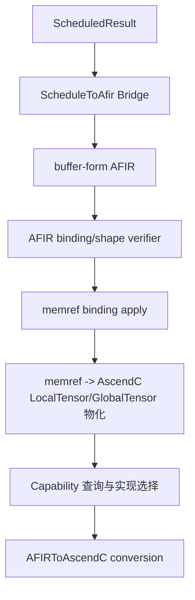

# AFIR 方言重构开发实施方案

> 状态：待实施
> 日期：2026-08-13
> 文档类型：开发实施方案
> 适用范围：`autofuse/mlir` 的 AFIR、ScheduleToAfir bridge、存储绑定应用和 AFIR 到 AscendC 后端

# 文档结构

阅读顺序为：第 1～2 章确认问题、事实和本阶段边界；第 3～5 章确定 IR、属性和 Bridge 接口；第 6～8 章确定
memref 到 AscendC 的物化、load/store 规则和 Capability 边界；第 9～12 章给出文件拆分、测试、实施顺序和验收标准。
文中使用三种实施状态：`[本期新增功能，需完整实现]` 表示本次交付必须完成；`[本期预留接口，未实现时返回 unsupported]` 表示只建立稳定边界和诊断；
`[未来演进，暂不预埋]` 表示本次不增加接口、属性或 pass。未加状态标签的“当前事实”来自当前 checkout。

# 1 简介

## 1.1 目的

当前 `ScheduleToAfir` 已经接收旧 Schedule 的 `ScheduledResult`。该结果包含完整的 buffer 位置、队列/缓冲区编号、复用编号和
双缓冲数量。本文把这些事实转换为可验证的 buffer-form AFIR，并定义后续如何把通用 `memref` 物化为 AscendC
`GlobalTensor`/`LocalTensor`。开发者可以据此拆分 ODS、Bridge、Pass、Capability 和测试任务。

## 1.2 范围

本阶段包含：

- AFIR Op 的逻辑形式和 buffer-form 统一规则，以及输入、输出、计算、常量和数据搬运角色；
- 通用 `memref` 类型、布局、存储层级和 Schedule binding 属性；
- `ScheduledResult -> Bridge DTO -> AFIR` 的完整单向映射；
- 已有 Schedule 结果的绑定应用，不重新实现 reuse/lifetime planner；但必须完整迁移并校验 Schedule 已产出的临时 buffer 生命周期分组语义；
- 合并在 `AFIRMemoryAllocatePass` 内部的 `memref -> AscendC GlobalTensor/LocalTensor` 物化阶段；
- Capability 查询、实现选择和现有 conversion 的边界；
- load/store 的当前语义；Schedule 迁移时的 Bufferization 标记为 `[未来演进，暂不预埋]`；
- UT、LIT、E2E、RDV 和 CANN 设备验证。

本阶段不包含：

- `[未来演进，暂不预埋]` One-Shot Bufferize；它只在未来 Schedule 迁移到 MLIR、输入不再自带 buffer 语义时引入；
- 通用 buffer 复用、生命周期重新分析、冲突消解或新的调度算法；本阶段只把既有 `life_time_axis_id`/`reuse_id` 结果应用到
  canonical `BufferDescAttr`，不重新推导生命周期；
- Legacy `codegen`、ATT、Workspace、`GenKernelEntry`、SuperKernel 和对外 Python/C++ API 的行为修改；
- 在 AFIR Core 中引入 `TQueue`、`TBuffer` 或其他 AscendC 类型。

## 1.3 产品环境

AFIR verifier、Bridge 和绑定应用阶段运行在普通 MLIR/C++ 构建环境；合并后的 `AFIRMemoryAllocatePass` 中 AscendC 类型注册、Capability
selection、源码生成和 kernel 编译依赖 CANN Toolkit。设备 RDV 还依赖可用的 Ascend 设备、runtime 和对应测试环境。本文不新增
Python 包、run 包安装路径或 runtime 对外接口。

## 1.4 软件功能

本设计交付四项能力：

1. 用 `TensorDescAttr` 保留 tensor/layout/Schedule 表达式，用按 operand/result/destination 对齐挂载的 `BufferDescAttr` 统一保存 queue、buffer、临时资源和 workspace；
2. 由 Bridge 将 `ScheduledResult` 直接转换为可验证的 memref buffer-form AFIR；每个输入、输出和 destination 同时携带对应的 tensor descriptor 和 buffer descriptor；
3. 由合并后的 `AFIRMemoryAllocatePass` 先应用既有 Schedule binding/lifetime，再解析 `size_bytes_expr` 并把 memref view 物化为 AscendC 资源；
4. 对 load/store 的索引映射、特殊 Op 能力、动态 shape、资源冲突和未支持能力给出确定性 verifier/诊断和商用测试边界。

# 2 当前事实、约束和目标链路

## 2.1 当前代码事实

| 位置 | 当前事实 | 本阶段处理 |
|---|---|---|
| `mlir/dialect/AFIR/IR/AFIRAttrs.td` | `AscTensorGroupsAttr` 同时保存 layout、`PositionConfig`、`AllocType`、`tensor_id`、`position_id`、`que_id`、`que_depth`、`que_buf_num`、`buf_id`、`reuse_id` | 新属性分层；迁移完成后删除旧聚合属性，生命周期语义统一迁移到 canonical `BufferDescAttr` |
| `mlir/dialect/AFIR/IR/AFIROpBase.td` | 公共 `outputs` 和 `tmp_buffers` 仍存在；部分基类用可选 `destination` 表示 buffer form | 删除 `tmp_buffers`，以 `BufferDescAttr` 承载临时资源；以 result/destination 绑定替代下标推断 |
| `mlir/bridge/AfirBuilder/AfirBuilder.h` | `TensorInfo` 仍接收 `alloc_type`、`position`、`que_depth`、`que_id`、`buf_id` 等旧字段 | 增加 Bridge DTO，`AfirBuilder` 不再接收 Legacy 类型 |
| `mlir/conversion/AFIRToAscendC/AFIRMemoryAllocate.cpp` | 当前读取 `outputs`/`AscTensorGroupsAttr`，按 `Position` 创建 AscendC buffer，并使用 `AllocType`、队列和 buffer 编号 | 在同一 Pass 内增加 canonical binding 阶段，再进入 AscendC 物化；现有算法作为行为基线，不在本阶段重写 reuse |
| `mlir/conversion/AFIRToAscendC/AFIRToAscendCPipeline.cpp` | 当前正式链路主要接入 selection 和 conversion | 本期接入 `AFIRLoopGeneratePass`、`AFIRMemoryAllocatePass`、selection 和 conversion；不保留 Legacy 兼容入口 |
| Capability provider | `BinaryElementwise` 等实现要求 `ascendc::LocalTensorType` | 合并 Pass 的物化阶段负责把通用 memref 转为后端类型，Capability 不反向读取 Legacy Schedule |
| `AFIREnums.td`、Legacy compute registry | 已有 `Gather`、`Split`、`Transpose`、`Cube`/MatMul 类 compute type 或 Legacy node 映射，但不等于 AFIR Op 已实现 | 在 AFIR ODS、Bridge registry、Capability 和 conversion 均有实现前，Bridge 必须明确拒绝这些节点并给出 unsupported 诊断 |
| `mlir/dialect/AFIR/IR/Ops/Data.cpp` | `load/store` 逻辑形式允许源和结果 rank/shape 不同，但要求 shaped tensor 和同元素类型 | 保留 AFIR 搬运语义；不能套用只适用于同形状 elementwise 的规则 |

## 2.2 设计约束和假设

1. `ScheduledResult` 是本阶段 buffer 事实的唯一来源。Bridge 不猜测调度结果，不依据 SSA 名称、指针地址或无序容器顺序生成编号。
2. buffer-form AFIR 使用通用 `memref`。canonical descriptor 中的 `space` 表示 GM、UB、L1、L2、L0A/L0B/L0C 等存储层级；它不表示
   `VECTOR_IN/VECTOR_OUT/VECTOR_CALC`，后者是 AFIR 角色，物化时才映射为 AscendC `TPosition`。
3. `que_buf_num` 是槽数量，`que_depth` 是队列流水深度，二者不是同一字段。队列资源缺少 `que_depth` 时本阶段报错，不能静默用
   `que_buf_num` 或写死一个后端值；非队列资源不携带 `que_depth`。
4. 旧 Schedule 的 reuse 和生命周期结果已经经过验证。本阶段只应用并校验结果；通用 reuse/lifetime planner 作为后续独立需求。
5. 任何新接口都必须在无 CANN 设备的普通 MLIR 环境完成 IR/verifier/bridge/pass 测试；AscendC kernel 编译和设备验证单独标记环境依赖。

本期同步完成函数角色迁移：`FunctionRole::Template` 改名为 `FunctionRole::KernelBody`，数值保持 `0` 以避免同一编译 session
内的临时对象误解，但 textual attribute 从 `template` 改为 `kernel_body`。不保留旧文本 alias；Bridge、LoopGenerate、MemoryAllocate、
PipelineSync、Dialect verifier、ABI helper、AFIR template-signature 相关测试和所有 MLIR fixtures 必须在同一变更中完成替换。
`KernelEntry` 保持数值 `1` 和 `kernel_entry` 文本不变。旧 `template` 属性在 canonical verifier 中统一报告 `InvalidFunctionRole`。

## 2.3 本阶段目标链路



逻辑 tensor-form AFIR 仍是方言的通用输入形态，但本阶段的 Schedule 路径不经过它再做 bufferization，而是由 Bridge 直接生成
buffer-form AFIR。未来 Schedule 迁移到 MLIR 后，才在 Bridge 前增加 `[未来演进，暂不预埋]` One-Shot Bufferize 或等价的 AFIR Bufferization 扩展。

# 3 目标 IR、角色和 Op 能力矩阵

## 3.1 两种形式

同一个 Op 名称保留两种形式：

```text
逻辑形式：   tensor operands -> tensor results
buffer-form：memref compute operands, memref destination -> memref results
```

普通 destination-style 计算 Op 的计算输入排在前面，destination 排在最后；每个 result 与一个 destination 一一绑定，类型、元素类型、
rank、shape 和 layout 必须满足该 Op 的规则。buffer-form 不允许 tensor/memref 混用。`load/store` 不属于普通计算 Op，按第 7 章的搬运规则处理。

## 3.2 角色 Trait 和查询 Interface

这里区分两套正交标签：数据值/图边界使用 canonical `RoleAttr`，实际执行内存搬运的 Op 使用方向 Trait。二者不能合并成一个枚举：

函数角色也与 Op 角色分开：`KernelBody` 表示包含 AFIR 计算本体的私有函数，原有 `Template` 名称在本期重命名为
`KernelBody`；`KernelEntry` 表示对外可调用的 kernel 函数入口，负责 AscendC ABI。`KernelBody` 是“kernel 代码本身”，
`KernelEntry` 是“kernel 函数入口”，不是两个资源域。Bridge 可以同时生成二者，但只有包含 AFIR Op 的 `KernelBody` 进入
`AFIRLoopGeneratePass`、`AFIRMemoryAllocatePass`、selection 和 conversion；`KernelEntry` 不得残留 AFIR Op，否则 verifier 失败。

```text
AFIR_Input       图的输入端点（通常是函数入口的外部 GM value，记录在 TensorDescAttr.role）
AFIR_Output      图的输出端点（由函数参数表示的外部 GM buffer；canonical 写回统一通过 store destination）
AFIR_Compute     产生计算结果的 Op/value 角色
AFIR_Constant    编译期常量、标量常量和索引表达式的 value 角色
AFIR_TransferIn  从外部存储读入片上视图（方向 Trait）
AFIR_TransferOut 将片上视图写回外部存储（方向 Trait）
```

`AFIRRoleInterface` 已实现为 canonical target role 查询；它从 destination/result descriptor 读取目标 role，缺失或冲突时返回
`failure()`。本轮 allocator 仍可直接消费 descriptor，但不得把接口缺失误认为 role 缺失。value role 与搬运方向分别由
`TensorDescAttr.role` 和 `AFIR_TransferIn`/`AFIR_TransferOut` trait 表达。`AFIRDataMoveInterface` 继承 MLIR 的
`MemoryEffectsOpInterface`；Trait 保证 ODS 静态标记，Interface 供 Bridge、绑定应用、物化和 Capability 查询。
`AFIR_Input`/`AFIR_Output` 表示图的输入/输出边界，`AFIR_Compute` 表示计算值，`AFIR_Constant` 表示常量值；这些是 value role，
不额外伪装成四个 Op Trait；
`AFIR_TransferIn`/`AFIR_TransferOut` 只标记 `load/store` 等搬运 Op 的方向。主角色不是 `space`，也不由 operand 下标或 Op 名称
临时猜测。

两套标签的组合关系如下：

| 场景 | 图/数据角色 | 搬运方向 | 说明 |
|---|---|---|---|
| 函数输入 `%gm_in` | `AFIR_Input` | 无 | 只表示外部输入端点，本身不代表已经发生 GM→UB 拷贝 |
| `load %gm_in outs(%ub)` | `%gm_in` 是 Input；`load` 是搬运 Op | `AFIR_TransferIn` | 读取外部存储并写入片上目标，推导 queue/`que_id` |
| 中间计算 `add/matmul/...` | `AFIR_Compute` | 无 | 读写计算 buffer，推导 buffer/`buf_id` |
| `store %ub outs(%gm_out)` | `%gm_out` 是 Output；`store` 是搬运 Op | `AFIR_TransferOut` | 从片上源写回外部存储，推导 queue/`que_id` |
| 临时 workspace 的回写/重载 | `AFIR_Compute` | `AFIR_TransferOut` 或 `AFIR_TransferIn` | 可能发生搬运，但不是图 Output/Input |

其余能力按实际消费者增加小型 Interface，不设计一个包含所有语义的“大接口”：

| Interface 状态 | 适用 Op | 负责内容 |
|---|---|---|
| `[本期新增功能，需完整实现]` `AFIRDataMoveInterface` | `load/store` 及未来搬运类 Op | 复用 MLIR memory effects；方向由 `AFIR_TransferIn/AFIR_TransferOut` Trait 固定 |
| `[本期新增功能，需完整实现]` `AFIRDestinationStyleInterface` | 一元/二元/三元/variadic 计算 | 计算输入、destination、tied result 和结果数量 |
| `[本期新增功能，需完整实现]` `AFIRIndexingMapInterface` | `load/store`、broadcast、reduce、split、concat、gather 等需要显式映射的 Op | 校验 `indexing_maps` 与端点 view 的 rank、offset、size、stride 对应关系；不新增 mapping 属性 |
| `[本期新增功能，需完整实现]` `AFIRBroadcastInterface` | 二元、三元、`broadcast`、`select/where` | 广播轴和结果 shape 推导 |
| `[本期新增功能，需完整实现]` `AFIRReductionInterface` | `max/min/sum/mean/prod/any/all` | reduction axis、结果 rank 和读写效果 |
| `[本期新增功能，需完整实现]` `AFIRCastInterface` | `cast` | 源/目标 element type 与 layout 保持规则 |
| `[本期预留接口，未实现时返回 unsupported]` `AFIRGatherInterface` | `gather` | index tensor、axis、边界模式和 index-dependent shape |
| `[本期预留接口，未实现时返回 unsupported]` `AFIRSplitInterface` | `split`/`slice` 类 Op | split axis、sections、每个结果的 offset/size 和多结果绑定 |
| `[本期预留接口，未实现时返回 unsupported]` `AFIRLayoutTransformInterface` | `transdata`/transpose 类 Op | permutation、源/目标 format、tile mapping 和 layout 变化 |
| `[本期预留接口，未实现时返回 unsupported]` `AFIRMatmulInterface` | `matmul`/`batch_matmul` 及 bias/offset 变体 | M/N/K、batch 维、转置标记、bias/offset 和 Cube 资源需求 |
| `[本期预留接口，未实现时返回 unsupported]` `AFIRConvolutionInterface` | `conv2d` 及 bias/offset 变体 | N/C/H/W、kernel、stride、dilation、padding、groups 和 Cube 资源需求 |
| `[本期新增功能，需完整实现]` `AFIRScalarInterface` | `scalar`、`index_expr` | 编译期/运行期 scalar 来源、dtype 和转换规则；`axpy` 等预留 Op 后续复用 |

## 3.3 本阶段 Op 能力矩阵

当前 checkout 的 ODS/Bridge 已实现集合主要是表中前半部分；`gather`、`split`/`slice`、`transdata`/transpose 和 matmul 系列已经在
Legacy Schedule/Codegen 或 `ComputeType` 枚举中存在，但还没有相应 AFIR ODS/Bridge/conversion。它们必须显式列入本设计，按
`[本期预留接口，未实现时返回 unsupported]` 处理，不能在本阶段被当作已支持能力。表中的“进入 AscendC”表示未来纳入完整链路后必须有对应
conversion/Capability 诊断；未声明支持的组合必须返回
`unsupported`，不能生成半成品 IR。

| Op 集合 | 角色/形式 | 操作数与结果 | destination、读写和 alias | shape/layout 规则 | AscendC 范围 |
|---|---|---|---|---|---|
| `load` | `AFIR_TransferIn`；逻辑 tensor 或 buffer-form memref | 逻辑 1->1；buffer 形态为源 memref + destination memref -> 1 memref | 读 GM/外部源，写 UB destination；结果与 destination 等价 alias | 元素类型相同；必须携带 `indexing_maps : AffineMapArrayAttr`，identity 或非平凡映射均显式给出 | MTE2/load pattern |
| `store` | `AFIR_TransferOut`；逻辑 tensor 或 buffer-form memref | 逻辑 1->0/1（按现有 ODS）；buffer 形态为源 memref + destination memref -> 无结果 | 读 UB 源，写 GM/外部 destination；无结果 alias | 必须携带 source/destination `indexing_maps`；不从 load 反推 | MTE3/store pattern |
| `scalar`、`index_expr` | `AFIR_Constant`；逻辑形式 | 0->1 shaped result | 无内存效果；不参与 destination | 标量值属性/表达式合法性；不扩展为全局分析 | 仅作为 Capability scalar 输入；无独立 buffer 物化 |
| `abs/exp/ln/sqrt/rsqrt/reciprocal/erf/tanh/relu/neg/sigmoid/logical_not/isnan/isfinite/leaky_relu` | `AFIR_Compute`；逻辑和 destination-style buffer form | 一元 1->1 | 读输入，写 destination/result；buffer result 与 destination 等价 | 一元同形；逐元素 layout 需可映射 | Vector elementwise |
| `add/sub/mul/div/minimum/maximum/truediv/pow/bitwise_and/floor_div/gelu/sign/logical_or/logical_and` | `AFIR_Compute`；逻辑和 buffer form | 二元 2->1 | 读两个输入，写 destination；只允许 destination 与 result alias | 广播由 `AFIRBroadcastInterface` 定义；destination 必须是广播后的结果形状 | Vector elementwise |
| `ge/eq/ne/gt/le/lt` | `AFIR_Compute`；逻辑和 buffer form | 二元 2->1，结果通常为 `ui8` | 同二元计算；比较结果不与输入 alias | 广播规则同上，结果 element type 由 ODS 约束 | Vector compare |
| `clip_by_value` | `AFIR_Compute`；逻辑和 buffer form | 三元 3->1 | 读三个输入，写 destination；只与 destination 等价 alias | 三个输入广播到结果；layout 必须提供索引映射 | Vector elementwise |
| `select/where` | `AFIR_Compute`；逻辑和 buffer form | condition + 两值 -> 1 | 读 condition/values，写 destination；不与任一输入隐式 alias | condition/value 广播规则由 Interface 定义 | Vector select |
| `broadcast` | `AFIR_Compute`；逻辑和 buffer form | 一元 1->1 | 读输入，写 destination | 显式目标 shape/layout；禁止从 operand 下标猜轴 | Vector broadcast |
| `concat` | `AFIR_Compute`；逻辑和 buffer form | variadic inputs + axis -> 1 | 读全部输入，写 destination；不与输入隐式 alias | 除 concat axis 外维度相等；axis 范围 checked | Vector concat |
| `[本期预留接口，未实现时返回 unsupported]` `gather` | `AFIR_Compute`；逻辑和 buffer form | data memref/tensor + index memref/tensor + axis -> 1 result | 读 data 和 indices，写 destination；默认不与输入 alias | index-dependent shape；axis、负 index、越界策略和 batch 维必须由 `AFIRGatherInterface` 明确 | Capability 按 target 选择 Vector/SIMT；未注册前返回 unsupported |
| `[本期预留接口，未实现时返回 unsupported]` `indirect_load` | `AFIR_TransferIn`/`AFIR_Compute`；逻辑和 buffer form | source + index/offset tensor -> 1 destination/result | 读外部 source 和 index，写片上 destination；不与 source alias | index/offset 的 element type、边界和向量化映射由 `AFIRIndexingMapInterface` 定义 | MTE2/Vector gather-load；未注册前返回 unsupported |
| `[本期预留接口，未实现时返回 unsupported]` `split`/`slice` | `AFIR_Compute`；逻辑和 buffer form | 1 input + axis/sections -> variadic results；buffer form 为 1 input + N destinations -> N results | 读一个输入，写 N 个 destination；每个 result 与对应 destination 等价；不得默认把结果当作 input view alias | split axis、sections、offset/size 必须完整；只有显式 disjoint view 证明后才允许零拷贝 alias | Vector/搬运 pattern；未注册前返回 unsupported |
| `[本期预留接口，未实现时返回 unsupported]` `transdata`/transpose | `AFIR_Compute`，可叠加 `AFIR_TransferIn/Out` 方向 Trait；逻辑和 buffer form | source + permutation/format attrs -> 1 result；buffer form 增加 destination | 读 source，写 destination；默认不与 source alias | `AFIRLayoutTransformInterface` 提供 permutation、ND/NZ/5HD 等 format、tile mapping；不能用普通 broadcast 规则 | TransData/transpose backend pattern；由 target profile 决定可用 format |
| `[本期预留接口，未实现时返回 unsupported]` `matmul`、`batch_matmul`、`matmul_bias`、`matmul_offset`、`matmul_offset_bias` 及 batch 变体 | `AFIR_Compute`；Cube；逻辑和 destination-style buffer form | A、B，可选 bias/offset + destination -> 1 result | 读矩阵输入和可选 bias/offset，写 destination；只允许 result 与 destination alias | `AFIRMatmulInterface` 校验 M/N/K、batch broadcast、transpose_x1/x2、layout、dtype 和 accumulator 类型 | Cube/MatMul Capability；必须提供 tiling、workspace 和临时资源需求 |
| `[本期预留接口，未实现时返回 unsupported]` `conv2d`、`conv2d_bias`、`conv2d_offset`、`conv2d_offset_bias` | `AFIR_Compute`；Cube；逻辑和 destination-style buffer form | input、weight，可选 bias/offset + destination -> 1 result | 读 input/weight/bias/offset，写 destination；不与输入 alias | `AFIRMatmulInterface` 不足以表达卷积；需 `AFIRConvolutionInterface` 校验 NCHW/NHWC、stride、dilation、padding、groups 和 layout | Cube/Conv2D Capability；未完成卷积接口和 tiling 时返回 unsupported |
| `[本期预留接口，未实现时返回 unsupported]` `remove_pad`、`pad`、`round` | `AFIR_Compute`；逻辑和 buffer form | 一元 input + pad/round attrs -> 1 result | 读 input，写 destination；默认不 alias | pad 区域、填充值、round mode 和 shape 变化必须显式属性化；不能套用普通同形 unary 规则 | Vector/layout pattern；未注册前返回 unsupported |
| `[本期预留接口，未实现时返回 unsupported]` `axpy` | `AFIR_Compute`；逻辑和 buffer form | `x1,x2,alpha` -> 1 result | 读两个输入和 scalar alpha，写 destination；不与输入 alias | 广播和 alpha dtype/范围由 `AFIRBroadcastInterface`/`AFIRScalarInterface` 定义 | Vector elementwise；未注册前返回 unsupported |
| `max/min/sum/mean/prod/any/all` | `AFIR_Compute`；逻辑和 buffer form | 输入 + axis -> 1 | 读输入，写 destination；不强制原地 | reduction axis、结果 rank、layout 由 `AFIRReductionInterface` | Vector reduce；Capability 不支持时明确报错 |
| `[本期预留接口，未实现时返回 unsupported]` `argmax` | `AFIR_Compute`；Reduce；逻辑和 buffer form | input + axis -> value/index result（结果数量由 ODS 固定） | 读 input，写 value/index destinations；每个 result 只与对应 destination alias | axis、tie-break、index dtype、结果 rank 必须显式定义 | Vector/Cube/Target-specific reduce；未注册前返回 unsupported |
| `[本期预留接口，未实现时返回 unsupported]` `reduce_store` | `AFIR_TransferOut` + `AFIRReductionInterface` | reduce source + GM destination -> 无结果 | 读片上 source，执行归约并写 GM destination；无隐式 alias | reduction axis 与目标 shape 必须由 mapping 证明 | MTE3 + reduce backend；不得误当普通 store |
| `cast` | `AFIR_Compute`；逻辑和 buffer form | 一元 1->1 | 读输入，写 destination；不与输入 alias | 只改变允许的 element type，shape/layout 不变 | Vector cast |
| `symbolic_eval` | 非数据角色 | 按现有 ODS 的符号输入/结果 | 无 buffer 绑定，不进入物化 | 只验证表达式和符号作用域 | 不进入 AscendC conversion |

本阶段当前 ODS 没有独立的 `afir.input`/`afir.output` Op，因此不新造只为标记而存在的伪 Op。Bridge 按以下规则标记：

| 标记对象 | 角色标记 | 规则 |
|---|---|---|
| 函数入口 block argument，对应外部传入的 GM tensor/memref | `AFIR_Input` | 写入 `afir.arg_descs[arg_index]`；仅表示图输入，不表示已经完成 GM→UB 搬运 |
| 作为外部输出 buffer 的 block argument | `AFIR_Output` | 写入对应 `arg_descs[arg_index]`；仅表示图输出边界，实际写回由 `afir.store` destination 完成 |
| `load` Op | 不标记为 `AFIR_Input`，标记 `AFIR_TransferIn` | `load` 是搬运动作；它的外部源 value 可以同时具有 `AFIR_Input` |
| `store` Op | 不标记为 `AFIR_Output`，标记 `AFIR_TransferOut` | `store` 是搬运动作；它的外部目标 value 可以同时具有 `AFIR_Output` |
| 一元、二元、reduce、matmul、transdata 等产生计算结果的 Op | `AFIR_Compute` | 结果 descriptor 放入 `result_descs`；即使结果最终连接到函数输出，Op 本身仍是 Compute |
| `scalar`、`index_expr` 和编译期常量 | `AFIR_Constant` | 不参与 Queue/Buffer 资源创建 |

因此，角色标记的对象必须与资源推导的对象分开：`Input/Output` 由函数边界和外部连接关系决定，`TransferIn/TransferOut` 由
`load/store` 的实际读写方向决定，`Compute` 由计算 Op 决定。Bridge 不根据 Op 名称猜测，而是根据函数参数、`store` destination、数据流和
Schedule binding 共同生成并校验这些标记。

## 3.4 Scalar 最小能力

本阶段不引入全局 `ScalarValueAnalysis`。只提供一个局部、可测试的 `[本期新增功能，需完整实现]` 接口：

```cpp
enum class ScalarKind { CompileTime, Runtime, NotScalar, Undetermined };
ScalarKind classifyScalar(mlir::Value value);
```

判定优先级固定为：带合法静态值的 `afir.scalar` 或编译期常量 -> `CompileTime`；由单元素 tensor/memref 在运行期读取且元素类型可表示
为 scalar -> `Runtime`；明确是非单值 shaped value -> `NotScalar`；信息不足、动态 rank 或自定义未知 Op -> `Undetermined`。
`index_expr` 只在其表达式可在编译期求值时归为 `CompileTime`，否则归为 `Undetermined`。Capability 只消费分类结果，不根据
`Value` 指针或 Op 名称猜测。负向测试覆盖错误属性、动态值和单元素但未证明的 memref。这个最小分类足以支撑本阶段的常量和 Capability
输入，不为一次性需求增加复杂类型系统。

# 4 属性分层和存储绑定

## 4.1 目标属性（Tensor/Buffer 两层模型）

将现有 `AscTensorGroupsAttr` 收敛为两类 canonical 属性：`TensorDescAttr` 和 `BufferDescAttr`。二者不是互斥的两种
 descriptor：logical form 只需要 tensor descriptor；buffer form 需要按 SSA 位置对齐的 tensor descriptor 和 buffer descriptor。

- `TensorDescAttr` 只描述 tensor/value 和 Schedule 语义，保留 `repeats`、`strides`、`vectorized_strides` 等符号化调度事实；
- `indexing_maps : AffineMapArrayAttr` 由所有 `load/store` 显式携带；一一搬运也必须写两张 identity map，rank-changing、transpose、slice、broadcast 等使用非平凡 map；
- `BufferDescAttr` 统一描述所有资源字段，包括普通 queue/buffer、临时 buffer 和 workspace；
- `BufferDescAttr` 与 `TensorDescAttr` 使用相同的 operand/result/destination 下标对齐，不再通过 `TensorDescAttr.buffer_ref` 间接引用资源表；
- `buffer_id` 是资源事实本身，资源复用通过 `(func.func, 资源域, buffer_id, reuse_id)` 确定，不依赖属性所在地址。

资源属性直接挂在产生或消费 SSA value 的 Op/函数边界上。函数级 `workspace_plan` 只描述没有对应普通 SSA value 的 workspace/scratch。
具体定义如下：

```text
TensorDescAttr
  axis: ArrayAttr<IntegerAttr> = []
  repeats: ArrayAttr<ExprAttr> = []
  strides: ArrayAttr<ExprAttr> = []
  vectorized_axis: ArrayAttr<IntegerAttr> = []
  vectorized_strides: ArrayAttr<ExprAttr> = []
  role: RoleAttr (required)

indexing_maps : AffineMapArrayAttr（所有 load/store 必须携带）
  indexing_maps[0] = source view map
  indexing_maps[1] = destination view map
  两张 map 共享同一传输迭代空间；identity 也必须显式写出

BufferDescAttr（所有资源的 canonical 描述）
  space: SpaceAttr (required)
  buffer_id: i64 = -1
  reuse_id: i64 = -1
  slot_count: i64 = -1
  queue_depth: i64 = -1
  size_bytes_expr: Optional<ExprAttr>
  alignment_bytes: i64 = -1
  life_time_axis_id: Optional<i64>
```

本期冻结的 ODS 契约如下，TableGen、Bridge 和 golden IR 必须以此为准：

| 定义 | 本期固定内容 |
|---|---|
| `RoleAttr` | 枚举 `Input=0`、`Output=1`、`Compute=2`、`Constant=3`；`TensorDescAttr.role` 必填 |
| `SpaceAttr` | 枚举 `GM=0`、`UB=1`、`L1=2`、`L2=3`、`L0A=4`、`L0B=5`、`L0C=6`；不把 `VECTOR_*` 放入 space |
| `TensorDescAttr` | 上表 5 个数组参数 + 必填 `role`；各数组长度必须与对应 view rank/axis 规则一致；本期不增加 `format`/`tile_mapping`，特殊 layout Op 另立属性设计 |
| `BufferDescAttr` | 上表 8 个字段；`size_bytes_expr` 和 `alignment_bytes` 仅在资源需要物化时必填；非 queue 的 `queue_depth` 必须为 `-1` |
| descriptor 容器 | 统一使用 `ArrayAttr`，元素必须分别是 `TensorDescAttr` 或 `BufferDescAttr`；不新增自定义 `ArrayAttr<...>` 类型 |
| `indexing_maps` | 使用现有 `AffineMapArrayAttr`；仅 `load/store` 强制恰好两张 map，其他 Op 不自动附加搬运 map |
| `FunctionRole` | 目标枚举为 `KernelBody=0`、`KernelEntry=1`，文本值为 `kernel_body`/`kernel_entry`；旧 `template` 文本和 `Template` 枚举名在本期迁移后拒绝 |

对应的 TableGen 参数冻结如下；字段顺序、类型、默认值和可选性不得由各实现自行改写：

```tablegen
// AFIREnums.td
def AFIR_RoleEnum : I32EnumAttr<"Role", "AFIR value role", [
  I32EnumAttrCase<"Input", 0, "input">,
  I32EnumAttrCase<"Output", 1, "output">,
  I32EnumAttrCase<"Compute", 2, "compute">,
  I32EnumAttrCase<"Constant", 3, "constant">
]> {
  let cppNamespace = "::mlir::afir";
  let underlyingType = "uint8_t";
}

def AFIR_SpaceEnum : I32EnumAttr<"Space", "AFIR memory space", [
  I32EnumAttrCase<"GM", 0, "gm">,
  I32EnumAttrCase<"UB", 1, "ub">,
  I32EnumAttrCase<"L1", 2, "l1">,
  I32EnumAttrCase<"L2", 3, "l2">,
  I32EnumAttrCase<"L0A", 4, "l0a">,
  I32EnumAttrCase<"L0B", 5, "l0b">,
  I32EnumAttrCase<"L0C", 6, "l0c">
]> {
  let cppNamespace = "::mlir::afir";
  let underlyingType = "uint8_t";
}

// AFIRAttrs.td
def RoleAttr : AFIR_Attr<"Role", "role"> {
  let parameters = (ins "::mlir::afir::Role":$value);
  let assemblyFormat = "`<` $value `>`";
}

def SpaceAttr : AFIR_Attr<"Space", "space"> {
  let parameters = (ins "::mlir::afir::Space":$value);
  let assemblyFormat = "`<` $value `>`";
}

def TensorDescAttr : AFIR_Attr<"TensorDesc", "tensor_desc"> {
  let parameters = (ins
    OptionalArrayRefParameter<"int64_t">:$axis,
    OptionalArrayRefParameter<"ExprAttr">:$repeats,
    OptionalArrayRefParameter<"ExprAttr">:$strides,
    OptionalArrayRefParameter<"int64_t">:$vectorized_axis,
    OptionalArrayRefParameter<"ExprAttr">:$vectorized_strides,
    "RoleAttr":$role
  );
}

def BufferDescAttr : AFIR_Attr<"BufferDesc", "buffer_desc"> {
  let parameters = (ins
    "SpaceAttr":$space,
    DefaultValuedParameter<"int64_t", "-1">:$buffer_id,
    DefaultValuedParameter<"int64_t", "-1">:$reuse_id,
    DefaultValuedParameter<"int64_t", "-1">:$slot_count,
    DefaultValuedParameter<"int64_t", "-1">:$queue_depth,
    OptionalParameter<"ExprAttr">:$size_bytes_expr,
    DefaultValuedParameter<"int64_t", "-1">:$alignment_bytes,
    AFIR_OptionalInt64Parameter<"optional lifetime axis id">:$life_time_axis_id
  );
}
```

`TensorDescAttr` 的五个数组参数默认为空；`role` 必填。`BufferDescAttr.space` 必填，`size_bytes_expr` 可选但在资源需要物化时由
verifier 强制非空；`life_time_axis_id` 在普通 queue/buffer descriptor 中可省略，在临时 buffer 和 `workspace_plan` 中必须显式写入
`-1` 或有效 loop axis，其余 `int64_t` 字段默认 `-1`。自定义 assembly format 可在不改变上述参数顺序和可选性的前提下实现；descriptor
容器仍使用普通 `ArrayAttr`，由 verifier 检查元素确为对应属性类型。

本期实现的公共 Interface 方法也固定为最小集合：

```cpp
// All names below are in namespace ::mlir::afir. Role is the generated AFIR
// enum type. Data-move direction is an ODS trait (AFIR_TransferIn or
// AFIR_TransferOut); memory effects reuse MLIR's MemoryEffectsOpInterface.
::mlir::FailureOr<Role> getRole();
unsigned getNumDestinations();
::mlir::FailureOr<unsigned> getTiedResultIndex(unsigned destinationIndex);
::mlir::FailureOr<::llvm::SmallVector<::mlir::AffineMap>> getIndexingMapList();
::mlir::LogicalResult verifyIndexingMaps();
```

`AFIRRoleInterface` 的 `getRole()` 返回 canonical 写入目标的 role；当 destination 与 result descriptor 同时存在时，二者必须一致。
逻辑 tensor-form 或 descriptor 缺失时返回 `failure()`，不得伪造默认 role。`AFIRDataMoveInterface` 继承 MLIR 的
`MemoryEffectsOpInterface`，不再复制 memory-effect record 或定义第二套 direction enum；
方向由 `AFIR_TransferIn`/`AFIR_TransferOut` Trait 唯一提供。`AFIRDestinationStyleInterface` 提供
destination/tied-result 方法，`AFIRIndexingMapInterface` 提供 map 方法。`AFIRBroadcastInterface`、`AFIRReductionInterface` 和
`AFIRCastInterface` 本期只增加 verifier 所需的专用查询方法，不新增通用“大接口”；Gather、Split、LayoutTransform、
Matmul 和 Convolution 接口仍是预留接口，未注册时只返回 `unsupported`。

当前已实现 `AFIRBroadcastInterface::verifyBroadcastShape()`，由 `broadcast` 同时覆盖 logical tensor-form 和
buffer-form；buffer-form 额外校验 destination/result tying，并通过 MLIR `MemoryEffectsOpInterface` 暴露 input read 和
destination write 效果。其余广播相关 Op（例如带条件的 `select/where`）仍按后续 Op 任务单独接入。

同时，`load/store/add` 的标准 tensor/memref 形式已恢复为 ODS canonical element-type 约束：数据搬运共用
`I8/UI8/I16/UI16/I32/UI32/I64/UI64/F16/F32`，`add` 使用 `I16/I32/F16/F32`。迁移期的 AscendC
`GlobalTensor/LocalTensor` shaped intermediate 保持可解析，由后续 Capability/Conversion verifier 继续负责其能力检查，避免把
legacy typed intermediate 误当成标准 memref buffer-form。

`getIndexingMapList()` 的命名用于避开 ODS 为 `indexing_maps` 属性生成的
`getIndexingMaps()` accessor。标准 `memref` buffer-form 的 `load/store` 必须通过 verifier 提供恰好两张 map；现有
AscendC `GlobalTensor/LocalTensor` typed intermediate 仅作为迁移兼容边界，暂不强制 map，待其 producer 统一生成 memref 后再收紧。

Verifier 的稳定错误类别固定为 `MissingDescriptor`、`DescriptorCountMismatch`、`DescriptorTypeMismatch`、
`InvalidRole`、`InvalidSpace`、`InvalidBinding`、`InvalidLifetime`、`InvalidIndexingMaps`、`InvalidAlias`、
`InvalidReturnBoundary` 和 `UnsupportedOperation`。诊断必须包含 owner、operand/result/destination index 和字段名；
函数角色、函数签名或 canonical `store` 返回值不符合约定时统一使用 `InvalidReturnBoundary`。

按 Op 场景的最小挂载组合如下：

| 场景 | 必需属性 | 可选属性 |
|---|---|---|
| logical form 计算 | `TensorDescAttr` | 无 |
| buffer-form 计算 | 每个 operand/result/destination 对齐的 `TensorDescAttr` + `BufferDescAttr` | `indexing_maps` 按 Op 能力需要 |
| 一一映射的 `load/store` | source/destination 对齐的 `TensorDescAttr` + `BufferDescAttr` + 两张 identity `indexing_maps` | 无 |
| rank/shape/index 非一一映射的搬运/变形 Op | source/destination 对齐的 `TensorDescAttr` + `BufferDescAttr` + 非 identity `indexing_maps` | 无 |
| 函数级 workspace、临时 buffer 或外部资源表 | `BufferDescAttr` 数组 | 无需普通值 descriptor |

因此 logical form 只接触 `TensorDescAttr`；buffer form 在同一 operand/result/destination 下标上同时读取两个 descriptor。资源字段不再在
`TensorDescAttr` 和 `BufferDescAttr` 之间重复保存。

Bridge 根据 Op 的角色和搬运方向选择旧的 `que_id` 或 `buf_id` 写入 `BufferDescAttr.buffer_id`，并在 DTO 中保留 `tensor_id`、
`position_id`、`alloc_type`、`que_id`、`buf_id` 等原始字段用于校验和诊断。`indexing_maps` 只描述跨 view 的索引关系，
不承载动态 offset/size/stride。

## 4.2 属性挂载位置和多结果规则 `[本期新增功能，需完整实现]`

这一节只解决“拆分后的 descriptor 挂在哪里、如何和 SSA 值对应”这个问题，不新增资源语义。`memref` 类型负责表达可操作的
buffer 类型和派生的 memory space；`TensorDescAttr` 负责表达 tensor layout、Schedule 表达式和 role；`BufferDescAttr` 负责表达资源。
由于 SSA value 本身不能直接挂任意
方言属性，descriptor 以数组属性挂在 Op 或函数边界上，并且必须按 result、operand 或 destination 的索引对齐。

- 每个产生 SSA result 的 Op 在 `afir.result_descs` 和 `afir.result_buffer_descs` 中分别携带按 result index 对齐的 `TensorDescAttr` 和 `BufferDescAttr`；多结果必须有相同数量的 descriptor。
- 函数 block argument 使用 `afir.arg_descs` 和 `afir.arg_buffer_descs`，按 argument index 对齐。KernelBody 不返回 tensor/memref，
  函数类型统一为 `() -> ()`；外部输出通过 `afir.store` 的 destination 写回 GM，函数不再维护 `return_descs` 或 `return_buffer_descs`。
- destination-style Op 在 `afir.destination_descs` 和 `afir.destination_buffer_descs` 中按 destination operand index 携带 descriptor；结果 descriptor 与其绑定关系由
  `AFIRDestinationStyleInterface` 返回，不依赖 `outputs` 数组的隐含末尾位置。
- buffer-form 的每个 result、argument、operand 和 destination 必须同时存在 tensor descriptor 与 buffer descriptor；两个数组长度不一致、
  资源字段缺失或同一资源 key 的字段不兼容时失败。
- `load/store` 必须使用现有 `indexing_maps : AffineMapArrayAttr` 保存 source/destination view 的索引映射；`indexing_maps[0]` 和 `[1]`
  共享同一传输迭代空间。offset/size/stride 不放在该属性中，而由 source/destination 的 view-producing Op、memref layout 或其
  动态 SSA operands 表达；`memref.subview` 只是可选实现，不是 AFIR 强制要求。源/目标
  各自的 layout 字段仍由对应的 `TensorDescAttr` 提供，搬运方向不在该属性中重复保存，而由 ODS 上的
  `AFIR_TransferIn`/`AFIR_TransferOut` Trait 确定。`store` 无结果时，目标 descriptor 仍在
  `destination_descs`，不能把信息挂在不存在的 result 上。
- 迁移完成前读取旧 `outputs` 的代码必须同时校验 canonical descriptor；两者不一致立即失败并报告 op、result index 和来源。

这些属性在流水线中的用途如下：

| 属性 | 由谁生成 | 在哪里使用 | 解决的问题 |
|---|---|---|---|
| `result_descs` + `result_buffer_descs` | ScheduleToAfir Bridge | AFIR verifier、`AFIRMemoryAllocatePass` 的绑定阶段和物化阶段 | 确定每个计算结果的 tensor layout、role 和资源事实 |
| `operand_descs` + `operand_buffer_descs` | ScheduleToAfir Bridge | operand 读写 effect、Capability query 和物化 | 明确每个输入 operand 的 tensor/layout 与资源事实 |
| `arg_descs` + `arg_buffer_descs` | Bridge 在函数入口建模时生成 | binding apply、函数参数到 GlobalTensor/LocalTensor 的物化 | SSA block argument 没有定义 Op，必须有独立的 descriptor 来源 |
| `destination_descs` + `destination_buffer_descs` | Bridge 根据 Schedule 的 destination 绑定生成 | destination-style verifier、tied/alias 校验和 buffer 资源绑定 | 明确 `outs(%dst)` 对应哪个 destination，禁止按 operands 末尾位置猜测 |
| `workspace_plan` | Bridge、selection 或 owner scope | 无 SSA owner 的 workspace/scratch 物化和生命周期校验 | 承载函数级 workspace 资源，不替代 Op 的 buffer descriptor |
| `indexing_maps` | Bridge 根据 `load/store` 的 source/target view 生成，两张 identity map 也必须显式生成 | `load/store` verifier、搬运物化和 MTE2/MTE3 conversion | 只表达 source/destination 索引关系；不重复保存 subview 的 offset/size/stride、layout/format 或方向 |

两者的边界必须保持如下关系：

| 属性 | 描述对象 | 示例 | 不负责的内容 |
|---|---|---|---|
| `TensorDescAttr` 的 layout/Schedule 字段 | 一个 tensor/memref 自身的 tensor 语义 | `axis`、`repeats`、`strides`、`vectorized_axis`、`vectorized_strides` | 不描述资源申请、queue/buffer ID 或另一个 tensor 的形状；format/tile 由后续特殊 layout Op 单独定义 |
| `indexing_maps` | 源 view 到目标 view 的索引关系 | 两张共享迭代空间的 `AffineMap`，例如 identity、permutation、broadcast map | 不复制源/目标 layout，不保存 subview 范围，不保存 `TransferIn/TransferOut` |
| `BufferDescAttr` | 一个可绑定或可申请的资源 | `space`、`buffer_id`、`reuse_id`、slot/depth、size/alignment、lifetime | 不描述 tensor 的 repeats/strides 或 Op role |

Verifier 将三者组合检查：先分别验证 source/destination 的 `TensorDescAttr` 与 `BufferDescAttr`，再验证 `indexing_maps` 能否在这两个 view 上合法实现。`transdata`/
transpose 的 format 变化属于 `TensorDescAttr` 的 layout 字段 + `AFIRLayoutTransformInterface`；如果它同时承担外部到片上的搬运，再叠加
`AFIR_TransferIn/AFIR_TransferOut` Trait，而不是把 format 或方向塞进 `indexing_maps`。

消费顺序固定为：Bridge 生成 descriptor → verifier 检查数量、类型和 alias → binding apply 生成 `StorageView` → memref 物化 Pass
读取 `TensorDescAttr`/`BufferDescAttr`/`indexing_maps` → AscendC conversion 生成后端资源和调用。Capability 不直接读取旧的
`AscTensorGroupsAttr` 或 Legacy `TensorInfo`。

`destination_descs` 和 `destination_buffer_descs` 不是可以脱离 SSA value 单独修改的第二份事实。它们必须与 destination value 的
`arg_descs`/`arg_buffer_descs` 或定义 Op 的 `result_descs`/`result_buffer_descs` 一致；binding apply 发现 descriptor 的 tensor layout、资源字段或资源 key 冲突时立即失败。

`indexing_maps` 的确定性校验规则：

1. `load`/`store` 必须恰好有两张 map，分别对应 source 和 destination；缺失、重复、顺序错误或 rank 不匹配时 verifier 失败。
2. identity 搬运也必须显式写两张 identity map；verifier 不生成默认 map，也不从 operand 顺序猜测 map。
3. `indexing_maps` 只表达共享传输迭代空间到 source/destination index 的 affine 关系；动态 offset/size/stride 必须来自实际 view 或其 SSA
   operands，不能编码到 map 之外的自定义字段中。
4. Bridge、绑定应用和 AscendC 物化都直接消费同一组 maps；store 的 map 方向仍然是当前 Op 的 source view -> destination view，不求逆。

下面是一个贯穿入口、搬运、计算和写回的本期目标 IR 示例；类型和无关属性已省略：

```text
func.func @f(%gm_in, %gm_out, %ub_dst, %out_dst)
    {afir.arg_descs = [
       tensor_desc(role=Input), tensor_desc(role=Output),
       tensor_desc(role=Input), tensor_desc(role=Output)],
     afir.arg_buffer_descs = [
       buffer(space=GM, buffer_id=-1), buffer(space=GM, buffer_id=-1),
       buffer(space=UB, buffer_id=1, slot_count=2, queue_depth=2),
       buffer(space=UB, buffer_id=3)]} {
  %x = afir.load %gm_in outs(%ub_dst)
       {afir.operand_descs = [tensor_desc(role=Input)],
        afir.operand_buffer_descs = [buffer(space=GM, buffer_id=-1)],
        afir.destination_descs = [tensor_desc(role=Input)],
        afir.destination_buffer_descs = [buffer(space=UB, buffer_id=1, slot_count=2, queue_depth=2)],
        indexing_maps = [
          affine_map<(d0) -> (d0)>,
          affine_map<(d0) -> (d0)>]}
  %y = afir.add %x, %x outs(%out_dst)
       {afir.operand_descs = [tensor_desc(role=Input), tensor_desc(role=Input)],
        afir.operand_buffer_descs = [buffer(space=UB, buffer_id=1), buffer(space=UB, buffer_id=1)],
        afir.result_descs = [tensor_desc(role=Compute)],
        afir.result_buffer_descs = [buffer(space=UB, buffer_id=3)],
        afir.destination_descs = [tensor_desc(role=Compute)],
        afir.destination_buffer_descs = [buffer(space=UB, buffer_id=3)]}
  afir.store %y outs(%gm_out)
       {afir.operand_descs = [tensor_desc(role=Compute)],
        afir.operand_buffer_descs = [buffer(space=UB, buffer_id=3)],
        afir.destination_descs = [tensor_desc(role=Output)],
        afir.destination_buffer_descs = [buffer(space=GM, buffer_id=-1)],
        indexing_maps = [
          affine_map<(d0) -> (d0)>,
          affine_map<(d0) -> (d0)>]}
}
```

在这个例子中，`arg_descs`/`arg_buffer_descs` 描述四个函数入口 tensor 及其资源事实；`load` 的两张 `indexing_maps` 显式描述
GM 到 UB 的一一索引映射，目标 `destination_buffer_descs[0]` 决定 queue/`que_id`；`add` 的 `result_descs[0]` 与
`result_buffer_descs[0]` 描述 `%y`，`destination_descs[0]` 与 `destination_buffer_descs[0]` 描述 `%out_dst`，二者由
`AFIRDestinationStyleInterface` 校验为 tied/alias；`store` 没有 result，因此只通过 operand/destination descriptor 和 `indexing_maps`
描述写回 GM。

当前 AFIR buffer-form 的 `add` 语法可以写成：

```text
%r = afir.add %a, %b outs(%dst) : (memref<...>, memref<...>, memref<...>) -> memref<...>
```

这里只有 `%r` 是 SSA result；`%dst` 是调用方提供的 destination memref，同时也是该计算的写入缓冲区，不是第二个 result。
Verifier 要求 `%r` 与 `%dst` 类型一致，`AFIRDestinationStyleInterface` 将二者标记为 tied/alias 关系。因此，`add` 的结果描述放在
`result_descs[0]`，destination 描述放在 `destination_descs[0]`。`load` 的目标描述放在 `destination_descs[0]`，源/目标的
rank-changing 对应关系放在 `indexing_maps`；`store` 即使没有 result，也仍然通过 `destination_descs[0]` 和
`destination_buffer_descs[0]` 描述写回目标。以上均为本期新增接口，最终名称和 ODS 挂载方式需与现有 `outputs` 的一次性迁移同步落地。

## 4.3 角色到 Position、Queue/Buffer 的推断

角色决定资源用途，`space` 决定存储层级。Queue/Buffer 不作为独立 AFIR 属性保存，而是按下列确定性规则由角色推导：

| 数据角色/搬运方向 | 典型旧 Position | AscendC 物化位置 | 资源域推导和旧 ID 来源 |
|---|---|---|---|
| `load` + `AFIR_TransferIn`（外部源端点可带 `AFIR_Input`） | `VECTOR_IN` | `VECIN` | 推导为 queue，写入对应 `BufferDescAttr.buffer_id = que_id` |
| `store` + `AFIR_TransferOut`（外部目标端点可带 `AFIR_Output`） | `VECTOR_OUT` | `VECOUT` | 推导为 queue，写入对应 `BufferDescAttr.buffer_id = que_id` |
| 普通计算 Op、`AFIR_Compute` | `VECTOR_CALC` | `VECCALC` | 推导为 buffer，写入对应 `BufferDescAttr.buffer_id = buf_id` |
| `AFIR_Constant` | 由 Schedule 的 storage 决定 | 由 storage/target 决定 | 不自动创建 queue；若经 load 搬入 UB，由 load 的 TransferIn 角色推导 |

`VECTOR_IN/VECTOR_OUT/VECTOR_CALC` 是角色到 AscendC `TPosition` 的后端映射，不是三个 memory space。canonical buffer-form consumer
在资源校验阶段查询 `AFIRRoleInterface`（以及 `AFIR_TransferIn`/`AFIR_TransferOut` 方向 Trait）；role 只用于确认 canonical target
语义，资源域仍由 `space` 与 Transfer trait 共同决定，再读取 `BufferDescAttr.buffer_id`。旧 `AllocType` 只用于一致性校验，角色与旧值
冲突时失败，新 AFIR 消费方不读取 `AllocType`。

`AFIR_Input`/`AFIR_Output` 只表示图的输入/输出端点，单独出现时不能证明一定发生了搬运，也不能凭端点名称选择 `que_id` 或 `buf_id`。
当端点明确连接到 `load/store` 时，端点角色与 `AFIR_TransferIn/AFIR_TransferOut` 共同确认这是 queue 搬运；如果端点直接作为
GM 参数或结果而没有搬运 Op，则不凭 `Input/Output` 自动创建 queue。已有 Schedule 的 `Position`、`AllocType` 和对应 ID 仍需与这一
推导结果一致，否则 Bridge 失败。因此，AFIR 不序列化独立的资源域字段：资源域由 `load/store/compute` 的角色和方向推导，资源编号和
其它资源字段统一落在与对应 SSA 位置对齐的 `BufferDescAttr`；`TensorDescAttr` 不再保存资源引用字段。

## 4.4 ID 作用域、冲突和反向映射

资源 key 的作用域为“单个 `func.func` 符号 + 由 Op 角色推导出的资源域 + `BufferDescAttr.buffer_id`”。因此 `que_id=1` 和 `buf_id=1`
虽然最终都可能写入 `buffer_id=1`，但因一个来自 Transfer/queue 域、一个来自 Compute/buffer 域，内部资源表必须是两个 key，禁止合并。
Bridge DTO 保存原始 `que_id`、`buf_id` 和推导来源，以便诊断和回溯。

- 同一作用域、同一推导资源域、同一 `buffer_id` 的记录必须拥有兼容的 memory space、element type、layout、alignment 和 slot 数；不兼容时失败。
- 负值表示未分配；未分配的值不能伪造为 0，也不能进入物化资源表。
- `que_id` 和 `buf_id` 同时非负时，必须由旧 `AllocType` 和角色唯一选择一个写入 `buffer_id`；无法确定、角色与 AllocType 冲突或两个 ID
  指向同一逻辑 tensor 时失败。
- 不做依赖遍历顺序的内部重编号。域标签只存在于 Bridge/物化阶段的内部 key，不序列化为 AFIR 属性。

## 4.5 `que_buf_num` 与 `que_depth`

`que_buf_num -> BufferDescAttr.slot_count`，表示 `InitBuffer` 的槽数量，合法值为 `>=1`。`que_depth -> BufferDescAttr.queue_depth`，表示 queue
流水深度，合法值为 queue 且 `>=1`。`slot_count=2` 只表示双缓冲，不能推出 `queue_depth=2`；两者必须分别保留。队列记录缺少任一字段时，
Bridge 返回可定位的错误；buffer 记录的 `queue_depth` 必须为空。后端物化不能用固定值吞掉缺失字段，target profile 默认也只能在未来明确
兼容策略后增加。

## 4.6 `BufferDescAttr`：统一资源描述并迁移临时 buffer 生命周期

本阶段直接删除旧属性名称和旧挂载方式，不做双轨 round-trip 兼容；但是删除 `TmpBufDescAttr/tmp_buffers` **不等于删除临时
buffer 的生命周期语义**。旧 `TmpBufDesc.life_time_axis_id` 参与了临时 buffer 的分组和复用，必须原样迁移到 canonical `BufferDescAttr`：

- 从 `AFIR_CommonAttrs` 删除公共 `tmp_buffers` 属性；
- 删除 `TmpBufDescAttr` 和 `TmpBufDescArrayAttr`；
- 删除 builder、parser、verifier、backend 对这两个旧名称的读取和写入；
- Bridge 将 `TmpBufDesc.size` 映射为 `size_bytes_expr`，将 `TmpBufDesc.life_time_axis_id` 映射为
  `life_time_axis_id`；
- 不保留旧属性的 round-trip 或隐式 importer。发现旧属性残留时，ODS/Bridge 检查直接失败，直到调用方完成迁移。

迁移依据是 Legacy allocator 的实际行为：`BufQueAllocator::InitNodeTmpBuffInfo` 将 `life_time_axis_id` 写入临时 buffer 的
`group_id`；值为 `-1` 时按节点使用区间参与 API 级 scratch 复用，非负值时进入对应 loop 级 `kLoopTmpBuff` 分组。因此，
`life_time_axis_id` 不是诊断字段，也不能用“SSA 定义到最后一次 use”的通用推导替代。

新设计只保留一个 canonical 资源描述属性。它既表示 Schedule 已绑定的 queue/buffer，也表示临时 buffer/workspace；普通 SSA value
在其对应的 operand/result/destination descriptor 中直接携带 `BufferDescAttr`，没有对应 SSA owner 的 workspace 才出现在
`afir.workspace_plan` 中：

```text
BufferDescAttr
  space: GM | UB | L1 | L2 | L0A | L0B | L0C
  buffer_id: int64 (Schedule binding 时填写，-1 表示未分配)
  reuse_id: int64 (Schedule binding 时填写，-1 表示无复用)
  slot_count: int64 (queue/buffer 需要时填写)
  queue_depth: int64 (queue 需要时填写)
  size_bytes_expr: ExprAttr (内部申请资源时必填)
  alignment_bytes: int64 (内部申请资源时必填)
  life_time_axis_id: int64 (临时 buffer/workspace 必填)

operand_buffer_descs/result_buffer_descs/destination_buffer_descs = ArrayAttr<BufferDescAttr>
afir.workspace_plan = ArrayAttr<BufferDescAttr>
```

`life_time_axis_id` 是生命周期**作用域/分组约束**，不是生命周期起止位置：

| 值 | 旧语义 | 新 Pass 的处理 |
|---|---|---|
| `-1` | API/function 级临时 buffer | 以函数/Kernel 调用为作用域；沿用 Schedule 给出的使用区间，只有不重叠且其它属性兼容时才允许复用 |
| `>= 0` | loop 级临时 buffer，值为 loop axis id | 只能在同一 loop axis 作用域内分组和复用；不能与 `-1` 或其它 axis 的计划合并 |

因此它不能被 `ResourceRequirements` provider 单独推断或省略。Schedule/Legacy `TmpBuffer` 是已验证的生命周期事实来源；Capability
provider 只提供 size、alignment、space 等资源需求，selection/Bridge 必须把调度上下文中的 `life_time_axis_id` 合并写入
`BufferDescAttr`。对于没有 Schedule 绑定的 provider 临时资源，selection 必须根据明确的 owner（Op/region/function）写入 `-1` 或
明确的 loop axis；缺失、负值（除 `-1` 外）或跨 region 无法解析时直接失败，不能默认成 API 级别。

`reuse_id` 与 `life_time_axis_id` 是两个独立约束：`reuse_id` 表示 Schedule 已决定的共用/复用关系，`life_time_axis_id` 限定可见
的生命周期作用域。两者都存在时必须同时匹配；不能仅因为 `reuse_id` 相同就跨生命周期组复用。一个生命周期组内还必须校验
`size_bytes_expr`（取最大需求或按既有 allocator 规则）、`alignment_bytes`、`space`、element type/layout 和 binding 兼容；
冲突立即失败，不自动扩大生命周期或隐式复制。

`BufferDescAttr` 是 DTO 在选定实现后的可序列化表示；它不是一次 runtime 分配。`AFIRMemoryAllocatePass` 读取该属性完成资源分组，
并将资源物化到函数/loop 对应的 AscendC 作用域；本阶段不新增 runtime free，而是复用现有 allocator/codegen 的作用域管理。API 级资源
在 Kernel 调用作用域内有效，loop 级资源在对应 loop 迭代作用域内有效，离开作用域后不得被后续不相交作用域继续使用。

挂载和索引也必须保持确定性：Op 上的 `afir.operand_buffer_descs[i]`、`afir.result_buffer_descs[i]` 和
`afir.destination_buffer_descs[i]` 分别对应第 `i` 个 SSA operand/result/destination；函数上的 `afir.workspace_plan[i]` 对应第 `i` 个
workspace requirement。数组顺序由 Bridge 按 Schedule descriptor 顺序写入，不得按 `Operation *` 地址或无序容器顺序重排。
`binding`、`life_time_axis_id` 和 size/layout 校验都以 owner + index 作为诊断上下文。

对应的 provider-side DTO 使用[Capability 查询实施设计](2026-08-05-ascend-instruction-registry-and-capability-query-implementation-design.md)已经定义的
`ResourceRequirements`，只携带需求事实，不携带 MLIR
`Operation *` 或已分配指针。它包含 `TemporaryBufferRequirement`、可选的 `WorkspaceRequirement` 和
`ExecutionResourceRequirement` 三类结果。它们与 canonical AFIR 的落点固定如下：

| Capability 结果 | canonical AFIR 落点 | 规则 |
|---|---|---|
| `TemporaryBufferRequirement` | 产生该 scratch 的 Op 的 `BufferDescAttr`，或无 SSA owner 时的 `afir.workspace_plan[i]` | `sizeInBytes`、`alignmentBytes`、`memorySpace` 合并为 `size_bytes_expr`、`alignment_bytes`、`space`；`life_time_axis_id` 必须由 Schedule/owner 提供 |
| `WorkspaceRequirement` | `func.func` 的 `afir.workspace_plan[i]` | 不挂到普通 operand/result；生命周期由函数 ABI/owner 校验 |
| `ExecutionResourceRequirement` | selection 结果的 provider-owned requirement，供 conversion/ABI 消费 | 不伪装成 buffer size，也不写入 `BufferDescAttr` 的存储字段 |

`BufferDescAttr` 是 AFIR 中唯一的存储资源事实载体，也同时是 Capability provider 的输入和 selection 的输出。provider 返回
`ResourceRequirements`，selection 必须按上表合并并校验冲突；后续物化只读取 canonical descriptor 和已选的 execution resource
requirement，不再读取 `tmp_buffers`。

当前 ScheduleToAfir 仍是旧 Schedule 的适配桥，尚未在 MLIR 中调用 provider；因此本期只冻结落盘协议，不宣称
`ResourceRequirements -> BufferDescAttr` 已经接通。未来 Schedule 迁移到 MLIR 后，调用顺序固定为：

1. Schedule/owner 先构造只读 `ResourceOwnerContext`，包含 `owner_kind`（Op、region、KernelBody）、owner stable id、所属函数、
   可选 `loop_axis_id` 和稳定 `ordinal`；provider 不负责推断这些字段。
2. selection 在 canonical descriptor 完成 binding 校验后调用 `queryResource(op, context, request)`，provider 只返回
   `ResourceRequirements` 的 size、alignment、memory space 和 execution resource，不返回生命周期分组。
3. 有 SSA owner 的 `TemporaryBufferRequirement` 写入该 Op 对应的 `BufferDescAttr`；无 SSA owner 的 temporary buffer 和全部
   `WorkspaceRequirement` 按 `owner_kind + ordinal` 稳定排序后写入 `func.func` 的 `afir.workspace_plan`。
4. selection 将 `ResourceOwnerContext.loop_axis_id` 写入 `life_time_axis_id`；函数/KernelBody 级 owner 使用 `-1`，缺失或无法解析时
   failure，禁止默认填充。`WorkspaceRequirement` 的生命周期属于 ABI/owner contract，不属于 provider capability fact。

因此，provider 当前“有接口、无调用方”是预期状态，不构成本期 AFIR pipeline 的已实现能力；真正接通时必须新增
`ResourceOwnerContext` 的构造、调用点、属性合并和对应正负向测试。

`size_bytes_expr` 表示申请资源的字节数，不是元素个数；`alignment_bytes` 表示字节对齐要求。两者在静态情况下必须完成 checked arithmetic，
动态情况下必须保留为受控表达式，不能直接转换成无界整数。生命周期字段也必须保留为编译期事实，不能被转成运行时未知值。

`size_bytes_expr` 的处理规则是：Bridge 对 Schedule 已知的资源必须填入符号表达式；当前 Schedule bridge 在旧 `ScheduledResult` 没有独立大小字段时，
根据已保留的 `repeats` 和元素字节数构造字节数表达式，无法安全构造时直接失败。`vectorized_strides`、view layout 等字段描述访问方式，
不作为当前资源申请字节数公式的额外因子；`alignment_bytes` 也在资源物化阶段单独执行 checked 对齐，而不是写回大小公式。
其他直接构造 canonical AFIR 的 producer 可以提供等价的静态或符号表达式。该表达式不能留空，也不能在 Pass 中被另一个来源静默覆盖。
`AFIRMemoryAllocatePass` 直接读取该表达式，并把其中的符号解析为 `TilingData` 成员、
`AxisAttr`/loop SSA 或静态常量，生成 checked 的 index/byte-size SSA；`TilingData` 是动态值的 ABI 承载，不是第二份资源事实。
表达式与 TilingData 字段名不需要经过独立“回写 Attr”阶段，物化时一次解析即可。

因此本阶段的事实流是：

```text
Bridge(Schedule BufferDescAttr.size_bytes_expr)
  -> AFIR dialect verifier
  -> AFIRLoopGeneratePass
  -> AFIRMemoryAllocatePass
       1. applyCanonicalStorageBindings
       2. resolve size_bytes_expr + materialize scheduled resources
  -> SelectImplementationPass
       1. Capability Provider(ResourceRequirements)
       2. merge requirement into BufferDescAttr/workspace_plan
  -> ConvertAFIRToAscendCPass
       1. materialize implementation-specific scratch/workspace
       2. lower selected API
```

删除旧属性不会丢失临时 buffer、workspace、alignment 或生命周期信息；如果 provider、Schedule binding 或 owner 没有提供完整 requirement，
selection 必须失败，不能生成空计划、默认 `life_time_axis_id=-1` 或沿用旧 `tmp_buffers`。

## 4.7 本阶段绑定应用

本阶段不要求把绑定应用注册成独立 Pass。推荐在现有 `AFIRMemoryAllocatePass` 内部增加一个明确的
`applyCanonicalStorageBindings()` 阶段：读取 Schedule 产生的、按 SSA 位置对齐的 `TensorDescAttr/BufferDescAttr`，建立稳定的资源表，
给每个 SSA value 关联 `StorageView`（resource key、offset、size、stride），并校验所有 descriptor。这个内部阶段不重新计算生命周期、
不决定新的复用关系，但必须把 `BufferDescAttr.life_time_axis_id` 原样带入资源表，并校验它与 `reuse_id`、loop/region 作用域一致；
不能因为新 IR 改成 memref 就丢弃临时 buffer 的生命周期。相同 `reuse_id` 的复用关系直接照搬 Schedule 结果；缺少 binding、descriptor 不一致、
缺少/非法 `life_time_axis_id`、动态 size 无法安全求值或 checked arithmetic 溢出时失败。遍历使用 block order + result index 的稳定顺序。

`[未来演进，暂不预埋]` 如果未来存在非 AscendC backend 或需要在物化前消费 `StorageView` 的独立 Pass，再另立设计提取
`AFIRStorageBindingApplyPass`；本阶段不预埋该 Pass。

## 4.8 绑定应用与现有 `AFIRMemoryAllocatePass` 的合并方案

当前 [`AFIRMemoryAllocate.cpp`](../../conversion/AFIRToAscendC/AFIRMemoryAllocate.cpp) 不是 4.7 的同义实现，而是一个把多层职责合在一起的旧路径：

需要特别区分两条现有链路：当前 MLIR `AFIRMemoryAllocatePass` **没有读取** `life_time_axis_id`；它只按 `reuse_id` 聚合队列资源，
再通过 SSA producer/use 的 operation order 推导 `firstProducer/lastConsumer`，并要求生命周期位于同一 block。真正消费
`life_time_axis_id` 的是 Legacy `BufQueAllocator -> MemReuseManager`：前者把它写入 `TmpBuffInfo.group_id`，后者据此区分 API 级
`kTmpBuff` 和 loop 级 `kLoopTmpBuff`，同时由 Legacy codegen 的 `ApiCall::Init` 按 axis 查找已分配的临时 buffer id。因此，canonical
buffer-form 迁移不能声称“复用现有 MLIR pass 已有的 lifetime 实现”；必须在合并 Pass 中把 Schedule 的 axis 事实接入资源分组，并保持
Legacy 语义等价。

| 当前 `AFIRMemoryAllocatePass` 逻辑 | 本设计中的归属 | 迁移处理 |
|---|---|---|
| 检查 `afir.loop_generated`，遍历 AFIR | loop prerequisite | 只校验当前 `KernelBody` 已完成 loop 物化；不再支持 logical/tensor-form 改写 |
| 读取 `outputs: AscTensorGroupsAttr`、按 `AllocType` 选择 `que_id/buf_id` | 4.7 的内部绑定阶段 | 改为读取 operand/result/destination 对齐的 `BufferDescAttr`；旧属性残留直接报错 |
| `collectLocalTensors`、`buildMemoryGroups` | 物化阶段的资源表构造 | 不重新计算 reuse/lifetime；使用 `BufferDescAttr` 中的 `reuse_id` 和 `life_time_axis_id`，只做兼容性检查、生命周期作用域校验和确定性分组 |
| `createResources` | 同一 Pass 的 AscendC 物化阶段 | 保留 AscendC `Pipe/Queue/TBuf` 创建，但资源域来自角色推导，编号来自 `buffer_id`；绑定阶段本身不能创建 AscendC Op |
| `createLocalBuffers`、`getOrCreateGlobalTensor` | 同一 Pass 的 AscendC 物化阶段 | 作为 memref view 到 `LocalTensor/GlobalTensor` 的物化逻辑保留，读取 `StorageView` 和按 SSA 对齐的 descriptor |
| `rewriteScheduledOperations`、删除 logical boundary | 新 buffer-form/AscendC 物化路径 | 新 Bridge 已生成 memref operands/destination，不再执行旧的 tensor→buffer 改写；只做 memref→AscendC 类型和资源绑定 |

因此，目标链路可以只注册一个合并后的 Pass，Pass 内部仍保持两个不可混淆的阶段：

```text
ScheduledResult -> Bridge(buffer-form AFIR)
  -> AFIRMemoryAllocatePass
       1. applyCanonicalStorageBindings（backend-neutral，保留 `life_time_axis_id`）
       2. materializeAscendCResources（AscendC-specific，按 lifecycle group 物化）
  -> Selection -> Conversion
```

迁移后的 `AFIRMemoryAllocatePass` 只接受 canonical buffer-form。输入中出现 tensor-form、`outputs`、`AscTensorGroupsAttr` 或旧
`tmp_buffers` 时立即 `failure()`，不保留同一 Pass 内的 Legacy 分支，也不提供 round-trip importer。Pass 在函数级别先验证所有
operand/result/destination descriptor 数组，再执行任何 IR 改写；descriptor 缺失、数组长度不一致或资源字段冲突时不生成部分资源。

canonical 模式成功后设置现有 `afir.memory_allocated` marker，供 `AFIRPipelineSync` 等后续阶段使用；新增
`afir.ascendc_materialized` marker 用于防止 canonical 模式重复执行。两个 marker 的设置必须发生在整个函数物化成功之后，不能在中途写入。

> **勘误（2026-09-14，AFIR 公开面重构验收 8）**：本节（以及下文「重复运行应以
> `afir.ascendc_materialized` 标记失败」、上文「检查 `afir.loop_generated`」）描述的四个阶段
> 标记属性**均已删除**，判据改为直接问 IR：物化过的函数带 `ascendc` 方言的算子，循环物化过的
> 函数带 `#afir.axis_binding`。理由是 D5——pass 执行状态既不是 payload 也不是候选身份，不该
> 出现在 `afir` 公开命名空间上，而且一份形态完全正确、只是没挂标记的手写 IR 会被误判成
> 「没跑过」。判据与其边界见 `conversion/AFIRToAscendC/LoweringStage.h`。

canonical 模式的临时资源处理顺序固定为：先按 `life_time_axis_id` 建立生命周期组，再在组内按 `reuse_id` 和稳定的
`BufferDescAttr` 出现顺序建立复用记录，最后检查 size/alignment/memory-space/layout/binding 兼容性并创建 AscendC 资源。`-1`、不同
loop axis 或不同函数的计划不得进入同一组；同组计划的实际释放/回收位置沿用 Schedule/现有 allocator 的作用域规则，不由 pass 根据
MLIR use 顺序重新发明一套 planner。若 loop axis 找不到对应 `scf.for`/调度作用域，或一个计划跨越不允许的 region 边界，必须在创建任何
AscendC 资源前报错并保持 IR 未物化。物化阶段还必须具备事务性：先完成全部生命周期/兼容性校验，再创建 Pipe/Queue/TBuf 和 view；
创建过程中任一错误都要删除本次阶段已创建的临时 Op，不能留下可被后续 pass 误认为有效的半成品资源。

当前实现还有一个必须在迁移任务中显式处理的差异：`createResources()` 使用 `que_buf_num` 设置 queue 的 buffer count，但
`QueueType::get(..., 1)` 将 queue depth 固定为 1，代码没有读取 `que_depth`。因此 4.7 保存的 `queue_depth` 不能声称已经被现有文件物化；
合并 Pass 的物化阶段必须补齐 queue depth 的读取和校验，或者在本阶段 verifier 中明确拒绝非默认 depth。

# 5 ScheduleToAfir Bridge 设计

## 5.1 DTO `[本期新增功能，需完整实现]`

Bridge 与 `AfirBuilder` 之间使用明确的 DTO，不把 Legacy `TensorInfo` 直接传入 ODS builder：

```cpp
struct ScheduleBindingDTO {
  int64_t tensorId;
  int64_t positionId;
  int64_t allocType;       // 仅过渡校验，不进入 canonical AFIR
  int64_t queueId;         // -1 表示未分配
  int64_t bufferId;        // -1 表示未分配
  int64_t reuseId;         // -1 表示无复用组
  int64_t queueDepth;      // queue 必填，buffer 为 -1
  int64_t queueBufferCount;// queue 必填，映射 slot_count
};

struct TensorDescDTO {
  ShapeExprs shape;
  ElementType dtype;
  LayoutExprs layout;
  AxisExprs repeats;
  AxisExprs strides;
  AxisExprs vectorizedStrides;
  SmallVector<int64_t> axis;
  SmallVector<int64_t> vectorizedAxis;
  Format format;
  TileMapping tileMapping;
  AFIRRole role;
};

struct BufferDescDTO {
  Space space;
  int64_t bufferId;          // canonical buffer_id；-1 表示尚未分配
  int64_t reuseId;           // -1 表示无复用
  int64_t slotCount;         // queue/buffer 槽数量
  int64_t queueDepth;        // queue 深度；非 queue 为 -1
  Expr sizeBytesExpr;
  int64_t alignmentBytes;
  int64_t lifeTimeAxisId;    // 临时资源必填，-1 表示 API/function 级
};
```

`ScheduleBindingDTO` 只保存迁移期间的原始来源字段；它不会嵌入 `TensorDescAttr`。`TensorDescDTO` 保存 Schedule 的 tensor 事实，
包括必须保留的 `repeats`、`strides` 和 `vectorizedStrides`；`BufferDescDTO` 保存所有资源事实。DTO 构造完成后只读，
`AfirBuilder` 只接收 DTO、资源表和 `MLIRContext`，不接收 `af::AscTensorAttr`、`Position` 或 `AllocType`。

## 5.2 映射规则

| Legacy 字段 | DTO | Canonical AFIR | 规则 |
|---|---|---|---|
| `tensor_id` | `schedule.tensorId` | Bridge DTO/source metadata | 只作来源/诊断 ID，不作为 SSA 身份 |
| `position` | `space + role` | `BufferDescAttr.space` + `TensorDescAttr.role` | GM/L1/L2/L0 直接映射；VECTOR_* 由 role 校验 |
| `alloc_type` | `schedule.allocType` | 不写入 canonical | 只校验 queue/buffer 推断一致性 |
| `que_id` | `schedule.queueId` | `BufferDescAttr.buffer_id` | `load/store` 等 Transfer 角色使用；域标签只存在于内部资源 key |
| `buf_id` | `schedule.bufferId` | `BufferDescAttr.buffer_id` | Compute 角色使用；域标签只存在于内部资源 key |
| `reuse_id` | `schedule.reuseId` | `BufferDescAttr.reuse_id` | 原值保留，-1 表示无复用 |
| `que_buf_num` | `schedule.queueBufferCount` | `BufferDescAttr.slot_count` | queue 必填且 >=1 |
| `que_depth` | `schedule.queueDepth` | `BufferDescAttr.queue_depth` | queue 必填且 >=1，不由 slot_count 推导 |
| `repeats`/`strides`/`vectorized_strides` | Schedule tensor facts | `TensorDescAttr` | 必须保留为 `ArrayAttr<ExprAttr>`，不能由 memref layout 或 indexing map 替代 |
| `position_id` | `schedule.positionId` | Bridge DTO/source metadata | 过渡来源字段，缺省为 -1 |

## 5.3 Bridge 处理流程

1. 按 scheduler registry 的稳定顺序读取 node、输入和输出，不使用 `unordered_map` 遍历结果决定 IR 顺序。
2. 对每个 tensor 校验 shape expression、dtype、layout 数组长度、非负 ID、`queueBufferCount/queueDepth` 范围和整数乘法溢出。
3. 生成 canonical Op 后由 consumer 查询 `AFIRRoleInterface` 目标角色；Bridge 负责根据 Schedule binding 写入 descriptor，
   再与旧 `alloc_type`、两个 ID 和 `Position` 交叉校验。Transfer queue/buffer 域由 Op trait 与 `space` 决定。
4. 生成 `TensorDescAttr`、`BufferDescAttr` 资源表和每个 `load/store` 必需的两张 `indexing_maps`；多结果按 result index 生成完整 descriptor 数组。
5. 生成 buffer-form AFIR：计算 Op 直接带 memref operands/destination；load/store 直接带源和目标 memref；不生成 tensor-form 再执行
   One-Shot Bufferize。
6. Bridge 只返回已经完成 DTO/descriptor 校验的模块；随后由 pipeline 运行方言 verifier 和
   `AFIRMemoryAllocatePass` 的绑定阶段。任何缺失或冲突都返回带 owner/index 定位的 `failure()`，不生成部分资源。

## 5.4 典型映射示例 `[本期新增功能，需完整实现]`

输入是 scheduler 已确定的 `VECTOR_IN + queueId=1 + queBufNum=2 + queDepth=2` 的 tensor，成功结果为：

```text
TensorDescAttr(role=Input,
               repeats=[Expr("...")], strides=[Expr("...")],
               vectorized_strides=[Expr("...")])
BufferDescAttr(space=UB, buffer_id=1, reuse_id=0,
               slot_count=2, queue_depth=2,
               size_bytes_expr=Expr("q1_size"))
Op trait: AFIR_TransferIn
Bridge DTO(schedule.que_id=1, schedule.que_buf_num=2, schedule.que_depth=2, ...)
```

若同一函数同时出现 `que_id=1` 和 `buf_id=1`，内部资源表按角色得到 `("queue", 1)` 与 `("buffer", 1)` 两项；若两个同域记录的
layout 或 slot_count 不兼容，Bridge 以 tensor_id、node 名和字段名报告冲突。

## 5.5 Bridge 修改范围

本期修改 `mlir/bridge/ScheduleToAfir/*`、`mlir/bridge/AfirBuilder/*`：增加 DTO、映射函数、descriptor 挂载、冲突诊断和多结果支持；同步
更新 AFIR bridge registry 和对应 CMake target。当前 registry 只包含 `Load/Store/Broadcast/Cast/Add/Sub/Mul/Div/Abs/Exp/Relu/Sqrt/Neg`；
新增 `Gather/Split/Slice/TransData/Transpose/MatMul/BatchMatMul` 及 bias/offset 变体前，必须同时增加 ODS、DTO 形状信息、Interface、
Capability provider、conversion pattern 和正负向测试。Legacy `TensorInfo` 可以作为上游 Schedule 原始输入类型暂时保留，但本次变更中
`AfirBuilder`、MemoryAllocate、Capability 和 conversion 均不再接收或读取它；只有一个 Bridge 适配点读取并立即转换为 DTO，不提供旧 AFIR
双轨或 round-trip 路径。

# 6 `AFIRMemoryAllocatePass` 内部的 memref 到 AscendC 物化阶段

## 6.1 职责和边界 `[本期新增功能，需完整实现]`

本阶段不新增独立注册的 `AFIRMemRefToAscendCPass`，而是在现有 `AFIRMemoryAllocatePass` 中增加明确的物化阶段。该阶段的输入输出为：

```text
buffer-form AFIR(memref)
  -> 校验 space/StorageView/TensorDesc binding
  -> 创建或查询 GlobalTensor/LocalTensor
  -> 写入 AscendC view、TPosition、slot/depth 属性
  -> Capability selection + existing AFIRToAscendC conversion
```

该内部阶段不做通用 bufferization，不改变 dtype、shape、layout、alias 和 Schedule 给出的 resource key；只把
通用 memref view 物化为后端类型。物化失败必须带 op、result index、resource key 和原因。

## 6.2 资源和角色映射

| memref/AFIR 信息 | AscendC 输出 | 依据 |
|---|---|---|
| `space=GM` | `GlobalTensorType` | storage 层级 |
| `space=UB` + `AFIR_TransferIn` trait | `LocalTensorType` + `TPosition::VECIN` | Op trait |
| `space=UB` + `AFIR_TransferOut` trait | `LocalTensorType` + `TPosition::VECOUT` | Op trait |
| `space=UB` + 无 transfer trait | `LocalTensorType` + `TPosition::VECCALC` | resource binding |
| `AFIR_TransferIn`/`AFIR_TransferOut` binding | AscendC queue 资源 | 由 Op 搬运方向 trait 推导；`buffer_id` 来自 `que_id` |
| 普通 UB binding | AscendC buffer 资源 | 由 descriptor 推导；`buffer_id` 来自 `buf_id` |
| L1/L2/L0 | target profile 和 provider 决定的后端类型 | 不在 AFIR Core 硬编码芯片类型 |

`que_id/buf_id` 通过 Schedule binding 映射为 `buffer_id`；同步和生产者—消费者关系由 conversion 内部的
`AFIRPipelineSync`/后端分析产生，不能把 ID 当成同步语义。
`slot_count` 用于资源槽数量，`queue_depth` 用于 queue 初始化深度，二者分别检查并传递。

## 6.3 View、大小和动态 shape

物化阶段根据 `StorageView(offset, size, stride)` 创建后端 view。所有 `element_count * element_bytes`、offset 和 stride 计算使用 checked
arithmetic；0 长度、负值、除零和无法证明的动态值直接失败。除非 target profile 明确提供运行时 shape 物化能力，否则动态 shape 只能保留为受控
symbolic expression，不能在 C++ 中强制转换为无界整数。Pass 不进行隐式 reshape；所有 load/store 直接读取两张
`indexing_maps`，identity、rank-changing、slice、broadcast 等情况均不得由 Pass 猜测或补全。view 的 offset/size/stride 从端点
view-producing Op、memref layout 或动态 SSA operands 获取，不能从 map 反推。

## 6.4 注册和 CMake 接线

不新增第二个 pass factory；在 `AFIRToAscendCPipeline.cpp` 中按以下顺序加入合并后的 Pass：

```text
AFIR loop/schedule prerequisites（当前已有）
-> AFIRMemoryAllocatePass
     -> applyCanonicalStorageBindings
     -> materializeAscendCResources
-> SelectImplementationPass（当前已有）
-> ConvertAFIRToAscendCPass（当前已有）
```

`AFIRMemoryAllocatePass` 保持现有 `af-opt`/DialectRegistry/CMake 注册名，内部阶段使用私有 helper 和明确 marker 区分。新 pipeline
不保留旧 logical-form 或旧 pipeline 兼容入口；重复运行应以 `afir.ascendc_materialized` 标记失败，不能生成第二套资源。

# 7 load/store 处理策略和 Bufferization 边界

## 7.1 本阶段的决定

AFIR 保留 `load` 和 `store`，因为它们表达的是 GM/片上视图之间的调度搬运，不等价于 MLIR `memref.load/store` 的单元素索引访问。
本阶段 Bridge 直接生成 buffer-form AFIR：

- `load`：源 memref + UB destination，结果 memref 与 destination 等价；读取源，写入 destination；
- `store`：UB 源 memref + GM destination，无结果；读取源，写入 destination；
- 两者都必须带恰好两张 `indexing_maps`。缺少 descriptor 中的 binding、端点 space 或 mapping 时失败；即使是一一映射也不得由 verifier 补写 identity。

MLIR 的 `tensor` dialect 没有同名的 tile load/store；它使用 `tensor.extract/insert` 表达元素或切片操作。`memref.load/store` 是带索引的
单元素访问，不能承载 Schedule 的合并轴、向量化轴和 GM/UB 搬运方向。因此 AFIR 不需要为了名称避让而删除 load/store，也不把它们
先改成标量 `memref.load/store` 再恢复；这样会丢失本阶段必须保留的调度映射。

`memref.copy` 只表示形状、rank、layout 和元素类型兼容的整块 copy。它可以作为未来某个“标准 memref copy”路径的内部实现，但一旦把
AFIR `load/store` 改成 `memref.copy`，现有 AFIRToAscendC 的 load/store pattern 将看不到该语义，必须另外实现 `memref.copy -> AscendC` pattern。
为避免本阶段出现两套 lowering，当前不改写为 `memref.copy`，而是保留 AFIR 搬运 Op。

## 7.2 rank-changing 规则

逻辑形式继续允许 load/store 源和结果 rank/shape 不同，但必须满足：元素类型相同；两张 `indexing_maps` 给出共享传输迭代空间到源/目标
索引的关系；端点 view/layout 或 SSA operands 提供实际 offset、size、stride；源和目标元素总数在静态情况下相等，在动态情况下可由同一
符号约束证明。不能证明时 Bridge/verifier 失败。
当前 `indexing_maps` 只携带 affine dimension/symbol 空间，不携带把动态 memref 维度绑定到同一符号的 SSA 约束。因此在引入显式
shared shape binding 之前，只要任一端包含动态维度，现阶段 verifier 都按“无法证明元素总数相等”拒绝；map 的 symbol 数相同只证明
两张 map 使用同一符号空间规模，不能代替动态 shape 等值证明。
mapping 的方向始终是该 Op 的“源 view -> 目标 view”：`load` 是外部源到片上目标，`store` 是片上源到外部目标；不要求 verifier 或后端
先求逆。若目标映射无法由同一组 map 表达，scheduler 必须直接提供完整的 `indexing_maps`，不能猜测或隐式补全。

## 7.3 未来 Schedule 迁移时的 Bufferization `[未来演进，暂不预埋]`

未来输入变为 tensor-form AFIR 后，另立设计再增加 AFIR Bufferization 扩展；本期不预埋接口、注册模型或 pass：

- `[已订正]` 原表述为「普通 destination-style 计算 Op **可**实现 `bufferization::BufferizableOpInterface` 和
  `DestinationStyleOpInterface` 外部模型」，该表述不成立：现形态下接 `DestinationStyleOpInterface` 有两条硬失败
  （逻辑 tensor 形态无 `destination` 却有 tensor result；下降中段 `destination` 持有 AscendC 类型），
  `BufferizableOpInterface` 则在 Schedule 迁移产出 tensor-form 输入前没有消费者。两者的复用边界、依据与推翻条件
  由 ADR-21 / ADR-22 统一管辖，论证见 2026-09-09 公开 DSL 架构文档 4.1——**本节不复述，以该节为准**；
  其中 4.1.4 规定了 ADR-22 落地前「逻辑 tensor 形态不得增长」的过渡期约束；
- load/store 使用自定义 `AFIRIndexingMapInterface` 描述读写、结果与 destination 的 alias 关系；`indexing_maps` 是该接口的唯一索引映射来源；只有 mapping 满足标准 copy 条件时才可选择
  `memref.copy`，rank-changing 情况继续 bufferize 为 AFIR buffer-form load/store；
- 冲突复制由 Bufferization 分析插入显式临时 tensor/copy，不能在本阶段假装已经完成；
- 未注册模型的 Op 必须确定性失败，不能依赖 `allow-unknown-ops` 默认为已 bufferized。

# 8 Capability 与后端 conversion 边界

## 8.1 职责

Capability provider 只回答目标 profile 下某个 AFIR Op、dtype、shape/layout、memory space 和资源计划是否支持，并返回必要的
workspace、temporary buffer、alignment、execution resource 需求。它不负责决定分配、复用或 Schedule 生命周期作用域，不读取 `AllocType`、
Legacy DTO 或未物化的 AscendC queue 指针。临时资源的 `life_time_axis_id` 由 Schedule/owner scope 提供，selection 只负责把这个已确定的
事实与 provider 的 size/alignment/memory-space requirement 合并写入 `BufferDescAttr`；若 provider 要求某种最小作用域，只能作为约束
参与校验，不能替代调度产生的 axis id。

合并后的 `AFIRMemoryAllocatePass` 的物化阶段先提供 `LocalTensorType/GlobalTensorType` 所需的类型事实；selection 再查询 Capability；conversion 最后生成
AscendC IR 和源码。当前 provider 对 `LocalTensorType` 的要求因此有明确的上游物化来源。

## 8.2 选择属性的一致性

selection 的输入事实包括 Op role、memref element type、shape/layout、StorageView 以及 operand/result/destination 对齐的
`TensorDescAttr`/`BufferDescAttr`；selection 成功后更新或写入对应的 `BufferDescAttr` 或 `workspace_plan`。任何 pass 改变
dtype、shape、layout、alias 或 binding 后，必须重新运行 selection；本阶段合并 Pass 的物化阶段禁止改变这些字段。发现旧 selection 属性与 canonical descriptor
不一致时失败，不沿用 stale 结果。

## 8.3 AscendC 专属策略

`TQueue/TBuffer`、`TPosition`、同步和 API 名称只在 `AFIRToAscendC` backend 出现。load/store 通常使用 queue，普通计算结果通常使用
buffer；这是 AscendC provider/物化策略，不是 AFIR 语义。PTO-ISA 或其他后端可以使用不同的资源和同步实现。

# 9 软件设计、文件范围和错误处理

## 9.1 文件修改范围 `[本期新增功能，需完整实现]`

| 模块 | `[本期新增功能，需完整实现]` 修改 |
|---|---|
| AFIR ODS/IR | `mlir/dialect/AFIR/IR/AFIRAttrs.td`、`AFIROpBase.td`、各 `Ops/*.td/.cpp`；新增 `AFIRInterfaces.td/.h/.cpp`、verifier utils |
| Bridge | `mlir/bridge/ScheduleToAfir/*`、`mlir/bridge/AfirBuilder/*`；新增 DTO、descriptor attach、冲突诊断和多结果映射 |
| 绑定应用/物化 | 调整 `AFIRMemoryAllocate.*`，在同一 Pass 内实现 canonical binding apply 和 memref 到 AscendC 类型/资源转换；不重做 reuse |
| Backend | 调整 `AFIRMemoryAllocate.*`、`AFIRPipelineSync.*`、`AscendCKernelABI.*`；旧 `AFIRTemplateFunctionSignature` 不进入新 pipeline |
| Pipeline/构建 | 调整 `AFIRToAscendCPipeline.*`、相关 CMake、`af-opt` 注册和 test lit 配置 |
| 资源描述 | 删除公共 `tmp_buffers`/`TmpBufDescAttr`，新增 `BufferDescAttr` 和标准 `ArrayAttr<BufferDescAttr>`（`afir.workspace_plan`）；显式承载并校验 `life_time_axis_id` |

不修改 `ascir`、`graph_metadef`、Legacy `codegen`、ATT、Workspace、`GenKernelEntry`、SuperKernel 和对外 Python/C++ ABI。

## 9.2 错误处理

| 错误 | 处理 |
|---|---|
| 未知 role、Position、AllocType，或无法由角色推导 Queue/Buffer 域 | Bridge/verifier 立即 `failure()`，包含 op/node/tensor_id |
| TransferIn/TransferOut 缺少 `que_id`、`que_buf_num` 或 `que_depth` | 失败；不生成默认 queue |
| Compute 缺少 `buf_id` 或带 queue-only 字段 | 失败 |
| 临时资源缺少 `life_time_axis_id`，或 axis id 不是 `-1`/有效 loop axis | 失败；不得默认成 API 级生命周期 |
| `life_time_axis_id` 与 `reuse_id`/region 作用域不一致，或不同生命周期组尝试合并 | 失败；不得扩大作用域或静默复制 |
| 同域同 ID 的 layout/space/dtype/slot 不兼容 | 失败；不自动重编号、不静默合并 |
| `que_id` 与 `buf_id` 数值相同 | 通过角色推导出的内部域分离为两项，不合并 |
| descriptor 缺失、数组长度不一致、多结果未对齐 | 失败并报告 result/operand index |
| 动态 shape、size/offset/stride 溢出或 0 长度 | 失败；只有 target profile 明确支持时才走受控 symbolic 路径 |
| stale selection/binding 属性 | 失败，要求重新运行对应 pass |
| Capability `unsupported/undetermined` | 保留结构化诊断并停止 conversion，不生成不完整 AscendC |
| Pass 重复物化或输入已是 AscendC 类型 | 由 materialized 标记确定性失败或 no-op，不能重复分配 |

## 9.3 生命周期和所有权

临时资源的编译期所有权属于 `BufferDescAttr` 所在的 Op/`func.func` workspace；`life_time_axis_id` 决定其 API/function 或 loop 作用域，
`reuse_id` 决定 Schedule 已批准的共用/复用关系。`AFIRMemoryAllocatePass` 必须在所有使用点覆盖对应作用域后才允许回收或复用；异常路径不写入
`afir.memory_allocated`/`afir.ascendc_materialized`，也不留下半成品 AscendC 资源；物化失败时回滚本次创建的 Pipe/Queue/TBuf/view。所有 descriptor、StorageView 和 resource table 只在一次
编译 session 内使用；Pass 不保存 `Operation *`、`TargetProfile` 或 runtime 指针到异步任务。当前阶段不新增 runtime/aclrt 调用；未来新增异步
拷贝时必须保持源/目的内存有效到同步点，并检查 size > 0 和返回码。

## 9.4 接口检查项

| 检查项 | 是否涉及 | 结论 |
|---|---|---|
| 接口说明/评审 | 是 | ODS Trait/Interface、Bridge DTO、Pass factory 和 descriptor 挂载位置在实现前评审 |
| 文档补充 | 是 | 本文作为开发基线；实现后补充实际命令、诊断样例和 CMake target |
| 行为兼容 | 是 | Legacy Schedule/Codegen/ATT 路径保持不变；canonical 与旧属性冲突时失败 |
| ABI/API 兼容 | 否 | 不改 Python/C++ 对外签名、动态库导出或安装路径 |
| 约束失败 | 是 | 缺字段、非法范围、未注册模型、unsupported/undetermined 均有结构化诊断 |
| 独立接口测试 | 是 | Bridge DTO、role query、binding apply、物化 factory 各有 UT/LIT，见第 11 章 |

# 10 非功能需求与跨特性交叉影响

## 10.1 设计约束、安全和兼容性

- shape、size、offset、stride、slot、depth 和 ID 均在进入索引、循环或分配前检查范围，并使用 checked arithmetic。
- 图改写只替换表示，不删除数据边或控制边；稳定顺序使用 block order、拓扑顺序和显式 result index。
- 不硬编码芯片型号、平台字符串、账号、密钥、公网地址或默认资源大小。
- AFIR Core 不依赖 AscendC；CMake 必须保留普通 MLIR 构建和 `--no-autofuse` 增量路径。
- 旧 Legacy Codegen/ATT/SuperKernel 的输入输出和 ABI 不变；本期只替换 Autofuse MLIR 内部 AFIR consumers，不增加 feature flag 或旧输入适配器。

## 10.2 跨特性交叉影响

| 场景 | 适用性 | 结论 |
|---|---|---|
| SuperKernel Python 接口 | 不适用 | 不改 Python 选项、wheel 或 pytest API；回归测试确认无导入路径变化 |
| SuperKernel C++/AOT 接口 | 不适用 | 不改 `libascendsk.so`、AOT ABI 或设备用例 |
| Autofuse 图优化 | 适用 | Bridge 只转换已调度图；保持数据/控制边，pass 顺序和 canonical descriptor 依赖写入 pipeline |
| Autofuse Codegen/Backend | 适用 | 新增 memref 物化和 AscendC resource mapping；覆盖生成 IR、源码和 unsupported 诊断 |
| AscendC API/Runtime | 适用 | 只在 backend 物化；检查 queue depth、slot count、view 生命周期和返回值 |
| Python/C++ 混合绑定 | 不适用 | 本阶段不增加 pyautofuse 或 CPython 接口；Bridge 单元测试覆盖 C++ DTO |
| 构建与打包 | 适用 | 新增 CMake target/注册；验证增量、离线、`--no-autofuse` 和 `build.sh --pkg -j 8` |
| 测试与覆盖率 | 适用 | 见第 11 章，必须覆盖正向、异常、E2E、RDV 和设备链路 |
| 性能与日志 | 适用 | 绑定应用为一次线性稳定遍历；禁止在每个 Op 默认输出海量日志；记录编译时开销和产物变化 |
| 兼容性 | 适用 | 本期直接替换 AFIR consumers；旧 attrs、旧 logical-form 和 Queue demo 不进入正式 pipeline，发现残留即失败 |

## 10.3 性能评估

- Bridge、descriptor 校验和绑定应用均按稳定的函数/block/result 顺序线性遍历，预期编译时复杂度为 `O(number of SSA values + number of resources)`；不引入新的全图 reuse/lifetime 分析。
- `AFIRMemoryAllocatePass` 的资源分组只应用 Schedule 已计算的 `reuse_id`/`life_time_axis_id`，不会增加运行时调度或额外拷贝；memref 到 AscendC 物化只改变编译期表示。
- 新增字段和 descriptor 可能增加 IR 文本与内存占用，但不改变 kernel ABI 或设备端数据布局；禁止默认开启逐 Op 海量日志。实现阶段用 MLIR pass wall time、IR size 和生成源码大小做基线对比。

## 10.4 安全检查与兼容性检查结论

shape、size、offset、stride、slot、depth 和 ID 在作为数组索引、循环次数或资源申请参数前必须完成范围校验和 checked arithmetic；
动态值只能沿显式 symbolic 路径传递。所有物化失败路径回滚已创建的后端资源并不写入完成 marker。Legacy Codegen、ATT、SuperKernel、Python/C++
接口、安装路径和脚本参数不在本阶段修改；canonical AFIR 与旧属性混用时确定性失败。

# 11 测试设计和商用验收

## 11.1 测试矩阵

| 类别 | 必测内容 | 夹具/文件（本期新增或复用） | 预期 |
|---|---|---|---|
| ODS/Interface UT | 每个角色 Trait、`AFIRRoleInterface`、destination/result tying、Interface 缺失 | TableGen 生成与 `AFIRDialect` 编译门禁；buffer-form load/store/add/broadcast 增加 AFIR gtest/LIT | 接口声明、MLIR `MemoryEffectsOpInterface` 继承关系和生成代码稳定；目标 role 缺失或冲突返回诊断 |
| 属性/LIT | canonical attrs 打印/解析、默认值、全部 descriptor 挂载点、descriptor 成对存在和 SSA/rank 对齐、`BufferDescAttr` 字段边界、lifetime axis 引用、旧 `tmp_buffers` 拒绝；正向 round-trip 与反例覆盖 | `mlir/test/lit/smoke/afir_attrs.mlir`、`mlir/test/lit/smoke/afir_attrs_invalid.mlir`、`mlir/test/lit/smoke/afir_transfer_ops_invalid.mlir`（正向执行两次 parse-print） | 新 IR 稳定；descriptor 缺失、类型、数组数量、axis/rank、binding、workspace 归属和 lifetime axis 引用失败均有确定性诊断 |
| Bridge 正向 | input/output/compute/constant、load/store、多结果、memref buffer form | `mlir/test/lit/bridge/schedule_to_afir_*.mlir` | descriptor、role、resource domain、ID 完整 |
| indexing maps | load/store 的 identity、静态 rank-changing 和共享 symbol 数；缺失 map、1/3 张 map、非 `AffineMapAttr`、迭代 rank/symbol 数不一致、端点 map result rank 不匹配、element type/静态元素数量不一致、动态元素数量无法证明 | `smoke/afir_transfer_ops.mlir`、`smoke/afir_transfer_ops_invalid.mlir` + Bridge/verifier gtest | memref buffer-form 的 load/store 都有恰好两张显式 `indexing_maps`，每张 map 与对应端点 rank 对齐并共享 dimension/symbol 空间；当前没有 shared shape binding 时动态 transfer 确定性失败；legacy typed intermediate 保持迁移兼容 |
| destination/tied result | logical load/store、memref load/store、无结果 store、同形及广播 buffer add；destination/result 类型不一致、add 输入 dtype/shape/广播结果不一致和 store buffer 误带 result | `smoke/afir_transfer_ops.mlir`、`smoke/afir_transfer_ops_invalid.mlir` | destination 数量、tied result、广播结果和运行时 operand/result 数量稳定；非法 alias/结果数量/shape/dtype 确定性失败 |
| 最小完整链路 | 两个 buffer-form `load` -> `add` -> 无结果 `store`，验证三类 Op 可串联 | `smoke/afir_transfer_ops.mlir::load_add_store_pipeline` | 只依赖本期 `Load/Store/Add`，完成可 round-trip 的最小搬运-计算-写回链路 |
| broadcast | logical tensor-form、buffer-form destination/result tying、合法 shape 广播；rank、维度、element type、无 destination 的 memref、tensor/memref 混用和 destination/result 不一致 | `smoke/afir_broadcast_ops.mlir`、`smoke/afir_broadcast_ops_invalid.mlir` | 合法广播可 round-trip；memref 必须使用 destination-style buffer form；非法输入确定性 verifier 失败，buffer-form 读输入并写 destination |
| Bridge 异常 | 未知枚举、缺 ID、queue depth/slot 非法、shape/layout 长度不一致、同域冲突 | `schedule_to_afir_invalid_*.mlir`/gtest | 失败且诊断含 node/tensor/result index |
| ID 域 | `que_id=1` 与 `buf_id=1`、角色推导、同域兼容/不兼容 descriptor、反向映射 | Bridge gtest | 两个资源不合并；冲突确定性失败 |
| 绑定应用 | 既有 Schedule binding 应用、SSA 独立、view offset/stride、稳定遍历 | `AFIRMemoryAllocate` 内部阶段 LIT/UT | 不重算 reuse，不改 dtype/shape/layout |
| 临时 buffer 生命周期 | `life_time_axis_id=-1`、loop axis 0/1、缺失/非法 axis、不同 axis 不复用、同组 size/alignment/space 冲突、跨 loop/region 使用 | `buffer_desc_lifetime_*.mlir` + allocator gtest | 旧 API/loop 生命周期语义完整迁移；非法或跨组复用在创建资源前确定性失败 |
| 动态与安全 | 动态 shape、0 长度、负 offset、乘法溢出、除零、symbolic 约束 | negative LIT + gtest | 全部拒绝或走显式受控 symbolic |
| load/store | 同形、rank-changing、缺 mapping、读写 alias、memref 混用 | `afir_load_store_*.mlir` | 只有合法 mapping 通过；不误改为 memref.load/store |
| Gather/Split | gather axis/index 越界、负 index 策略、split 多结果、sections/offset/size、不合法 alias | `afir_gather_split_*.mlir` + Bridge gtest | 形状和每个 destination 对齐；未注册能力确定性 unsupported |
| TransData/Transpose | permutation、ND/NZ/5HD format、tile mapping、源/目标 memory space 和 layout 不兼容 | `afir_transdata_*.mlir` | 不套用 elementwise/broadcast 规则；后端 pattern 明确报错或生成正确 IR |
| MatMul/Cube | M/N/K、batch、transpose_x1/x2、bias/offset、dtype/accumulator、workspace/tiling 缺失 | `afir_matmul_*.mlir` + Capability UT | 只允许 destination/result alias；Capability 负责资源需求和 unsupported 原因 |
| 物化 | GM/UB/L1/L0、VECIN/VECOUT/VECCALC、queue/buffer、slot/depth、重复运行 | `AFIRMemoryAllocate` LIT | 生成正确 AscendC type/resource；重复物化确定性处理 |
| Capability/selection | stale binding、unsupported/undetermined、`BufferDescAttr` 冲突 | 现有 Capability fixtures 扩展 | 不生成半成品 conversion |
| 后端 E2E | AscendC IR、C++ 源码、LocalTensor/GlobalTensor、源码编译 | `mlir/test/lit/conversion` + CANN ST | IR 和源码均可验证，编译错误可定位 |
| 兼容回归 | 旧 Schedule、旧 Legacy Codegen/ATT、`--no-autofuse` | 既有 autofuse UT/ST/RDV | 旧行为不变 |
| 设备 RDV | load/compute/store、单双缓冲、队列深度、动态尺寸边界 | CANN 设备 RDV | 结果正确、无越界/泄漏/同步错误 |

`[未来演进，暂不预埋]` “未注册 Bufferizable 模型”负向用例随未来 Bufferization 设计另行添加；本期不实现、不注册，也不纳入本期测试门禁。

## 11.2 测试命令

文档阶段不触发全量构建；实现后按仓库规范限制并行度：

```bash
sh build.sh -u --module=autofuse_framework -j 8
sh build.sh -s --module=autofuse_e2e -j 8
AF_CANN_VOLUME=cann-volume bash mlir/scripts/enter_dev_container.sh -- \
  cmake --build /workspace/build --target check-autofuse-mlir -j 8
git diff --check
```

预期为 AFIR UT/LIT、Bridge、conversion 和 E2E 全部通过；无 CANN 环境时至少完成 IR、verifier、Bridge、合并 Pass 内部绑定阶段和失败诊断测试，
不得把未运行的设备测试描述为已通过。

## 11.3 验收标准

- Schedule 路径直接产出 buffer-form AFIR(memref)，不依赖本阶段 One-Shot Bufferize；
- 每个纳入 Op 在 ODS 有明确角色 Trait，并可通过 Interface 查询计算输入、destination、读写效果和 shape/layout 能力；
- `que_id`、`buf_id`、`buffer_id`、`reuse_id`、`que_buf_num`、`que_depth`、`tensor_id`、`position_id` 的来源、角色推导、作用域、缺失和冲突行为均可测试；
- `que_id=1` 与 `buf_id=1` 不会误合并；同域不兼容 binding 确定性失败；
- `BufferDescAttr`/`afir.workspace_plan` 完整承载临时 buffer、workspace、alignment 和 `life_time_axis_id` 信息；`-1` 的 API/function 级和
  `>=0` 的 loop 级生命周期、Schedule binding、Op/region 所有权和 kernel ABI 语义完整迁移；旧 `tmp_buffers` 名称和挂载方式不再存在；
- `AFIRMemoryAllocatePass` 内部完成 memref 到 AscendC 物化，Capability/conversion 不再回读 Legacy Schedule 或隐含 `outputs` 下标；
- 所有 load/store 都显式携带两张 `indexing_maps`：identity map 也完整序列化；rank-changing、transpose、slice、broadcast 等使用
  非平凡 map；Bridge、verifier 和后端物化不隐式猜测或求逆；相关正负向测试齐全；
- 生成的 AscendC IR/源码、CANN 编译和设备 RDV 通过，旧 Codegen/ATT/SuperKernel 回归通过；
- `check-autofuse-mlir`、专项测试和 `git diff --check` 通过。

# 12 实施顺序和交付物

1. **函数角色迁移**：将 `FunctionRole::Template`、`template` textual attr 和相关 helper/fixture 统一替换为 `KernelBody`、`kernel_body`；旧文本不保留 alias。
2. **ODS 与属性基础**：新增 role Trait/Interface、`TensorDescAttr`、`BufferDescAttr`/标准数组属性和 verifier；直接删除旧 `tmp_buffers`，
   并为每个临时计划要求 `life_time_axis_id` 的显式迁移和范围校验。
3. **Op 形式统一（本期范围限定为 `load/store/add`）**：为 `add` 补齐 buffer-form destination/result tying 和 alias 规则；为 `load/store` 增加
   mapping、transfer direction 和 memory-effect verifier，并用一个 `load -> add -> store` 完整链路固化最小可运行用例。其他一元、二元、三元、广播、
   归约及特殊 Op 的 destination/result 规则后续单独开发，不阻塞本 step 验收。
4. **扩展 Op 建模**：本 step 先完成 `broadcast` 的 logical/buffer 两种形式、destination/result tying、shape verifier 和 memory effects，
   并以正向和反例 LIT 固化行为。后续再按 `gather/indirect_load`、`split/slice`、`transdata/transpose`、`matmul/batch_matmul`、`conv2d`、
   `argmax/reduce_store` 以及 `pad/remove_pad/round/axpy` 的 Interface 和矩阵逐类增加 ODS、Bridge registry、shape/layout verifier、
   Capability 和 conversion；任一未完成能力保持确定性 `unsupported`，不在本 step 预埋其实现。
5. **Bridge DTO**：实现完整字段映射、域标签、冲突诊断、多结果和 descriptor 挂载；先用 Bridge gtest/LIT 固化旧 Schedule 行为。
6. **合并绑定与物化**：在 `AFIRMemoryAllocatePass` 内实现 `applyCanonicalStorageBindings` 和 `materializeAscendCResources` 两个内部阶段，完成 checked arithmetic、动态 shape、稳定顺序、类型/资源创建、slot/depth 传递和重复运行保护；不新增第二个注册 Pass。
7. **Capability/Conversion 迁移**：将 provider 输入切换为 canonical descriptor 和 `BufferDescAttr`，调整 `AFIRMemoryAllocate`、`AFIRPipelineSync`、
   `AscendCKernelABI`；`SelectImplementationPass` 只写选择结果和资源需求，`ConvertAFIRToAscendCPass` 执行最终 lowering。
8. **旧属性清理**：删除 `outputs`、`AscTensorGroupsAttr`、旧 `TmpBufDescAttr/tmp_buffers` 的消费者；不提供旧资源计划的 round-trip 兼容路径。
9. **商用验证**：运行第 11 章全部 UT/LIT/E2E/RDV，记录设备、CANN 版本、命令和结果；未通过项不得宣称交付完成。

`[未来演进，暂不预埋]` 未来 Schedule 迁移到 MLIR 时，另立设计和实现任务引入 One-Shot Bufferize、标准/自定义 BufferizableOpInterface 以及冲突复制规则；该任务
不能反向扩大本阶段的实现范围。

# 13 附录 A：旧 IR 到 canonical buffer-form IR 的开发对照

本附录用于编码前逐文件、逐层核对。示例分为两种：标记为“当前 IR”的代码来自 checkout 中已有测试，原则上可以由当前 parser
读取；标记为“目标 IR”的代码是本设计确定的 ODS/Bridge 目标形态，属性拼写和自定义打印格式需要随实现落地，但数据边和资源语义
必须保持一致。

## 13.1 改动点总表

| 层次 | 当前实现 | 目标实现 | 必须删除/新增的内容 |
|---|---|---|---|
| AFIR 公共属性 | 每个 Op 的 `outputs: AscTensorGroupsAttr[]` 同时携带 layout、Position、AllocType、tensor/queue/buffer/reuse 字段；公共 `tmp_buffers` 携带临时资源 | `TensorDescAttr`、`BufferDescAttr` 两类 canonical 属性；descriptor 按 result/argument/destination 对齐；load/store 使用 `indexing_maps`；临时资源带 `life_time_axis_id` | 删除 `outputs`、`AscTensorGroupsAttr`、`TmpBufDescAttr`、`TmpBufDescArrayAttr` 及其消费者 |
| AFIR 类型 | 逻辑形式主要是 `tensor`；buffer form 通过可选 `destination` 和后端类型逐步出现 | Schedule 路径直接生成 `memref` buffer-form；AFIR Core 只依赖通用 memref，不引入 AscendC 类型 | 补齐 memref verifier、layout/memory-space 检查和 result/destination tying |
| Op 角色 | 主要依赖 Op 名称、Position 和 `AllocType` 推断 | ODS Trait/Interface 标记 `Input/Output/Compute/Constant`；`TransferIn/TransferOut` 单独标记搬运方向 | 新增 role、transfer、destination、shape/layout 能力 Interface |
| load/store | `tensor -> tensor`，通过 `outputs` 描述搬运资源；store 当前仍可有 result | `memref source + memref destination` 的 AFIR 搬运语义；canonical store 无结果，写回由 destination 表达 | 增加强制两张 `indexing_maps` verifier；禁止把 rank-changing 搬运误降成普通 `memref.load/store` |
| 计算 Op | `tensor operands -> tensor result`；部分 Op 已有可选 `outs` | `memref operands + memref destination -> memref result`，result 与 destination tied/alias | 为 unary/binary/ternary/variadic/reduce 统一 destination 访问和 alias 校验 |
| 多结果/特殊 Op | 结果和资源信息依赖 `outputs` 数组位置 | 每个 result、destination 都有明确 descriptor；split 等多结果按 index 对齐 | 增加多结果 descriptor、split/gather/transdata/matmul 等 Interface |
| Bridge | `TensorInfo` 直接传入 `AfirBuilder`，builder 生成 `AscTensorGroupsAttr` | `ScheduledResult -> DTO -> memref + TensorDesc/BufferDesc/indexing_maps` | DTO 保留原始 `que_id/buf_id/reuse_id/que_buf_num/que_depth/tensor_id/position_id`，canonical IR 只保留规范字段 |
| 存储绑定 | `AFIRMemoryAllocatePass` 读取旧 `outputs`，再按 AllocType 建资源 | 同一 Pass 先 `applyCanonicalStorageBindings`，再 `materializeAscendCResources` | 新路径不读取旧 attrs；绑定阶段保留 `life_time_axis_id` 和 Schedule reuse 结果 |
| 临时 buffer | Legacy `TmpBuffer.life_time_axis_id` 参与 `BufQueAllocator/MemReuseManager` 分组；当前 MLIR Pass 尚未读取它 | `BufferDescAttr.life_time_axis_id` 显式承载 API/loop 生命周期组 | 不删除生命周期语义；缺失/非法 axis 或跨组复用必须失败 |
| 后端 | Capability/Conversion 直接看到 AscendC `LocalTensorType` 或 Legacy 属性 | 物化阶段提供 LocalTensor/GlobalTensor 所需类型，Capability 读取 canonical descriptor/plan | 禁止后端回读 `AscTensorGroupsAttr`、Legacy `TensorInfo` 或隐含下标 |
| Pipeline | 现有正式链路主要是 selection + conversion，旧 MemoryAllocate 面向 logical AFIR | `Bridge -> AFIR dialect verifier -> AFIRLoopGeneratePass -> AFIRMemoryAllocatePass(绑定+物化) -> selection -> conversion` | 本阶段不引入 One-Shot Bufferize；合并 Pass 内部保留两个阶段 |

### 13.1.1 文件级改动清单

| 文件/目录 | 主要改动 |
|---|---|
| `mlir/dialect/AFIR/IR/AFIRAttrs.td` | 删除 `TmpBufDesc*` 和旧聚合资源字段；新增 `TensorDescAttr`、`BufferDescAttr`，并在资源 descriptor 内直接定义 `space` 和 binding 字段 |
| `mlir/dialect/AFIR/IR/AFIROpBase.td` | 删除公共 `outputs/tmp_buffers`；增加 descriptor 挂载属性、role trait、destination/result 约束基类 |
| `mlir/dialect/AFIR/IR/Ops/*.td/.cpp` | load/store mapping；计算 Op buffer-form；split 多结果；gather、transdata/transpose、matmul、conv/reduce 等 Interface 和 verifier |
| `mlir/dialect/AFIR/IR/AFIRInterfaces.td/.h/.cpp` `[本期已实现/按需接入]` | `AFIRRoleInterface`、`AFIRDataMoveInterface`、`AFIRDestinationStyleInterface`、`AFIRIndexingMapInterface` 及当前 Op 所需 Interface；方向由 `AFIR_TransferIn`/`AFIR_TransferOut` Trait 提供，特殊 Op 接口只预留 |
| `mlir/bridge/ScheduleToAfir/*` | 从 `ScheduledResult` 生成 DTO、角色/方向、临时资源计划和生命周期轴；补齐冲突和多结果诊断 |
| `mlir/bridge/AfirBuilder/*` | 不再接收 Legacy `TensorInfo` 直接生成 `AscTensorGroupsAttr`；改为创建 memref、`TensorDescAttr`、`BufferDescAttr` 和 `indexing_maps` |
| `mlir/conversion/AFIRToAscendC/AFIRMemoryAllocate.*` | canonical 模式的 binding apply、`StorageView`、生命周期组校验和 memref→AscendC 物化；Legacy 模式最终删除 |
| `mlir/conversion/AFIRToAscendC/Capability/*` | provider/selection 改读 canonical descriptor 和 `BufferDescAttr`，不再依赖 AscendC 类型作为 AFIR 输入事实 |
| `mlir/conversion/AFIRToAscendC/AFIRToAscendCPipeline.*` | 接入合并后的 MemoryAllocate；明确 pass 顺序和重复物化 marker |
| `mlir/test/lit`、AFIR gtest、Bridge gtest、E2E/RDV | 新旧 IR golden、属性 verifier、角色/多结果、生命周期、物化、Capability unsupported 和设备回归 |

## 13.2 当前实际 IR：logical tensor-form

以下形式取自现有 `mlir/test/lit/demo/afir_memory_allocate.mlir` 的结构，省略了 loop 和 graph 属性：

```mlir
func.func @old(%lhs: tensor<?xf16>, %rhs: tensor<?xf16>) -> tensor<?xf16> {
  %x = afir.load %lhs {
    outputs = [#afir.asc_tensor<
      axis = [2],
      repeats = [#afir.expr<"tile_size">],
      vectorized_axis = [2],
      vectorized_strides = [#afir.expr<"1">],
      tensor_id = 3,
      alloc_type = Queue,
      reuse_id = 0,
      que_id = 0,
      que_depth = 2,
      que_buf_num = 2,
      position = <vector_in, depth = 2, is_double_buffer = true>>]
  } : tensor<?xf16> -> tensor<?xf16>

  %y = afir.add %x, %x {
    outputs = [#afir.asc_tensor<
      axis = [2],
      repeats = [#afir.expr<"tile_size">],
      vectorized_axis = [2],
      vectorized_strides = [#afir.expr<"1">],
      tensor_id = 5,
      alloc_type = Buffer,
      reuse_id = 9,
      buf_id = 7,
      position = <vector_calc>>]
  } : (tensor<?xf16>, tensor<?xf16>) -> tensor<?xf16>

  %out = afir.store %y {
    outputs = [#afir.asc_tensor<tensor_id = 2, position = <gm>>]
  } : tensor<?xf16> -> tensor<?xf16>
  return %out : tensor<?xf16>
}
```

这个 IR 的问题是：`outputs[0]` 既描述 `%x/%y/%out` 的 layout，又描述资源域、编号、队列深度和复用；`%out` 的 store result
也容易让下游误以为它是另一个计算结果；临时 buffer 生命周期还不在该 IR 中表达。

## 13.3 目标实际语义：canonical buffer-form

下面是 Bridge 输出、MemoryAllocate 物化前的目标 IR。`#afir.space<...>`、`#afir.tensor_desc<...>` 等是本期新增功能的
自定义属性打印形式；实现时可以采用等价的 generic form，但字段和索引关系不能改变。

```mlir
func.func @new(
    %lhs_gm: memref<?xf16, #afir.space<GM>>,
    %rhs_gm: memref<?xf16, #afir.space<GM>>,
    %out_gm: memref<?xf16, #afir.space<GM>>,
    %lhs_ub: memref<?xf16, #afir.space<UB>>,
    %rhs_ub: memref<?xf16, #afir.space<UB>>,
    %out_ub: memref<?xf16, #afir.space<UB>>)
    attributes {
      afir.arg_descs = [
       #afir.tensor_desc<role = Input>, #afir.tensor_desc<role = Input>,
       #afir.tensor_desc<role = Output>, #afir.tensor_desc<role = Compute>,
       #afir.tensor_desc<role = Compute>, #afir.tensor_desc<role = Compute>],
      afir.arg_buffer_descs = [
        #afir.buffer_desc<space = #afir.space<GM>, buffer_id = -1>,
        #afir.buffer_desc<space = #afir.space<GM>, buffer_id = -1>,
        #afir.buffer_desc<space = #afir.space<GM>, buffer_id = -1>,
        #afir.buffer_desc<space = #afir.space<UB>, buffer_id = 0,
          reuse_id = 0, slot_count = 2, queue_depth = 2,
          size_bytes_expr = #afir.expr<"q0_size">, alignment_bytes = 32>,
        #afir.buffer_desc<space = #afir.space<UB>, buffer_id = 1,
          reuse_id = 0, slot_count = 2, queue_depth = 2,
          size_bytes_expr = #afir.expr<"q1_size">, alignment_bytes = 32>,
        #afir.buffer_desc<space = #afir.space<UB>, buffer_id = 7,
          reuse_id = 9, slot_count = 1,
          size_bytes_expr = #afir.expr<"b7_size">, alignment_bytes = 32>],
      afir.workspace_plan = [#afir.buffer_desc<space = #afir.space<UB>, buffer_id = 99,
        size_bytes_expr = #afir.expr<"tile_size * 2">,
        alignment_bytes = 32, life_time_axis_id = -1>]
    } {
  %x = afir.load %lhs_gm outs(%lhs_ub)
      {
        afir.operand_descs = [#afir.tensor_desc<role = Input>],
        afir.operand_buffer_descs = [#afir.buffer_desc<space = #afir.space<GM>, buffer_id = -1>],
        afir.result_descs = [#afir.tensor_desc<role = Compute>],
        afir.result_buffer_descs = [#afir.buffer_desc<space = #afir.space<UB>, buffer_id = 0,
          slot_count = 2, queue_depth = 2, size_bytes_expr = #afir.expr<"q0_size">,
          alignment_bytes = 32>],
        afir.destination_descs = [#afir.tensor_desc<role = Compute>],
        afir.destination_buffer_descs = [#afir.buffer_desc<space = #afir.space<UB>, buffer_id = 0,
          slot_count = 2, queue_depth = 2, size_bytes_expr = #afir.expr<"q0_size">,
          alignment_bytes = 32>],
        indexing_maps = [affine_map<(d0) -> (d0)>, affine_map<(d0) -> (d0)>]}
      : (memref<?xf16, #afir.space<GM>>,
         memref<?xf16, #afir.space<UB>>)
        -> memref<?xf16, #afir.space<UB>>

  %y = afir.add %x, %x outs(%out_ub)
      {
        afir.operand_descs = [#afir.tensor_desc<role = Compute>, #afir.tensor_desc<role = Compute>],
        afir.operand_buffer_descs = [#afir.buffer_desc<space = #afir.space<UB>, buffer_id = 0>,
          #afir.buffer_desc<space = #afir.space<UB>, buffer_id = 0>],
        afir.result_descs = [#afir.tensor_desc<role = Compute>],
        afir.result_buffer_descs = [#afir.buffer_desc<space = #afir.space<UB>, buffer_id = 7,
          reuse_id = 9, slot_count = 1, size_bytes_expr = #afir.expr<"b7_size">,
          alignment_bytes = 32>],
        afir.destination_descs = [#afir.tensor_desc<role = Compute>],
        afir.destination_buffer_descs = [#afir.buffer_desc<space = #afir.space<UB>, buffer_id = 7,
          reuse_id = 9, slot_count = 1, size_bytes_expr = #afir.expr<"b7_size">,
          alignment_bytes = 32>]}
      : (memref<?xf16, #afir.space<UB>>,
         memref<?xf16, #afir.space<UB>>,
         memref<?xf16, #afir.space<UB>>)
        -> memref<?xf16, #afir.space<UB>>

  afir.store %y outs(%out_gm)
      {
        afir.operand_descs = [#afir.tensor_desc<role = Compute>],
        afir.operand_buffer_descs = [#afir.buffer_desc<space = #afir.space<UB>, buffer_id = 7,
          reuse_id = 9, slot_count = 1, size_bytes_expr = #afir.expr<"b7_size">,
          alignment_bytes = 32>],
        afir.destination_descs = [#afir.tensor_desc<role = Output>],
        afir.destination_buffer_descs = [#afir.buffer_desc<space = #afir.space<GM>, buffer_id = -1>],
        indexing_maps = [affine_map<(d0) -> (d0)>, affine_map<(d0) -> (d0)>]}
      : (memref<?xf16, #afir.space<UB>>,
         memref<?xf16, #afir.space<GM>>)
  return
}
```

目标 IR 中只有 `%x`、`%y` 是计算/搬运 Op 的 SSA result；`outs(%lhs_ub)`、`outs(%out_ub)` 和 `outs(%out_gm)` 是 destination
operand，不是第二个 result。每个 operand/result/destination 都有同下标的 `TensorDescAttr` 与 `BufferDescAttr`；`load`/`store` 的
queue 资源由 `AFIR_TransferIn`/`AFIR_TransferOut` trait 推导，`add` 的 buffer 资源由 `Compute` 推导。临时 buffer 的生命周期不挂在普通
`TensorDescAttr` 上，而挂在对应的 `BufferDescAttr.life_time_axis_id` 上。

## 13.4 特殊 Op 的目标写法

特殊 Op 不得套用二元 elementwise 的规则，至少要在 ODS、descriptor 数组和 Interface 中表达以下信息：

```mlir
// split：两个结果、两个 destination，descriptor 按 result/destination index 对齐。
%s0, %s1 = afir.split %x outs(%d0, %d1)
    {sections = [4, 4], axis = 1 : i32,
     afir.result_descs = [
       #afir.tensor_desc<role = Compute>,
       #afir.tensor_desc<role = Compute>],
     afir.result_buffer_descs = [#afir.buffer_desc<space = #afir.space<UB>, buffer_id = 8>,
                                 #afir.buffer_desc<space = #afir.space<UB>, buffer_id = 9>],
     afir.destination_descs = [#afir.tensor_desc<role = Compute>,
                               #afir.tensor_desc<role = Compute>],
     afir.destination_buffer_descs = [#afir.buffer_desc<space = #afir.space<UB>, buffer_id = 8>,
                                      #afir.buffer_desc<space = #afir.space<UB>, buffer_id = 9>]}
    : (memref<8x8xf16, #afir.space<UB>>,
       memref<8x4xf16, #afir.space<UB>>,
       memref<8x4xf16, #afir.space<UB>>)
      -> (memref<8x4xf16, #afir.space<UB>>,
          memref<8x4xf16, #afir.space<UB>>)

// transdata/transpose：layout 发生变化，必须携带显式 mapping。
%t = afir.transdata %x outs(%tdst)
    {format = #afir.format<ND>, target_format = #afir.format<NZ>,
     indexing_maps = [affine_map<(d0, d1) -> (d0, d1)>,
                      affine_map<(d0, d1) -> (d1, d0)>]}
    : (memref<128x256xf16, #afir.space<GM>>,
       memref<128x256xf16, #afir.space<UB>>)
      -> memref<128x256xf16, #afir.space<UB>>

// matmul：M/N/K、转置和 accumulator 规则由 AFIRMatmulInterface 校验。
%mm = afir.matmul %a, %b outs(%mm_dst)
    {transpose_a = false, transpose_b = false,
     afir.matmul = #afir.matmul_desc<m = 128, n = 256, k = 64,
       accumulator = f32>,
     afir.operand_descs = [#afir.tensor_desc<role = Input>, #afir.tensor_desc<role = Input>],
     afir.operand_buffer_descs = [#afir.buffer_desc<space = #afir.space<L0A>, buffer_id = 10>,
                                  #afir.buffer_desc<space = #afir.space<L0B>, buffer_id = 11>],
     afir.result_descs = [#afir.tensor_desc<role = Compute>],
     afir.result_buffer_descs = [#afir.buffer_desc<space = #afir.space<L0C>, buffer_id = 12,
       size_bytes_expr = #afir.expr<"m * n * 4">, alignment_bytes = 32>],
     afir.destination_descs = [#afir.tensor_desc<role = Compute>],
     afir.destination_buffer_descs = [#afir.buffer_desc<space = #afir.space<L0C>, buffer_id = 12,
       size_bytes_expr = #afir.expr<"m * n * 4">, alignment_bytes = 32>]}
    : (memref<128x64xf16, #afir.space<L0A>>,
       memref<64x256xf16, #afir.space<L0B>>,
       memref<128x256xf32, #afir.space<L0C>>)
      -> memref<128x256xf32, #afir.space<L0C>>
```

上面特殊 Op 的具体 mnemonic、属性名和 assembly format 仍需以最终 ODS 为准；开发验收的硬约束是：多结果索引稳定、destination
数量明确、layout/shape mapping 不丢失、Capability 不支持时返回确定性 `unsupported`，不能先生成一个缺少资源计划的半成品 Op。

## 13.5 开发时的改动顺序

1. 先改 ODS/Attr/Interface，使目标 IR 能打印、解析并完成 verifier；此时不接 AscendC conversion。
2. 修改 Bridge，把 `TensorInfo` 映射为目标 memref、`TensorDescAttr`、`BufferDescAttr` 和 `indexing_maps`；用旧 IR/新 IR golden fixture 对照每个字段。
3. 在 `AFIRMemoryAllocatePass` 中增加 canonical 模式，先绑定 `StorageView`，再按 role、binding、`life_time_axis_id` 物化 AscendC。
4. 修改 Capability/Conversion，只读取目标 descriptor 和 `BufferDescAttr`；删除对 `outputs`、`AscTensorGroupsAttr`、Legacy DTO 的读取。
5. 接通 `addAFIRToAscendCPipeline`，确保顺序为 `Bridge -> AFIR dialect verifier -> AFIRLoopGeneratePass -> AFIRMemoryAllocatePass
   -> selection -> conversion`；本阶段不插入 One-Shot Bufferize，并删除旧的 selection/conversion-only pipeline 接口。
6. 最后删除旧属性消费者，并运行 A 部分测试矩阵中的 IR round-trip、Bridge、Pass、Capability、源码生成和设备回归。

# 14 附录 B：AFIR 方言完整定义速查表

本附录以当前 checkout 的 ODS 为事实基线，供 AFIR、Bridge、Pass 和后端开发者独立阅读。表中“当前”表示已经在
`mlir/dialect/AFIR/IR/AFIROps.td` 及其子文件注册；带有本期状态标签的条目表示本次重构要新增或补齐，当前 parser 还不能直接解析。

## 14.1 方言基本信息

| 项目 | 定义 |
|---|---|
| Dialect 名称 | `afir` |
| C++ 命名空间 | `::mlir::afir` |
| 全称 | AFIR（Ascend Frontend IR） |
| 当前输入 | 主要为标准 MLIR `tensor` 类型；部分 Op 通过可选 `destination` 支持 buffer form |
| 本阶段目标输入 | Schedule 路径直接生成标准 `memref` buffer-form AFIR；AFIR Core 不依赖 AscendC 类型 |
| 类型解析 | 当前未定义 AFIR 专属 tensor/memref 类型；使用标准 MLIR 类型约束和自定义 dialect parser/printer |
| 属性存储 | 当前使用 operation attributes，不使用 MLIR properties |
| 下游 | `AFIRMemoryAllocatePass`、Capability/selection、`AFIRToAscendC` conversion |

## 14.2 AFIR 枚举定义

| 枚举 | 当前取值 | 用途 |
|---|---|---|
| `FunctionRole` | `KernelBody`、`KernelEntry` | `KernelBody` 是包含 AFIR 代码本体的私有函数；`KernelEntry` 是对外 ABI 入口；旧 `Template` 在本期彻底替换 |
| `Position` | `GM`、`VECTOR_IN`、`VECTOR_OUT`、`VECTOR_CALC`、`L1`、`L2`、`L0A`、`L0B`、`L0C`、`INVALID` | 当前 Legacy 资源位置；重构后 GM/L1/L2/L0* 迁移到 `BufferDescAttr.space`，`VECTOR_*` 由 Op role/Transfer Trait 推导 |
| `AllocType` | `Global`、`L1`、`L2`、`Buffer`、`Queue`、`Invalid` | 当前 Legacy 分配类型；canonical AFIR 不再作为资源域事实来源 |
| `ComputeUnit` | `None`、`MTE1`、`MTE2`、`MTE3`、`Scalar`、`Vector`、`Cube`、`Invalid` | Op 执行单元和后端选择 |
| `ComputeType` | `Load`、`Store`、`ReduceStore`、`Elementwise`、`Broadcast`、`Reduce`、`Transpose`、`Concat`、`Gather`、`Cube`、`Split`、`Invalid` | Op 计算/搬运类别 |
| `AxisType` | `Original`、`BlockOuter`、`BlockInner`、`TileOuter`、`TileInner`、`Merged`、`Invalid` | Schedule loop axis 类型 |
| `AscGraphType` | `Compute`、`Invalid` | 图级别类型 |

## 14.3 当前 AFIR 属性定义

| 属性 | 当前语法/字段 | 作用 | 重构处理 |
|---|---|---|---|
| `FunctionRoleAttr` | `#afir.function_role<kernel_body\|kernel_entry>` | 函数角色 | 目标语法；旧 `template` 只作为迁移前事实，不进入 canonical IR |
| `ExprAttr` | `#afir.expr<"...">` | SymEngine 支持的符号表达式 | 保留；用于 shape、size、axis 和安全算术 |
| `PositionConfigAttr` | `#afir.pos_config<position, depth = ..., is_double_buffer = ...>` | 位置、深度、双缓冲标志 | Legacy 过渡；canonical 资源直接用 `BufferDescAttr` 的 `space` 和 binding 字段 |
| `AscTensorGroupsAttr` | `#afir.asc_tensor<axis, repeats, strides, vectorized_axis, vectorized_strides, tensor_id, alloc_type, reuse_id, position_id, que_id, que_depth, que_buf_num, buf_id, position>` | 当前聚合保存 tensor layout、调度绑定、队列/Buffer 资源 | 删除；收敛为 `TensorDescAttr`、`BufferDescAttr`，搬运映射使用 `indexing_maps` |
| `AxisAttr` | `#afir.axis<id, name, axis_type, bind_block, size, align, from, split_pair_other_id>` | 定义 Schedule loop axis | 保留；补充与 `life_time_axis_id` 的引用校验 |
| `TmpBufDescAttr` | `#afir.tmp_buf_desc<{size = "...", life_time_axis_id = ...}>` | 当前临时 buffer 大小和生命周期轴 | 删除名称；字段迁移到 `BufferDescAttr` |
| `AscGraphAttrGroupsAttr` | `#afir.asc_graph<tiling_key, axes, type, size_var>` | 图级 tiling key、axis 和 size variable | 保留；作为符号绑定和 loop 上下文来源 |
| `ScalarValueAttr` | `#afir.value<{value = "..."}>` | 标量/输出节点的字符串值 | 保留，必要时与 `afir.scalar` verifier 对齐 |
| `TmpBufDescArrayAttr` | `Array<TmpBufDescAttr>` | 当前 `tmp_buffers` 数组元素类型 | 删除 |
| `AscTensorGroupsArrayAttr` | `Array<AscTensorGroupsAttr>` | 当前 `outputs` 数组元素类型 | 删除 |

## 14.4 目标 canonical 属性定义

| 属性 | 关键字段 | 挂载位置 | 用途 |
|---|---|---|---|
| `TensorDescAttr` `[本期新增功能，需完整实现]` | `axis`、`repeats`、`strides`、`vectorized_axis`、`vectorized_strides`、`role` | `operand_descs[i]`、`result_descs[i]`、`arg_descs[i]`、`destination_descs[i]` | 为每个 SSA value 提供 tensor/Schedule descriptor；本期不保存 format/tile 字段 |
| `BufferDescAttr` `[本期新增功能，需完整实现]` | `size_bytes_expr`、`alignment_bytes`、`space`、`life_time_axis_id`、`buffer_id`、`reuse_id`、`slot_count`、`queue_depth` | `operand_buffer_descs[i]`、`result_buffer_descs[i]`、`arg_buffer_descs[i]`、`destination_buffer_descs[i]` 或 `workspace_plan[i]` | 为对应 SSA value 或无 SSA owner 的 workspace 提供资源事实 |
| `ArrayAttr<BufferDescAttr>` `[本期新增功能，需完整实现]` | `Array<BufferDescAttr>` | Op 的 operand/result/destination 属性或 `func.func` 的 `workspace_plan` | 只表达索引对齐容器，不增加新的资源语义 |

## 14.5 公共 Op 属性

| 属性 | 类型 | 当前含义 | 目标处理 |
|---|---|---|---|
| `indexing_maps` `[本期新增功能，需完整实现]` | `AffineMapArrayAttr` | 输入/输出索引映射 | 保留；所有 `load/store` 必须携带恰好两张 source/destination map（identity 也显式写出），并纳入 TensorDesc layout/shape verifier |
| `loop_axis` | optional `i32`，默认 `-1` | 当前 Op 关联的 loop axis | 保留；与 `AxisAttr`、`life_time_axis_id` 校验 |
| `ir_attr_def` | `DictionaryAttr`，默认 `{}` | Legacy/IR 专属附加属性 | 保留过渡，逐类迁移到专用 Op 属性或 Interface |
| `tmp_buffers` | `TmpBufDescArrayAttr` | 当前临时资源 | 删除，改为各 Op 的 `BufferDescAttr` 或 `afir.workspace_plan` |
| `outputs` | `AscTensorGroupsArrayAttr` | 当前每个 result 的聚合 tensor descriptor | 删除，改为 `result_descs`/`destination_descs`/`arg_descs` |
| `afir.operand_descs` / `afir.result_descs` / `afir.arg_descs` / `afir.destination_descs` `[本期新增功能，需完整实现]` | `ArrayAttr<TensorDescAttr>` | 分别按 operand/result/argument/destination index 对齐 | 每个 SSA value 的唯一 tensor descriptor 来源 |
| `afir.operand_buffer_descs` / `afir.result_buffer_descs` / `afir.destination_buffer_descs` `[本期新增功能，需完整实现]` | `ArrayAttr<BufferDescAttr>` | 对应 Op 的 operand/result/destination | 与对应 tensor descriptor 按 SSA index 对齐 |
| `afir.arg_buffer_descs` `[本期新增功能，需完整实现]` | `ArrayAttr<BufferDescAttr>` | `func.func` 函数边界 | 与 `arg_descs` 按 block argument index 对齐 |
| `afir.workspace_plan` `[本期新增功能，需完整实现]` | `ArrayAttr<BufferDescAttr>` | 函数级 workspace/临时资源计划 | 不由 Capability 单独推断生命周期 |

## 14.6 当前 Op 总表：数据和搬运类

| Op | ODS 形式 | 操作数/结果 | 当前类型约束 | ComputeType/Unit | 关键规则 |
|---|---|---|---|---|---|
| `afir.scalar` | Nullary | 0 -> 1 | I8/UI8/I16/UI16/I32/UI32/I64/UI64/F16/F32；value 为对应 scalar attr | `Invalid/Scalar` | 编译期标量属性；无 destination |
| `afir.index_expr` | Nullary | 0 -> 1 | I8/UI8/I16/UI16/I32/UI32/I64/UI64/F16/F32 | `Invalid/Vector` | 符号/索引表达式值；无 destination |
| `afir.load` | Bufferizable unary | logical 1 -> 1；buffer form 输入 + destination -> result | ODS `I8/UI8/I16/UI16/I32/UI32/I64/UI64/F16/F32`；标准 Tensor/MemRef 受约束，legacy AscendC shaped intermediate 保持迁移兼容；rank/shape 可不同 | `Load/MTE2` | 目标 result 与 destination tied；目标通常 UB，本期新增 `AFIR_TransferIn` 标记 |
| `afir.store` | 自定义 BaseOp | logical 1 -> optional 1；canonical buffer form 源 + destination -> 0 | 同 `load` 的 ODS 数据搬运类型约束；result/destination 可选 | `Store/MTE3` | 本期新增 canonical store 无结果；目标 descriptor 在 destination；标记 `AFIR_TransferOut` |
| `afir.symbolic_eval` | 独立 Op | variadic inputs -> 1 | `AnyType` | 无 ComputeType/Unit | `expr`、`positive_args`、`overflow_checked`、`safety_verified`；无内存效果 |

## 14.7 当前 Op 总表：一元计算类

| Op 集合 | ODS 形式 | 输入/结果 | element type | Trait/Interface | ComputeType/Unit |
|---|---|---|---|---|---|
| `abs`、`exp`、`ln`、`sqrt`、`rsqrt`、`reciprocal`、`erf`、`tanh`、`sigmoid` | Unary math | 1 -> 1，同形 | F16/F32 | `Pure`、`SameOperandsAndResultType` | `Elementwise/Vector` |
| `relu` | Unary math | 1 -> 1，同形 | I32/F16/F32 | `Pure`、同形 | `Elementwise/Vector` |
| `neg` | Unary math | 1 -> 1，同形 | I16/I32/F16/F32 | `Pure`、同形 | `Elementwise/Vector` |
| `logical_not` | Unary math | 1 -> 1，同形 | UI8/I16/I32/F16/F32 | `Pure`、同形 | `Elementwise/Vector` |
| `isnan`、`isfinite` | Unary base | 1 -> 1 | 输入 F16/F32，结果 UI8 | `Pure` | `Elementwise/Vector` |
| `leaky_relu` | Unary + scalar attr | tensor + `negative_slop: F32Attr` -> 1 | 输入/结果 F16/F32 | `Pure`、同形 | `Elementwise/Vector` |
| `afir.broadcast` | Unary | 1 -> 1 | I8/UI8/I16/UI16/I32/UI32/UI64/F16/F32 | `Pure` | `Broadcast/Vector` |
| `afir.cast` | Unary type-changing | 1 -> 1 | 输入 I4/I8/UI8/I16/I32/UI32/I64/UI64/F16/F32/BF16；结果 I4/I8/UI8/I16/UI16/I32/UI32/I64/UI64/F16/F32/BF16 | `Pure` | `Elementwise/Vector` |

## 14.8 当前 Op 总表：二元、比较和条件类

| Op 集合 | 输入/结果 | element type | 结果规则 | Trait/Interface | ComputeType/Unit |
|---|---|---|---|---|---|
| `add` | 2 -> 1；当前已有可选 destination buffer form | ODS `I16/I32/F16/F32`；标准 Tensor/MemRef 受约束，legacy AscendC shaped intermediate 保持迁移兼容 | broadcast/兼容 shape | `InferTypeOpInterface`；本期新增 `AFIRDestinationStyleInterface` | `Elementwise/Vector` |
| `sub`、`mul`、`div`、`minimum`、`maximum`、`truediv`、`pow`、`bitwise_and`、`floor_div`、`gelu`、`sign` | 2 -> 1 | 分别由 ODS 类型列表约束：F16/F32，部分含 I16/I32/UI8/UI16 | `InferTensorTypeAdaptor`；broadcast 后结果 shape | `Pure` | `Elementwise/Vector` |
| `logical_or`、`logical_and` | 2 -> 1 | 输入 UI8/I16/I32/F16/F32；结果 UI8 | 同形/广播兼容 | `Pure`、`InferTensorTypeAdaptor` | `Elementwise/Vector` |
| `ge`、`eq`、`ne`、`gt`、`le`、`lt` | 2 -> 1 | 输入按各 Op ODS 列表；结果统一 UI8 | 比较结果 shape 为输入广播结果 | `Pure`、`InferTensorTypeAdaptor` | `Elementwise/Vector` |
| `clip_by_value` | 3 -> 1 | F16/F32 | 三个输入广播到结果 shape | `Pure`、`InferTensorTypeAdaptor` | `Elementwise/Vector` |
| `select`、`where` | condition + 2 value -> 1 | condition UI8；value/result I16/I32/I64/F16/F32 | condition/value 广播 | `Pure`、`InferTensorTypeAdaptor` | `Elementwise/Vector` |

## 14.9 当前 Op 总表：变形、归约和扩展类

| Op | ODS 形式 | 操作数/结果 | 属性 | 类型/规则 | ComputeType/Unit |
|---|---|---|---|---|---|
| `afir.concat` | Variadic | N inputs -> 1 | `concat_axis: I32Attr` | I8/UI8/I16/UI16/I32/UI32/I64/F16/F32；axis 外维度兼容 | `Concat/Vector` |
| `afir.max`、`min` | Unary reduce | 1 -> 1 | `axis: I32Attr` | F16/F32；结果 shape 由 axis 推导 | `Reduce/Vector` |
| `afir.sum` | Unary reduce | 1 -> 1 | `axis: I32Attr` | I32/F32 | `Reduce/Vector` |
| `afir.mean` | Unary reduce | 1 -> 1 | `axis: I32Attr` | F32 | `Reduce/Vector` |
| `afir.prod`、`any`、`all` | Unary reduce | 1 -> 1 | `axis: I32Attr` | F32 | `Reduce/Vector` |
| `gather`、`split`/`slice`、`transdata`/`transpose`、`matmul`/`batch_matmul`、`conv2d` | 当前未注册；本期预留接口 | 由对应 Interface 定义 | axis/index/sections、layout mapping、M/N/K、卷积参数等 | 未注册前必须返回确定性 `unsupported` | Gather/Split/Transpose/Cube 等按 target profile |

## 14.10 当前 Trait、Interface 和 verifier 能力

| 能力 | 当前来源 | 当前覆盖 | 重构目标 |
|---|---|---|---|
| `Pure` | MLIR Trait | 大多数纯计算、broadcast、cast、condition、concat、reduce | 保留；buffer-form 计算 Op 需改用显式 memory effects |
| `MemoryEffectsOpInterface` | `AFIR_Bufferizable*`、`store` 声明 | load/store 和 destination-style 基类 | 统一读 source、写 destination、result/destination alias 语义 |
| `ConditionallySpeculatable` | bufferizable 基类、store | 当前声明 | 保留并补充搬运/资源约束 |
| `SameOperandsAndResultType` | 一元 math | 一元同形计算 | buffer-form 增加 memref layout/space 检查 |
| `InferTensorTypeAdaptor` | 二元、condition、concat、reduce | broadcast/axis 结果 shape 推导 | 保留逻辑 tensor form；buffer form 使用 destination/result verifier |
| `AFIRRoleInterface` | `[本期已实现]` | buffer-form load/store/add/broadcast 查询 canonical target role；缺失/冲突返回 failure | `Input/Output/Compute/Constant` 由 descriptor 提供，搬运方向仍由 Transfer trait 提供 |
| `AFIRDataMoveInterface` | `[本期新增功能，需完整实现]` | 无当前实现 | 复用 MLIR memory effects；`load -> AFIR_TransferIn`、`store -> AFIR_TransferOut`，方向唯一来源 |
| `AFIRDestinationStyleInterface` | `[本期新增功能，需完整实现]` | 无当前实现 | destination 数量、result tying、alias 查询 |
| `AFIRIndexingMapInterface` | `[本期新增功能，需完整实现]` | 无当前实现 | `indexing_maps` 与端点 view 的 rank、offset/size/stride 校验，覆盖所有搬运/变形类 Op |
| `AFIRBroadcastInterface` | `[本期新增功能，需完整实现]` | 无当前实现 | broadcast 轴与结果 shape |
| `AFIRReductionInterface` | `[本期新增功能，需完整实现]` | 无当前实现 | reduction axis、结果 rank 和写入关系 |
| `AFIRLayoutTransformInterface` | `[本期预留接口，未实现时返回 unsupported]` | 无当前实现 | transdata/transpose 的 format/layout 变化 |
| `AFIRGatherInterface`、`AFIRSplitInterface`、`AFIRMatmulInterface`、`AFIRConvolutionInterface` | `[本期预留接口，未实现时返回 unsupported]` | 无当前实现 | 特殊 Op 的 operand/result、shape、layout 和资源需求 |

## 14.11 AFIR 的两种使用形式

| 形式 | 示例 | 适用阶段 | 约束 |
|---|---|---|---|
| logical tensor-form | `%r = afir.add %a, %b : (tensor<...>, tensor<...>) -> tensor<...>` | 通用 AFIR、未来 Schedule 迁移和 Bufferization 输入 | tensor operand/result；不带 destination |
| canonical buffer-form | `%r = afir.add %a, %b outs(%dst) : (memref<...>, memref<...>, memref<...>) -> memref<...>` | 当前 ScheduleToAfir 输出、MemoryAllocate 前 | memref operand/destination/result；`%r` 与 `%dst` 类型和 layout 必须一致 |
| transfer buffer-form | `%r = afir.load %src outs(%dst) {indexing_maps = [identity, identity]} : (memref<GM>, memref<UB>) -> memref<UB>` | MTE2/MTE3 搬运 | 方向由 Op Trait；两张 `indexing_maps` 给出 source/target view mapping |
| canonical store | `afir.store %src outs(%dst) : (memref<UB>, memref<GM>)` | 写回外部输出 | 无 result；destination descriptor 必须存在 |

## 14.12 开发者使用 AFIR 的最小规则

1. 先确认 Op 是否在 B.6～B.9 的“当前”集合中；标记为 `[本期预留接口，未实现时返回 unsupported]` 的 Op 当前只能生成 `unsupported` 诊断。
2. logical form 使用 `tensor`；Schedule 路径直接使用 buffer-form `memref`，本阶段不插入 One-Shot Bufferize。
3. 计算 Op 的 destination 必须通过 `outs(%dst)` 显式传入；result 与 destination tied，不把 destination 当第二个 result。
4. `load`/`store` 的方向由 `AFIR_TransferIn/AFIR_TransferOut` Trait 固定；`indexing_maps` 必须显式写两张 identity 或非平凡 affine map。
5. 每个 result、函数参数和 destination 都必须有对应 descriptor；多结果按 SSA index 对齐。
6. `TensorDescAttr` 直接描述单个值的 layout、Schedule 表达式和 role；同一 SSA index 上的 `BufferDescAttr` 描述 space、ID/reuse/slot/depth、
   临时资源大小、对齐和 `life_time_axis_id`，两者不能互相替代，也不通过 `buffer_ref` 间接关联。
7. Queue/Buffer 资源域由角色推导，编号使用 `buffer_id`；`que_id`/`buf_id` 只在 Bridge DTO 和诊断中保留来源。
8. 任何 dtype、shape、layout、alias、binding 或生命周期字段冲突，必须在 verifier/Bridge/MemoryAllocate 阶段确定性失败。
