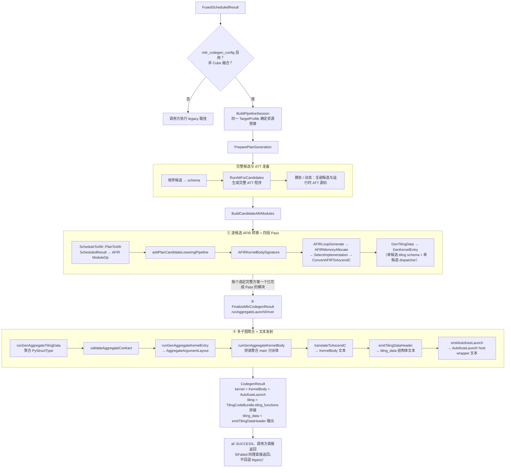

# Inductor MLIR Codegen 全链路流程图与阶段说明

> 状态：现状说明（非新设计，不引入任何行为变更）
> 日期：2026-08-31
> 文档类型：现状导览

## 目的

`2026-08-26-inductor-mlir-codegen-launch-pipeline-design.md` 是本链路的设计文档。

本文则按本 PR 落地后的实际代码，画出从 `FusedScheduledResult` 到 `CodegenResult` 的完整调用链路图，并逐阶段说明输入、输出和职责。不重复设计文档中的决策背景、备选 方案或历史演进，需要这些内容时请查阅上述设计文档。

## 总体流程图



## 调用入口与三态返回码

链路由 `mlir::bridge::RunMlirCodegen`（`autofuse/mlir/bridge/CodegenOrchestration/CodegenOrchestration.h`）
统一承载，`Codegen::GenerateForInductor` 与 `Codegen::Generate`（`autofuse/codegen/codegen.cpp:397`/`442`）
在各自现有 legacy 调用之前调用它：

```cpp
enum class MlirCodegenStatus { kNotSupported, kFailed, kSucceeded };
enum class MlirCallerScene { kInductor, kTensorFlow };

MlirCodegenStatus RunMlirCodegen(const ascir::FusedScheduledResult &fused_schedule_result, MlirCallerScene scene,
                                 const std::string &soc_version, codegen::CodegenResult &result);
```

- `kNotSupported`：关闭 MLIR、命中 Cube 范围排除，或外层 `fallback` 配置将失败转为 legacy 回退。
- `kFailed`：严格 `mlir` 模式下失败，或配置非法；调用方直接返回失败。
- `kSucceeded`：完整产物生成成功；失败不交付部分 kernel/tiling。
- 内部异常也经过同一外层策略，PlanSelector 不自行决定是否回退。

## 各阶段详细说明

### 阶段 0：入口守卫（`RunMlirCodegen`）

- 读取 `AUTOFUSE_DFX_FLAGS` 的 `--mlir_codegen_config=none|mlir|fallback`，默认 `none`。
- 调用 `ascgen_utils::IsCubeFusedScheduled` 排除 Cube/CV 融合场景（现有 `GenAggregate*`/四段 Pass 均未
  支持该场景）。
- 两者任一命中即返回 `kNotSupported`，不进入下面任何阶段。

### 候选与 ATT 准备：`PreparePlanGeneration`

输入：完整 schedule、静态/动态模式、caller scene、同一 TargetProfile 的物理核数和 UB 容量。

1. 统一枚举候选、建立 schema、生成一次完整 ATT 程序。ATT 与 AFIR 使用同一资源预算，256 字节 UB 预留只扣一次。
2. 静态和动态 shape 都保留全部候选及 ATT 源码；codegen 不启动 host 编译器、不执行独立 solver，单候选也不提前求解。
3. lowering 全部候选，不重编号，不因静态 shape 添加 `afplan.static_selection`。保留原始 plan/template ID、tiling key 及模板语义信息。
4. 生成 host tiling 和 device 源码，供调用方编译。Inductor 可并行编译 host、device 和 wrapper；调用 `AutofuseTiling` 时通过 `optiling::GetTiling` 求解，并计算所选方案的 workspace。

输出：`PlanGenerationResult{selections, tiling}`，生产调用链的 `tiling` 为 `TilingCodeBundle`，候选与源码成功时一起交付。独立静态 solver 及冻结产物接口仍有单独测试，但不再由 `PreparePlanGeneration` 调用。

这一步只推迟求解，不保证每个 kernel 编译更快：保留更多候选可能增加 device 源码和编译量。具体并行度仍由调用方编译器控制。

#### 当前候选策略（2026-11-03 更新）

- **不按 MLIR 能力预筛选模板。** 已删除的搬运连续性、逐元素广播和 queue/reuse 视图筛选，
  是为了规避当时后端无法处理的场景，不是性能择优。选择层不再复制这些支持条件，不因它们
  删除模板或整个 plan；对应的合法性和能力判断由 bridge、资源校验及 lowering 负责。
- **静态与动态均保留全部。** ATT 在生成的 host tiling 中求解，不做提前冻结。
- **保持失败归因。** ATT 源码生成或 lowering 的能力不足仍按外层配置处理；host 编译及 tiling 执行失败由调用方报告。不会删除无法 lowering 的候选并重新择优。
- **接受完整候选集的覆盖要求。** 保留多个候选时，其中一个无法下降就不能产出成功的 MLIR
  结果；不以剩余候选成功掩盖覆盖缺口。
- **测试区分层次。** 改写节点类型的合成输入只验证 bridge 能力诊断；端到端回落使用真实
  ArgMax 图经 optimizer 生成的合法 schedule，验证 ATT 成功后返回 `kNotSupported`。
  保留 legacy ATT 模板选择测试能力，不恢复 MLIR 专用 pinning。

历史验证（提前静态择优版本）：桥接 110 项、schedule 51 项、选择策略 19 项及 29 项 CPU 回归通过。此记录不代表推迟求解后的验证结果。

### 准备前置：`BuildPipelineSession`（TargetProfile + Pass Session 构造）

输入：`soc_version`（如 `"Ascend910B2"`，来自 `Codegen` 的 `soc_version_` 成员，由 `CodegenOptions`
构造时传入）。

1. `soc_version` 为空直接失败（清晰报错，不静默用默认值）。
2. `TargetSelection::builtinPlatform(soc_version)` → `TargetProfileLoader::load`，解析出
   `ascend::TargetProfile`。
3. `createAFIRToAscendCPipelineSession`：内部构造并冻结 `ImplementationRegistry`/
   `SelectionPolicyRegistry`，产出 `AFIRToAscendCPipelineSession`。

该 Session **只构造一次**，供本次调用涉及的全部候选模块共享（冻结后只读，多个 `PassManager` 复用同一
份安全）。

### 阶段 ③：`BuildCandidateAfirModules`（逐候选 AFIR 转换 + 四段 Pass）

对阶段①产出的每个 `(subgraph_id, plan_id)` 候选：

1. `ScheduleToAfir::PlanToAfir`：把一个 `ScheduledResult` 转换为一个独立的 AFIR `ModuleOp`
   （标注 `#afplan.candidate`，即候选身份 `(subgraph, plan)`）。
2. 为该模块新建一个 `PassManager`，调用 `addPlanCandidateLoweringPipeline`（
   `mlir/conversion/AFIRToAscendC/AFIRToAscendCPipeline.cpp:67`），依次跑：
   - `AFIRKernelBodySignature`：补齐规范的 `TilingData` 形参，构造 kernel body 函数边界。
   - `addAFIRToAscendCPipeline` 四段正式 Pass：
     - `AFIRLoopGenerate`：物化调度后的 `scf` 循环树（只生成轴值和循环结构，不做张量/内存 lowering）。
     - `AFIRMemoryAllocate`：完成内存分配。
     - `SelectImplementation`：按 `TargetProfile` + 冻结后的 `ImplementationRegistry`/
       `SelectionPolicyRegistry` 为每个 AFIR 算子选定具体实现。
     - `ConvertAFIRToAscendC`：把已选定实现的 AFIR 算子转换为 AscendC/EmitAsc dialect。
   - `GenTilingData`：把规范 `TilingData` 重命名为该候选的 per-stage schema。
   - `GenKernelEntry`：为该候选合成 plan 级 dispatcher。
3. 任一子步骤失败：记录 `subgraph_id`/`plan_id` 的诊断，交给外层严格/fallback 策略处理。

输出：每个选定完整方案一个已完成上述全部 Pass 的 `ModuleOp`（`BuiltPlanModules`，`owned` 持有生命周期，
`views` 是传给下一阶段的非拥有视图）。

### 阶段 ④：`FinalizeMlirCodegenResult`（多子图聚合 + 文本发射）

调用 `runAggregateLaunchDriver`（`mlir/conversion/AFIRToAscendC/AggregateLaunchDriver.cpp`），内部两段：

**4a. `BuildAggregateEntryModule`（聚合）**

1. `runGenAggregateTilingData`：把各候选模块中已由四段 Pass 标注的 tiling 相关属性聚合为单一
   `AutofuseTilingData`（`PyStructType`）。
2. `validateAggregateContract`：校验 `ascendc.plan_entries` 与候选模块数一致等聚合前置契约，
   校验失败时比聚合本身失败给出更早、更精确的诊断。
3. `runGenAggregateKernelEntry`：生成聚合 `main` FuncOp，每个形参标注
   `mlir::afir::KernelArgumentIdentity{kind, index}`（`Input`/`Output`/`Workspace`），返回
   `FailureOr<AggregateArgumentLayout>`（`arguments` + `tiling_arg_index`）。
4. `runGenAggregateKernelBody`：把各候选真实的 `<symbol>_main` 函数体克隆进聚合模块内对应的空函数声明，
   并把聚合 `main` 提升为 `FunctionRole::KernelEntry`。

**4b. `EmitArtifactsFromEntryModule`（文本发射）**

1. 在聚合模块内找到 `FunctionRole::KernelEntry` 函数，取其名字作为 `graphName`。
2. `translateToAscendC`：把聚合 Entry Module 翻译为完整可编译的 AscendC 设备源码文本（`kernel_body`，
   含 tiling_key 分支）。
3. 从 `ascendc.tiling_schema` 属性取出聚合 `PyStructType`，调用 `emitTilingDataHeader` 渲染为 C++
   结构体文本（`tiling_data`）。
4. `emitAutofuseLaunch`：基于 4a 产出的 `AggregateArgumentLayout`，按
   `blockDim → stream → input... → output... → workspace → tiling_data` 的现网 ABI 顺序拼接
   `extern "C" int64_t AutofuseLaunch(...)` 函数文本（`autofuse_launch`），逐字节兼容
   `codegen_kernel.cpp` 现网生成文本，调用点（Inductor/torchair 侧）无需修改。

### 收尾：装配 `CodegenResult`

```text
result.kernel      = artifacts.kernel_body + artifacts.autofuse_launch
result.tiling      = bundle.tiling_functions 逐项拼接（阶段①的 ATT 产物，与阶段④的聚合 tiling_data 是两条独立路径）
result.tiling_data = artifacts.tiling_data（阶段④的聚合 PyStructType 渲染结果）
```

全部成功后 `RunMlirCodegen` 返回 `kSucceeded`，调用方以 `af::SUCCESS` 返回；产出的 `.so` 可直接被
`autofuse/compiler/python/ascendc_compile.py`/`compile_adapter.py` 现有 bisheng 编译驱动消费。

## 涉及的源码位置速查

| 阶段 | 组件 | 路径 |
|---|---|---|
| 入口/编排 | `RunMlirCodegen` 及其四个子步骤 | `autofuse/mlir/bridge/CodegenOrchestration/CodegenOrchestration.{h,cpp}` |
| ① 候选选优 ⚠️legacy ATT | `StaticPlanSelector`（内部调用 `att::GetModelInfoMap`） | `autofuse/mlir/bridge/StaticPlanSelector/StaticPlanSelector.{h,cpp}` |
| ① ATT tiling ⚠️legacy ATT | `AttSchemaAdapter`（调用 ATT C++ 生成器） | `autofuse/mlir/bridge/AttSchemaAdapter/AttSchemaAdapter.{h,cpp}` |
| ② TargetProfile/Session | `AFIRToAscendCPipelineSession` | `autofuse/mlir/conversion/AFIRToAscendC/AFIRToAscendCPipeline.{h,cpp}` |
| ③ 单 Plan 转 AFIR | `PlanToAfir` | `autofuse/mlir/bridge/ScheduleToAfir/ScheduleToAfir.{h,cpp}` |
| ③ 四段 Pass + 单候选收尾 | `addPlanCandidateLoweringPipeline` | `autofuse/mlir/conversion/AFIRToAscendC/AFIRToAscendCPipeline.cpp` |
| ④ 聚合 + 文本发射 | `runAggregateLaunchDriver` | `autofuse/mlir/conversion/AFIRToAscendC/AggregateLaunchDriver.{h,cpp}` |
| ④ AutofuseLaunch 生成 | `emitAutofuseLaunch` | `autofuse/mlir/conversion/AFIRToAscendC/Emit/AutofuseLaunchEmitter.{h,cpp}` |
| 调用点 | `GenerateForInductor`/`Codegen::Generate` | `autofuse/codegen/codegen.cpp:397`/`442` |
| 命令行等价入口 | `af-opt --afir-plan-candidate-lowering-pipeline` / `--afir-aggregate-launch` | `autofuse/mlir/tools/af-opt/main.cpp` |

`af-opt` 提供了与上述③④阶段等价的独立命令行入口，可脱离完整 Codegen 调用单独调试单个候选的四段 Pass
（`--afir-plan-candidate-lowering-pipeline`）或聚合发射（`--afir-aggregate-launch`），对应 lit 测试见
`autofuse/mlir/test/lit/conversion/afir-plan-candidate-lowering-pipeline.mlir`/`afir-aggregate-launch.mlir`。

## 已知限制（不在本文解决，详见设计文档 1.3/3.2/3.7 节）

- `Codegen::Generate` 内的挂钩点对经由 `pyautofuse.cpp`（`HandleDeviceCodeGenForNonCVFusion`/
  `HandleHostCodeGenForNonCVFusion`）的现网 TensorFlow 生产流量暂不生效，因为这两个函数直接调用
  `GenerateTilingData`/`GenerateKernel`/`GenerateTiling`，不经过 `Codegen::Generate`。
- 阶段①先于阶段③执行是临时的依赖倒置：旧 ATT 尚未迁移到消费 MLIR 产出的 IR，因此当前只能先让 ATT
  消费 `FusedScheduledResult`，再单独跑 AFIR 转换与四段 Pass；ATT 完成自身 MLIR 迁移后预期顺序会调整。
